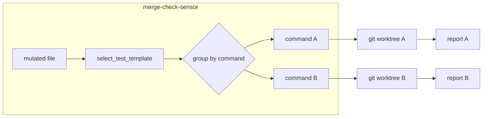

# `/merge-check`

`/merge-check` is a self-contained, non-skippable review command.

It discovers your team's reviewer droids, runs them against the diff, probes your tests with a **discrimination sensor**. That is, it breaks code in a throwaway copy and checks the tests catch it. Rather than relying on good intentions, it writes
one **attestation** file per MR *(`attestations/mr-<iid>.md`)* that your CI gate can enforce.

It holds **no** project-specific knowledge: reviewer routing lives in the droids, and the one generated file — `.factory/merge-check.yml` — holds the rest. That file lives outside the skill bundle, so upgrades never touch it.

## How it works

```text
   changed files                          .factory/merge-check.yml
        │                                 (test cmd · paths)
        ▼                                         │
 ┌──────────────────────────────┐                  │
 │ 1  PICK REVIEWERS            │◀─ droids (merge_check: globs) + security floor
 │ 1.5 REUSE CLEAN VERDICTS     │◀─ local cache, APPROVE-only, exact fingerprint
 │ 1.7 SLICE DIFF PER REVIEWER  │◀─ merge-check-plan slice → scoped diff
 │ 2  CHECK OUTCOME             │◀─ acceptance criteria (issue / openspec)
 │ 3  TEST YOUR TESTS           │◀─ break code in a throwaway copy, run the
 │    (sensor: kill/survive)    │   test command from the config
 └────────────┬─────────────────┘
              ▼
   attestations/mr-<iid>.md  ──►  CI gate (mr-require-quality-gates job)
        (the stamp)                 reads commit_sha + verdict + force_full
                                   + reviewed_base (covers the MR diff?)
                                   → APPROVE · NEEDS_FIX · BLOCK
```

### What `/merge-check` decides deterministically

Everything that gates a merge has to come from code, not from the LLM's mood — otherwise the pre-merge gate can't be enforced.

??? note "Deterministic vs model-chosen parts"

    | Part                          | Deterministic?         | Why it is safe                                                                  |
    | ----------------------------- | ---------------------- | ------------------------------------------------------------------------------- |
    | Which reviewers run           | **Yes**                | file globs in the droids; `--skip-outcome-runner` removes named runners explicitly from run/reuse (overridden by `--force-full`) |
    | Per-reviewer diff slice       | **Yes**                | the same glob the planner already uses for `_reviewer_files`                    |
    | Pass/fail of one mutation     | **Yes**                | runs your tests, reads the exit code                                            |
    | Which lines the sensor breaks | **No** (model chooses) | a *fail* is always real; a *pass* = "faults I tried were caught", not "perfect" |
    | Criterion → code mapping      | **Mostly**             | anchored to a stable id; vague ones are flagged, never guessed                  |
    | Cached reviewer verdict reuse | **Yes**                | SHA-256 fingerprint must match exactly, and only prior APPROVE is reusable      |

> **Remember:** a **fail** is always real — trust it. A **pass** means "nothing wrong in
> what was checked", not "perfect".

## What you need

- **git** — diff + commit SHA.
- **uv** ([astral.sh/uv](https://docs.astral.sh/uv/)) + **python3 (≥3.12)** — `uv run` provisions the pinned env (one declared dep, PyYAML) on first use, so there is no manual `pip install`.
- **bash** — the skill's orchestration (already present on macOS/Linux).
- **glab CLI** — resolves the MR IID from the branch. Skip it by setting `MERGE_CHECK_MR_IID`
  (e.g. in CI, or on a non-GitLab forge).
- **a test command** — only for the sensor; read from `.factory/merge-check.yml`. A language
  with no entry simply skips the sensor; the rest of `/merge-check` runs unaffected.

Run the helpers with the prefix `MC="uv run --project .factory/skills/merge-check"`,
e.g. `$MC merge-check-roster --audit`. The attestation `schema_version` history lives in `references/attestation-predicate.md`.

For testing and development commands, see `SKILL.md` (`Maintainers testing` tip).

## Set it up

!!! tip "Already configured"
    If your droids already carry a `merge_check:` block, skip to
    **Run it**. Confirm wiring with `$MC merge-check-roster --audit`.

You only need one step: **annotate your reviewer droids.**

Add a `merge_check:` block to each droid's frontmatter so `/merge-check` can discover and route changes to them *(why in `references/roster-discovery.md`)*:

   ```yaml
   ---
   name: rtf-go-reviewer
   description: Reviews Go modules for correctness and memory efficiency.
   model: kimi-k2.7-code
   tools: ["Read", "Grep", "Glob"]
   merge_check:
     triggers: ["**/*.go"]   # globs; the droid joins if any changed file matches
     always: false           # true → joins every run (e.g. a security reviewer)
   ---
   ```

   Verifier-role droids (e.g. `rtf-outcome-verifier`) are recognised by their
   filename suffix `-verifier`, not a frontmatter key. They join the roster
   only when criteria resolve (issue/openspec).

   ```text

### Setup tips

- A good practice is to have one reviewer per concern; the name is the scope.
- For reviewers you always want to run, use `always: true`; typically `rtf-security-reviewer`.
- Check your setup: `$MC merge-check-roster --audit` flags any droid with no `merge_check:` block.

## Run it

Run **`/merge-check` with no arguments** for most MRs — it path-routes the roster, uses your tracking branch (or `main`) as the base, and auto-discovers the acceptance criteria.

The first run also writes `.factory/merge-check.yml` (next section). After that, `/merge-check` is ready.

## Incremental fix loops

Full reviewer fan-out is expensive, so `/merge-check` has an **iteration mode**:
it can reuse a cached reviewer **APPROVE verdict** when that reviewer's inputs are
unchanged. It does not reuse the reviewer process or replay output; it reuses the
fact that the reviewer already approved the same fingerprint.

```text
                 changed files + criteria + droid routing
                              │
                              ▼
              merge-check-plan plan
                              │
          ┌───────────────────┴───────────────────┐
          │                                       │
          ▼                                       ▼
   compute reviewer                         read local cache
   SHA-256 fingerprint                      .factory/merge-check-cache.json
          │                                       │
          └───────────────────┬───────────────────┘
                              ▼
                  compare fingerprint + verdict
                              │
          ┌───────────────────┴───────────────────┐
          │                                       │
          ▼                                       ▼
 cached APPROVE verdict                   no match / changed input /
 matches exact fingerprint                prior BLOCK/WARN/NEEDS_FIX
          │                                       │
          ▼                                       ▼
   skip dispatch for that reviewer       merge-check-plan slice
                                                │      ─▶ per-reviewer
                                                │         relevant files
                                                ▼
                                      reviewer runs over its scoped diff
                                                │
                                                ▼
                                      reviewer returns APPROVE
                                                │
                                                ▼
                         merge-check-plan record
                         recompute fingerprint + verify HEAD
                         record elapsed seconds for tuning
                                                │
                                                ▼
                                  update local cache
```

**Diff slicing keeps the same deterministic routing, with smaller inputs.** Each
reviewer subagent receives only the git diff scoped to its trigger patterns
(the same glob the planner uses). The skipped-dispatch and dispatch paths share
that routing, so scope never drifts. The `relevant_file_counts` field on the
plan JSON tells you which reviewers are seeing the most context.

The fingerprint is a SHA-256 hash over:

```text
reviewer name
+ criteria hash
+ reviewer droid file digest
+ reviewer routing config
+ relevant changed file paths
+ relevant changed file digests
```

Symlinks are not followed. The fingerprint records the symlink target path, so a
symlink cannot make the planner read arbitrary files outside the repo.

**Safety rule:** fix loops may reuse cached APPROVE verdicts, but the final
APPROVE attestation must run once with `--force-full`. That keeps the pre-merge
gate non-skippable while making repeated mechanical fixes faster.

**Focus hints (attention, not coverage).** At the `--force-full` stamp, the plan
JSON carries a `focus_hints` map for each RUN-bucket reviewer: `focus` (files
changed since the reviewer's last cached APPROVE) and `unchanged` (the rest).
The hint is advisory — it directs the reviewer's attention to the delta, but the
fingerprint still covers the full relevant set. Worst case (a droid ignores the
hint) equals today: the reviewer sees everything. The hint never lets a file skip
a reviewer's view or fingerprint.

**Hollow-APPROVE guard.** An APPROVE recorded with zero tool uses (no file reads,
no commands) is rejected as `REVIEWER_FAILURE` — a degraded droid that rubber-stamps
without inspecting the diff cannot enter the cache. Pass `--tool-use-count <N>` when
recording a verdict so the guard can enforce it. **At the `--force-full` stamp, the
count is mandatory**: `None` fails closed because the stamp is the non-bypassable
floor where the guard matters most. During iteration, `None` is tolerated for
backward compatibility. The count must be the reviewer subagent's real, observed
tool-call total from its execution result — not a value the orchestrator invents.
If the harness cannot surface a real count, re-dispatch the reviewer rather than
guessing. First-time reviewers (no prior APPROVE in the cache) get `focus` = all
relevant files, so cold-cache stamps are unaffected.

## Configure & tune

`/merge-check` uses a configuration at `.factory/merge-check.yml`.

It sets overridable defaults so it works out of the box. The `test` map is empty by default — fill it in yourself with commands scoped to the changed files (see the FAQ below).

Commit it, edit it, or delete it to regenerate.

```yaml
# all paths are relative to the PROJECT ROOT, not to this file
schema_version: 1                # config-file version; unrelated to the
                                 # `attestation.schema_version` field the gate reads.
droids_dir: ".factory/droids"     # where your reviewer droids live
attestation_dir: "attestations"   # /merge-check writes "<dir>/mr-<iid>.md" into it
test:                             # keyed by FILE EXTENSION without the dot; one-shot, never watch
  ts: "pnpm exec vitest related --run {files}"   # {files}=changed files, {package}=dir of first
  go: "cd services && go test ./..."
```

**You only ever change three things:**

- `test:` — the sensor's command per language.
- each droid's `merge_check:` block — which reviewers run.
- `attestation_dir` — where the stamp is written.

## Evolving

The engine never changes — you add data, not code.

| You want to…                                     | You change…                                                                                                                      | Code?                             |
| ------------------------------------------------ | -------------------------------------------------------------------------------------------------------------------------------- | --------------------------------- |
| Add a language (e.g. Rust)                       | a reviewer droid (`merge_check:` block, e.g. `triggers: ["**/*.rs"]`) + one `test:` line keyed by extension (`rs: "cargo test"`) | No                                |
| Test cmd needs env vars                          | put them inline in the `test:` string ↓                                                                                          | No                                |
| Switch harness (OpenCode, Windsurf, Claude Code) | `droids_dir` in config · re-key frontmatter · map the subagent tool                                                              | No — scripts + formats move as-is |

The `test:` key is the **file extension without the dot** — `rs` for Rust, `py` for
Python, `go` for Go, `vue` for Vue. An extension with no entry just skips the sensor.

```yaml
test:
  py: "DATABASE_URL=sqlite:///tmp/test.db pytest {files}"   # secrets stay in CI, never here
```

```text
Where does a new thing go?

  per-repo state, changes in normal use ─────────────▶  .factory/merge-check.yml
  a reviewer's property (model · tools · when) ──────▶  that droid
  one-time migration step ──────────────────────────▶  a checklist, not the tool
```

That decision is the whole reason `/merge-check` stays a tool, not a framework.

## Override — human-acknowledged NEEDS_FIX

Use when `/merge-check` refused the stamp on **unrelated** pre-existing
findings in a file you're editing but didn't author, and fixing the dirty
code is out of scope for your MR.

```text
  /merge-check override "<reason>" #<issue-iid>
      │
      ▼
  stamp front-matter: attestation.override_requested
      (reason · optional issue_ref)      ← no identity fields
      verdict: NEEDS_FIX
      │
      ▼
  ci-automation: mr_override_merge_check
      │  ── reads stamp via GitLab API
      │  ── verifies non-author approval (fails pipeline if absent)
      │  ── on verified:
      │       • AddLabel "override:merge-check"  (idempotent)
      │       • per-feature note in CI Governance Report
      │         (reason · optional issue_ref)
      ▼
  merge gate accepts stamp  ◀─── anti-forgery on
  (commit_sha + reviewed_base)    commit_sha + reviewed_base stays live
```

CLI form:

```bash
$MC merge-check-attest attestations/mr-<iid>.md \
    --force-full \
    --override-requested "<reason>" --override-issue-ref <iid> \
    < report-body
```

Run `/merge-check override` with no arguments to be prompted for the reason and issue id (see SKILL.md).

The existing +1 human approval policy is the security gateway. The override
is **head-scoped** — a new commit invalidates it (`commit_sha` no longer
matches MR HEAD, the gate re-asks).

## FAQ

> A reminder: `$MC` is `uv run --project .factory/skills/merge-check` (defined under **What you need** above). The snippets below all use it.

### Why not just run the reviewers myself? What does `/merge-check` add?

Reviewers answer "is this code good?". `/merge-check` keeps your *same* reviewers and adds what
they can't — and makes it **provable**:

```text
  reviewers alone              →   /merge-check also…
  ───────────────                  ───────────────
  the ones you remember        →   every matched reviewer + security floor (forced)
  code that's IN the diff      →   what's MISSING (each criterion → code)
  can't judge test quality     →   whether your tests actually catch bugs
  "I reviewed it"              →   a stamp your CI enforces
```

It's not a new review engine and not extra ceremony — it removes the human variance of
"which reviewers did you run, and did you check everything?".

### What is the "discrimination sensor"?

It checks whether your tests can *tell apart* correct code from broken code. It never touches your real files:

```text
  break one line in a throwaway copy → run your tests
        ├─ tests FAIL → good: a real bug would be caught   (killed)
        └─ tests PASS → the test is too weak    (survived → BLOCK)
```

**It is not mutation testing**. It borrows the idea, not the method. Mutation testing is <u>exhaustive</u> and *scored*: a dedicated tool *(Stryker, mutmut, PIT)* applies a fixed catalogue of mutations across the code and reports a percentage.

The sensor is a lightweight spot-check: 1–3 model-chosen faults on the *changed lines only*, no score, no extra tool. So a clean run means "the faults it tried were caught", not a guaranteed mutation score — use it as a fast signal, not a coverage metric.

### Is it deterministic? "Models are non-deterministic…"

The parts that gate a merge are deterministic: which reviewers run, the slice
each reviewer sees, each test pass/fail, the fingerprint that gates cache
reuse, and `--skip-outcome-runner` exclusion. See the **What `/merge-check`
decides deterministically** table at the top of this file for the row-by-row
breakdown.

The only non-deterministic part is *which* faults the sensor tries — and that
can only ever **miss** a weak test, never raise a false alarm. So a **fail is
always real**; a **pass** means "the faults I tried were caught", not "perfect".
Model variance can't produce a wrong BLOCK.

### How does `/merge-check` get the acceptance criteria? What if I don't use openspec?

Resolved in order, first hit wins:

```text
  1  --change <name> / --issue <N>        (you pass it)
  2  issue id in the branch name          feat/issue-27 → #27
  3  openspec change the diff touches
  ─────────────────────────────────────
  none → link/create an issue, or run adversarial-only (recorded)
```

**openspec is optional** — for a plain issue it reads the issue body's `## Acceptance Criteria` section:

```markdown
## Acceptance Criteria

- Users can export reviews to CSV
- The export includes every review and its metadata
- Export is blocked for users without the `export` permission
```

**No criteria anywhere?**

`/merge-check` stops and asks you to link or create an issue (or proceed adversarial-only, recorded as `outcome_skipped`) — it never silently drops the check.

### How does it know my test command — does it detect my tooling, or wait for me?

`merge-check-config --init` writes the default skeleton; fill in `test:` yourself on first run.

`--init` does **not** detect your tooling — it only writes the default values for `schema_version`, `droids_dir`, and `attestation_dir`, leaving the per-language `test:` map empty. The detection-and-proposal flow (`package.json`, `Makefile`, `go.mod`, `pytest`, … → per-language one-shot commands) is a roadmap item, not in the current build. Today an extension with no entry is **skipped, never guessed** — fill in `test:` yourself and commit.

The paths work out of the box; the `test:` map is the part that needs your input.

### What if my test command is wrong?

You get a clear failure, not a silent pass. A command that errors (or never exits) is reported as a sensor failure and recorded in the stamp — fix the `test:` line and re-run.

The command must be **one-shot**: a watch-mode runner (e.g. bare `vitest`) would hang, so use `vitest run`, not `vitest`.

### How do I name the `test:` keys?

Use the **file extension without the dot**: `ts`, `vue`, `go`, `py`, `rs`. Rust is `rs`. If a language has several extensions, add a key for each.

### Does it work in a monorepo? (known limitation)

Partly. Reviewer **routing** is path-based (each droid's `triggers` globs), so
reviews scope correctly per package. The **discrimination sensor** is the gap:
its `test:` map is keyed by file *extension*, so it assumes every `.ts` file is
tested by the same runner. In a monorepo where `apps/web` runs `vitest` and
`apps/legacy` runs `jest`, one `ts:` command can't be right for both.

What works today: set the command that covers your most-changed package, or scope
a run to packages that share a runner. An extension with no entry is skipped
(recorded, never a false pass), so it fails safe rather than running the wrong tests.
The full per-package design is [sketched below](#design-sketch-per-package-sensor)
for the team that takes it on.

## Design sketch: per-package sensor

The enhancement was left deliberately easy. Command resolution is a **single
function** (`merge_check.config.select_test_template`) and the sensor is
**package-agnostic** (it runs one command over a subset of mutations). A
per-package version would (1) resolve the command from each file's package
inside `select_test_template`, (2) group mutations by resolved command, and
(3) invoke `merge-check-sensor` once per group. No reviewer, cache, or
attestation logic is touched.



The `test:` config shape would need a new `schema_version` under a per-package
key. The existing sensor surface (`--language`, `--files`, `--base`) is already
one invocation per file group, so the orchestrator change is just a loop.

<details>
<summary>Long-term shape: hierarchical, localized <code>.factory</code></summary>

Factory supports folder-level `.factory/` directories, so each package could own
a localized `.factory/merge-check.yml` (and its own `.factory/droids/`), with the
*nearest* config resolved per changed file (closest-wins, like `AGENTS.md`).
Per-package test commands and reviewer rosters then fall out for free. The core
is already positioned for it — the loaders take an explicit path/dir
(`load_config(path, root)`, `load_droids(dir)`) and planning takes an
already-built `droids` dict — so hierarchy is an *additive resolution layer*,
not a rewrite. It needs three things: a nearest-config resolver, a droid union
across the in-play `.factory/droids` dirs (namespacing the
`dict[str, MergeCheckSpec]` keys so two packages' `rtf-python-reviewer.md` don't
collide), and the same union in the CI gate when it collects drift triggers.

</details>

### Does it change my code?

No. Every mutation happens in a throwaway `git worktree`; your working tree is untouched.

### If the result is BLOCK, does it only report?

No. `/merge-check` should auto-fix concrete, deterministic findings before it
hands back control: missing docstring sections, literal constants, stale command
names, format drift, and similarly mechanical issues. It should only stop with a
manual next step when the fix requires a product decision, unclear acceptance
criteria, a security trade-off, or another choice the agent cannot safely make.

### Does incremental mode bypass reviewers?

No. It reuses only a cached **APPROVE verdict** when the reviewer fingerprint is
identical. A prior `BLOCK`, `WARN`, or `NEEDS_FIX` is never reusable.

```text
same reviewer inputs + prior APPROVE  → reuse the verdict, skip dispatch
changed inputs or non-APPROVE result  → run the reviewer again
attestation-only change               → validate attestation, skip dispatch
docs-only change                      → run docs/outcome; security only for gate/security docs
final approval                        → writer verifies cache is complete, then stamps
```

The cache is local (`.factory/merge-check-cache.json`) and ignored by git. It is a
speed aid for fix loops, not the audit artifact; the attestation remains the
merge contract.

The planner also stores reviewer elapsed seconds, so repeated slow reviewers are
visible in the next tuning pass instead of being anecdotal.

### How does `/merge-check` avoid review fatigue?

It separates **fix-loop speed** from **final-gate confidence**. During iteration,
it reuses cached APPROVE verdicts and runs only the reviewer domains touched by
the latest edit. Before final approval, it runs the full gate once with
`--force-full`.

```text
                     developer fixes one finding
                              │
                              ▼
                    fast deterministic checks
                     (lint · compile · smoke)
                              │
                              ▼
                 merge-check-plan plan
                              │
        ┌─────────────────────┼─────────────────────┐
        │                     │                     │
        ▼                     ▼                     ▼
 unchanged domain      docs-only edit       attestation-only edit
 cached APPROVE        docs/outcome only    schema/SHA validation
        │                     │                     │
        ▼                     ▼                     ▼
 skip reviewer dispatch   run affected reviewers   validate attestation
        │                     │                     │
        └──────────────┬──────┴──────────────┬──────┘
                       ▼                     ▼
              record APPROVEs + timing   no droid dispatch
                       │                     │
                       └──────────┬──────────┘
                                  ▼
                    final merge path: writer verifies cache, then stamps
```

The mitigations are:

- **APPROVE-only cache reuse** — bad or unresolved findings never get reused.
- **Per-reviewer fingerprints** — a reviewer is skipped only when its inputs are
  byte-for-byte equivalent for that reviewer.
- **Attestation fast path** — attestation-only commits validate schema/SHA instead
  of rerunning the whole reviewer suite.
- **Docs fast path** — ordinary docs rerun docs/outcome; security reruns only for
  security or gate-policy docs.
- **Scoped failures** — format drift and timeouts retry/fail the affected reviewer,
  not the whole suite.
- **Timing persistence** — slow reviewers are measured, so tuning uses data rather
  than frustration.

### A language has no tests yet — does `/merge-check` fail?

No. That language is skipped and recorded; the reviewers and outcome check still run.

### I'm not on GitLab. Will it work?

Yes. The MR id comes from `glab`, but set `MERGE_CHECK_MR_IID` to skip it (CI, or another forge).

### Will an upgrade wipe my `.factory/merge-check.yml`?

No. It lives outside the skill bundle, so reinstalls never touch it. Delete it yourself to regenerate from defaults.

### How do I find out which reviewers are slow?

`/merge-check` records `elapsed_s` for every reviewer that returns `APPROVE`.
The data lives in `.factory/merge-check-cache.json` and is surfaced by:

```bash
$MC merge-check-plan status
# → merge-check cache: N entries
#   slowest cached reviewers (top 5)
#   largest reviewed slices (top 5)
#   stale (>7 days)
```

The plan JSON also exposes `slowest_cached_reviewer` and `relevant_file_counts`
so the orchestrator can pick the hot one without re-running `status`. Pick the
top entry; the two routine levers, in payoff order, are: **(1) slice the diff**
(use `slice --reviewer X` to give it only its relevant files), **(2) trim the
droid prompt** (keep the contract, drop repeated examples). Reach levers:
tighten triggers or move the reviewer down one model tier.

### How do I skip a broken outcome runner?

Pass `--skip-outcome-runner <name>` (repeatable) to the planner:

```bash
$MC merge-check-plan plan \
  --with-outcome --criteria "$CRITERIA" \
  --skip-outcome-runner rtf-outcome-verifier
```

The plan JSON records `outcome_skip: { outcome_skipped: true, skipped_runners: [...] }`,
the runner is never dispatched, and the attestation carries `outcome_skipped: true`
with the same reason. Use this when you observe the runner returning a tool-state
artifact instead of a review.

Note: `--skip-outcome-runner` is overridden by `--force-full`. The final pre-merge
gate is non-skippable — outcome verifiers always run on the full pass.

### How do I know the merge contract holds before I press merge?

Two independent peers run side-by-side at the merge boundary and both must pass:

- **Peer A — CodeRabbit (LLM)** enforces the MR description rubric and issue assessment.
- **Peer B — `scripts/ci/mr_require_quality_gates.py`** re-verifies the attestation frontmatter, post-stamp drift, and that the recorded `reviewed_base` covers the full MR diff.

Peer B's `reviewed_base` check has **no override**: the gate recomputes the merge-base of the MR target and HEAD from the merge ref's own parents, so a narrowed-`--base` review cannot slip through. The full contract is documented in `references/attestation-predicate.md`.

Run `/merge-check --force-full` once before the final push. The writer derives `commit_sha` and `verdict` from git and the cache, not from the caller, and refuses to stamp unless every reviewer in the plan has a matching cached APPROVE. This client-side check and the server-side gate together prevent fabricated attestations.

### How does /merge-check prevent fabricated attestations?

Forgery is blocked at two layers because the writer runs in the agent's own environment and can never be the last word:

- **Client-side (`merge-check-attest`)** derives `commit_sha` and `verdict` from git and the planner cache; it never accepts them from the caller and refuses to stamp unless every reviewer in the plan has a matching cached APPROVE. See `SKILL.md` Step 6 for the orchestrator-level details.
- **Server-side (`mr_require_quality_gates.py`)** re-checks `force_full`, `commit_sha`, post-stamp drift, and `reviewed_base` coverage. See `references/attestation-predicate.md` for the full gate contract.

### What about genuinely automated changes, like the daily changelog?

Some MRs are machine-generated and have no source to review adversarially — the
`git-cliff` changelog regeneration is the canonical case. Those are **exempt from
the attestation requirement** via the server-side `gate:` policy subtree in
`.factory/merge-check.yml`:

```yaml
gate:                               # server-side policy; the client ignores this subtree
  attestation_exempt:
    - reason: "Daily changelog regeneration by git-cliff; derived content, no source to review."
      paths: ["CHANGELOG.md"]
      source_branch: "changelog/*"  # optional secondary guard
```

Everything the CI gate reads lives under `gate:`, so the client/server split is
structural (not tribal knowledge) and future gate policy — e.g. a reviewer-label
override — slots in under the same key without touching the client.

### Why is the automated-change exemption safe?

Two properties make it a confinement, not a bypass:

- **Confinement, not membership.** The gate skips only when *every* changed file is
  inside a rule's `paths` allowlist. Bundling `CHANGELOG.md` with a code file is
  **not** confined to `[CHANGELOG.md]`, so the code file keeps the attestation
  required — you cannot smuggle changes through by touching an exempt path.
- **Policy read from the target branch.** In an MR pipeline the working tree is the
  attacker-influenced merge result, so the gate reads `attestation_exempt` from the
  merge **target** (`git show origin/<target>:…`), never the MR under review. Adding
  or widening a rule is itself a change that must merge through this gate first. Any
  read/parse failure yields no rules — the gate stays enforced.

`source_branch`/`title` are optional secondary guards read from GitLab's CI env vars
(`CI_MERGE_REQUEST_SOURCE_BRANCH_NAME`, `CI_MERGE_REQUEST_TITLE`), so the gate needs
no GitLab API call or token. There is **no `author` guard**: unlike the branch and
title, the MR *author* is not exposed as a trustworthy env var (`GITLAB_USER_LOGIN`
is the pipeline triggerer, `CI_COMMIT_AUTHOR` the commit author), so matching it would
mean adding a GitLab API dependency to the deliberately-standalone gate. It is left
out on purpose — path confinement, not the actor, is what makes the exemption safe.
The exemption is evaluated **only by the CI gate**, never client-side: the client
(`merge-check-config`) merely tolerates the `gate:` subtree and ignores it.

### Is it actually tested now? Where do the tests live?

The package ships a real suite under `.factory/skills/merge-check/tests/`:
`unit/` (pure logic), `integration/` (real git: cache record/verify, the
attestation writer, worktree isolation), `property/` + `fuzz/` (Hypothesis —
glob/fingerprint/path-traversal invariants, and fail-closed totality of every
untrusted-input parser), and `e2e/` (the whole discover → plan → record → attest
lifecycle, asserted against the *real* CI gate, including the drift and
narrowed-base rejections). The tests sit beside `src/`, never under the
model-loaded `references/`, so they cost the agent zero context.

### What is `reviewed_base`, and why did `schema_version` jump to 4?

`schema_version: 4` adds `reviewed_base` — the merge-base the reviewers actually
diffed against — so the gate can prove the review covered the MR's full diff
rather than a narrowed slice (see the anti-forgery answer above). **Migration:**
if you have an in-flight MR with a schema-3 attestation, re-run
`/merge-check --force-full` once to re-stamp; already-merged MRs are unaffected.

### What happens if I forget --force-full?

The shell gate fails the merge with a 1-line diagnostic naming the unset
field (`attestation is missing force_full: true`). Re-run
`/merge-check --force-full` once and push the new commit. The writer
verifies the cache is complete (all reviewers have cached APPROVE with
matching fingerprints) before writing the stamp, so the flag alone is
not enough — the reviewers must have actually been dispatched.

### When does rtf-outcome-verifier run? Is it tied to --force-full?

No — rtf-outcome-verifier's dispatch is tied to `--with-outcome`, not
`--force-full`. The slash command sets `--with-outcome` whenever criteria
resolve (a branch issue with a `## Acceptance Criteria` body, or an openspec
change with `tasks.md` checkboxes). With criteria present, rtf-outcome-verifier
joins both incremental iterations **and** the pre-merge `--force-full` run;
without criteria, it never enters the roster at all. Incremental re-runs are
fine as long as the criteria fingerprint hasn't moved. Adding a future
verifier (e.g. `compliance-verifier.md`) follows the same convention —
filename suffix `-verifier` is the role, and the orchestrator picks it up
with no schema change.
