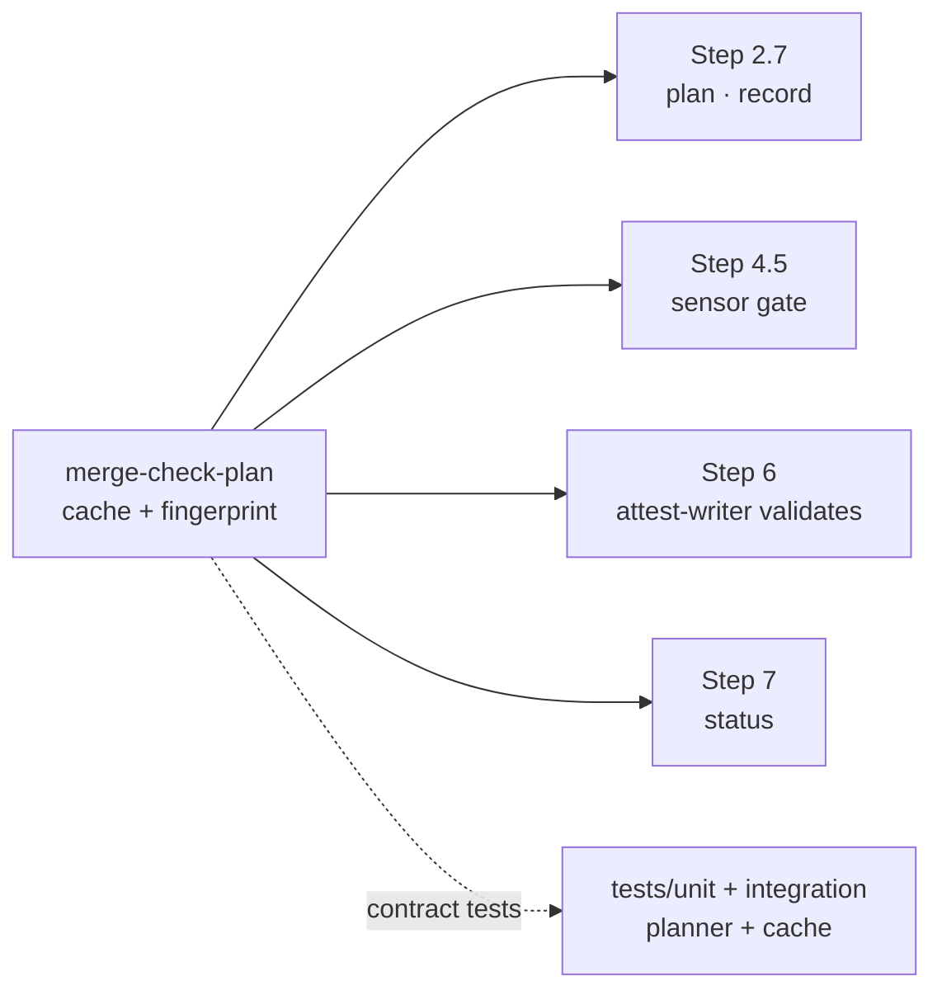
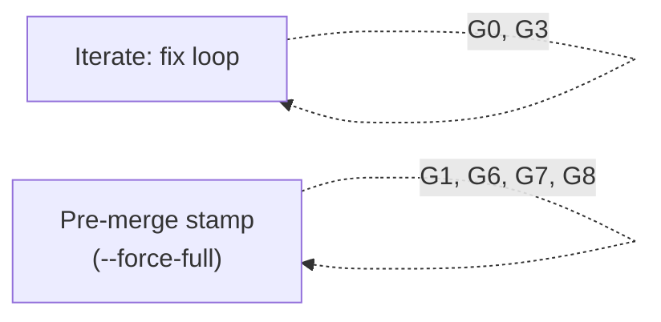
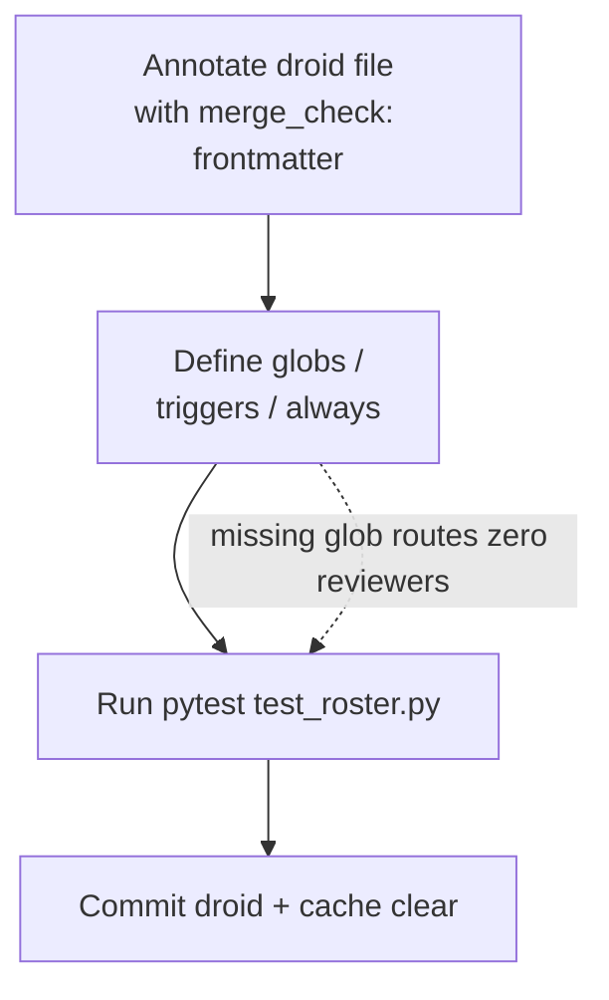

# `/merge-check` — adversarial + outcome-review floor

We run the adversarial reviewer suite by hand for every MR. The default roster is path-routed, the outcome reviewer is always on (criteria are auto-discovered), and we probe the test suite with a discrimination sensor so "green" actually means something. The result lands in `attestations/mr-<iid>.md` as a verifiable contract, not a vibes check. The frontmatter `commit_sha` records the reviewed code commit; if the attestation is committed as a follow-up commit, the gate validates that SHA against the first non-attestation commit behind `HEAD`.

**Portable.** The skill holds no project-specific droid names or paths. We discover reviewers from each droid's `merge_check:` frontmatter (`references/roster-discovery.md`); porting the skill is a copy of the bundle plus an annotation on each team droid. See [README.md](README.md).

**Use this when** — you have changes ready for adversarial review, openspec'd or ad-hoc.

**Not this** — `/opsx:verify` checks openspec changes against the spec; `/merge-check` checks the diff against reviewer contracts. Orthogonal, complementary.

## Inputs

`$ARGUMENTS` accepts up to four tokens in any order. **All are optional** — the criteria source is auto-discovered (see Step 1.5); these only override or supplement it:

1. `--all` **or** comma-separated droid names (explicit roster)
2. git ref (anything else non-flag)
3. `--change <openspec-change-name>` (force these openspec artifacts as the criteria)
4. `--issue <N>` (force this GitLab issue as the criteria)

Both `--change` and `--issue` are mutually compatible; criteria concatenate.

## Defaults

We run with no arguments most of the time: path-routed roster, tracking branch or `main` as BASE, criteria auto-discovered from the branch/issue/spec. Sane defaults — override only when needed.

| Flag | Default | Override |
|---|---|---|
| Roster | path-routed | `--all` or comma-names |
| BASE ref | tracking branch or `main` | positional arg |
| Outcome criteria | auto-discovered (branch → issue, openspec change) | `--change` / `--issue` |
| `always` droids (security floor) | always | cannot override |

## Concepts

- **Roster floor** — the path-routed set of droids we always dispatch (the `always` set is its non-bypassable core). `merge-check-roster` derives it.
- **Fingerprint** — the SHA-256 of (droid file, routing config, criteria text, relevant files). Two reviews with matching fingerprints can reuse each other's `APPROVE`.
- **Slice** — the per-reviewer scoped diff. `merge-check-plan slice --reviewer X` returns the files the droid's glob would touch.
- **Stamp** — `attestations/mr-<iid>.md` with structured frontmatter (`commit_sha`, `verdict`, `force_full`). The CI gate reads it.
- **glab** — the GitLab CLI; `merge-check-iid` uses it to resolve the MR IID from the branch.
- **worktree** — a throwaway `git worktree` is a separate working copy on a temporary branch; the discrimination sensor uses one so mutations never touch the real tree.

## Runtime: the `merge_check` package

We ship the deterministic helpers as an installable Python package under
`.factory/skills/merge-check/` (src layout, one declared dependency: **PyYAML**),
not as loose scripts. Run them with **uv**, which provisions the pinned
environment from `uv.lock` on first use — no manual `pip install`. Every snippet
below uses this prefix:

```bash
MC="uv run --project .factory/skills/merge-check"
```

The six entry points (console scripts, also runnable as `python -m merge_check.cli.<module>`):

| Command | Replaces | Role |
|---|---|---|
| `$MC merge-check-roster`  | discover_roster   | roster discovery / `--audit` |
| `$MC merge-check-config`  | merge_check_config| read `.factory/merge-check.yml` |
| `$MC merge-check-plan`    | incremental_review| `plan` / `record` / `status` / `slice` / `classify` |
| `$MC merge-check-sensor`  | mutation_sensor   | discrimination sensor (stdin JSON) |
| `$MC merge-check-iid`     | resolve_mr_iid    | resolve the MR IID |
| `$MC merge-check-attest`  | write_attestation | anti-forgery attestation writer |

!!! tip "How do maintainers run the test suite?"
    `cd .factory/skills/merge-check && uv run --extra dev pytest` runs unit +
    integration + property + fuzz + e2e. `uv run --extra dev mypy` and
    `uv run --extra dev ruff check .` gate types and lint. The `--extra dev`
    is required — pytest/hypothesis/mypy/ruff live there, so a fresh checkout
    collects zero tests without it. Tests live in `tests/` (a sibling of `src/`),
    never referenced from this file, so they cost the model zero context. The
    `merge-check-plan test` smoke subcommand delegates to `pytest -q` for runtime
    verification; it is not the contract surface.

## Config (`.factory/merge-check.yml`)

The only per-repo state we need is read via `$MC merge-check-config`:
`droids_dir`, `attestation_dir`, and the per-language `test` command for the sensor
(all paths relative to the project root). It may also carry a `gate:` subtree —
server-side policy the client ignores and the CI gate reads from the merge target
branch (today `attestation_exempt`, waiving machine-generated MRs like the git-cliff
changelog from the attestation requirement; see `references/attestation-predicate.md`).
It lives **outside** the skill bundle so a skill upgrade never wipes it, ships with
universal path defaults (so a fresh repo works zero-ask), and regenerates from those
defaults when deleted. **First run:** `merge-check-config --init` writes the default
skeleton — it does **not** detect your tooling. Fill in `test:` yourself and commit.
Routing still lives in the droids — this file never holds models, tools, or the roster.

## Steps

| # | What | Where the detail lives |
|---|---|---|
| 1 | Resolve BASE; pre-filter binary / LFS; emit `DIFF` and `CHANGED` | inline bash here |
| 1.5 | **Discover criteria** into `$CRITERIA` (args → branch issue → openspec change). No criteria → course-correct | inline bash (see below) |
| 1.6 | Criteria adequacy heuristic — prompt on thin lists; honour `MERGE_CHECK_CRITERIA_CHOICE` env | inline bash |
| 2 | Discover the roster floor (`merge-check-roster`) — path-routed, `always` droids always, `-verifier` filename-suffix droids run when criteria exist | `src/merge_check/roster.py` + `references/roster-discovery.md` |
| 2.5 | **Reason on top of the floor** — read the diff and add any reviewer the globs missed | inline judgement (see below) |
| 2.7 | **Incremental plan** — reuse unchanged reviewer APPROVEs during iteration; force full before final attestation | `src/merge_check/planner.py` + `persistence.py` |
| 3 | Dispatch reviewers in parallel via the **Task** tool | inline template |
| 4 | Aggregate findings; **evidence gate** + format-drift gate | inline rules |
| 4.5 | **Discrimination sensor** — inject behaviour-level mutations, confirm tests kill them; survivors → BLOCK | `src/merge_check/sensor.py` + `references/discrimination-sensor.md` |
| 5 | If verdict is BLOCK/NEEDS FIX, decide whether to auto-fix before returning | inline judgement (see below) |
| 6 | Render the consolidated report **and write** `attestations/mr-<iid>.md` (with structured frontmatter) | `src/merge_check/attestation.py` + body template |
| 7 | Exit code (loudest signal wins: 0/1/2/3) | inline table |

The planner is the single source of truth for every step that touches the cache or the fingerprint:



## Progress (keep the human informed)

`/merge-check` spends most of its wall-clock in two **black-box waits** — the parallel
reviewer dispatch (Step 3) and the discrimination sensor re-running the test command
(Step 4.5). Neither streams output, so a multi-minute silent run reads as a hang.
We emit a one-line status at each phase boundary: before a blocking step starts and,
for the long phases, after it completes with timing. Status never changes a
verdict or exit code. Keep each line undecorated:

- **Kickoff (Step 1)** — `/merge-check: <N> files changed vs <BASE> · phases: discover → review → sensor → attest (usually a few minutes).`
- **After discovery (Step 2)** — `Discovery done: <N> files · <M> reviewers selected in <T>s.`
- **Before dispatch (Step 3)** — `Review: dispatching <N> reviewers in parallel — <name1>, <name2>, … . Each is an independent subagent; this is usually the longest phase.`
- **After reviewers return** — `Review done: <block> BLOCK · <warn> WARN · <info> INFO across <N> reviewers in <T>s.`
- **Before the sensor (Step 4.5)** — `Sensor: running \`<test_cmd>\` on <files> — once per injected fault (<N> runs), so it re-runs your tests; watch its per-fault timing on stderr.`
- **After the sensor** — `Sensor: killed <K>/<N> (<survivors> survived) in <T>s.`
- **If the sensor is skipped** — `Sensor: skipped — <reason> (<files>).`
- **Before the write (Step 6)** — `Writing attestation → <path>.`
- **After the write (Step 6)** — `Attestation written → <path> in <T>s.`

Capture elapsed seconds for discovery, reviewer dispatch, sensor, and attestation write.
Print them in the corresponding "done" line, and include the same `timing` object in
`META_JSON` so slow runs leave an auditable bottleneck trail.

These lines are the only "is it alive?" signal during the long waits — never skip them.

## Step 1.5 — discover the criteria (outcome is default-on)

Every change is expected to map to a traceable issue, so the outcome reviewer runs **by default** — there is no flag to remember. Resolve `$CRITERIA` in precedence order, first hit wins:

1. **Explicit args** — `--change <name>` and/or `--issue <N>` (force the source).
2. **Branch name** — parse the current branch for an issue number, e.g. `feat/issue-27`, `fix/27-foo`, `27-foo` → issue `27`; then `glab issue view <N>`.
3. **In-progress openspec change** — if the diff touches `openspec/changes/<name>/`, load that change's `tasks.md` / spec as criteria.

```bash
CRITERIA=""
# (1) explicit args already parsed into $ARG_CHANGE / $ARG_ISSUE
# (2) else infer the issue from the branch
if [ -z "$ARG_CHANGE$ARG_ISSUE" ]; then
  BRANCH="$(git rev-parse --abbrev-ref HEAD)"
  ISSUE_N="$(printf '%s' "$BRANCH" | grep -oE '[0-9]+' | head -1)"
fi
# load criteria from whichever source resolved; see outcome-verifier-format.md

# P6: when both a GitLab issue and an openspec change are needed, fetch in
# parallel so the network round-trip doesn't block the local file read.
if [ -n "$ISSUE_N" ] && [ -n "$ARG_CHANGE" ]; then
  _issue_tmp="$(mktemp)"
  glab issue view "$ISSUE_N" --output json >"$_issue_tmp" 2>/dev/null &
  _change_criteria="$(cat "openspec/changes/$ARG_CHANGE/tasks.md" 2>/dev/null)"
  wait
  CRITERIA="$(<"$_issue_tmp")${_change_criteria}"
  rm -f "$_issue_tmp"
fi
```

**No criteria found → course-correct, don't skip.** A change with no linked issue or spec is a traceability gap, not a reason to drop the outcome check. Stop and resolve it:

- `1` — **link** an existing issue (provide `<N>`); re-resolve criteria and continue.
- `2` — **create** an issue now (title + acceptance criteria), link it to the MR, then continue.
- `3` — proceed adversarial-only **and** record `outcome_skipped: no-traceable-issue` in the attestation (explicit, audited — not silent).

`MERGE_CHECK_CRITERIA_CHOICE=1|2|3` selects non-interactively for CI. Outcome runs whenever `$CRITERIA` is non-empty (the skill then passes `--with-outcome` to `merge-check-roster`).

## Step 2.5 — reason on top of the floor

`merge-check-roster` gives a deterministic **floor** from globs + `always` droids. Globs are coarse, so before dispatching, **read the actual diff and add any reviewer whose expertise is clearly implicated even if no trigger matched** — e.g. an auth change buried in a file the security globs didn't catch, or a query change a path glob missed. (`merge-check-roster --audit` shows how every droid is wired if you need to check coverage.)

Reasoning may only **add** reviewers, never remove one the floor included — that keeps the suite non-skippable while fixing glob blind spots.

## Step 2.7 — incremental reviewer reuse

Default iteration should be cheap. Before Step 3, ask `merge-check-plan` which
reviewers still need to run:

```bash
PLAN_JSON="$(git diff --name-only "$BASE"...HEAD | $MC merge-check-plan plan \
  --droids-dir "$($MC merge-check-config --get droids_dir)" \
  --with-outcome \
  --criteria "$CRITERIA")"
```

We reuse unchanged `APPROVE`s keyed by the reviewer fingerprint, dispatch only
`PLAN_JSON.run` each iteration, and run `--force-full` exactly once at the final
stamp. See [`references/incremental-plan.md`](references/incremental-plan.md)
for the cache policy, run discipline, focus hints, Hollow-APPROVE guard, diff
slicing, and the record command.

## Step 4.5 — discrimination sensor (does the suite actually bite?)

Reviewers read code and the outcome verifier maps criteria to code; neither proves
that a **regression would turn the suite red**. A green suite that asserts nothing
passes every other gate. This step injects 1-3 behaviour-level faults on the
**changed lines** in a throwaway `git worktree`, runs the tests, and confirms they
**kill** the fault. A survivor is a weak/missing test → **BLOCK**.

Selection is your judgement (read `DIFF`, pick faults a correct test *must* catch);
the mechanics and the kill/survive verdict are deterministic in the script. Full
contract — gating, test-command resolution, mutation-selection rules,
finding/attestation mapping, limitations — lives in `references/discrimination-sensor.md`.

```bash
# Resolve the per-language command from .factory/merge-check.yml; "skip:<reason>" → record + skip that language.
TEST_CMD="$($MC merge-check-config --test-cmd ts --files "$CHANGED_TS")"
SENSOR_JSON="$($MC merge-check-sensor <<JSON
{ "test_cmd": "$TEST_CMD", "link": ["node_modules"], "mutations": [ … ] }
JSON
)"
SENSOR_RC=$?   # 0 all killed · 1 survivor(s) → BLOCK · 2 operational error → REVIEWER_FAILURE
```

### Gating and limitations

**Gate it** — run only when the diff changes non-test source with a resolvable test
command. Otherwise record the skip explicitly (never silent):
`discrimination: { ran: false, reason: no-testable-source | no-test-command }`.
Each survivor becomes one BLOCK finding (with `**Evidence:**` naming the surviving
mutation and that the suite stayed green). The `discrimination` summary is carried
in the attestation frontmatter (Step 6).

**Monorepo note (known limitation).** Per-package runners cannot share an
extension-keyed `test:` map. Until the per-package design lands, scope the sensor
to packages that share a runner; a language with no entry simply skips (recorded).
Full design sketch and today's workaround in the monorepo FAQ in [README.md](README.md).

## Step 5 — auto-fix what is actionable

`/merge-check` is not just a reporting command. If the run returns `BLOCK` or
`NEEDS_FIX` and the findings include concrete fixes the agent can safely apply,
apply them immediately before handing control back:

1. Classify each finding:
   - **Auto-fixable** — exact file/line evidence, deterministic fix, no product
     decision needed (missing docstring sections, literal constants, format drift,
     renamed command references, scoped test/config updates).
   - **Manual-attention required** — missing requirement, unclear acceptance
     criteria, product/design decision, security trade-off, destructive data
     change, ambiguous reviewer instruction.
2. For every auto-fixable item, edit the code/docs, run the relevant fast
   validators, then rerun the affected reviewer or deterministic check.
3. If any manual-attention item remains, stop after writing the attestation and
   surface the next step clearly (`Manual attention required: <specific decision>`).
4. Never auto-fix by weakening tests, removing criteria, downgrading findings, or
   changing the attestation verdict without rerunning the relevant checks.

If all BLOCK/NEEDS_FIX items are auto-fixed and validators pass, rerun
`/merge-check` (incremental, no `--force-full`) before writing the final
attestation so the committed report describes the fixed diff, not the stale
failing one. Batch all fixes from one run before re-running — do not fix one
finding and immediately re-run, which wastes dispatch wall clock. Use
`--force-full` exactly once, for the final pre-merge stamp.

## Step 6 — write the attestation

The full body template lives in this skill; the disk-write is delegated to a sibling
script. We pass the structured run data as `META_JSON` so the attestation frontmatter
carries the audit map (`runners_ran`, `adversarial_counts`, the per-criterion
`outcome_verifier.criteria` list from Step 4, and the `discrimination` summary from
Step 4.5). The writer does NOT accept `COMMIT_SHA` or `VERDICT` from the caller; it
derives both from git HEAD and the planner cache, and refuses to write unless every
reviewer in the plan has a cached APPROVE with a matching fingerprint.

### Step 6.1 — assemble `META_JSON`

`META_JSON` is assembled from the run. Reserved keys are ignored by the writer.
Its shape is documented in `references/attestation-predicate.md`.

```bash
META_JSON='{"runners_ran":[…],"adversarial_counts":{"block":0,"warn":0,"info":0},
"outcome_verifier":{"ran":true,"verdict":"APPROVE","criteria_count":N,"mapped":N,
"missing":0,"partial":0,"vague":0,"criteria":{"C01":{"status":"MAPPED","location":"file:line"}}},
"discrimination":{"ran":true,"injected":N,"killed":N,"survived":0},
"timing":{"discovery_s":0,"reviewer_dispatch_s":0,"sensor_s":0,"attestation_write_s":0}}'
```

### Step 6.2 — invoke the writer

```bash
MR_IID="$($MC merge-check-iid)" // (1)!
REPORT_OUT="$($MC merge-check-config --get attestation_dir)/mr-${MR_IID}.md"

$MC merge-check-attest \ // (2)!
  "$REPORT_OUT" "$META_JSON" ${FORCE_FULL:+--force-full} \
  --base "$BASE" --criteria "$CRITERIA" \
  ${WITH_OUTCOME:+--with-outcome} \
  ${SKIP_RUNNER:+--skip-outcome-runner "$SKIP_RUNNER"} <<'BODY'
# /merge-check report

**BASE:** $BASE (merge-base $(git merge-base "$BASE" HEAD))
**HEAD:** $(git rev-parse HEAD)
**Reviewed:** $(git diff --name-only "$BASE"...HEAD | wc -l | tr -d ' ') files changed

## Findings

…

## Reviewer status

…
BODY
```

1. Resolves the MR IID from the branch via `glab` (or `MERGE_CHECK_MR_IID` in CI).
2. The writer invocation; it verifies every reviewer in the plan has a cached APPROVE with a matching fingerprint before writing. `--force-full` re-expands the `always` floor and makes `--tool-use-count` mandatory — the non-bypassable final gate.

**G8 — always show the merge-base SHA, never the ref tip.** `git merge-base "$BASE" HEAD` returns the actual commit reviewers diffed against. The ref tip (`$BASE` itself) is the branch head that may be ahead of the merge-base; recording it in the report body would obscure unrelated commits already in the target branch.

When the orchestrator sets `FORCE_FULL=1` (final pre-merge stamp), the
attestation is forced to carry `force_full: true`. The writer also verifies
the planner cache at this point: every reviewer in the plan must have a
cached APPROVE entry with a fingerprint matching the current diff. If any
reviewer is missing (not dispatched, or inputs changed since last record),
the writer REFUSES to write — we dispatch the missing reviewer
and record its verdict before the stamp writes. That's the
anti-forgery gate; nobody can sketch an attestation by skipping the
expensive dispatch.

After write, the contributor commits `attestations/mr-<iid>.md` next to the change. This is usually an attestation-only follow-up commit whose frontmatter `commit_sha` points at the reviewed code commit, not at the attestation commit itself. Squash-merge discards the branch and the attestation dies with it — that's the lifecycle, not something to workaround.

## Step 7 — exit code

```text
0  → adversarial APPROVE, zero BLOCK, no failures, sensor clean (or skipped)
1  → adversarial NEEDS FIX / BLOCK, outcome-gap, or a surviving mutant (weak test)
2  → reviewer ERROR, format-drift, or discrimination-sensor operational error
3  → reviewer timeout, or rtf-outcome-verifier ERROR
```

Maximum across the categories — the loudest signal wins. A surviving mutant
(`merge-check-sensor` exit 1) folds into the adversarial BLOCK channel; a sensor
operational error (exit 2) folds into the reviewer-ERROR channel.

## Guardrails overview

We enforce the guardrails below in two windows: the iteration loop and the pre-merge stamp. Each rule is anchored to the window that enforces it.

*Tag legend:* `G-N` = guardrail rules anchored in the table below. `C-N` = cross-cutting policy added later (e.g. C08). `P-N` = inline performance notes in code blocks. G2 lives in `references/discrimination-sensor.md`; G4 and G5 are absorbed into the planner round-history logic (see `references/incremental-plan.md`).



| Tag | Rule | Window |
| --- | --- | --- |
| G0 | cache scope + lineage | iterate |
| G1 | tool_use_count mandatory | stamp |
| G3 | classify before override | iterate |
| G6 | dispatch_started_at mandatory | stamp |
| G7 | wall-clock from dispatch_started_at | stamp |
| G8 | merge-base SHA in body | stamp |

## Iteration-loop rules

- **Cache scope is branch-keyed (G0).** The incremental cache is tied to the current branch; entries from a different branch are treated as a full miss. See the "Cache is already configured" tip for file locations.
- **Lineage proof before reuse (G0).** A cached APPROVE is only reused when the cached HEAD is an ancestor of the current HEAD. After a rebase or force-push, the stale entry is re-dispatched.
- **classify before override (G3).** `--override-requested` stamps must run `merge-check-plan classify` first so the in-diff vs pre-existing determination is grounded in real diff data. See §"Diff-scoped severity" for the invocation and override semantics.

!!! tip "Cache is already configured"
    No setup needed — the planner reads/writes these on every run.
    * Cache file: `.factory/merge-check-cache.json` — schema v2.
    * Run artifacts: `.factory/merge-check-runs/<branch-slug>/` (prefer repo-local, with `/tmp` fallback on read-only filesystems).
    * On `schema_version 1` error, delete the cache and start fresh.

## Stamp rules (--force-full)

- **tool_use_count is mandatory (G1).** `merge-check-attest` refuses the stamp with a `tool_use_count` error unless every reviewer entry carries a positive integer. The count must be the reviewer's real tool-call total. See [`references/incremental-plan.md`](references/incremental-plan.md) for record-time details.
- **always-droid entries must be re-recorded (G1).** Without `--force-full`, an `always` droid's fingerprint only covers its declared triggers — `merge-check-attest` then refuses the stamp because the floor was not expanded to the full diff. Re-run the floor with `--force-full` and re-record before stamping. See §Step 2.7 for the iteration vs stamp scope difference.
- **dispatch_started_at is mandatory (G6).** `merge-check-attest` refuses the stamp if any reviewer entry is missing a non-empty ISO-8601 UTC timestamp. The raw dispatch time is what the planner uses for wall-clock. See [`references/incremental-plan.md`](references/incremental-plan.md) for the flag form.
- **planner uses dispatch_started_at for wall-clock (G7).** The planner derives real reviewer wall-clock from this timestamp and uses `--elapsed-s` only as a fallback. See [`references/incremental-plan.md`](references/incremental-plan.md) for the flag form.
- **merge-base SHA in the report body (G8).** The attestation body shows the merge-base SHA, not the ref tip. See §Step 6 for the template and rationale.
- **Cumulative findings from branch history (C08).** The attestation writer derives `cumulative_findings` from the per-reviewer round history in the cache, not from META_JSON `adversarial_counts`.

## Cross-cutting rules

- **Progress is mandatory.** We emit the per-phase status lines from the "Progress" section before each blocking step; a multi-minute silent run reads as a hang. Status output never affects the verdict or exit code.
- **Timeouts are scoped.** A reviewer timeout affects only that reviewer. Continue collecting completed reviewer reports, mark the timed-out reviewer as failure (exit 3), and avoid a full rerun unless the final pre-merge `--force-full` pass is being attempted.
- **Read-only** — every droid prompt includes `DO NOT modify any files`.
- **No repo internals or generated caches.** Reviewer prompts must say: do not read `.git/**`, `node_modules/**`, `.nuxt/**`, `.output/**`, `dist/**`, or `__pycache__/**`; use the supplied changed-file list/diff instead of Git internals.
- **Focus hints are advisory, not coverage.** The plan's `focus_hints` map tells each RUN-bucket reviewer which files changed since its last APPROVE. The hint directs attention; it never changes the fingerprint or lets a file skip review.
- **Criterion anchors are stable and audited.** Every criterion carries an anchor (`C01`, `C02`, … or its spec `REQ-NNN`/`AC-NNN` id). The anchor threads through the report and the attestation's `outcome_verifier.criteria` map.
- **A VAGUE criterion cannot read as satisfied.** Closure is a gate: any criterion failing the checklist (unambiguous, verifiable verb, measurable outcome) is `VAGUE` and forces at least `NEEDS FIX`; it can never be silently `MAPPED`.
- **Discrimination sensor runs when source with tests changed.** Mutations are injected in a throwaway worktree only. A surviving mutant is a BLOCK. A skip is explicit (`discrimination.ran: false` + reason), never silent.

## Auto-enforced gates

The gates below are enforced automatically; a contributor can trip them if the reviewer output format drifts or the record invocation is incomplete.

!!! warning "Format-drift gate"
    Enforce the first-line regex `^Summary: (APPROVE|NEEDS FIX|BLOCK) — N findings$` on every droid's output. Drift → exit 2.

!!! warning "Evidence gate"
    BLOCK/WARN without a paired `**Evidence:**` line is auto-downgraded to INFO with `downgraded_to_info:<count>` flag.

!!! warning "Hollow-APPROVE guard"
    A reviewer returning APPROVE with zero tool uses is rejected at `record_verdict` time. See [`references/incremental-plan.md`](references/incremental-plan.md) for the record-time rule.

!!! warning "Outcome-runner skip is explicit and audited"
    Passing `--skip-outcome-runner <name>` records `outcome_skipped: true` plus the skipped runner names. The runner is never dispatched. Use this when a runner is misbehaving; the attestation remains the audit artifact.

## Diff-scoped severity

A finding whose evidence (file:line) anchors entirely outside the MR's changed lines must not gate the merge. After collecting findings from all reviewers, classify each one against the full diff:

```bash
# Classify each finding — diff is derived from git merge-base automatically (G3):
printf '{"file":"pkg/x.py","line":42,"severity":"WARN"}\n' \\
  | $MC merge-check-plan classify --base "$BASE"

# Alternatively, supply an explicit diff file:
git diff "$BASE"...HEAD > /tmp/full.diff
printf '{"file":"pkg/x.py","line":42,"severity":"WARN"}\n' \\
  | $MC merge-check-plan classify --diff-file /tmp/full.diff
```

To use `--override-requested` at the stamp, the cache must carry `classify_done: true`
(set by the commands above). If classification could not be run, record the accepted
risk explicitly:
`$MC merge-check-plan classify --skip-reason '<reason>'`.

This adds a `classification` field: `"in_diff"` or `"pre_existing"`.
Pre-existing findings are demoted to an advisory channel — visible, auditable,
optionally auto-filed as follow-up issues — and **excluded from the verdict
computation**. A reviewer's verdict must be recomputed from in-diff findings
only. Empirical prior data showed a majority of gating findings were on pre-existing code the MR never modified.

## Performance tuning — when a reviewer is slow

If a reviewer runs over budget, find the hot one first, then apply the two routine levers:

```bash
$MC merge-check-plan status           # top-5 slowest cached reviewers, top-5 largest slices
```

Read `slowest_cached_reviewer`, `relevant_file_counts`, and `warnings`; they point at the reviewer to attack first. Routine levers, in payoff order:

1. **Slice the diff** — `merge-check-plan slice --reviewer X` and pass only that scoped diff. Often 30–60% per-call drop on wide triggers.
2. **Trim the droid prompt** — keep the contract (severity rules, output format, "what linters catch"); drop redundant examples. Larger model = higher per-token cost, so a tighter prompt pays twice.

Reach decisions (NOT routine — only after the two above fail):

- Tighten a reviewer's triggers so it stops pulling in unrelated files.
- Move a reviewer down one model tier (always keep `rtf-security-reviewer` on the strongest model).

Re-run and compare `elapsed_s` recorded for that reviewer; the cached timing is the source of truth.

## Output

We emit the attestation at `attestations/mr-<iid>.md` plus the consolidated report in the chat transcript. Stdout structure: severity-grouped findings (BLOCK → WARN → INFO → OUTCOME_GAP → Drift → Reviewer status), then exit code.

## Adding a new reviewer droid

When you bring `/merge-check` into a new repo, the touch order is:



## References (kept out of this file to keep context lean)

**Markdown contracts** (read on demand):

- `references/roster-discovery.md` — the `merge_check:` droid contract + routing modes
- `references/outcome-verifier-format.md` — MAPPED / MISSING / PARTIAL / VAGUE semantics, criterion anchors, closure gate
- `references/discrimination-sensor.md` — mutation selection, gating, finding mapping, limitations
- `references/attestation-predicate.md` — frontmatter shape + verdict enum
- `references/incremental-plan.md` — cache policy, run discipline, focus hints, Hollow-APPROVE guard, slicing, record command
- `references/override.md` — the human-acknowledged override flow and CI verification

**Package modules** (`src/merge_check/`, run via the `$MC` commands above; read the source only when you need the algorithm):

- `config.py` (`merge-check-config`) — reads `.factory/merge-check.yml` (droids_dir, attestation_dir, per-language test cmd) with safe defaults
- `roster.py` (`merge-check-roster`) — discovery engine (reads `merge_check:` frontmatter; `--audit`; `--droids-dir` from config)
- `planner.py` (`merge-check-plan`) — reviewer run/reuse/skip planner + the plan-validated `record_verdict`; exposes `plan`, `record`, `status`, `slice`, `classify`
- `persistence.py` — the incremental-review cache's disk I/O (read/write/transaction + status report) that the planner reads and writes through
- `sensor.py` (`merge-check-sensor`) — the discrimination-sensor engine (throwaway worktree; kill/survive verdict)
- `resolve_iid.py` (`merge-check-iid`) — iid resolution (fail-loud on auth/branch issues)
- `attestation.py` (`merge-check-attest`) — writes `attestations/mr-<iid>.md` with anti-forgery cache verification (derives commit_sha + verdict from git + cache, refuses if any reviewer missing)
- `core/` — shared, tested primitives: `globs`, `frontmatter` (PyYAML), `paths` (traversal/symlink guards), `gitio`, `jsonio` (atomic write + flock), `fingerprint`
- Contract tests live in `tests/` (unit + integration + property + fuzz + e2e); the legacy inline `test` subcommand now delegates to `pytest -q` via `merge-check-plan test` — the smoke entry point stays, but it forwards to the external suite rather than reimplementing it

> Optional
>
> The override path lets a contributor wave `NEEDS_FIX` on pre-existing dirty code they didn't author. See [`references/override.md`](references/override.md) for the full flow, frontmatter shape, and CI verification.

## Defaults — sane flags above arguments

`/merge-check` resolves most cases with **zero arguments**. The four flag-style overrides exist for the narrow set of MRs that need them. Don't add flags that diverge from the default — fold them into the default.
