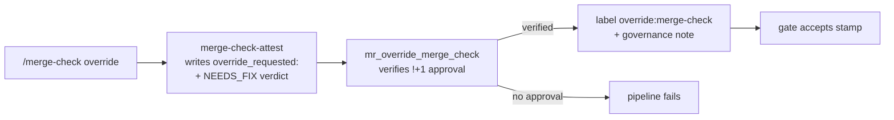

# `/merge-check override` — human-acknowledged NEEDS_FIX

When `/merge-check` fails on **unrelated** pre-existing findings in a file being edited (the contributor is not the author of the dirty code, and fixing the dirty code is not in scope of their MR), the run produces a refused stamp. Two paths forward:

1. **Fix the dirty code** alongside the MR — preferred when scope is small.
2. **Request an override.** The contributor (or any person who's sure) invokes:

```text
/merge-check override "<free-text reason>" [<issue-iid>]
```

When invoked as `/merge-check override` with no arguments, **AskUser** for the reason and the optional issue id (one cheap question, not blocking). When the user supplies arguments inline, run them through immediately — do not re-prompt.



The slash command maps to:

```bash
$MC merge-check-attest attestations/mr-<iid>.md \
    --force-full \
    --override-requested "<reason>" --override-issue-ref <iid> \
    < report-body
```

The writer records an `override_requested:` block in the stamp's frontmatter (`reason`, optional `issue_ref`) and writes an honest **NEEDS_FIX** verdict. No identity fields (`applied_by`, `applied_at`) are written — the stamp records the request only; identity attribution comes from the GitLab API (see below).

**Audit trail.** The CLI emits a single stderr line so CI job output captures the escape-hatch for compliance/security grep:

```text
[write-attestation] OVERRIDE-REQUESTED: reason="<reason>" issue_ref=<iid>
[write-attestation] wrote schema_version 6 + verdict 'NEEDS_FIX' + force_full=True ...
```

**Reason length.** Capped at 200 characters to keep the override readable. The findings themselves live in the stamp body, so the frontmatter reason is a one-to-two-line acknowledgement, not the full rationale.

**Constraints worth knowing:**

- The stamp verdict is always **NEEDS_FIX** with an `override_requested:` block — not APPROVE. The CI gate accepts it only when the `mr_override_merge_check` feature has verified a non-author approval (see below).
- The contributor does NOT have to refactor the dirty code. The `issue_ref` (when present) keeps the deferred work visible in the team's backlog.
- The request is **head-scoped** — pushing a new commit invalidates it (`commit_sha` no longer matches MR HEAD, the gate re-asks).
- The stamp body still lists every finding that drove the NEEDS_FIX, so reviewers see what was waved.
- The existing +1 human approval policy remains the security gateway.

**CI automation.** Once the stamp with `override_requested:` lands in the MR, the `mr_override_merge_check` CI automation feature fires on the next pipeline and:

- Verifies a non-author (`!+1`) approval exists via the GitLab API. If not, **fails the pipeline job** as a deterrent — the contributor must get a human to approve before the MR can land.
- When verified: auto-applies the `override:merge-check` label (idempotent), adds a per-feature governance note (reason + issue ref) to the CI Report, and the gate accepts the well-formed stamp.

Reading the label + governance note is enough — no need to clone the contributor's worktree and re-run `/merge-check`.
