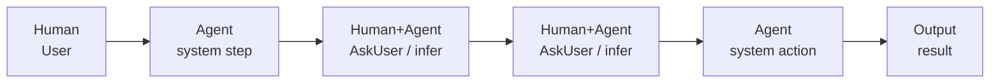
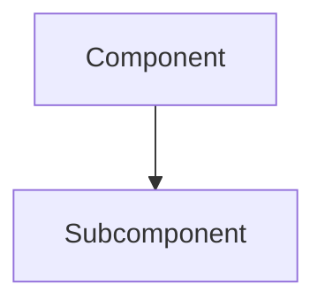

<!-- link to the GitLab issue that will be closed on merge -->
Closes #N

## Summary

### Problem

What issue were we solving? (1 sentence)

### Solution

What we did and why it matters (1-2 sentences)

## At a glance

<!-- One diagram that captures the essence of the change. Replace the placeholder below. Use a second diagram only if the change is genuinely complex.

Taste:
- Prefer Mermaid; GitLab renders it natively and it stays aligned regardless of font.
- Keep it compact: few nodes, short labels, use `<br/>` to split long labels.
- Label each node with the actor type when it matters: Human, Agent, Human+Agent, Output.
- Use ASCII only when Mermaid cannot express the diagram cleanly. -->



## Quality Gates Checklist

<!-- Agents must run these locally and attach evidence. Do not check a box without a command output or link. -->

- [ ] `make lint` passes — evidence:
- [ ] `make typecheck` passes — evidence:
- [ ] `make test` passes — evidence:
- [ ] `make test:integration` passes (if the change touches sync, migrations, or API) — evidence:
- [ ] `make test:e2e` passes (if the change touches UI flows) — evidence:
- [ ] `/merge-check` adversarial reviewers run on changed files — evidence:
- [ ] OpenSpec artifacts match code (if applicable) — evidence:

<!-- Agents add evidence here so it's collapsible to not bring noise to the MR -->

<details>
<!-- Provide evidence per checklist item -->
<summary>Evidence</summary>
</details>

## Changes

| File/Component  | Change      |
| --------------- | ----------- |
| path/to/file.ts | Description |

## Relevant Trade-offs (Optional)

<details>
<summary>Expand</summary>

| Decision | Alternative  | Rationale |
| -------- | ------------ | --------- |
| Chose X  | Considered Y | Why X     |

</details>

## Architecture / Scope (Optional)

<details>
<summary>Expand</summary>



Or ASCII (use code block):

```text
┌─────────┐     ┌─────────┐
│   A     │ --> │   B     │
└─────────┘     └─────────┘
```

</details>

## Tech Debt (Optional)

<details>
<summary>Expand</summary>

Resolves TD-XXX (if applicable)

</details>

---

OpenSpec artifacts are self-explanatory and do not need to be pasted here.
