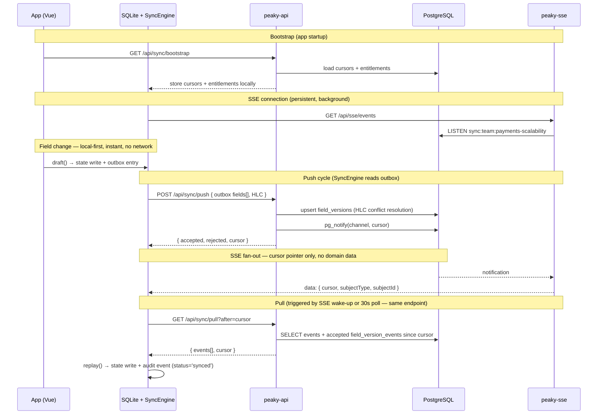
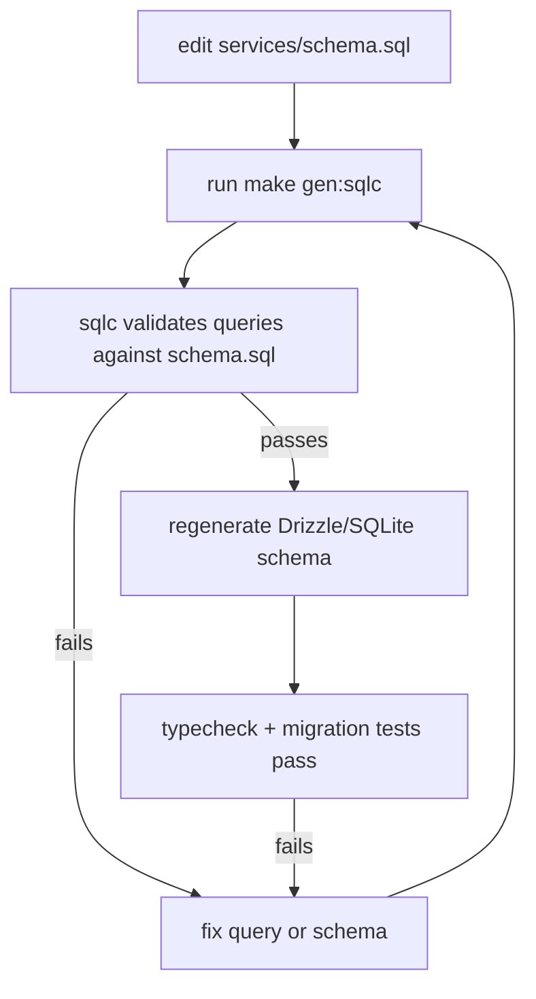

# Backend Sync Engine Design

## Context

Peaky's local-first Stage 1 is complete. The browser has a full SQLite database, outbox, entitlement cache, and sync client that exercises the push/pull protocol every 30 seconds. But the server side was a Nitro in-memory simulator — data didn't survive a restart, there was no real conflict resolution, and multi-device convergence didn't work.

We replaced the simulator with a Go API server backed by PostgreSQL, introduced field-level HLC conflict resolution, and established a schema pipeline that keeps client and server schemas in sync from a single source of truth. A separate SSE fan-out service (`peaky-sse`) delivers cursor notifications to connected clients via Server-Sent Events, reducing effective sync latency from 30s to near-instant while keeping the polling interval as a fallback.

**Status: Phase 1 shipped.** A thin sync entity registry now separates the generic push/pull protocol from per-entity behavior so Phase 2 can add template and product sync behavior without adding new sync endpoints. See [tasks.md](./tasks.md) for the full task log.

---

## How it works — end-to-end flow



**Key design choices in the diagram:**

- **Field changes are local-first** — `draft()` writes to SQLite immediately and returns. The network never blocks the user. The SyncEngine drains the outbox in the background.
- **`peaky-sse` carries no domain data** — only a cursor pointer. `DB` (SyncEngine) calls `pullChanges()` on receipt; entitlement enforcement stays on the pull path.
- **Pull returns event-specific accepted field values** from `field_version_events`, not the latest value repeated for every event. Pre-migration rows can still fall back to current `field_versions`.
- **The 30s poll and SSE-triggered pull use the same endpoint** — SSE is a latency optimisation, not a separate protocol.
- **`pg_notify` fires after conflict resolution** — only accepted field writes fan out.
- **Entity validation is registry-driven** — the wire payload stays `{ entityType, entityId, operation, fields[] }`; the registry decides which entity types are valid, and the audience resolver routes SSE fan-out. Authorization is the authz boundary's call — the sync engine forwards the raw entity, which keeps it single-responsibility and lets a Cedar-backed AuthZ service drop in later.

---

## Goals / Non-Goals

**Goals (Phase 1 — shipped):**

- Replace the Nitro sync simulator with a durable Go + PostgreSQL backend
- Establish a single-source-of-truth schema pipeline (`schema.sql` → goose migrations + sqlc-generated Go queries + SQLite schemas)
- Introduce field-level HLC conflict resolution for concurrent multi-assessor editing
- Complete bidirectional sync: pulled events update local SQLite via `LocalMutation.replay()`
- Add `peaky-sse` — SSE fan-out via PG LISTEN/NOTIFY; 30s polling becomes fallback
- Degrade gracefully: amber dot when pull is failing but push is still saving

**Non-Goals (deferred to later phases):**

- CloudEvents ingestion: forwarding client audit events to server (Phase 2)
- Admin events UI and activity feed from server data (Phase 2)
- Machine integration CRUDL endpoints and API keys (Phase 3)
- Okta JWT authentication — OIDC foundation in `main`, swap is one middleware change (Phase 4)
- Cedar authorization engine (Phase 4)
- Presence ("who's viewing this page") — SSE foundation is in place (Phase 4)
- Client-side merge conflict resolution UI — `field_versions` synced, UI deferred (Phase 4)
- Production AWS deployment — local Docker only in Phase 1

---

## Decisions

### 1. Schema pipeline — PostgreSQL DDL is the single source of truth

`services/schema.sql` is the canonical schema. Everything else derives from it:

```text
services/schema.sql
  │
  ├── goose migrations (services/internal/dbmigrate/migrations/)
  │     applied at container startup by peaky-ctl migrate
  │
  ├── sqlc (services/internal/syncengine/repo/queries.sql → services/internal/syncengine/db/)
  │     validates queries against schema.sql at codegen time
  │     make gen:sqlc regenerates after any edit
  │
  └── codegen script (TS, ~100 lines)
        reads SQL → emits Drizzle sqliteTable() definitions
        → shared/db/schema/*.ts → drizzle-kit → SQLite client migrations
```



**Drift detection is enforced, not aspirational:**

- sqlc fails `make gen:sqlc` if a query references a non-existent column
- CI gate: apply `schema.sql` fresh == apply all migrations sequentially (results must match)

**`make migrate:new NAME=...`** scaffolds the next numbered goose file and prints the remaining manual steps.

### 2. Wire protocol — field-level HLC

Per-field HLC stamps let the server accept Alice's `answer` while rejecting Bob's conflicting `answer` — without losing Bob's non-conflicting `naReason` update.

```text
Alice pushes:
  { name: "answer",   value: "yes", hlc: "1000:0001" }   ← wins (newer)
  { name: "naReason", value: null,  hlc: "1000:0002" }   ← no conflict

Bob pushes (same question):
  { name: "answer",   value: "no",  hlc: "900:0001" }    ← rejected (older HLC)
  { name: "naReason", value: "...", hlc: "1100:0001" }   ← wins (newer HLC)

Result: answer="yes" (Alice), naReason="..." (Bob)
```

**Push envelope:**

```json
{
  "clientCursor": "string | null",
  "events": [{
    "id": "UUIDv7",
    "entityType": "review_answer",
    "entityId": "reviewId:questionId",
    "operation": "upsert",
    "actorId": "actor_alice",
    "fields": [
      { "name": "answer",   "value": "yes", "hlc": "1716220800000:0001:actor_alice" },
      { "name": "naReason", "value": null,  "hlc": "1716220800000:0002:actor_alice" }
    ],
    "pushedAt": "2026-05-26T10:00:00.000Z"
  }]
}
```

**HLC storage:** wire format carries `actor_alice` for debuggability; stored as `hlc = "wallclock:counter"` + `actor_id` column separately (~50% smaller per row).

**Atomic HLC conflict resolution:** the `UpsertFieldVersion` SQL uses `ON CONFLICT DO UPDATE ... WHERE EXCLUDED.hlc > field_versions.hlc OR (EXCLUDED.hlc = field_versions.hlc AND EXCLUDED.actor_id > field_versions.actor_id)`. This makes HLC comparison atomic at the database level — concurrent pushes for the same field cannot race between the Go-level read and write. The Go layer still does a pre-flight HLC check (`GetFieldVersion` → `WinsOver`) to produce accurate accept/reject responses, but the SQL WHERE clause is the authoritative safety net.

> Optional — only needed if you're modifying HLC generation or debugging clock-drift test failures.

**Clock synchronisation and jump guard:** after each pull, the client calls `HLCClock.receive(remoteHLC)` for every field in the pulled events. This advances the local clock to be causally after all observed remote timestamps — without it, a client with a slower system clock would generate timestamps that lose every conflict against faster peers. A jump clock guard rejects any remote HLC whose wallclock is more than 60 seconds ahead of local time. This prevents a single client with a misconfigured clock from poisoning conflict resolution for all peers by generating timestamps far in the future.

### 3. API surface

| Service   | Endpoint                  | Method | Purpose                                      |
|-----------|---------------------------|--------|----------------------------------------------|
| peaky-api | `/api/sync/bootstrap`     | GET    | Actor + entitlements + cursors               |
| peaky-api | `/api/sync/push`          | POST   | Field-level HLC push                         |
| peaky-api | `/api/sync/pull`          | GET    | Deltas since cursor, scoped by entitlements  |
| peaky-api | `/api/sync/entitlements`  | GET    | Permission refresh                           |
| peaky-api | `/api/attachments/:id`    | GET    | Binary download                              |
| peaky-sse | `/api/sse/events`         | GET    | SSE stream — cursor pointer on push accepted |

`engineVersion` in the bootstrap response is `"1.0"` — the runtime language is an implementation detail, not part of the protocol contract.

### 3.1 Sync entity registry — same protocol, additive entity support

The sync API is intentionally not split into one endpoint per domain. Entity-specific rules live behind a small registry used by the generic handlers:

```text
POST /api/sync/push
  { entityType, entityId, operation, fields[] }
          │
          ▼
sync entity registry  (sync shape — authorization is the authz boundary)
  ├─ validate entityType + operation
  ├─ map review-scoped entities → SSE review owner
  └─ declare pull roots (pulled in their own right)
          │
          ▼
generic HLC conflict resolution + event persistence
```

Phase 1 registers review entities and reserves adapters for product/template entity types. Phase 2 should be additive: implement projection/validation for `template`, `template_draft`, `template_draft_pillar`, `template_draft_question`, and `product` by extending the registry and local mutation adapters, not by creating new sync endpoints.

### 4. LocalMutation — three write paths

```text
draft()   → state + outbox                (auto-save, no audit event)
commit()  → state + outbox + audit event  (milestone / meaningful action)
replay()  → state + audit event (synced)  (server-originated pull, no outbox)
```

**Loop prevention:** `replay()` sets `status='synced'`, `source='peaky.sync'`. Push pipeline filters `WHERE status = 'pending'` — replayed events are never re-pushed.

**Idempotency:** `replay()` uses `ON CONFLICT DO NOTHING` on the event row. Server seed events have stable IDs; a cursor reset causes a re-pull of the same events, which must not block the state write.

**Inbound handlers (Strategy pattern):**

| entityType          | Handler             | Target table          |
|---------------------|---------------------|-----------------------|
| `review_answer`     | ReviewAnswerHandler | `review_answer_state` |
| `review_note`       | ReviewNoteHandler   | `review_note_state`   |
| `review_attachment` | AttachmentHandler   | `review_attachments`  |
| `review`            | ReviewHandler       | `reviews`             |
| `product`           | ProductHandler      | `subjects` + `productProfiles` |
| `team`              | TeamHandler         | `subjects` + `teamProfiles`    |

Note: handlers must write **all required join tables** (`productProfiles`, `teamProfiles`) — not just `subjects` — or the entity will be invisible to queries that use INNER JOIN.

### 4.1 Auto-save, debouncing, and push batching

A common challenge in local-first collaborative apps is balancing responsiveness against flooding the sync engine with every keystroke or rapid interaction. Peaky solves this at multiple layers that compose together:

**Layer 1 — Per-entity debounce (UI, 300 ms)**

Each answerable entity (question answer) has an independent 300 ms debounce timer keyed by its `questionId`. Rapid interaction on the same question (e.g. clicking Yes → No within one breath) collapses into a single `draft()` call once the user settles. Different questions have independent windows and do not interfere with each other.

```text
User clicks Yes on Q3, then No on Q3 within 150 ms
        │
        ├── handleAnswer(Q3, "yes")   ← reactive state update (UI, instant)
        ├── debounce timer Q3 started (300 ms)
        │
        ├── handleAnswer(Q3, "no")    ← reactive state update (UI, instant)
        └── debounce timer Q3 reset  (new 300 ms window)
                   │
                   │  ...300 ms of silence on Q3
                   ▼
             draft(Q3, "no")          ← SQLite write + outbox entry queued
```

Pillar navigation (next/prev/jump) flushes all outstanding timers immediately so answers are never lost silently between pillars.

**Layer 2 — isSyncing guard (SyncEngine)**

`runSyncCycle()` is guarded by an `isSyncing` flag. Concurrent cycles are dropped — not queued. This means if the user settles three questions in quick succession and each `draft()` call fires `triggerPush()`, only the first cycle wins:

```text
t=0 ms    Q3 debounce settles → draft() → triggerPush() → runSyncCycle() starts
t=50 ms   Q7 debounce settles → draft() → triggerPush() → cycle already running → NO-OP
t=120 ms  Q11 debounce settles → draft() → triggerPush() → still running → NO-OP
t=~400 ms cycle completes
              └── next triggerPush() (from Q11's draft) fires a new cycle
                  → all 3 outbox entries sent together in one POST
```

The outbox is the accumulator. Entries stay `status='pending'` until successfully pushed; the push cycle reads **all** pending entries in one query and sends them in a single POST regardless of how many accumulated.

**Layer 3 — Push cycle = the natural batch boundary**

No explicit batch design is needed at the application layer. The SyncEngine's push cycle is already the batch: every `draft()` writes an outbox entry, and the next cycle that wins the `isSyncing` guard sends all of them together.

**Effective latency end-to-end:**

```text
User settles answer (stops toggling)
        │
        + ~300 ms  debounce window expires
        │
        + ~0 ms    draft() → SQLite write (local-first: data safe immediately)
        │
        + ~0 ms    triggerPush() → runSyncCycle() fires (or waits for ongoing cycle)
        │
        + ~RTT     POST /api/sync/push + GET /api/sync/pull round trip
        │
        + ~0 ms    field_versions updated in PostgreSQL
        │
        + ~0 ms    pg_notify → SSE → remote peers receive cursor pointer
        │
        └── Recent Changes feed updated in all open tabs
```

No 30 s poll wait. The 30 s `setInterval` is a safety net for cases where `triggerPush()` was dropped by the `isSyncing` guard and no subsequent write arrived.

**Phase 4 conflict implications:**

Each question answer is an independent entity (`entityId = reviewId:questionId`). Debouncing per question means the HLC timestamp is stamped at the time the settled write reaches `draft()`, not at the time of the first click. Two collaborators answering the same question before either flushes will produce two HLC-stamped writes; the server applies both and the later HLC wins — deterministic resolution without application-level coordination.

### 5. Authentication & Authorization

Phase 1: `x-actor-id` header → actor registry JSON file lookup. The `Authorizer` interface (package `internal/authz`) is defined; Okta JWT is a single implementation swap (Phase 4).

Security invariants (all phases):

- sqlc enforces parameterised queries — no SQL injection path
- Entitlements scope WHERE clauses; unauthorised data never leaves PostgreSQL
- Actor ID in push events is overridden server-side — clients cannot impersonate

### 6. SSE fan-out — peaky-sse + PG LISTEN/NOTIFY

`peaky-sse` is a separate ECS service: different memory/CPU profile, independent deploy, no SSE connection state in the API process.

**Why PG LISTEN/NOTIFY over Redis:** PostgreSQL is already the persistence layer. LISTEN/NOTIFY is built-in, zero additional infrastructure. Redis adds cost and an operational dependency for a problem PG already solves.

**Channel model:** `sync:{subjectType}:{subjectId}` — e.g. `sync:team:payments-scalability`. After accepting a push batch, `peaky-api` builds the notification payload via `json.Marshal` (not string concatenation — prevents injection via subject IDs) and calls `pg_notify(channel, payload)`. `peaky-sse` holds one PG connection per pod and accumulates `LISTEN` calls as actors connect.

**SSE payload — cursor pointer only:**

```json
{ "cursor": "2026-05-31T10:30:00Z", "subjectType": "team", "subjectId": "payments-scalability" }
```

No domain data crosses the SSE connection. `peaky-sse` is stateless with respect to domain data.

**Heartbeat:** 15s SSE comment lines keep connections alive through ALB idle timeouts.

**SSE-aware polling:** While SSE is connected, the 30s scheduled poll is suppressed — SSE messages trigger sync cycles on demand. When SSE disconnects, polling resumes automatically as a fallback. Push callbacks and visibility-change cycles run regardless of SSE state. See `SyncScheduler.setSseConnected()` and `useSseClient`.

### 7. Sync status indicator

Four states, all implemented:

```text
●  green  (success)   Online — all changes synced
◑  sky    (spinning)  Syncing — push or pull in progress
●  amber  (warning)   Degraded — push saving, pull failing
○  slate  (dimmed)    Offline
```

**Degraded state** fires when `pullChanges()` throws (network failure, server error) but push is still succeeding. `SyncEngine` tracks `pullDegraded` separately from the connection status. Tooltip: `"Changes saving · live updates paused"`. Recovers automatically when pull succeeds.

**Cursor reset detection:** `SyncEngine` calls `bootstrap()` on every cycle (not just first run). If the server returns no cursor for the actor (e.g. after a reseed), the client resets its local cursor to null and does a full re-pull from epoch. This surfaces automatically — no manual intervention needed.

### 8. Two distinct history surfaces

```text
MILESTONES (events table — commit() writes):
  "Alice saved checkpoint — 12 questions answered"
  → sparse, meaningful, human moments
  → review details timeline

CHANGE FEED (field_version_events — accepted field writes):
  "Alice changed Q3 answer: No → Yes (2 min ago)"
  → granular, every field change with HLC + actor
  → like Google Docs version history
  → read from local SQLite field_version_events (synced via pull, no extra server call)
```

### 8.1 Recent Changes — how the change feed is constructed

```text
═══════════════════════════════════════════════════════════════════════════════════════════
                          How Recent Changes is constructed
═══════════════════════════════════════════════════════════════════════════════════════════

Two persisted surfaces, one grouped read path.

     ┌──────────────────────┐
     │  User edit           │
     └──────────┬───────────┘
                ▼
     ┌────────────────────────────────────┐
     │ field_versions                     │
     │ one mutable current winner/field   │
     └──────────┬─────────────────────────┘
                │ also write accepted field event
                ▼
     ┌────────────────────────────────────┐
     │ field_version_events               │
     │ one row per accepted field change  │
     └──────────┬─────────────────────────┘
                ▼
     ┌────────────────────────────────────┐
     │ Recent Changes read side           │
     │ group adjacent same actor/question │
     │ within 5 seconds                   │
     └────────────────────────────────────┘
```

The 5-second window is now presentation-only. The write path keeps accepted changes; `groupRecentChangeEntries()` groups only adjacent rows with the same actor and question inside the window. The grouped row shows the first before value and final after value, while the trail popover keeps every intermediate accepted change inspectable.

### 9. Local/server storage TTL

Local SQLite is a 14-day sliding window. Cleanup sweep runs on startup or post-sync cycle. Server PostgreSQL also needs an explicit retention/compaction policy for `field_version_events`; raw field-level history is Recent Changes data, not compliance evidence. Milestone/audit events remain the durable compliance surface.

---

## Testing strategy

Four layers build confidence from logic through SQL to mathematical proof. Each layer catches a class of bug the others cannot:

```text
Layer              What it catches                        Needs Docker?   Command
─────              ───────────────                        ─────────────   ───────
Unit (77 tests)    Logic wiring — handler calls repo,     No              make test:go
                   repo returns expected shape

Property (6)       Math invariants — ordering is          No              (runs with unit)
                   transitive, conflict resolution
                   is deterministic

Fuzz (4 targets)   Hostile input — parser panics,         No              make test:go:fuzz
                   counter overflow, garbage accepted

PG integration     Real SQL — atomicity, concurrency,     Yes             make test:go:pg
(12 tests)         round-trip through PostgreSQL
```

The fast quality gate (`make mr`) runs unit + property tests only. Fuzz and PG integration are separate targets for local runs and CI.

### Why each layer exists

**Unit tests** prove the Go logic is wired correctly, but they use an in-memory fake that just stores values in a map. The fake cannot test whether the SQL WHERE clause actually rejects an older HLC — it always overwrites.

**PG integration tests** run the same push/pull operations against real PostgreSQL via testcontainers. The most important test spins up 20 goroutines writing to the same field with different HLCs and asserts the newest always survives. This is the only layer that can prove the atomic upsert SQL works under concurrency.

**Fuzz tests** generate millions of random byte sequences and feed them to the HLC parser. They found two real bugs before merge: counter overflow past 4 digits broke lexicographic ordering, and the parser accepted empty segments like `::::` without error.

**Property-based tests** state mathematical rules that must hold for any valid input and verify them over thousands of random cases. The most valuable property: conflict resolution is deterministic — the same set of fields produces the same winners regardless of which actor pushes first.

### PG integration test inventory

All tests use GIVEN/WHEN/THEN structure and run against `postgres17-o9-ci` via testcontainers (locally) or GitLab services sidecar (CI, via `PG_TEST_DSN`).

| Test | What it proves |
|------|----------------|
| Atomic HLC upsert | Older HLC silently rejected by SQL WHERE clause |
| Newer-wins + actor tiebreaker | Conflict resolution correct at database level |
| Concurrent upsert (20 goroutines) | Race condition impossible — newest HLC survives |
| Pull entitlement scoping | Events from unauthorised entities never returned |
| Cursor filtering + HasMore | Incremental sync delivers correct event windows |
| Field version attachment | Pull response includes current field values |
| JSONB round-trip (10 types) | All JSON types survive PostgreSQL JSONB casting |
| Null field values | SQL NULL correctly round-trips |
| pg_notify delivery | LISTEN/NOTIFY wakes SSE correctly |
| Cursor CRUD | Cursor save/load round-trip |

### Fuzz targets and bugs found

| Target | Input | Bug found |
|--------|-------|-----------|
| FuzzParseWire | Random strings | Empty segments accepted without error |
| FuzzCompareWire | Random string pairs | No additional bugs (confirms robustness) |
| FuzzWinsOver | Random string pairs | No additional bugs |
| FuzzGenerate | Random valid HLCs | Counter overflow breaks lexicographic sort |

### Property invariants

| Property | Why it matters |
|----------|----------------|
| CompareWire transitivity | Ordering is well-defined (no cycles) |
| CompareWire antisymmetry | If A > B then B < A (no contradictions) |
| WinsOver/CompareWire consistency | Accept/reject agrees with ordering |
| Generate monotonicity | Each new HLC is strictly greater than the last |
| Deterministic conflict resolution | Push arrival order cannot change which fields win |
| Independent field acceptance | Non-overlapping fields are always accepted |

### Client tests (Vitest)

- `LocalMutation.replay()` — state write + synced audit, no outbox, ON CONFLICT DO NOTHING on event row
- `useSyncStatus` — degraded state (pull failing, push succeeding)
- `SyncEngine` — always-bootstrap cursor reset detection
- `BackoffGate` (14 tests) — exponential delay, jitter, cap, mayAttempt cooldown, per-endpoint isolation
- `SyncScheduler` (17 tests) — scheduling, push gating, visibility change, backoff, SSE-aware poll suppression — zero mocks (ports & adapters)
- `useSyncClient` (2 tests) — thin Vue wrapper, reactive state binding only
- `useSseClient` (16 tests) — connection lifecycle, message handling, gate-controlled reconnect, poll suppression signals

### Schema drift gate (CI)

- `schema.sql` applied fresh == all migrations applied sequentially
- `make gen:sqlc` passes (queries compile against schema)

---

## Resilience: per-endpoint backoff gates

Sync polling (peaky-api) and SSE reconnect (peaky-sse) are independent failure domains. Each gets its own `BackoffGate` instance so one service being down does not throttle traffic to the other — avoiding the shared circuit breaker anti-pattern ([Brooker 2022](https://brooker.co.za/blog/2022/02/16/circuit-breakers.html)).

```text
syncGate (peaky-api)              sseGate (peaky-sse)
  base: 30s, cap: 5 min            base: 1s, cap: 2 min
  consumers:                        consumer:
    - scheduled poll cycle            - SSE reconnect
    - user-triggered push
```

**Ports and adapters:** `SyncScheduler` is a plain class that takes `{ engine: SyncPort, gate, registerPush, onDowngrade }` in the constructor. All scheduling, backoff, and push gating logic lives here. The composable (`useSyncClient`) is a thin Vue wrapper that binds the scheduler to reactive state. Tests inject fakes for `SyncPort` — zero `vi.mock`. Same pattern applies to SSE via `{ gate }` DI on `useSseClient`.

**Error-as-value:** `SyncEngine.runSyncCycle()` never throws — it returns `SyncCycleResult` with `success: false` and an `error` string on failure. The scheduler propagates this to `gate.recordSuccess()` or `gate.recordFailure()`. No try/catch, no swallowed exceptions.

---

## Push rejection classification

When the server rejects an outbox event, the `reason` string in the push response determines whether the client retries or gives up immediately. Terminal rejections mark the outbox entry as `failed` on the first attempt — no backoff, no retry. Retryable rejections use exponential backoff with decorrelated jitter (up to 5 attempts, 1s–60s window).

**Terminal (never retry):**

| Reason | Source | When |
|---|---|---|
| `access_revoked` | Go push handler | Actor lost `canEdit` entitlement for the entity |
| `hlc_conflict` | Go push handler | All fields in the event lost HLC comparison — another actor's newer timestamp won. The stale HLC will always lose. |
| `partial_hlc_conflict` | Go push handler | Some fields accepted, some lost HLC comparison. Accepted fields are already stored; retrying the losers with the same HLC is futile. |
| `validation_error` | Reserved (Phase 2) | Malformed push payload |
| `forbidden` | Reserved (Phase 4) | Cedar authorization denied |

**Retryable (exponential backoff):**

All other reasons — primarily network errors (`ECONNREFUSED`, `ETIMEDOUT`, fetch failures) and server errors (HTTP 5xx). HTTP 429 uses the `Retry-After` header value when present.

**Implementation:** `NON_RETRYABLE_REASONS` set in `app/services/sync/RetryPolicy.ts`. The `handleRejectedItem` method in `SyncEngine.ts` checks `isRetryable(reason)` and routes to `markItemFailed()` (terminal) or `resetItemForRetry()` (retryable, increments `retryCount`).

**UI effect:** A `failed` outbox entry for a question where the winning `field_versions.actorId` differs from the current actor triggers the "overridden" badge in Recent Changes.

---

## Security considerations

1. **Parameterised queries everywhere** — sqlc generates them; no string concatenation of user input
2. **Entitlement scoping** — pull WHERE clauses use `(entity_type, entity_id) IN (...)` tuple comparison so different entity kinds sharing the same bare ID cannot leak across types; data never filtered post-query
3. **Actor override** — server overwrites `actor_id` from push events; clients cannot impersonate
4. **HLC as user input** — compared lexicographically, never parsed as executable code
5. **Entity-type whitelist** — `review_progress` and other non-sync types are rejected server-side with `invalid_entity_type` even if a buggy client sends them
6. **`errorMessage` on `*Failed.v1` events** — currently free-text with regex sanitisation; must be replaced with `{ code, kind }` allow-list before events leave the device (Phase 2 prerequisite)

---

## Open questions / deferred

| Topic | Decision |
| --- | --- |
| CloudEvents ingestion (client → server) | Phase 2. `draft()` events excluded by design — auto-save must not generate permanent server audit rows |
| Admin pull-events API shape | Deferred. Decide custom API vs Looker before Phase 2 starts |
| Machine API versioning | `/api/v1/` added in Phase 3 when external consumers exist |
| Catalog scheduled pull | Phase 1 serves static JSON. Scheduled LDAP/Backstage pull is a separate change |
| Presence | Phase 4. SSE foundation already in place; adds `sync:presence:{reviewId}` channel + presence table |
| Cedar authorization | Phase 4. `Authorizer` interface defined; Cedar is a single implementation swap |
