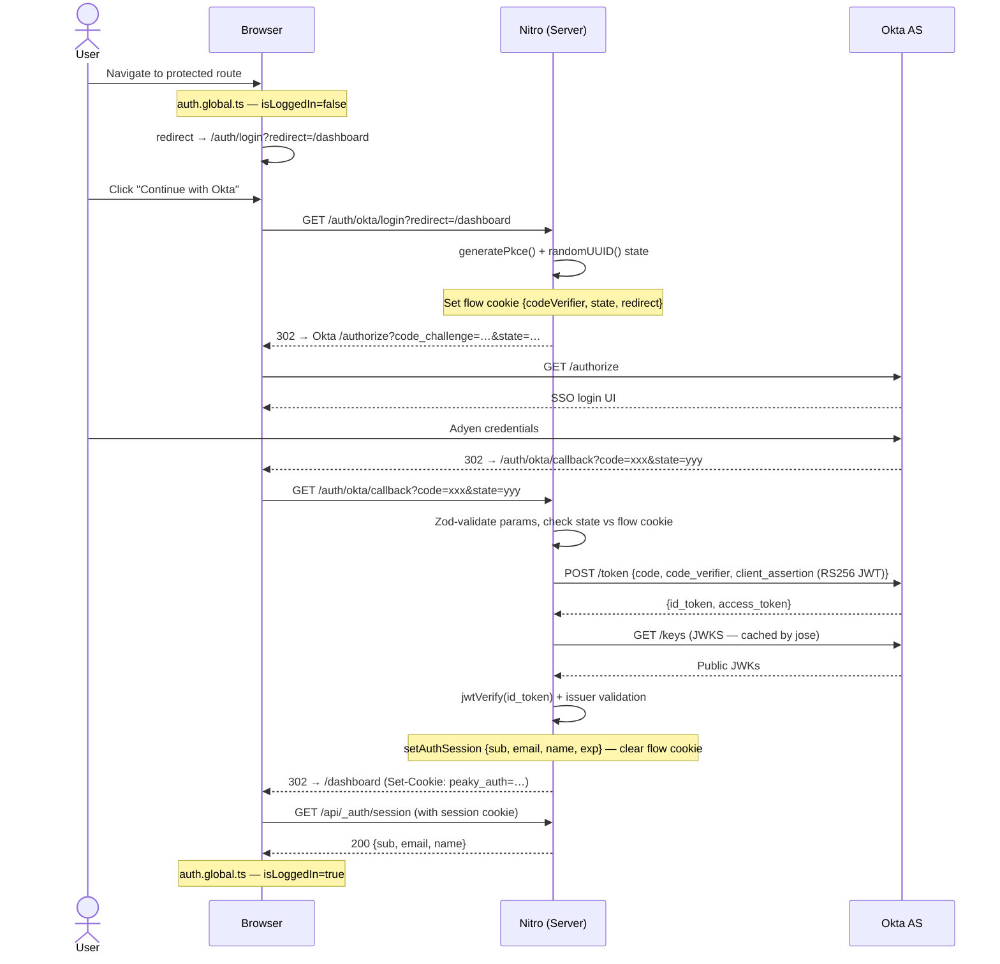

## Context

Peaky is replacing a temporary production-only password gate (`@plutotcool/nuxt-password-protect`) with proper OIDC authentication against the internal Okta tenant. The Okta team has provisioned an OIDC application configured for `private_key_jwt` client authentication — i.e., no shared client secret; the server signs a short-lived JWT with an RSA private key whose public counterpart is registered in Okta.

`nuxt-oidc-auth` (the most capable Nuxt OIDC module) does not support `private_key_jwt` — its `authenticationScheme` only covers `header` (Basic) and `body` (client_secret_post). Custom Nitro server routes are therefore the right approach, keeping full control of the token request.

The app is currently deployed on Vercel (SSR, Nitro). In a few weeks it will move to AWS Amplify. Both targets use Nitro's zero-config presets; the implementation is deployment-agnostic.

## Goals / Non-Goals

**Goals:**

- Implement OIDC Authorization Code Flow + PKCE against Okta with `private_key_jwt` token endpoint authentication
- Encrypted sealed-cookie sessions (stateless, Nitro H3 `useSession`) — no Redis, no file storage
- Fast shell: the app root renders immediately; auth check happens client-side after hydration
- Global `auth` middleware with public opt-out (`definePageMeta({ public: true })`) — new pages are protected by default, no boilerplate required
- `useAuth()` composable exposing `{ isLoggedIn, user }` — no raw tokens ever reach the client
- `/auth/login` page (branded, "Sign in with Okta" button)

**Non-Goals:**

- Multi-provider support (Okta only for now)
- Token refresh / silent renew (access token expiry triggers re-login)
- Role/permission enforcement (handled by existing `authorization` spec)
- Replacing the password-protect module in preview environments (that stays until Okta is live)

## Decisions

### 1. Custom Nitro routes over `nuxt-oidc-auth`

`nuxt-oidc-auth` doesn't support `private_key_jwt`. Writing three focused Nitro route handlers gives us exactly what we need without patching a third-party module.

### 2. `jose` for JWT operations

`jose` is already a transitive dependency of nuxt-oidc-auth and is the standard for JWT/JWK operations in the Node.js ecosystem. Used for:

- Building and signing the `client_assertion` JWT (`SignJWT` + `importJWK` — see Decision 4 for why JWK JSON over PEM)
- Validating the ID token (`jwtVerify` + `createRemoteJWKSet` against Okta's JWKS endpoint)

### 3. Discovery via `.well-known/openid-configuration`

URLs (`authorizationUrl`, `tokenUrl`, `userInfoUrl`, `jwksUrl`, `logoutUrl`, `issuerUrl`) are derived from the OIDC discovery document at `${domain}/.well-known/openid-configuration` rather than hardcoded. The discovery document is cached per-domain for the lifetime of the process (cold-start fetch on first login).

Why: Platform Engineering provisioned the **legacy** authorization server at `${domain}/oauth2/v1/...` rather than a Custom Authorization Server named `default` at `${domain}/oauth2/default/v1/...`. Hardcoding `/oauth2/default/...` would 404 on the real tenant and break `validateIdToken`'s `iss` check (the JWT's `iss` claim is the bare domain, not the `/oauth2/default` suffix). Discovery adapts to whatever auth server the IdP org actually provisions. Concurrent first-call requests share one in-flight Promise so we never stampede the discovery endpoint; rejected Promises are evicted from the cache so transient failures stay retryable.

### 4. JWK JSON private key distribution

`NUXT_OIDC_OKTA_PRIVATE_KEY` holds the JWK JSON as delivered by PE (paste verbatim — including the surrounding braces). `buildClientAssertion` accepts both a stringified JWK and a parsed `JsonWebKey` object via `jose.importJWK(jwk, "RS256")`. The `importPKCS8` path was abandoned because jose v6 throws hard on JSON input and PE distributes the key as JWK JSON.

The matching **public** JWK (with the same `kid`) must be registered in the Okta app's *Sign On → OpenID Connect → Client authentication → Public keys* — otherwise the token endpoint will reject every `client_assertion` with an `invalid_client`/`invalid_grant` signature-verification failure. When rotating, paste a fresh JWK JSON into the env var AND ask PE to register the new public half in Okta; existing sealed-cookie sessions keep validating until they expire naturally.

### 5. Request-origin OAuth redirect_uri

`redirect_uri` is derived from `getRequestURL(event).origin + "/auth/okta/callback"` rather than `NUXT_OIDC_*` env vars or `NUXT_PUBLIC_BASE_URL`. The `auth.okta.login.get.ts` and `auth.okta.callback.get.ts` handlers both derive the redirect base from the request origin so the URI tracks whatever hostname the browser used to reach us: localhost (dev), Vercel preview URLs (per-deploy random hash), Vercel production, and the upcoming AWS Amplify migration all work without per-environment configuration. The login ↔ callback pair is the only front-channel OAuth path that follows this origin model — `auth.okta.logout.get.ts` deliberately does not, and resolves its `post_logout_redirect_uri` from `NUXT_PUBLIC_BASE_URL` instead (see "Logout trust boundary" below for the threat model).

The previous hardcoded `http://localhost:3000` fallback surfaced as `redirect_uri_mismatch` on every Vercel preview deploy. The `NUXT_PUBLIC_BASE_URL` override was rejected because it required hand-maintenance per environment and stopped working the moment Vercel rotated a preview hostname.

### 6. `useSession` (H3) for sealed cookies

Nitro's H3 `useSession` provides sealed, tamper-proof cookies out of the box. No external storage needed. Works identically on Vercel and AWS Amplify (stateless Lambda).

The canonical payload shape lives on `AuthSession` in `server/utils/auth/session.ts`. The required four keys are always present (`sub`, `email`, `name`, `exp`); optional standard OIDC claims (`given_name`, `family_name`, `email_verified`, `preferred_username`, `ldap_uid`, `picture`, `groups`) and the raw OIDC `id_token` (server-only — stripped by `/api/_auth/session` before crossing the client boundary) are added when the IdP delivers them. Raw tokens are never serialized to the client bundle.

### 7. PKCE + state for the authorization request

Even though `private_key_jwt` already secures the back-channel, PKCE and `state` protect the front-channel (authorization redirect). Both are generated server-side and stored in a short-lived flow cookie.

### 8. Global middleware with public opt-out

All routes are protected by default via `app/middleware/auth.global.ts`. Pages that should be publicly accessible declare `definePageMeta({ public: true })` to opt out.

```text
Browser request → Nitro SSR
  ├── / (home)          → public: true → renders immediately, no auth check
  ├── /dashboard        → protected by default → 401? redirect /auth/login?redirect=/dashboard
  └── /auth/login       → public: true → shows "Sign in with Okta" button
```

This is safer than opt-in: new pages are protected automatically. No per-page `middleware: 'auth'` boilerplate. The `PageMeta` type is extended with `public?: boolean` in `app/types/auth.d.ts`.

The local-first app populates from OPFS while the auth check resolves. Users see the shell instantly.

### 9. Local admin self-claim (Cedar placeholder) — until Policies UI ships

PE's IdP does not deliver the OIDC `groups` claim on the live `sso.adyen.com` authorisation server (`sub`, `ldap_uid`, `ldap_groups` are configured; the standard `groups` claim is not). Until Cedar authz and the Authorisation Policies UI ship, the Profile modal exposes a self-claim switch (`useCurrentActor.setSelfClaimAdmin`) that writes `["admin"]` to the `peaky:actor-override-roles` localStorage key. The reactive `actor` derived value reads this key and applies it, so a signed-in user can elevate to `admin` role locally without depending on a `peaky-admins` LDAP group.

Why we explicitly do not propagate `peaky-admins` into Okta/LDAP as a managed group:

1. **Bloat.** `ldap_groups` already carries ~30 platform-tier group memberships per user; adding `peaky-admins` as an LDAP group would leak product-internal admin membership into every Adyen tool that mirrors LDAP.
2. **Unnecessary dependency.** Admin in Peaky is a product-internal role (governing Peaky resources), not an org-tier capability. Letting the OIDC identity provider dictate who can administer a single product creates coupling we don't want — a product-internal capability should be governed by a product-internal policy store.
3. **Migration cost.** Promoting the role to an LDAP group today means a 1-line Okta request but locks us into LDAP-shaped RBAC. Cedar / Open Policy Agent policies can express much richer conditions (time-of-day, resource relation, attribute-based) that don't fit into a single LDAP group membership.

The override is **clearly labelled as a placeholder** in the Profile UI with an explicit note "Local placeholder. Future Cedar authz + Policies UI replace this." Removal of the override block is fixed scope for the Cedar MR — once a real authorisation policy engine exists, `actorOverrideKey` and the `isSelfClaimAdmin` / `setSelfClaimAdmin` exports of `useCurrentActor` are deleted in lockstep with the switch UI being removed.

### Sequence diagram



### File layout

```text
server/
  routes/
    auth/
      okta/
        login.get.ts      — PKCE + state generation, Okta redirect (503 when unconfigured)
        callback.get.ts   — Zod query validation, state check, token exchange, session creation
        logout.get.ts     — session clear, Okta SLO redirect
      dev/
        login.get.ts      — dev-only session bypass (404 in production)
  utils/
    auth/
      pkce.ts             — generatePkce() using crypto.subtle
      okta.ts             — buildClientAssertion(), getOktaUrls(), validateIdToken()
      session.ts          — getAuthSession(), setAuthSession(), clearAuthSession(), AuthSession type
      flow.ts             — shared flow session config (DRY between login + callback)

app/
  composables/
    useAuth.ts            — useAuth(): { isLoggedIn, user, login, logout }
  middleware/
    auth.global.ts        — global guard; skips if oidcEnabled=false or to.meta.public=true
  types/
    auth.d.ts             — PageMeta augmentation: public?: boolean
  pages/
    auth/
      login.vue           — branded login page with dot grid background
```

## Testing strategy

```text
Unit tests (vitest)
  server/utils/auth/okta.ts
    ├── buildClientAssertion: assert JWT claims (iss, sub, aud, exp ≤ now+5min, jti present)
    ├── generatePkce: assert codeChallenge = base64url(sha256(codeVerifier))
    └── (id token validation tested via jose directly — no need to duplicate)

Integration tests (vitest + @nuxt/test-utils)
  server/routes/auth/okta/login.get.ts
    ├── GET /auth/okta/login → 302 to Okta with correct query params
    └── flow cookie is set

  server/routes/auth/okta/callback.get.ts
    ├── valid code + state → session cookie set, redirect to /
    ├── state mismatch → 400
    └── missing code → 400

  server/routes/auth/okta/logout.get.ts
    ├── clears session cookie
    └── redirects to /auth/login (or Okta SLO if configured)

  server/api/_auth/session.get.ts
    ├── valid session → 200 { sub, email, name }
    └── no session → 401
```

No E2E tests against real Okta during CI — the flow requires a live IdP. Manual verification against a dev Okta tenant during integration testing.

## Security Considerations

1. **New API endpoints**: `/auth/okta/login`, `/auth/okta/callback`, `/auth/okta/logout`, `/api/_auth/session`. The callback validates `code` and `state` via Zod (presence + max-length), then validates `state` cryptographically against the flow cookie. Open-redirect protection on `redirect` param (relative paths only).

2. **Browser storage**: Only a sealed session cookie (`HttpOnly`, `Secure`, `SameSite=Lax`). No tokens in localStorage or OPFS. The cookie contains `{ sub, email, name, exp, given_name?, family_name?, email_verified?, preferred_username?, picture?, groups? }` along with the raw OIDC `id_token` (server-only — `session.get.ts` filters it out of the wire payload). The full payload stays under the ~4 KB browser per-cookie ceiling; `id_token` alone is ~700-1.5 KB.

3. **Who can access data**: The global `auth.global.ts` middleware runs client-side only (UX guard). Nitro API routes that need auth must independently call `getAuthSession()` and return 401 if absent. Client middleware alone is not sufficient for API protection.

4. **User-supplied content rendered**: Login page renders no user-supplied content. Post-login redirect uses the `redirect` query param but only to navigate — never rendered as HTML.

5. **Private key exposure**: `NUXT_OIDC_OKTA_PRIVATE_KEY` is a server-only runtime config key (`runtimeConfig` private section). It is never included in `runtimeConfig.public` and never serialized to the client bundle.

6. **CSP entry is defensive, not load-bearing.** The Okta domain is reached through 302 full-page navigation only — `/auth/okta/login` redirects the browser to Okta's authorisation endpoint, Okta redirects back to `/auth/okta/callback`. Neither path issues a browser-side `fetch`/`XHR` to Okta, so the OAuth round-trip never traverses `connect-src`. Server-side calls (token exchange at Okta's token endpoint, JWKS validation via `createRemoteJWKSet`) carry no CSP at all. `nuxt.config.ts` includes `NUXT_OIDC_OKTA_DOMAIN` in `connect-src` as defense-in-depth in case future browser-side calls to Okta are introduced (e.g. an in-browser userinfo check); deleting the entry does not change behaviour in the present flow. The fall-through `connect-src: "'self'"` is what governs any browser-side fetches the client does today (none go to Okta).

7. **Cookie-size budget enforcement**: `server/utils/auth/session.ts:setAuthSession` now calls `enforceCookieBudget` before sealing, dropping optional heavy fields (`id_token → picture → groups → preferred_username → ldap_uid → given_name → family_name → email_verified`) in deterministic order when the input JSON exceeds `COOKIE_BUDGET_BYTES` (3000 B). The required four (`sub`, `email`, `name`, `exp`) are never dropped. When `id_token` is dropped the user falls back to local-only logout — `logout.get.ts` already routes any post-logout redirect away from Okta when no `id_token_hint` is available, so the UX degrades cleanly to "Okta SSO cookie stays valid until its own expiry" rather than spelunking through `ERR_COOKIE_SIZE`. A `[AUTH-DEBUG]` `console.warn` carries the payload size + dropped key list so operators can spot a misbehaving IdP before users notice the local-only fall-through. The hard ceiling on the sealed cookie is still the 4 KB browser cap; iron-webcrypto HMAC-SHA256 + base64 inflation turns the 3000-byte input safety margin into the 4 KB output ceiling.

## Risks / Trade-offs

| Risk | Mitigation |
|------|-----------|
| RSA private key rotation | Document in runbook: update `NUXT_OIDC_OKTA_PRIVATE_KEY` env var and register new public JWK in Okta app. Old sessions remain valid until they expire naturally. |
| Okta JWKS caching | `jose`'s `createRemoteJWKSet` caches keys in memory for the process lifetime. Lambda cold starts re-fetch. Acceptable. |
| Session cookie size | `{ sub, email, name, exp }` is ~200 bytes; sealed cookie fits well within the 4KB browser limit. |
| No token refresh | Access token expiry forces re-login. Okta's default access token lifetime is 1 hour — acceptable for an enterprise internal tool. Can add refresh later. |

## Feature Flag

OIDC is gated by the presence of three env vars: `NUXT_OIDC_OKTA_DOMAIN`, `NUXT_OIDC_OKTA_CLIENT_ID`, and `NUXT_OIDC_SESSION_SECRET`. When any are absent:

- `runtimeConfig.public.oidcEnabled` is `false`
- The global `auth.global.ts` middleware is a no-op (no access control at the Nuxt layer — Vercel preview protection remains the only gate for non-production URLs)
- OIDC routes (`/auth/okta/*`) return 503
- The login page at `/auth/login` is still accessible but shows the Okta button (unreachable without config)

When all three are set, `oidcEnabled` becomes `true` and the middleware activates.

### Local Dev Bypass

For local development without a real Okta tenant, set only `NUXT_OIDC_SESSION_SECRET` (any 48+ char string) and visit:

```text
GET /auth/dev/login
```

This sets a fake `{ sub, email, name }` session directly, skipping the Okta round-trip. Only available when `NODE_ENV !== "production"`. Accepts an optional `?redirect=` query param.

## Logout trust boundary

The `/auth/okta/callback` and `/auth/okta/login` handlers derive their OAuth redirect base from `getRequestURL(event).origin` — the request origin is what Okta needs to send the user back during the front-channel auth-code round-trip, and Vercel forwards a trusted `Host` from the deployment URL.

`/auth/okta/logout` is different. Okta's `end_session_endpoint` honours `post_logout_redirect_uri` to land the user after the IdP acknowledges logout — that URI is what the browser hits once Okta confirms the SSO session is gone, so a forged `Host` header on the request would put the user on an attacker-controlled page, not the IdP. To keep that surface small, logout resolves its redirect base from `NUXT_PUBLIC_BASE_URL` (already required per-environment for absolute client-side data URLs), not `getRequestURL(event).origin`. If the env var is missing or fails the URL/HTTPS check, the handler falls back to local-only sign-out and Okta's SSO cookie stays valid in the user's browser until its own expiry — acceptable for Beta, never a redirect to an untrusted origin.

The external Okta branch now also requires a session-borne `id_token_hint` (RFC §5.1 RECOMMENDED) — the `id_token` is captured into the sealed cookie at login (`setAuthSession`) and read back by the logout handler BEFORE `clearAuthSession`, then attached to the Okta redirect as `id_token_hint=`. Without it, Okta returns HTTP 400. Dev-bypass sessions (which never had a real id_token) stay on the local-only sign-out path.

## Server-side actor trust model

`server/utils/lifecycleActor.ts:getLifecycleActor(event)` is the canonical server-side identity resolver for lifecycle audit and admin gating. The pre-OIDC implementation read `x-actor-id`, `x-actor-name`, and `x-actor-roles` directly from the request — a spoofable surface that any peer could forge by setting those headers. `/merge-check` surfaced this gap (B-1) and the fix lands in this MR:

1. **Sealed session preferred.** The resolver is now `async` and starts by calling `getAuthSession(event)`. If a session is present, `id` is the verified `sub`, `name` is `name ?? preferred_username ?? email ?? sub`, and `roles` is `["admin"]` when the verified `groups` claim contains `peaky-admins`, otherwise `["member"]`. Spoofed request headers are ignored in this branch.
2. **Header fallback is dev-only.** When no session is present (e.g. OIDC env vars not set, dev/e2e test fixtures), the resolver falls back to reading `x-actor-*` headers / `actor*` query params so existing tests + dev workflows stay viable.
3. **Caller contract.** All 12 server-side call sites now `await` the resolver; `requireReviewContentActor` mirrors the change because it wraps `getLifecycleActor` for the review-notes / attachments endpoints. Caller changes are pure `async`/`await`; no caller rewrote its own role logic.

The local self-claim Admin toggle (`app/composables/auth/actor-override.ts`) remains a UI placeholder — it now only flips the local UI's view of the actor (cosmetic), it can no longer escalate server-side authorisation because the server never reads the override key. The toggle + override key + helper exports are removed when the Cedar authz + Policies UI MR lands (Scenario 4 of `Requirement: Local Admin Self-Claim` in `specs/authentication.md`).

Verification: `tests/unit/server/utils/lifecycleActor.test.ts` (5 cases) asserts that a session-borne actor of `{ sub, name, exp, groups: [] }` ignores a spoofed `x-actor-roles: admin` header and resolves to `["member"]`.

## Migration Plan

Status as of `feat/okta-2nd-stage` (deployed to `fork/main`, mirrored on Vercel preview):

1. Deploy with `NUXT_OIDC_OKTA_*` env vars unset → `oidcEnabled=false`, password-protect active, OIDC routes return 503 — **done in earlier preview deploys**
2. Okta team registers the app, provides `clientId`, domain, and registers the public JWK — **done**, `0oaxvsw77k7g8Aufk417` on `sso.adyen.com`
3. Set all five OIDC env vars in Vercel dashboard → `oidcEnabled=true`, auth middleware activates, password-protect disabled automatically — **done** in Production + Preview scopes (sensitive)
4. QA login flow on preview deployment using real Okta credentials — **done**: login flow, post-login redirect, logout-to-SLO all live-verified end-to-end. Session-expiry (Item 6 in issue #82) confirmed at 24-hour cookie TTL.
5. **Remove `@plutotcool/nuxt-password-protect` module and its env vars** — **done** in this same MR (PR `feat/okta-2nd-stage`).
6. **openspec change archived** — pending — lands once the MR merges to `main`.

## Lessons Learned (live verification on `sso.adyen.com`)

These surfaced during issue #82 walkthrough and shaped the Decisions above. Keep them in mind when working adjacent code:

- **Front-channel Vs back-channel red herrings.** Front-channel failures (`redirect_uri mismatch` 400) and back-channel failures (500 from a malformed JWK) present at the same handler but with very different causes. Always triage the exact Okta error in the response body before changing code — front-channel says `redirect_uri invalid_request`, back-channel says something like `invalid_grant` or returns an empty ID token.
- **Okta's discovery doc is mandatory reading on day one.** PE-provided `.well-known/openid-configuration` is the canonical ground truth for endpoint shape, scope support, signing algorithms, and SLO endpoint. Decision 3 leans on it. Hardcoded paths are an anti-pattern: the org's authorisation-server choice is something only PE can answer.
- **`NUXT_PUBLIC_BASE_URL` is the wrong knob for OAuth redirect_uri.** It's right for client-side fetched-data absolute URLs (the dataschema SSE endpoint uses it), but for OAuth the browser's request origin is the only thing that matters. The env-var approach was the original implementation; the request-origin switch was the central decision in this PR.
- **PE's default private-key distribution format is JWK JSON, not PEM.** jose v6's `importPKCS8` does not auto-detect; the build would throw with a non-obvious `"JWK must be an object"` error. `importJWK` + an explicit `JSON.parse` fallback is what survives the change.

## Open Questions

Resolved during live verification:

- ~~Does Okta's authorization server URL use the `/oauth2/default` path or a custom authorization server?~~ — **Legacy auth server active at `${domain}/oauth2/v1/...`** on `sso.adyen.com`. The `default` Auth Server is *not* provisioned, so hardcoded `/oauth2/default` paths would have 404'd. Decision 3 (discovery via `.well-known`) handles both shapes anyway, so a future auth-server swap is non-breaking.
- ~~What scopes does the Okta team want to expose? (minimum: `openid email profile`)~~ — **`openid email profile` granted** by PE; load-bearing claims `sub`, `email`, `email_verified`, `name`, `given_name`, `family_name`, `preferred_username`, `picture` all flow through. The **`groups` scope is still pending** a PE follow-up — until then every actor is `["member"]` and `email_verified` returns true for our IdP.
- ~~What is the desired access token lifetime configured in the Okta app?~~ — Not pre-measured. The sealed session cookie's own TTL (`SESSION_MAX_AGE = 24h`) is what governs re-login in practice; Okta's ID token exp is used opportunistically inside `getAuthSession` to short-circuit expiry earlier than the cookie's TTL.

Other open items:

- **Rotation cadence for `NUXT_OIDC_OKTA_PRIVATE_KEY`** — not yet documented in a runbook. Until then, key rotation needs both a Vercel env-var update AND a PE-side registration of the new public JWK in the Okta app, in that order.
- **`post_logout_redirect_uri` trust list in the Okta app** — `/auth/okta/logout` now derives the URI from `NUXT_PUBLIC_BASE_URL`, not `getRequestURL(event).origin`. PE must register that exact origin in the "Logout redirect URIs" list for SLO to fire; otherwise the handler falls back to local-only sign-out (Okta SSO cookie stays valid until its own expiry).
