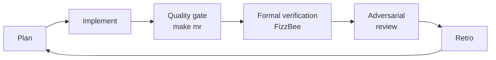
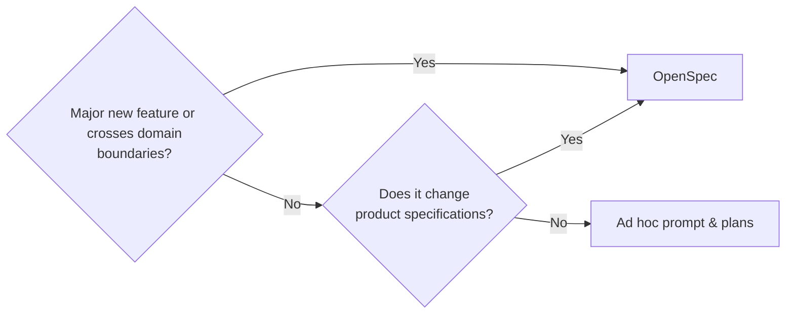
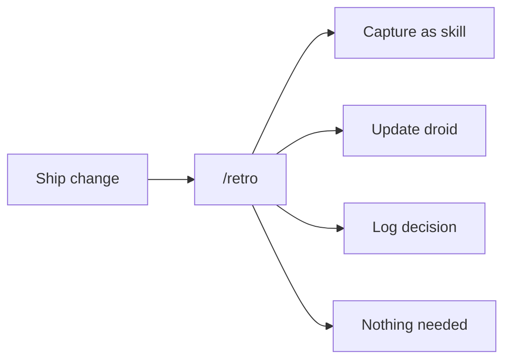

# Working with AI

Peaky uses AI throughout the development loop — planning, implementation, review, and improvement. This page explains how we keep that loop reliable, efficient, and continuously getting better.

## The loop



Cheap, deterministic feedback fires first — lint, typecheck, unit tests. For critical failure domains, FizzBee specs verify correctness properties before adversarial droids do their pass. Non-deterministic reviewer droids run last, on already-clean code.

## Deterministic guardrails

Non-deterministic agents are only as reliable as the floor they stand on. Rules and quality gates provide that floor.

| Layer               | What it is                                                          | Where                           |
| ------------------- | ------------------------------------------------------------------- | ------------------------------- |
| **Rules**           | Mandatory instructions loaded into every session                    | `.factory/rules/`               |
| **Quality gate**    | TS lint → typecheck → audit → unit → Go fmt/vet/tests → integration | `make mr`                       |
| **Type safety**     | Compiler rejects bad domain events, missing fields                  | TypeScript strict mode + Go vet |
| **Reviewer droids** | Adversarial second opinions on every change                         | `.factory/droids/`              |

Rules are short, focused files — one concern each. They are loaded by reference, not inlined into `AGENTS.md`, so adding a new rule doesn't grow the context window.

## Skills

Skills are reusable agent programs. Where a rule says *what to do*, a skill says *how to carry out a specific task* — step by step, with context baked in. Invoke with a slash command (e.g. `/retro`) or by name in a prompt.

### Development

| Skill                | What it does                                                      |
|----------------------|-------------------------------------------------------------------|
| `nuxt-ui`            | Build UIs with NuxtUI v4 — components, theming, layouts           |
| `linear-walkthrough` | Generate architecture walkthrough docs under `site/docs/`         |
| `fizzbee-spec`       | Write FizzBee formal verification specs for a failure domain      |
| `playwright-cli`     | Browser automation via agent-browser — screenshots, visual checks |

### Process

| Skill   | What it does                                                                |
| ------- | --------------------------------------------------------------------------- |
| `retro` | Structured retrospective after a change — surfaces patterns for improvement |
| `glab`  | GitLab operations — MRs, issues, comments                                   |

Skills capture hard-won patterns so they don't have to be rediscovered each session. When a pattern recurs across multiple retros, it graduates into a skill.

## OpenSpec vs ad hoc

Use **OpenSpec** for anything that changes system behaviour or crosses domain boundaries. Use an **ad hoc prompt** for isolated, well-scoped changes.



OpenSpec keeps domain knowledge in `openspec/specs/` as DDD specs — persistent, reviewable, and linkable across changes. Ad hoc work lives only in the session. When in doubt: if you'd want to reference this decision six months from now, use OpenSpec.

### OpenSpec workflow

| Step | Use |
| --- | --- |
| `/opsx-explore` | Optionally clarify requirements and trade-offs |
| `/opsx-propose` | Create the change and its apply-ready planning artifacts |
| `/opsx-update <change>` | Reconcile existing artifacts when decisions drift; confirms each edit, creates no artifacts, and never edits code |
| `/opsx-apply` | Implement the planned tasks; rerun after an update if implementation had started |
| `/opsx-verify` | Check implementation against the change artifacts |
| `pnpm exec openspec archive <change>` | Validate, merge delta specs, and archive deterministically |

Factory derives hyphenated command names from `opsx-*.md`; OpenSpec's tool-neutral documentation uses `/opsx:*`. Matching `openspec-*` skills provide the same generated workflows for natural-language activation.

Factory is the only committed integration target (`.factory/commands/` and `.factory/skills/`); `.claude/` is ignored. Do not edit generated files manually. Peaky omits generated sync and archive workflows because archive depends on the optional sync skill ([OpenSpec #913](https://github.com/Fission-AI/OpenSpec/issues/913)). Run CLI maintenance through `pnpm exec` or the project binary added to `PATH` by direnv.

### Traceability IDs

Every new or changed requirement and scenario must have a permanent ID. Some older live specs do not have IDs yet. #145 tracks the work to add them. Tasks, outcome reviews, FizzBee models, and model-based tests use IDs to refer to the same behaviour even when its text changes.

New IDs include the OpenSpec change name:

- Requirements: `REQ-<change-name>-001`
- Scenarios: `AC-<change-name>-001`

REQ and AC numbers use separate sequences. Each sequence continues across all capability files in the change. Older numeric IDs, such as `REQ-004`, remain valid and must not change. Active changes created before namespacing shipped on 2026-08-27 keep their numeric IDs.

When an ID is used outside its spec, add the capability name: `<capability>:<ID>`. For example: `products:AC-add-product-search-001`. The capability name is required because an older numeric ID can exist in more than one capability.

Follow these rules:

- An `ADDED` requirement or scenario uses the current change name in its ID.
- A `MODIFIED` or `REMOVED` requirement keeps its ID if it already has one.
- An existing scenario keeps its ID if it already has one.
- An older requirement or scenario without an ID receives one from the current change.
- A new scenario in a `MODIFIED` requirement uses the current change name.
- A renamed requirement and its existing scenarios keep their IDs.
- After the first ID is created, do not rename or reuse the OpenSpec change.

Run `pnpm openspec:ids` to check the IDs. The command reports the exact ID needed for a missing or placeholder ID. It also rejects malformed IDs, wrong change names, duplicate IDs, reused archived change names, and changes to existing IDs. The command only reports problems; it never edits a spec.

Pre-commit runs `make openspec-validate` when an active delta spec is staged. This target runs strict OpenSpec validation and the ID check. The `openspec-validate-ids` CI job runs the same target for OpenSpec changes, so the check still runs when local hooks are missing or skipped.

### Upgrading OpenSpec

The exact version in `package.json` and `pnpm-lock.yaml` is the source of truth. From the project root:

1. Run `pnpm add --save-dev --save-exact @fission-ai/openspec@<version>`.
2. Set the global generator profile explicitly: `pnpm exec openspec config set profile custom`, `pnpm exec openspec config set workflows '["propose","explore","apply","update","verify"]'`, then `pnpm exec openspec config set delivery both`. Do not add `sync` or `archive` while OpenSpec #913 remains unresolved.
3. Run `pnpm exec openspec update --force`. Use `init --tools factory` only when adding or reconfiguring the integration target; `update` is the CLI upgrade command, while `/opsx-update` revises an active change's planning artifacts.
4. Review every generated `.factory/` change and confirm `openspec/config.yaml` is unchanged. The generated skills should all report the new version in `generatedBy`.
5. Run `make openspec-validate`, then commit the dependency, lockfile, and generated files together.

`openspec update` regenerates configured commands and skills but does not replace the project schema or custom rules in `openspec/config.yaml`. Never accept generated-file deletions caused by a different global workflow profile.

## Token efficiency

Three levers, used together.

### Model tiers

| Role                        | Model type                      | Why                        |
| --------------------------- | ------------------------------- | -------------------------- |
| Planning and architecture   | SOTA (e.g. Claude Sonnet)       | Needs reasoning depth      |
| Implementation              | Mid-tier                        | Speed and cost balance     |
| Adversarial reviewer droids | Small and fast (e.g. kimi-k2.6) | High volume, focused scope |

### Rules

`.factory/rules/token-efficiency.md` instructs agents to use targeted tools, read files once, avoid narrative prose, and search in parallel. Applied every session, automatically.

### Pointer-style `AGENTS.md`

Conventions live in `site/docs/development/` — one source of truth for humans, agents, and droids alike. `AGENTS.md` points there rather than duplicating content. This keeps the context window small and keeps conventions in one maintainable place.

## Browser automation

For any task that requires a real browser — capturing screenshots, visual verification, or navigating the live preview — invoke the `playwright-cli` skill. Under the hood it uses `agent-browser`.

Common uses:

| Task                                | How                                                                  |
| ----------------------------------- | -------------------------------------------------------------------- |
| Capture a doc screenshot            | Invoke `playwright-cli`, navigate to the page, `screenshot --full`   |
| Visual spot-check after a UI change | Invoke `playwright-cli`, open localhost, screenshot light + dark     |
| Full UX review                      | Use the `rtf-ux-reviewer` droid — it runs the browser flow automatically |

When targeting `orr-sample.vercel.app`, the skill handles the password gate automatically — no manual intervention needed.

## Adversarial reviewers

Each reviewer is a focused droid with a narrow scope, its own conventions, and a pointer to the relevant `site/docs` file as ground truth. Splitting them keeps prompts small and findings actionable — a security reviewer that also checks style is worse at both.

### Roster

| Droid               | What it catches                                                    | Runs on         | Model     |
| ------------------- | ------------------------------------------------------------------ | --------------- | --------- |
| `rtf-go-reviewer`       | Memory waste, error handling gaps, correctness bugs in sync/SSE    | `.go` files     | kimi-k2.6 |
| `rtf-go-test-reviewer`  | Missing correctness tests, TDD violations, test-impl coupling      | `_test.go`      | kimi-k2.6 |
| `rtf-python-reviewer`   | Python correctness, maintainability, and security issues           | `.py` files     | kimi-k2.6 |
| `rtf-python-test-reviewer` | Python test quality and coverage                                | `test_*.py`     | kimi-k2.6 |
| `rtf-postgres-reviewer` | Missing indexes, unsafe migrations, query anti-patterns            | `.sql` + schema | kimi-k2.6 |
| `rtf-ui-reviewer`         | Design system violations — semantic colors, NuxtUI v4, Public Sans | `.vue` files    | kimi-k2.6 |
| `rtf-typescript-test-reviewer`  | Test bloat, over-mocking, duplicate coverage                       | `.test.ts`, `.spec.ts` | kimi-k2.6 |
| `rtf-security-reviewer`      | Vulnerabilities — thinks like an attacker, not a pattern matcher        | all code           | kimi-k2.6 |
| `rtf-sqlite-reviewer`        | DDL transaction risks, idempotency gaps, SSR hydration mismatches       | SQLite migrations  | kimi-k2.6 |
| `rtf-docs-product-reviewer`  | Voice consistency, clarity, audience fit for user-facing docs           | `user-guide/**`    | kimi-k2.6 |
| `rtf-docs-dev-reviewer`      | Technical precision, scannability, structural completeness for dev docs | `development/**`   | kimi-k2.6 |
| `rtf-ux-reviewer`            | Broken interactions, missing feedback, real browser flows               | live app           | glm-5.1   |
| `rtf-outcome-verifier`       | Acceptance-criteria ↔ diff mapping, drift, "did we actually do it?"   | `--change` / `--issue` | gpt-5.5 |

### Invoking reviewers

Ad hoc via slash command, scoped to specific files or directories:

```text
/rtf-vue-reviewer app/components/reviews/ReviewCard.vue
/rtf-security-reviewer app/server/api/
```

Or inline in any prompt or spec task — the agent picks it up and runs it as part of the flow:

```text
Refactor the template studio sidebar, then run rtf-vue-reviewer and rtf-typescript-reviewer on the changed files.
```

All findings must be addressed. "Non-blocking" is not an acceptable resolution.

## Continuous improvement

After every meaningful change, run `/retro`. It's a Socratic conversation, not a form to fill out.



Keep informal notes during a change — surprises, blockers, anything suboptimal. Paste them into `/retro` at the end. The harness compounds: every session is a chance to improve it for the next one.

### Shifting non-deterministic to deterministic

When an adversarial droid catches a real class of bug, ask: *can this be a linter rule instead?* If yes, add it to `.golangci.yml` or `eslint.config.mjs`, remove the check from the droid prompt, and the adversarial surface shrinks. The droid focuses on what linters cannot catch — domain-specific correctness, architectural invariants, security boundaries. Over time, droids get smaller and sharper.

## Keeping `AGENTS.md` lean

`AGENTS.md` is loaded at the start of every agent session. A large file increases token cost and dilutes signal.

Our pattern: keep `AGENTS.md` as a *pointer file*. It names the rules and links to docs; it does not reproduce them.

```text
AGENTS.md                           site/docs/development/
┌────────────────────────┐          ┌──────────────────────┐
│ Follow rules in        │─────────▶│ vue.md               │
│   .factory/rules/      │          │ typescript.md        │
│                        │          │ golang.md            │
│ Read docs by task type │─────────▶│ postgresql.md        │
│   (table in AGENTS.md) │          │ testing.md           │
│                        │          │ visual-design.md     │
│                        │          │ decisions.md         │
│                        │          └──────────────────────┘
│ Critical patterns      │
│   (memorize these)     │          .factory/rules/
└────────────────────────┘          ┌──────────────────────┐
             └─────────────────────▶│ token-efficiency.md  │
                                    └──────────────────────┘
```

Adding a new convention? Add it to the relevant `site/docs` file. `AGENTS.md` only needs updating when a genuinely new *category* of instruction is introduced — not for every new rule or pattern.
