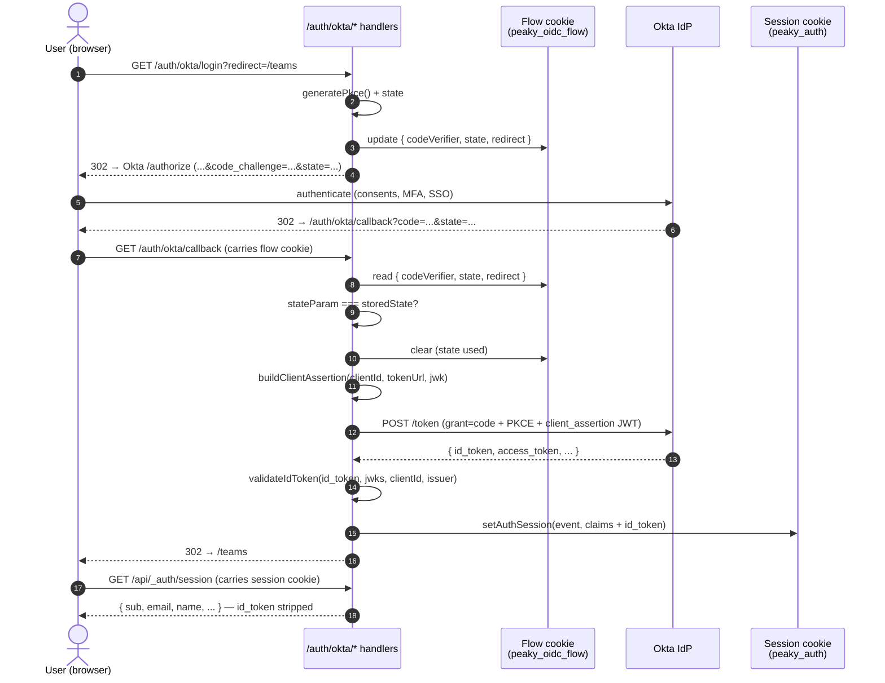
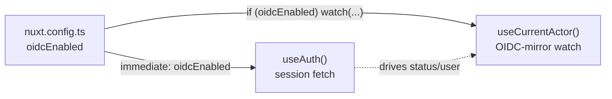

# Authentication — end-to-end

> **TL;DR — Peaky never sends the raw Okta JWT to the browser.** The `id_token` lives only on the server. The browser holds a sealed, encrypted cookie containing the few claims it actually needs (`sub`, `email`, `name`, plus any standard OIDC claims the IdP delivered). `id_token` is intentionally absent from `/api/_auth/session` so it cannot leak to the client bundle or to a curl-style attacker.

This doc complements:

- [Authentication spec](../../../openspec/specs/authentication/spec.md) — the normative WHEN/THEN scenarios.
- [Local-first security walkthrough](./walkthroughs/local-first/security.md) — where the trust boundary sits in the broader local-first threat model.
- [Decision log](./decisions) — the entry for `oidc-okta-auth` summarizes *why* we picked this shape.

If a file in this doc and the spec disagree, the spec wins.

<details>
<summary>In a nutshell</summary>
```
┌──────────────────────────────────────────────────────────────────────────────────────┐
│                              CLIENT BROWSER                                          │
│  • The browser only sees:  Cookie: peaky_auth=<opaque sealed blob>                   │
│  • The client cannot decrypt, read, or tamper with the cookie contents               │
│  • HttpOnly flag prevents JavaScript from accessing the cookie                       │
│  • Secure flag ensures the cookie is only sent over HTTPS                            │
│  • SameSite=Lax prevents the cookie from being forwarded to arbitrary third parties  │
└───────────────────────────────────┬──────────────────────────────────────────────────┘
                                    │
                                    │  sealed cookie travels on every request
                                    ▼
┌──────────────────────────────────────────────────────────────────────────────────────┐
│                                SERVER                                                │
│                                                                                      │
│  ┌────────────────────────────────────────────────────────────────────────────────┐  │
│  │  1. ID TOKEN CLAIMS (received from Okta /token endpoint and validated via JWKS)│  │
│  │                                                                                │  │
│  │     Required fields stored in the session cookie:                              │  │
│  │       • sub, email, name, exp                                                  │  │
│  │                                                                                │  │
│  │     Optional fields stored when Okta provides them:                            │  │
│  │       • ldap_uid, preferred_username, picture, groups, email_verified, etc.    │  │
│  │                                                                                │  │
│  │     The raw id_token is also stored server-side inside the sealed cookie       │  │
│  │     for RP-initiated logout (id_token_hint) but is never exposed to the client.│  │
│  └──────────────────────────────────┬─────────────────────────────────────────────┘  │
│                                     ▼                                                │
│  ┌────────────────────────────────────────────────────────────────────────────────┐  │
│  │  2. enforceCookieBudget(session)                                               │  │
│  │                                                                                │  │
│  │     • JSON.stringify the payload, then measure UTF-8 bytes with TextEncoder    │  │
│  │     • Input budget: COOKIE_BUDGET_BYTES = 3000 bytes                           │  │
│  │     • If the payload exceeds the budget, drop optional fields in order:        │  │
│  │         id_token → picture → groups → preferred_username → ldap_uid           │  │
│  │                 → given_name → family_name → email_verified                   │  │
│  │     • If the required fields {sub, email, name, exp} still exceed the budget,  │  │
│  │       the server throws an explicit error rather than sealing an oversized     │  │
│  │       cookie.                                                                  │  │
│  └──────────────────────────────────┬─────────────────────────────────────────────┘  │
│                                     ▼                                                │
│  ┌────────────────────────────────────────────────────────────────────────────────┐  │
│  │  3. H3 useSession seals the payload into an encrypted/signed cookie            │  │
│  │                                                                                │  │
│  │     • Secret: NUXT_OIDC_SESSION_SECRET (server-only, never exposed)            │  │
│  │     • Algorithm: HMAC-SHA256 via iron-webcrypto                                │  │
│  │     • Output: base64-encoded sealed blob with an integrity tag                 │  │
│  │     • Cookie name: peaky_auth                                                  │  │
│  │     • Max age: 24 hours (the exp claim is also checked on every read)          │  │
│  │     • Flags: HttpOnly, Secure in production, SameSite=Lax                      │  │
│  └──────────────────────────────────┬─────────────────────────────────────────────┘  │
│                                     ▼                                                │
│     Set-Cookie: peaky_auth=<sealed blob>                                             │
└───────────────────────────────────┬──────────────────────────────────────────────────┘
                                    │
                                    │  sealed cookie returned on every request
                                    ▼
┌──────────────────────────────────────────────────────────────────────────────────────┐
│     H3 decrypts and verifies the cookie with the same NUXT_OIDC_SESSION_SECRET       │
│     Any tampering or decryption attempt without the secret fails HMAC verification   │
│     and the server treats the request as unauthenticated.                            │
└──────────────────────────────────────────────────────────────────────────────────────┘

     NOTES
     - The raw id_token is stored inside the sealed cookie for server-only
       logout (id_token_hint), but is NEVER sent to the client.
     - The client can only see the public user claims returned by
       /api/_auth/session, which is a separate, filtered JSON response.
     - Any tampering with the cookie bytes fails HMAC verification and the
       server treats the request as unauthenticated.

```text
</details>

## 1. Front-channel vs. back-channel

OIDC's two faces:

- **Front-channel** — the browser. Carries `code`, `state`, and PKCE `code_verifier` (in a cookie, not the URL). All values here are short-lived and rotated.
- **Back-channel** — server-to-server. Carries the JWT client assertion and the access/id token. The raw `id_token` never crosses a wire the browser touches.



The sealed `peaky_auth` cookie carries two flags the browser is never told about: the `exp` claim (driven by the ID token's `exp`, capped at 24h) and `id_token` itself (server-only, used as `id_token_hint` on RP-initiated logout).

---

## 2. The sealed cookie

### 2.1 What goes in

The cookie name is `peaky_auth`. Its payload's *required* fields:

| Field   | Type   | Source                          |
| ------- | ------ | ------------------------------- |
| `sub`   | string | ID token `sub`                  |
| `email` | string | ID token `email` (default `""`) |
| `name`  | string | ID token `name` (default `""`)  |
| `exp`   | number | ID token `exp` (Unix seconds)   |

It also carries optional fields when the IdP delivers them: `given_name`, `family_name`, `email_verified`, `preferred_username`, `ldap_uid`, `picture`, `groups`. All standard OIDC claims; absence is not an error.

### 2.2 What does NOT go in

- `id_token` itself — server-only. Stored in the cookie payload, but **filtered out** before any HTTP response from `/api/_auth/session` returns. The client never has it.
- The client's `access_token` and `refresh_token` — never requested. Peaky only needs identity, not API tokens; the OIDC `openid` scope is enough.

### 2.3 Cookie hardening

Defined in `server/utils/auth/session.ts`:

```text
name:           peaky_auth
password:       NUXT_OIDC_SESSION_SECRET (HMAC-SHA256 seal)
maxAge:         60 * 60 * 24       // 24h
httpOnly:       true
secure:         NODE_ENV === "production"
sameSite:       "lax"
```

`httpOnly` keeps the cookie out of `document.cookie` so XSS can't exfiltrate it. `sameSite=lax` (not `strict`) so Okta's `end_session_endpoint` redirect chain isn't blocked.

### 2.4 Cookie size budget

H3's `useSession` seals with HMAC-SHA256 and adds ~30% overhead, so a 4 KB browser per-cookie ceiling leaves a ~3 KB JSON budget. The cookie can blow the budget when `id_token` + `picture` + a wide `groups[]` arrive together.

The helper `enforceCookieBudget()` in `server/utils/auth/cookie-budget.ts` is a pure function that drops optional fields in a deterministic priority order until the payload fits:

```text
id_token → picture → groups → preferred_username → ldap_uid
       → given_name → family_name → email_verified
```

The four required fields (`sub`, `email`, `name`, `exp`) are never dropped. If even those overflow (a million-character name due to malicious IdP config) the function throws and `setAuthSession` aborts the request — no oversized cookie is ever sent.

When `id_token` is dropped, the user falls back to *local-only* logout: the Okta SSO cookie stays valid until Okta's own expiry, but the `peaky_auth` cookie is cleared so the user's Peaky session ends. This is preferred over letting the browser surface `ERR_COOKIE_SIZE`.

---

## 3. Why a sealed cookie, not the raw JWT

Three reasons:

1. **No XSS exfil path.** A raw JWT in `localStorage` or a non-HttpOnly cookie is one `document.cookie` away from being stolen. An HttpOnly sealed cookie can't be read by any script in the page.
2. **No CSP or Sec-Cookie caveats.** The browser can't see the cookie, so we don't have to add `HttpOnly-Policy`, `SameSite`, or `Secure` tokens to a token we don't actually want clients to touch. Tokens the server reads but the client never sees have a much smaller trust surface.
3. **The client doesn't need it.** All the client wants is "who is the current user?". The claims we expose are stable identity fields the user can read in DevTools to confirm their session; everything else stays server-side.

The cost is the cookie budget (~3 KB), defended exhaustively in `server/utils/auth/cookie-budget.ts` + the unit suite in `tests/unit/server/utils/auth/session.test.ts`.

---

## 4. The OIDC client

### 4.1 `private_key_jwt` — no shared secret

`client_secret_basic` would have required PE to provision a shared client secret to enumerate as a Vercel env var. We don't. Instead Peaky uses `private_key_jwt`:

- PE generates the RSA key pair.
- PE registers the *public* half as a JWK in the Okta application's "Client authentication" settings.
- PE delivers the *private* half to us as a JWK JSON blob (paste verbatim into `NUXT_OIDC_OKTA_PRIVATE_KEY`).

`server/utils/auth/okta.ts:buildClientAssertion()` signs an RS256 JWT carrying `{ iss: clientId, sub: clientId, aud: tokenUrl, exp: now+5m, jti: uuid }`. The assertion lives for ≤ 5 minutes (RFC: client assertion expiry ≤ 5 minutes is the OAuth 2.0 recommendation). No shared secret ever crosses the wire.

### 4.2 Request-origin `redirect_uri`

`redirect_uri` is derived from `getRequestURL(event).origin`, not from `NUXT_PUBLIC_BASE_URL`. Why: Vercel preview deploys and local dev share one codebase with three different origins; an env-var fallback produced the first Vercel preview `redirect_uri mismatch` Okta error.

`server/routes/auth/okta/{login,callback}.get.ts` both compute `${origin}/auth/okta/callback` from the request. Logout deliberately uses `NUXT_PUBLIC_BASE_URL` because the IdP-side redirect runs in the user's browser after they leave our app — it must come from a trusted source, not from a request we no longer own.

### 4.3 Endpoint discovery via `.well-known/openid-configuration`

`server/utils/auth/discovery.ts:discoverOktaUrls(domain)` fetches `${domain}/.well-known/openid-configuration` on first use, caches per-domain in a module-level `Map<string, Promise<OktaUrls>>`. Concurrent first-call callers share one in-flight Promise; rejections are evicted so transient failures stay retryable. The fetch carries `AbortSignal.timeout(5000)` so a slow Okta origin fails fast rather than stalling Nitro's event loop.

The legacy Okta org (`sso.adyen.com`) provisions `/oauth2/v1/...` URLs; Custom Authorization Servers use `/oauth2/default/v1/...`. The mapping code in `discoverOktaUrls` adapts to either shape — no consumer knows or cares which one Okta gave us.

### 4.4 PKCE

`server/utils/auth/pkce.ts:generatePkce()` produces a 32-byte `code_verifier` and its SHA-256 base64url `code_challenge` using `crypto.subtle`. PKCE protects the front-channel: an attacker who intercepts the `code` query param from the redirect above cannot exchange it without the `code_verifier` they don't have.

The verifier lives in a separate `peaky_oidc_flow` cookie for the 10-minute round-trip:

```text
name:     peaky_oidc_flow
maxAge:   60 * 10            // 10 minutes
httpOnly: true
sameSite: "lax"              // Strict would block the IdP-side redirect back
```

It is cleared on callback success and on `state` mismatch — both leave a 400 to the browser.

### 4.5 Scope

The login redirect requests `openid email profile groups`. The `groups` claim is what `useCurrentActor.projects()` reads to derive the `admin` lifecycle role — without that scope, every actor projects to `["member"]` because PE's IdP does not emit `groups` by default.

---

## 5. The session API

`server/api/_auth/session.get.ts` is the only identity endpoint the client composable calls:

```text
GET /api/_auth/session
→ 200 { sub, email, name, given_name?, family_name?, email_verified?,
        preferred_username?, ldap_uid?, picture?, groups? }
→ 401 (no session or expired)
```

The handler explicitly excludes `id_token` from the response payload. It also re-runs the `exp` short-circuit on read (in case the cookie is still on disk but its `exp` is past) — see `server/utils/auth/session.ts:getAuthSession`.

The `useAuth()` composable calls this endpoint lazily, server-side disabled (`useFetch(..., { lazy: true, server: false })`), so the app shell renders before the session resolves.

The fetch is also gated on `immediate: oidcEnabled`: when OIDC is not configured, the endpoint always 401s, so `useAuth()` skips the call entirely instead of firing a doomed request on every page load. One flag, two gated call sites:



Skipping the fetch means `useCurrentActor`'s OIDC-mirror watch never runs either, so it can't clear the locally persisted actor on a terminal session error — see [issue #89](https://gitlab.is.adyen.com/containers/rtf/peaky/-/issues/89) and the local actor picker in `ProfileModal.vue`. Normative behavior lives in [Authentication spec § Local Development Without OIDC](../../../openspec/specs/authentication/spec.md) (rationale for the gate itself lives in that composable's doc comment; not repeated here).

---

## 6. Trust hierarchy on the server

`server/utils/lifecycleActor.ts:getLifecycleActor(event)` is the single point where every server-side authorization check resolves identity. The hierarchy is:

1. **Sealed OIDC session** (read via `getAuthSession`). The IdP-issued claims are the source of truth; the actor's `id` = `sub`, `name` = `name ?? preferred_username ?? email ?? sub`, `roles` = `[isAdmin ? "admin" : "member"]` from the `groups` claim against `ADMIN_LIFECYCLE_GROUPS` (`{ peaky-admins, peaky-admin }` — the generic tenant-wide `admin` group is intentionally excluded to avoid cross-app privilege inheritance).
2. **Client-supplied `x-actor-*` headers** — only as a fallback when OIDC is not configured (dev / tests / e2e paths). In production, or when `isOidcEnabled(event)` is true but no session is present, the function fails closed with a 401 instead of returning an anonymous `member` actor.

The 401 fail-closed branch is the B-1 closure that landed in this MR — and it was the whole reason this mint was non-trivial. The original placeholder trusted client-supplied headers as the source of truth for identity; the Local Admin Self-Claim toggle (see [Authentication spec](../../../openspec/specs/authentication/spec.md)) made that gap reachable in production.

---

## 7. Logout and `id_token_hint`

RP-initiated logout (RPL) is `OK + ${OIDC_OKTA_LOGOUT_URL} + id_token_hint + post_logout_redirect_uri`. The IdP authenticates the logout with `id_token_hint` (otherwise Okta returns HTTP 400 for RPL when `post_logout_redirect_uri` is set) and bounces the user back to `/auth/login`.

The `peaky_auth` cookie keeps the raw `id_token` purely so that `logout.get.ts` can read it before clearing the session. After the redirect fires:

- The Okta SSO cookie in the user's browser remains valid until Okta's own expiry (~24h).
- The `peaky_auth` cookie is cleared, so any further Peaky request is anonymous.

When `oidcOktaLogoutUrl` is unset (or `NUXT_PUBLIC_BASE_URL` is unset / fails the `https:` check in production), `logout.get.ts` falls through to local-only sign-out — same destination, no Okta round-trip. Acceptable for Beta; documented at the call site.

---

## 8. Local dev bypass — `/auth/dev/login`

When you want a fake session without standing up a real Okta tenant, set *only* `NUXT_OIDC_SESSION_SECRET` (48+ chars) and visit:

```text
GET /auth/dev/login?redirect=/teams
```

The route checks `NODE_ENV`, returns 404 in production, and otherwise seals a `{ sub: "dev-user", email: "dev@peaky.local", name: "Local Dev" }` session and redirects. No IdP round-trip. Required env vars for the full Okta flow (DOMAIN, CLIENT_ID, PRIVATE_KEY, SESSION_SECRET) are listed in `.env.example`.

Note that the dev-bypass session deliberately does not write an `id_token`, so a subsequent `/auth/okta/logout` falls through to local-only sign-out (no Okta SLO redirect) — see `logout.get.ts`.

---

## 9. `[AUTH-DEBUG]` dev-only env-gated log

Three handlers emit `[AUTH-DEBUG]` lines when `NUXT_OIDC_AUTH_DEBUG=1`. Off by default; the env var must be set explicitly.

```text
server/routes/auth/okta/callback.get.ts   → raw decoded id_token claims (signature-agnostic)
server/api/_auth/session.get.ts           → server-filtered session payload (no id_token)
server/api/_auth/debug.get.ts             → both, plus the full AuthSession incl. id_token
```

Together they let a PE round-trip verify (1) the IdP emitted what we expect, (2) the server boundary strips what it should, (3) no PII leaks into the client bundle. Set the env var, replay a login, compare the three dumps.

A pre-existing `/api/_auth/debug` route is gated by `NUXT_OIDC_AUTH_DEBUG === "1" && NODE_ENV !== "production"` in `server/utils/auth/debug-gate.ts:debugEnabled()`. Bounded dev convenience; slated for removal once PE settles the OIDC contract.

---

## 10. Failure modes

| Symptom                                                            | Cause                                                                                   | Where the failure surfaces              | Operator action                                                                            |
| ------------------------------------------------------------------ | --------------------------------------------------------------------------------------- | --------------------------------------- | ------------------------------------------------------------------------------------------ |
| `/auth/okta/login` 503 `OIDC not configured`                       | One of `NUXT_OIDC_OKTA_{DOMAIN,CLIENT_ID,PRIVATE_KEY,SESSION_SECRET}` unset             | `login.get.ts:18-32`                    | Set missing env var (Vercel dashboard)                                                     |
| `/auth/okta/callback` 502 `OIDC discovery failed`                  | First call to `discoverOktaUrls` after deploy times out (5 s) or the IdP is unreachable | `discovery.ts:32-50`                    | Verify IdP health; first request retries are non-cached rejections are evicted             |
| `/auth/okta/callback` 502 `Token exchange failed`                  | Okta rejected the client assertion (key mismatch, expired token URL, wrong audience)    | `callback.get.ts:90-110`                | Check that the public JWK in Okta matches the private half in `NUXT_OIDC_OKTA_PRIVATE_KEY` |
| `/auth/okta/callback` 400 `State mismatch — possible CSRF attempt` | The `state` in the URL doesn't match the flow cookie                                    | `callback.get.ts:69-77`                 | Replay the login; user-in-flight swizzling or cookie wiped                                 |
| `[AUTH-DEBUG] post-trim payload still exceeds cookie budget`       | All droppable fields dropped but required four still overflow the cookie                | `session.ts:setAuthSession`             | Inspect IdP claim size (e.g., a 10 KB `name` field); not a normal-path failure             |
| Use of legacy `x-actor-*` headers in production                    | New server-side code asking for legacy trust                                            | `lifecycleActor.ts:140-146` returns 401 | Use the sealed session; the headers are dev/e2e-only since this MR                         |

The OIDC contract is "log in once, survive 24 hours, log out and never come back". Every failure mode above is the path *away* from that contract — none are silent, every one is logged at the server boundary.

---

## 11. Failure contract (one-liners)

- **OIDC not configured** → login returns HTTP 503, session API returns HTTP 401, clients render the unauthenticated state.
- **Discovery times out** → login and callback return HTTP 502; the user sees a server error banner.
- **State mismatch** → callback returns HTTP 400; the user is bounced back to `/auth/login` for a fresh attempt.
- **Cookie size overflow** → setAuthSession throws before the response is sent; the callback 502s on the way out, the user lands on `/auth/login` again.
- **Diagnostic dump needed** → set `NUXT_OIDC_AUTH_DEBUG=1` in the Vercel preview env, replay the login flow, send the three `[AUTH-DEBUG]` blocks to PE.

---

## 12. Key files

| Concern                             | File                                                                 |
| ----------------------------------- | -------------------------------------------------------------------- |
| Login redirect                      | `server/routes/auth/okta/login.get.ts`                               |
| Token exchange + session sealing    | `server/routes/auth/okta/callback.get.ts`                            |
| Logout / SLO                        | `server/routes/auth/okta/logout.get.ts`                              |
| Dev-only bypass                     | `server/routes/auth/dev/login.get.ts`                                |
| Session API (client-facing)         | `server/api/_auth/session.get.ts`                                    |
| Session seal + cookie budget        | `server/utils/auth/session.ts`, `server/utils/auth/cookie-budget.ts` |
| PKCE                                | `server/utils/auth/pkce.ts`                                          |
| Flow cookie (state, codeVerifier)   | `server/utils/auth/flow.ts`                                          |
| Endpoint discovery                  | `server/utils/auth/discovery.ts`                                     |
| Client assertion + ID token verify  | `server/utils/auth/okta.ts`                                          |
| Server-side trust hierarchy         | `server/utils/lifecycleActor.ts`                                     |
| Runtime config + `oidcEnabled` flag (gates §5's two call sites) | `nuxt.config.ts`                                         |
| Client composable                   | `app/composables/useAuth.ts`                                         |
| Lifecycle actor (server + client)   | `app/composables/auth/useCurrentActor.ts`                            |
| Normative spec                      | `openspec/specs/authentication/spec.md`                              |
| Archived change (history)           | `openspec/changes/archive/2026-06-30-oidc-okta-auth/`                |

The contract that's *not* in code is in [decisions.md *oidc-okta-auth*](./decisions) — the entries for `nu-oidc-auth` and `delete-nu-oidc-auth`-style decisions explain why we didn't use `nuxt-oidc-auth` (it doesn't support `private_key_jwt`), why sessions are seal-only and stateless (so the same code runs on Vercel and AWS Amplify without a Redis dependency), and what the Local Admin Self-Claim placeholder is doing in the interim.
