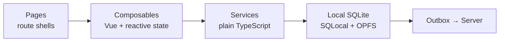

# Maintainer documentation

We build Peaky as a local-first readiness tool. This section is for engineers contributing to or operating it.

Pages are thin. Composables are Vue glue — reactive state, no SQL. Services are plain TypeScript with no Vue imports — testable without mounting anything. Everything writes to browser SQLite first; the outbox drives background sync to the server.

## Where to start

<!-- markdownlint-disable -->

-   :material-compass-outline:{ .lg .middle } **New to the codebase?**

    ---

    Start with [Setup](./setup), then [Architecture](./walkthroughs/codebase/architecture) and [Domain model](./walkthroughs/codebase/domain) for the mental model.

    [:octicons-arrow-right-24: Codebase walkthroughs](./walkthroughs/codebase/)

-   :material-source-branch:{ .lg .middle } **Adding a feature?**

    ---

    Worked examples end-to-end, `make mr` quality gate, contribution checklist. Check [Events](./walkthroughs/codebase/events) if you need a new event type.

    [:octicons-arrow-right-24: Contributing walkthrough](./walkthroughs/codebase/contributing)

-   :material-history:{ .lg .middle } **Back after time away?**

    ---

    5-minute reading map to rebuild context. Skim the [Decision log](./decisions) for what changed.

    [:octicons-arrow-right-24: Codebase reading map](./walkthroughs/codebase/)

-   :material-presentation-play:{ .lg .middle } **Learning how the team works?**

    ---

    Start with the interactive guide to Peaky's product loop, development workflow, review floor, and onboarding practice.

    [:octicons-arrow-right-24: Team explainers](./explainers)

-   :material-database-search-outline:{ .lg .middle } **Debugging sync or persistence?**

    ---

    [Failure domains](./walkthroughs/local-first/failure-domains) for the on-call scan map. [Upgrades](./walkthroughs/local-first/upgrades) for migration rollout and recovery.

    [:octicons-arrow-right-24: Local-first series](./walkthroughs/local-first/)

<!-- markdownlint-enable -->

## Tech stack

| Layer | Technology |
|-------|------------|
| Framework | Nuxt 4, Vue 3 |
| UI library | NuxtUI v4, Tailwind CSS v4 |
| Local database | SQLite WASM + OPFS via SQLocal, Drizzle ORM |
| Nuxt server | Nitro (built into Nuxt) — page rendering and Nuxt API routes |
| Sync backend | Go (`peaky-api`) — push/pull/bootstrap, HLC conflict resolution; PostgreSQL 17 |
| SSE fan-out | Go (`peaky-sse`) — PG LISTEN/NOTIFY → Server-Sent Events; reduces sync latency to network RTT |
| Infrastructure | AWS ECS Fargate — `peaky-api` + `peaky-sse` as separate task definitions |
| Testing | Vitest (unit + integration), Playwright (E2E), Go `testing` package (in-memory fakes) |
| Quality gate | `make mr` — TS lint → docs → typecheck → audit → unit → Go fmt/vet/tests |

## Conventions at a glance

| Topic | Guide |
|-------|-------|
| Vue and Nuxt patterns | [vue.md](./vue) |
| TypeScript patterns | [typescript.md](./typescript) |
| UI design system | [visual-design.md](./visual-design) |
| Testing strategy and TDD | [testing.md](./testing) |
| Architectural decisions and why | [decisions.md](./decisions) |
| Domain event catalog and schema | [events/](./events/) |
| Authentication end-to-end (OIDC) | [authentication.md](./authentication) |

## Walkthroughs

Two series cover the system in depth. The **[codebase series](./walkthroughs/codebase/)** covers the six layers, domain model, authorization, typed events, UI patterns, and contribution process. The **[local-first series](./walkthroughs/local-first/)** covers the persistence runtime, sync protocol, security threat model, auditing, failure domains, and client schema migration rollout.

If a convention file here and a walkthrough disagree, the walkthrough is authoritative.

## For agents

Read `AGENTS.md` first — it has mandatory rules and make commands. The walkthroughs are the source of truth for architecture; don't duplicate their content in new files.

Before writing code:

- Check `decisions.md` to avoid re-solving solved problems
- New mutation → service class + composable + typed domain event (see [Events](./walkthroughs/codebase/events))
- Schema change → migration file required — see the SQLite migration rules in `AGENTS.md`
- UI work → review [vue.md](./vue) and [visual-design.md](./visual-design) first

Reviewers available: `rtf-vue-reviewer`, `rtf-typescript-reviewer`,
`rtf-security-reviewer`, `rtf-docs-dev-reviewer`, and
`rtf-docs-product-reviewer`.
