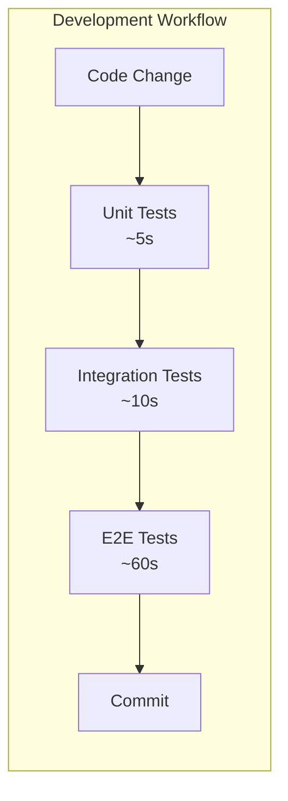
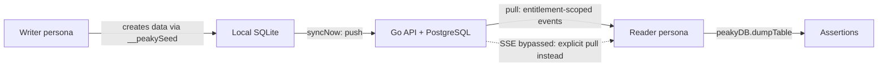

# Testing Guide

## TDD: Red/Green/Refactor

Follow test-driven development when implementing features (frontend, backend, composables, utilities, etc.):

```text
┌─────────────────────────────────────────────────────────────┐
│                    RED → GREEN → REFACTOR                   │
├─────────────────────────────────────────────────────────────┤
│                                                             │
│   1. RED     Write a failing test that defines expected     │
│              behavior. Run it - it MUST fail.               │
│                                                             │
│   2. GREEN   Write minimal code to make the test pass.      │
│              No more, no less. Run test - it MUST pass.     │
│                                                             │
│   3. REFACTOR  Clean up the code (extract, rename, etc.)    │
│                while keeping the test green.                │
│                                                             │
│   Repeat for each behavior/scenario.                        │
│                                                             │
└─────────────────────────────────────────────────────────────┘
```

**Key principles:**

- Tests guide implementation, not the other way around
- Never change a test to make it pass - change the implementation
- Each cycle should be small (minutes, not hours)
- Commit after each green phase

**Anti-patterns to avoid:**

- Writing implementation first, then tests to match
- Writing multiple tests before any implementation
- Changing test assertions to match buggy behavior
- Skipping the refactor phase

## Test Strategy Overview

Peaky uses a three-tier testing strategy where each tier has a distinct job:



### The testing pyramid

| Tier | Speed | What it tests | What it does NOT test |
|------|-------|---------------|----------------------|
| **Unit** | Milliseconds per test | Pure functions, domain logic, composable state machines, component rendering | I/O, API calls, database, cross-module integration |
| **Integration** | Seconds per suite | Nitro API handlers with stubbed globals and in-memory data stores | Browser rendering, real HTTP, E2E user flows |
| **E2E** | Seconds per test | Full browser user journeys through the real app | Internal implementation details |

### When to write which test

- **Unit test** when: the function is pure (no I/O), has branching logic, and can be tested with just inputs and outputs. Examples: `RetryPolicy.isRetryable()`, `ReviewProjection.buildPillars()`, `stripMarkdown()`, `formatEventTime()`.
- **Integration test** when: the code is a Nitro API handler that reads params/body, validates input, and returns a response. These stub Nitro globals but exercise the full handler logic including data store mutations.
- **E2E test** when: you need to verify a user journey across multiple pages/components, or test behavior that depends on browser APIs (OPFS, service workers, local-first writes).

### What makes a good unit test

Unit tests run on every change and must be fast, isolated, and deterministic:

- **Fast**: No I/O (no database, no filesystem, no network). Import the function and call it.
- **Deterministic**: Same input = same output. Use `vi.useFakeTimers()` for time-dependent code, `vi.spyOn(Math, 'random')` for jitter.
- **Isolated**: No shared mutable state. No global stubs. Tests can run in any order or in parallel.
- **Tests real code**: Import the production function — never re-implement logic in the test file.

**Anti-patterns** (each of these caused real failures caught during audit):

| Anti-pattern | Why it's wrong | Real example |
|---|---|---|
| Testing a local copy of production code | Test passes forever while production diverges | `markdown-export.test.ts` defined its own `templateToMarkdown()` — never imported the real one |
| Testing language features (`typeof`, no-op stubs) | Tests JavaScript, not your application | `reactive.test.ts` asserted `typeof insert === "function"` on a no-op stub |
| Real I/O in unit tests (SQLite, `$fetch`) | Breaks isolation, flaky in CI, slow | `migrations.test.ts` opened real SQLite; `useBulkActions.test.ts` made real network calls |
| Wall-clock `new Date()` without fake timers | Flakes at day/month boundaries | `EntitlementService.test.ts` offline-window tests could flip at midnight |
| Mounting Vue components in unit suite | Integration test in disguise, slow setup | `usePillarNotes.test.ts` used `@testing-library/vue` with 2 mocked services |
| Non-deterministic randomness assertions | "Run 20 times and check variance" is inherently flaky | `RetryPolicy.test.ts` jitter tests relied on statistical uniqueness |

**Rule of thumb**: If a test file has zero imports from `app/` or `shared/`, it's testing JavaScript, not your application. Delete it.

### Fixing common violations

**Time-dependent code** — pin the clock:

```typescript
const FIXED_NOW = new Date("2026-03-26T10:00:00.000Z");
beforeEach(() => { vi.useFakeTimers(); vi.setSystemTime(FIXED_NOW); });
afterEach(() => { vi.useRealTimers(); });
```

**Randomness-dependent code** — pin `Math.random`:

```typescript
vi.spyOn(Math, "random").mockReturnValue(0.5);
// Now assert exact values, not statistical distributions
expect(policy.getDelay(2)).toBe(2000); // deterministic
```

**Network calls in unit tests** — stub `$fetch`:

```typescript
beforeEach(() => { vi.stubGlobal("$fetch", vi.fn().mockRejectedValue(new Error("mocked"))); });
afterEach(() => { vi.unstubAllGlobals(); });
```

**Tests that mount components** — move to `tests/nuxt/` (integration suite with Nuxt environment), not `tests/unit/ui/` (unit suite).

## Test Types

| Type | Location | Command | Purpose |
|------|----------|---------|---------|
| Unit Tests | `tests/unit/**` | `make test` | Test pure functions, composables, and component rendering |
| Integration Tests (Nitro handlers) | `tests/nuxt/api/` | `make test` | Test API handlers with stubbed Nitro globals |
| Integration Tests (selected) | `tests/integration/` | `make test:integration` | Test SQLite migrations and sync API contracts in Node |
| E2E Tests | `tests/e2e/*.spec.ts` | `make test:e2e` | Test user journeys end-to-end |
| Sync-Stack E2E (gated) | `tests/e2e/sync-scoped-pull.spec.ts` | `make test:e2e:sync` | Test pull scoping across personas (requires `make watch`) |
| Accessibility Tests | `tests/e2e/a11y/` | `make test:a11y` | axe-core WCAG compliance checks |

### Vitest configuration

The main suites use separate configs because `@nuxt/test-utils` does not support the `projects` feature in `defineVitestConfig`:

- **`vitest.config.ts`** — fast tests (unit + Nitro handler integration). Includes `tests/unit/**` and `tests/nuxt/**`.
- **`vitest.integration.config.ts`** — selected Node integration tests for SQLite migrations and sync API contracts. Full-server files are not selected by this config.
- **`vitest.threat-model-drift.config.ts`** — Node-only pre-commit runner for the filesystem-based threat-model guard. The same guard remains part of the main suite.

### Template/Revision persistence and boundary tests

The stable Template/Revision model needs behavior tests at each authority and freeze boundary:

- **SQLite upgrade** starts from migration 0015, seeds every enumerated Template/Review domain, audit, outbox, pending-review, field-history, entitlement, and preserved data class, then proves migration 0016 removes only the approved manifest. Products, Teams, catalog data, cursors, migration logs, and unrelated events remain unchanged.
- **PostgreSQL upgrade** starts from Goose 007 and proves Goose 008 resets the applicable Template/Review domain, audit, and generic sync rows without broad `CASCADE`; unrelated Product, Team, cursor, migration, and sync rows remain.
- **Fresh and upgraded persistence** exercises the same accepted/rejected Template/Revision constraints through `services/schema.sql`, Goose, the hand-written SQLite Drizzle schema, and registered SQLite migrations. Do not test or run the non-authoritative PostgreSQL-to-Drizzle converter.
- **Local authoring** proves one atomic state write through `LocalMutation.localOnly()` with no event, outbox row, push trigger, or legacy/new Template entity emission.
- **Publication and lifecycle** prove controls are absent or calls return HTTP 503/code `template_write_unavailable` with zero state, event, outbox, fixture, or timestamp writes.
- **Review selection** accepts one to three exact current published Revisions from distinct active Templates and rejects invalid, draft, retired, archived-parent, duplicate, non-contiguous, or out-of-range selections without partial rows. These tests make no cross-client transport claim.
- **Improvement Plan** asserts the exact rollup key `${templateRevisionId}::${questionId}` and keeps equivalent Questions in different Revisions separate.

## Test Data: Seeding and Factories

### Unit tests: inline fixtures

Unit tests create minimal test data inline. No seed files, no shared state:

```typescript
// Good: minimal inline fixture
const actor = { id: "user-1", roles: ["admin"] };
expect(isReviewAdmin(actor)).toBe(true);
```

### Integration tests: shared helpers and factories

Nitro handler tests use shared helpers from `tests/nuxt/helpers/`:

- **`nitro.ts`** — `setupNitroStubs()` installs Nitro global stubs (`defineEventHandler`, `getRouterParam`, `readBody`, `createError`, etc.) in `beforeAll`/`afterAll`
- **`seed.ts`** — `seedProduct()`, `seedTemplate()`, `seedTeamReview()`, `resetArray()` for creating test data through real handlers

```typescript
import { setupNitroStubs, resetNitroStubs } from "../helpers/nitro";
import { seedProduct, resetArray } from "../helpers/seed";

describe("My handler", () => {
  const stubs = setupNitroStubs();
  beforeEach(() => resetNitroStubs(stubs));

  it("works", async () => {
    stubs.routerParams = { id: "01932b3c-7d00-7000-8000-000000002001" };
    const result = await handler({} as never);
    expect(result).toHaveProperty("id");
  });
});
```

All IDs in integration tests use UUID7 format matching the seed data (e.g., `01932b3c-7d00-7000-8000-000000002001`), never prefixed shorthand like `review-001` or `tpl-001`.

### E2E tests: mutation-based seeding

E2E tests seed data through the app's own mutation functions via `window.__peakySeed`, exposed by a dev-only Nuxt plugin. Event-enabled mutations include the same domain events and outbox entries as production writes. Template draft fixtures are the deliberate exception: current authoring uses `LocalMutation.localOnly()` and installs or edits Template/draft Revision state without events or outbox rows.

```typescript
// tests/e2e/helpers/seed.ts
await seedTemplate(page, {
  name: "[E2E] My local-only draft",
});

await createReview(page, {
  name: "[E2E] My Review",
  subjectId: team.id,
  templateRevisionIds: [PUBLISHED_FIXTURE_REVISION_ID],
});
```

All E2E-created resources are prefixed with `[E2E]` for cleanup traceability.

### Sync-stack e2e: persona-based pull scoping tests

Each persona opens a fresh browser context seeded with `peaky:current-actor` — the server resolves that actor's entitlements during every pull. This verifies the **pull scoping** authorization boundary across multiple browser contexts.

By default the spec is **skipped**. Run it against a `make watch` stack with `PEAKY_E2E_SYNC_STACK=1`.

**Running the tests:**

```bash
# Terminal 1: start the full stack
make watch

# Terminal 2: run the gated sync e2e
make test:e2e:sync

# Headed mode (see browser windows)
make test:e2e:sync EXTRA_ARGS="--headed"

# Verbose step-by-step output
make test:e2e:sync EXTRA_ARGS="--reporter=list"

# Both
make test:e2e:sync EXTRA_ARGS="--headed --reporter=list"
```

**Key files:**

| File | Purpose |
|------|---------|
| `tests/e2e/helpers/personas.ts` | Reusable persona helper: `personaPage()`, `awaitSeedReady()`, `syncNow()`, `expectSees()`, `expectDoesNotSee()`, `PERSONAS` registry |
| `tests/e2e/sync-scoped-pull.spec.ts` | Gated spec: #53 (wildcard cross-family leak), #83 (scoped child ride-along), I3 (single-family sealing) |
| `app/plugins/test-seed.client.ts` | Dev-only bridge exposing `syncNow` on `window.__peakySeed` |

**How it works:**



1. Each persona gets a fresh browser context with `peaky:current-actor` set in localStorage (shape `{id, name, roles}`)
2. `awaitSeedReady()` waits for the seed bridge (`__peakySeed`), local DB (`peakyDB`), and sync scheduler (`peakySyncReady`) before proceeding
3. The writer persona creates data via `__peakySeed` mutations, then calls `syncNow()` to push
4. The reader persona's `expectSees()` polls with `syncNow()` on each iteration to actively pull (background tabs are timer-throttled in headless runs)
5. Assertions check the reader's local SQLite (`peakyDB.dumpTable`) for the expected/unexpected data

!!! warning "What these tests bypass"
    **Tested:** pull predicate — which events the server returns to each actor based on their entitlements.

    **Bypassed:** SSE delivery — we do an explicit `syncNow()` pull instead of waiting for SSE notifications. Headless browser tabs throttle `setTimeout` / `setInterval`, making SSE-based wait times non-deterministic. The explicit pull keeps the test deterministic without adding artificial delays. SSE has its own unit test coverage and can be validated in separate e2e tests.

## E2E Test Best Practices

1. **Use accessible selectors** - `getByRole`, `getByText`, `getByPlaceholder`
2. **Avoid `data-testid`** unless absolutely necessary
3. **Wait for network** - `await page.waitForLoadState("networkidle")`
4. **Wait for animations** - `await page.waitForTimeout(300)` after transitions
5. **Mask dynamic content** in screenshots (timestamps, random IDs)

## Accessibility Testing

NuxtUI components provide built-in ARIA attributes and keyboard navigation. When adding custom components, validate accessibility with axe-core:

- **Playwright**: Use `@axe-core/playwright` in E2E tests to catch contrast/ARIA violations
- **Manual**: Check WCAG-AA contrast (4.5:1 for text, 3:1 for large text) on all interactive elements

## Running Tests

| Command | What it runs | Speed |
|---------|-------------|-------|
| `make test` | Unit tests (`vitest run`) | ~16s |
| `make test:coverage` | Unit tests + coverage report | ~21s |
| `make test:integration` | Integration tests (real Nuxt server) | ~25s |
| `make test:e2e` | E2E browser tests (Playwright, chromium) | ~3m |
| `make test:all` | Unit + integration + E2E + a11y | ~4m |

### Code coverage

Coverage is configured as a **ratchet** — thresholds are set just below current levels to prevent regression. As coverage improves, thresholds should be raised (never lowered).

```bash
# Run tests with coverage report
make test:coverage

# View HTML report
open coverage/index.html
```

**Scope:** Coverage only measures code we unit test (services, composables, utilities, API handlers). Vue components are covered by E2E tests and are excluded from unit coverage metrics.

**Current thresholds:**

| Metric | Threshold | Current |
|--------|-----------|---------|
| Statements | 35% | ~40% |
| Branches | 65% | ~73% |
| Functions | 50% | ~55% |
| Lines | 35% | ~40% |

## Related Guides

- **Quality gates and automation pipeline** — see [Contributing walkthrough](./walkthroughs/codebase/contributing) (`make mr`, git hooks, full pipeline timeline)
- **Security threat model** — see [Local-first Security walkthrough](./walkthroughs/local-first/security) (trust boundary, attack scenarios, mitigations)
- **Authorization rules** — see [Authorization walkthrough](./walkthroughs/local-first/authorization) (entitlements, review access, admin gates)

## CI Considerations

- E2E tests run headless in CI
- `PLAYWRIGHT_BASE_URL` env var configures target URL
