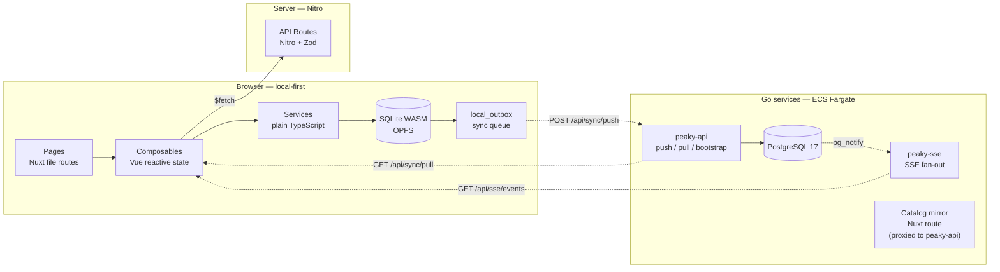
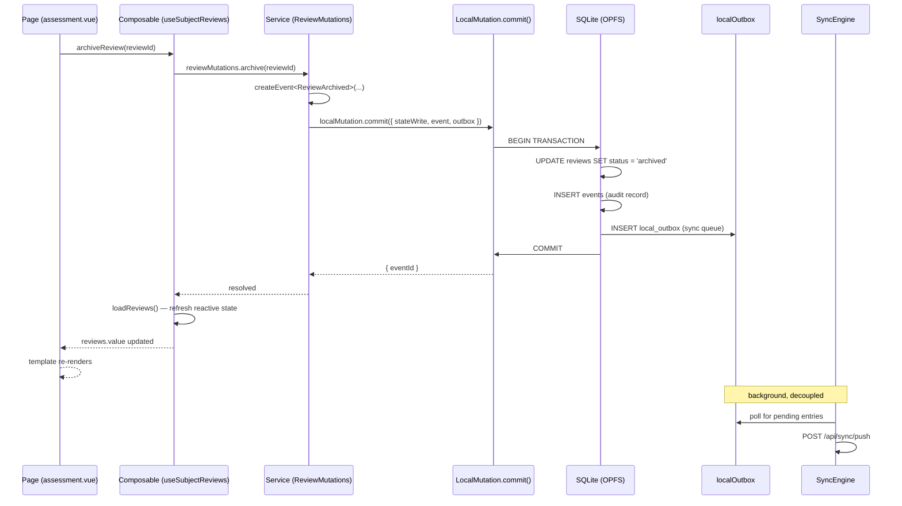
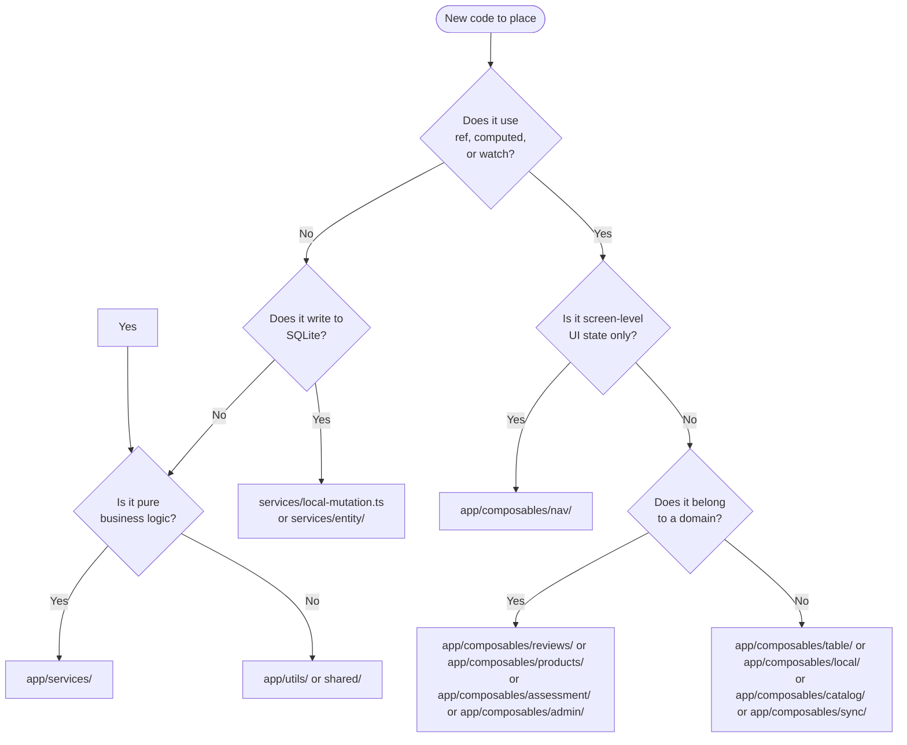

# Codebase Architecture — Walkthrough

This walkthrough explains the six layers of the application, how the service pattern enforces that separation, and what the directory tree looks like from the inside.

Short on time? Start with the [codebase reading map](./).

It is intentionally progressive:

1. understand the six layers and their responsibilities
2. understand what separates a service from a composable
3. walk through the top-level directory tree
4. follow a user action through the full request path
5. use the decision flowchart to place new code in the right layer

---

## 1. The six layers

Every feature in Peaky passes through some or all of these layers. The diagram below shows the browser/server split — everything in the Browser box is client-local; the dashed arrow is the background sync, not a direct call.



| Layer | Responsibility | Primary path |
| --- | --- | --- |
| **Pages** | File-based routes; import composables, pass props to components | `app/pages/` |
| **Composables** | Vue reactive state, lifecycle hooks, calls services and `$fetch` | `app/composables/` — subdirs encode role: `auth/`, `nav/`, `table/`, `local/`, and one folder per domain |
| **Services** | Pure TypeScript business logic; no Vue imports; async class methods | `app/services/` |
| **Local DB** | SQLite WASM via SQLocal; Drizzle schema; OPFS persistence | `app/local-db/`, `shared/db/schema/` |
| **Nuxt server** | Nitro HTTP routes for catalog mirror and Nuxt-rendered pages | `server/api/` |
| **Go backend** | Sync push/pull/bootstrap (peaky-api) and SSE fan-out (peaky-sse); PostgreSQL 17 | `services/` |

Those are different responsibilities, not just different folders. A service method can be called from a composable, a server route handler, or a test — it does not care. A composable cannot be called from a server route, because it depends on Vue's reactivity runtime.

The DB-to-outbox arrow applies only to enabled transports. Stable Template and draft Revision/Pillar/Question authoring uses `LocalMutation.localOnly()` to commit state in SQLite without an event, outbox row, or push trigger. A Template owns stable identity, `active | archived` lifecycle, immutable owning Team, and aggregate provenance; a Revision owns complete content with `draft | published | retired` status and publication provenance. Publication and Template lifecycle writes are unavailable.

Local Review creation stores one to three ordered exact published Revision IDs. Those immutable selection rows are not added to outbox fields, Go validation, inbound replay, or PostgreSQL Review projection by #140; Generic Sync Hardening owns complete transport.

---

## 2. The service pattern

A service is a plain TypeScript class with async methods. The rule is strict: no Vue imports, no `ref`, no `computed`, no `useXxx` calls inside `app/services/`.

```typescript
// app/services/entity/ReviewMutations.ts — a service
export class ReviewMutations {
  async archive(reviewId: string): Promise<void> {
    // plain TypeScript — no Vue dependency
    const event = createEvent<ReviewArchived>(...);
    await localMutation.commit({
      stateWrite: async (tx) => { ... },
      event,
      outbox: { entityType: "review", entityId: reviewId, operation: "update", payload: { ... } },
    });
  }
}

export const reviewMutations = new ReviewMutations();
```

A composable wraps service calls in Vue reactivity:

```typescript
// app/composables/reviews/useSubjectReviews.ts — a composable
export function useSubjectReviews(surface: ReviewSurface, subjectId: MaybeRef<string>) {
  const reviews = ref<ReviewSummary[] | null>(null);
  const pending = ref(false);

  const archiveReview = async (reviewId: string) => {
    await reviewMutations.archive(reviewId); // delegates to service
    await loadReviews(toValue(subjectId));   // refreshes reactive state
  };

  return { reviews, pending, archiveReview };
}
```

The upside of this separation is testability: service logic can be tested with plain `vitest` without mounting anything. The trade-off is that every new mutation path requires two touch points — one in the service, one in the composable — but the discipline pays off when the service needs to be called from a different surface.

---

## 3. Directory tour

=== "Pages & Components"

    ```text
    app/
    ├── pages/                     ← Nuxt file-based routing (thin view layer)
    │   ├── index.vue              ← Overview / dashboard
    │   ├── products/              ← Product routes
    │   │   ├── index.vue
    │   │   ├── new.vue
    │   │   └── [productId]/
    │   │       ├── index.vue
    │   │       └── reviews/[reviewId]/assessment.vue
    │   ├── teams/                 ← Team routes (mirrors product structure)
    │   ├── templates/             ← Template editor routes
    │   ├── events.vue             ← /events — activity feed (member + admin, 403 fallback)
    │   └── system.vue             ← /system — local engine diagnostics (all members)
    │
    ├── components/                ← Reusable Vue components (no route logic)
    │   ├── assessment/            ← Assessment screen components
    │   ├── review/                ← Review card, lifecycle actions
    │   ├── lifecycle/             ← Archive/restore/delete modals
    │   ├── system/                ← /system tiles + emergency banner + maintenance
    │   └── template-studio/       ← Template authoring UI
    │
    ├── models/                    ← Zod schemas + inferred TypeScript types
    ├── lifecycle/                 ← Authorization predicates for destructive ops
    │   └── management.ts          ← canManageProductLifecycle, assertLifecycleConfirmation
    └── ui/                        ← Modal and panel composables (surface state only)
        ├── useNAModal.ts
        ├── usePillarNotes.ts
        ├── useSaveModal.ts
        └── useMoreInfoPanel.ts
    ```

=== "Composables"

    ```text
    app/composables/
    ├── auth/                  ← Auth/identity
    │   └── useCurrentActor.ts ← reads/writes actor from localStorage
    ├── nav/                   ← Screen-level navigation UI state
    │   ├── useCommandPalette.ts
    │   ├── usePageHeader.ts
    │   └── useBreadcrumbs.ts
    ├── table/                 ← Generic table utilities
    │   ├── useFilterState.ts
    │   └── useSortState.ts
    ├── local/                 ← Reactive wrappers over SQLite reads (no mutations)
    │   ├── useLocalReview.ts
    │   ├── useLocalProduct.ts
    │   ├── useLocalTeam.ts
    │   ├── useLocalAnswer.ts
    │   ├── useLocalNote.ts
    │   └── useLocalTemplate{Draft,Drafts,Import,Pillars,Questions}.ts
    ├── assessment/            ← Assessment orchestrator + sub-modules
    │   ├── useAssessment.ts   ← Orchestrator (public API)
    │   ├── useAssessmentFetch.ts
    │   ├── useAssessmentMutate.ts
    │   ├── useAssessmentAnswers.ts
    │   ├── useAssessmentProgress.ts
    │   └── useAssessmentNavigation.ts
    ├── reviews/               ← Review management
    │   ├── useSubjectReviews.ts ← archive/restore/delete + list (shared by product + team)
    │   ├── useReviewData.ts
    │   ├── useReviewSessions.ts
    │   ├── useReviewWorkspace.ts
    │   └── useReviewWizard.ts
    ├── products/              ← Product lifecycle
    │   ├── useProducts.ts
    │   ├── useProductDetails.ts
    │   ├── useProductCreation.ts
    │   ├── useProductFilters.ts
    │   └── useProductDashboardLifecycle.ts
    ├── teams/                 ← Team composables (read-only catalog mirror)
    │   ├── useTeams.ts        ← parallel remote + local merge
    │   ├── useTeamDetails.ts  ← local-first with remote fallback
    │   └── useTeamFilters.ts
    ├── templates/             ← Template authoring
    │   ├── domain/useTemplateCatalog.ts
    │   ├── studio/useTemplateStudio.ts ← singleton state machine
    │   └── storage/useTemplatePersistence.ts
    ├── applications/          ← Application list and filters
    ├── admin/                 ← Events feed UI
    │   ├── useAdminEventsFeed.ts
    │   └── useAdminEventsLiveTail.ts
    ├── system/                ← /system page state derivation
    │   └── useSystemStatus.ts ← Database/Schema/Storage/Sync tiles
    ├── catalog/               ← External catalog (users, groups, components)
    │   ├── useCatalogMirrorResource.ts ← base: eager-load + idle scheduling
    │   ├── useCatalogUserSearch.ts
    │   ├── useCatalogGroupSearch.ts
    │   └── useCatalogComponentSearch.ts
    └── sync/                  ← Sync infrastructure
        ├── useSyncClient.ts          ← SyncEngine Vue adapter (30 s poll)
        └── usePendingReviewQueue.ts  ← conflict-resolution queue
    ```

=== "Services & Runtime"

    ```text
    app/
    ├── services/              ← Plain TypeScript — no Vue imports (testable in isolation)
    │   ├── entity/            ← Per-entity mutation services
    │   │   ├── ReviewMutations.ts
    │   │   ├── ProductMutations.ts
    │   │   ├── TeamMutations.ts   ← fetchAll/fetchById only (read-only entity)
    │   │   ├── AnswerMutations.ts
    │   │   ├── NoteMutations.ts
    │   │   └── AttachmentMutations.ts
    │   ├── review/            ← Review read logic + governance
    │   │   ├── ReviewRepository.ts
    │   │   ├── ReviewHydration.ts ← merge remote + local SQLite data
    │   │   └── ReviewGovernance.ts
    │   ├── sync/
    │   │   ├── SyncEngine.ts
    │   │   └── RetryPolicy.ts
    │   ├── local-db/
    │   │   └── StorageMonitor.ts  ← OPFS quota + stale-row health checks
    │   └── local-mutation.ts  ← `commit` (state + event + outbox) and `localOnly` (state only)
    │
    ├── admin/                 ← Plain TS support for the events feed (not composables)
    │   ├── events.ts          ← AdminEventRecord types + event class hierarchy
    │   ├── formatters.ts
    │   └── localEvents.ts     ← fetchLocalAdminEvents(): local_outbox + events → AdminEventRecord[]
    │
    ├── catalog-directory-mirror/  ← External catalog fetch + deduplication
    │   ├── local.ts
    │   ├── mappers.ts
    │   ├── groups.ts
    │   └── scoped-entities.ts
    │
    ├── local-db/              ← SQLocal wrapper, withDatabase, createUuidV7, nowISO
    └── plugins/
        ├── commandPalette.client.ts
        └── local-db.client.ts ← SQLite WASM bootstrap, error recovery overlay
    ```

=== "Server & Shared"

    ```text
    server/
    ├── api/                   ← Nitro route handlers (Zod-validated)
    │   ├── products/          ← CRUD + review endpoints
    │   ├── teams/             ← Read-only team endpoints
    │   ├── reviews/           ← Review + assessment read endpoints
    │   ├── templates/         ← read-only fixtures + fail-closed write routes
    │   ├── events.get.ts      ← Member event feed (scoped to actorId)
    │   ├── admin/             ← Admin-only endpoints
    │   │   ├── events.get.ts  ← Full event feed (all actors)
    │   │   └── events/stream.get.ts  ← SSE live tail
    │   ├── sync/              ← push / pull sync endpoints
    │   └── schemas/           ← Event schema catalog browser
    └── db/                    ← Nitro compatibility repositories

    shared/
    ├── db/schema/             ← Hand-written runtime SQLite Drizzle definitions
    │   ├── product.ts
    │   ├── review.ts
    │   ├── template.ts        ← stable Templates, Revisions, Pillars, Questions
    │   ├── events.ts
    │   └── local.ts           ← client-only outbox and import/provenance tables
    └── types/                 ← Shared TypeScript types

    services/
    ├── schema.sql             ← PostgreSQL desired end state
    ├── internal/dbmigrate/    ← Goose migrations
    └── internal/syncengine/db/ ← sqlc-generated PostgreSQL models
    ```

---

## 4. The request path

Follow a single user action — clicking "Archive" on a review — through the full stack:



The user sees the UI update before the server is contacted. The outbox entry drives the eventual background sync. If the push fails, the entry remains pending and will be retried on reconnect.

This example is an enabled Review mutation. Template and draft Revision/Pillar/Question authoring deliberately uses `LocalMutation.localOnly()` instead: one SQLite state transaction with no event, outbox, or push. PostgreSQL and SQLite also have independent schema authorities; persistence behavior tests align their shared contract, and the unused PostgreSQL-to-Drizzle converter is non-authoritative.

---

## 5. Decision flowchart: where does this code belong?



The quick check: if you can test it without Vue, it belongs in `app/services/`. If it reacts to user input or route changes but has no domain logic, it belongs in `app/composables/nav/`. Domain composables in `app/composables/reviews/` and friends are the middle layer: they compose service calls and `$fetch` calls inside Vue reactive state.

---

## Scope

This walkthrough covers the six layers, the service pattern, the directory layout, and the request path for a local-first mutation.

It defers to the [local-first architecture walkthrough](../local-first/architecture) for:

- how SQLocal and SQLite WASM are bootstrapped in the browser
- how the outbox poll cycle and sync push/pull work at the runtime level
- how entitlement snapshots are fetched and refreshed on reconnect
- the failure domain map for production on-call use
