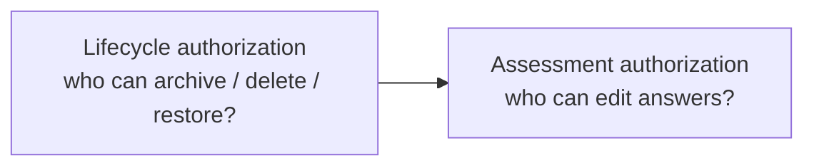
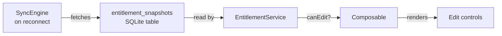

# Authorization — Walkthrough

This walkthrough explains how Peaky decides who may act, covering the two authorization layers, the actor identity model, entitlement snapshots, and the governance helpers used by services.

Short on time? Start with the [codebase reading map](./).

It complements:

- [Architecture](./architecture) — where authorization sits in the layer model
- [Events](./events) — the audit trail left after an authorized action
- [local-first authorization](../local-first/authorization) — the sync-level entitlement refresh and server enforcement

The short version is:



---

## 1. Two authorization layers

Peaky has two distinct authorization concerns that are handled separately:

| Layer | Question answered | Where it lives |
| --- | --- | --- |
| **Lifecycle** | Can this actor archive, restore, or delete this entity? | `app/lifecycle/management.ts`, `app/services/review/ReviewGovernance.ts` |
| **Assessment** | Can this actor edit answers or notes in this review right now? | `app/services/entitlement/EntitlementService.ts` |

Lifecycle authorization is role-based and evaluated synchronously from the actor's persisted roles. Assessment authorization is snapshot-based and may be evaluated offline against a cached permission record.

---

## 2. LifecycleActor: the identity shape

All services that need to know who is acting read from a single shape persisted in `localStorage`:

```typescript
// app/lifecycle/management.ts
export interface LifecycleActor {
  id: string;
  name: string;
  roles: LifecycleRole[];   // "admin" | "member"
}
```

The actor is read via `readPersistedActor()` from `app/composables/useCurrentActor.ts`. This function reads `localStorage` directly and falls back to a default actor if the key is absent or malformed. Because it reads from `localStorage`, it works in service methods without any Vue dependency — a service can call `readPersistedActor()` directly.

```typescript
// app/composables/useCurrentActor.ts
export function readPersistedActor(): LifecycleActor {
  return readStoredActor(); // reads "peaky:current-actor" from localStorage
}
```

The actor is set when a user selects a profile in the navigation. The profile picker writes to the same `localStorage` key, so the next service call picks up the new identity automatically.

---

## 3. Lifecycle roles

| Role | What it permits |
| --- | --- |
| `admin` | Archive, restore, delete any entity; access the admin events feed |
| `member` | Create entities they own; archive and restore their own entities |

Role checks are performed by the governance helpers in `app/services/review/ReviewGovernance.ts` and by the lifecycle management utilities in `app/lifecycle/management.ts`. These are pure synchronous functions — no DB access, no Vue.

```typescript
// app/services/review/ReviewGovernance.ts
export function isReviewAdmin(
  actor: string | Pick<ReviewActor, "id" | "roles">
): boolean {
  if (typeof actor === "string") {
    return REVIEW_ADMIN_IDS.has(actor);
  }
  return actor.roles?.includes("admin") ?? REVIEW_ADMIN_IDS.has(actor.id);
}
```

The `REVIEW_ADMIN_IDS` set is a small compile-time constant used while the full identity provider integration is pending. When a proper auth system is in place, `isReviewAdmin` will delegate to the roles array instead.

---

## 4. Entitlement snapshots

Assessment-level authorization uses cached permission snapshots rather than live role checks. This is necessary because assessment editing happens in a local-first context where the server may not be reachable.



| Property | Value |
| --- | --- |
| Storage | `entitlement_snapshots` table in local SQLite |
| Default offline window | 7 days from snapshot creation |
| Key format | `entityType:entityId` or `entityType:*` (wildcard) |
| Refresh trigger | SyncEngine on reconnect |

The snapshot stores a JSON map of entitlements keyed by `entityType:entityId`. The wildcard key `review:*` grants the entitlement for all reviews of that actor without needing a per-entity row.

---

## 5. EntitlementService

`app/services/entitlement/EntitlementService.ts` is the single service responsible for reading and writing entitlement snapshots. It has no Vue imports.

Key methods:

| Method | What it does |
| --- | --- |
| `getSnapshot(actorId)` | Reads the actor's snapshot from SQLite |
| `saveSnapshot(actorId, entitlements, validUntil)` | Upserts the full entitlement map |
| `canEdit(entitlements, entityType, entityId)` | Checks wildcard then specific key |
| `canView(entitlements, entityType, entityId)` | Same lookup pattern for view access |
| `isOfflineWindowValid(snapshot)` | Returns false if more than 7 days have passed since snapshot creation |
| `getRemainingOfflineDays(snapshot)` | Returns days until the window expires |

When the snapshot is `null` (never fetched, or actor has no record), `canEdit` and `canView` both return `false`. The composable layer handles this by showing a read-only view with a prompt to reconnect.

```typescript
// app/services/entitlement/EntitlementService.ts
canEdit(entitlements, entityType, entityId): boolean {
  const wildcardKey = `${entityType}:*`;
  const specificKey = `${entityType}:${entityId}`;
  return (
    (entitlements[wildcardKey]?.canEdit ?? false) ||
    (entitlements[specificKey]?.canEdit ?? false)
  );
}
```

---

## 6. ReviewGovernance

`app/services/review/ReviewGovernance.ts` provides three pure predicates used by the review mutation services and lifecycle UI:

| Function | What it answers |
| --- | --- |
| `isReviewAdmin(actor)` | Is this actor an admin? (by role or by ID constant) |
| `isReviewParticipantOwner(actorId, participants)` | Is the actor a named participant in this review? |
| `normalizeReviewActor(actor)` | Coerces a partial actor shape to a valid `ReviewActor`, falling back to the default |

These are called synchronously before a lifecycle mutation is allowed to proceed. If neither predicate returns true, the service throws before any DB write occurs.

---

## 7. The offline window trade-off

The 7-day offline window is a deliberate usability choice:

**Upside:** Users can continue editing reviews while offline for up to a week without being blocked by a stale permission check. This is the primary use case for field engineers and remote reviewers in areas with unreliable connectivity.

**Trade-off:** If an actor's permissions are revoked on the server, they retain local edit access until either the window expires or the SyncEngine fetches a new snapshot on reconnect. The revocation is not instant.

The sync layer handles this: on reconnect, SyncEngine calls the entitlement refresh endpoint before processing the outbox push. If the new snapshot has reduced permissions, the service updates the local record and the composable reacts immediately. Any outbox entries that were written during the window are evaluated server-side before being accepted; the server is the final authority.

---

## Scope

This walkthrough covers the two authorization layers, the LifecycleActor identity shape, lifecycle roles, entitlement snapshots, EntitlementService methods, and the ReviewGovernance predicates.

It defers to the [local-first authorization walkthrough](../local-first/authorization) for:

- how entitlement refresh is triggered during the reconnect cycle
- how the server enforces the same rules at the HTTP boundary
- the pending review queue and how permission drift is handled during sync
