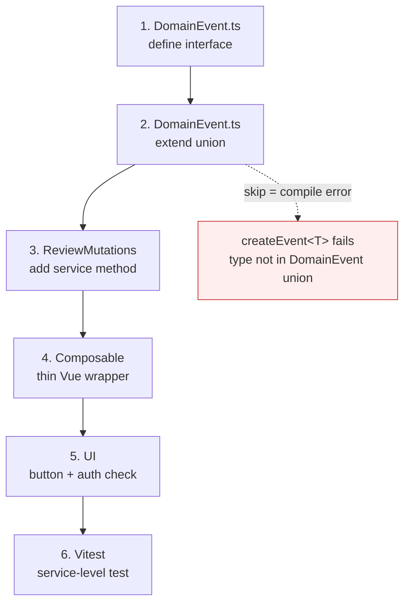
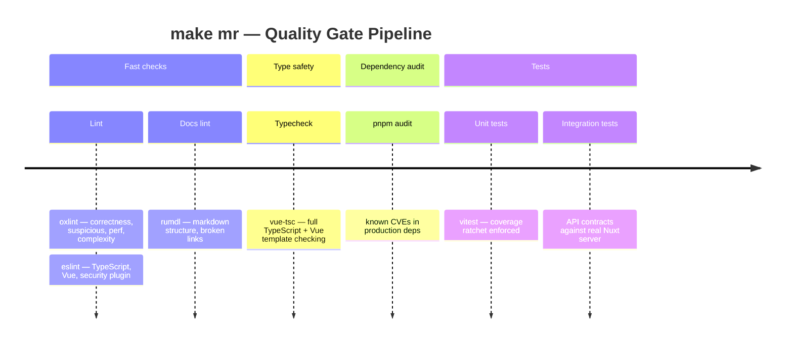

# Contributing — Walkthrough

This is our practical guide for adding features to Peaky. We walk through two worked examples end-to-end, then close with a checklist you can use for any new feature.

Short on time? Read [Architecture](./architecture) first so the layers and service pattern are familiar.

Further reading: [local-first series](../local-first/) — the sync runtime that carries your mutation to the server.

---

## 1. Adding a new lifecycle operation

Worked example: **mark a review as complete**.

This operation does not exist in the codebase today. Adding it requires touching the event types, the mutation service, the composable, and the UI — in that order.



Follow the steps in order. Skipping step 2 breaks the compiler before the app can run.

### Step 1 — Define the domain event

Open `app/services/events/DomainEvent.ts` and add the interface alongside the other review lifecycle events:

```typescript
export interface ReviewCompleted extends DomainEventEnvelope {
  type: "ReviewCompleted.v1";
  entityType: "review";
  data: {
    name: string;
    completedAt: string;
  };
}
```

Then add it to the `DomainEvent` union at the bottom of the file:

```typescript
export type DomainEvent =
  | ReviewAnswerRecorded
  | ReviewCompleted        // <-- add here
  | ReviewCreated
  | ReviewArchived
  // ...
```

TypeScript will now enforce that any `createEvent<ReviewCompleted>()` call supplies `name` and `completedAt` in its `data` argument.

### Step 2 — Add the mutation to ReviewMutations

Open `app/services/entity/ReviewMutations.ts`. Add a `complete` method following the same pattern as `archive`:

```typescript
async complete(reviewId: string): Promise<void> {
  if (!reviewId) throw new Error("reviewId is required");

  const row = await withDatabase(async (db) => {
    const result = await db
      .select({ name: reviews.name })
      .from(reviews)
      .where(eq(reviews.id, reviewId))
      .limit(1);
    return result[0] ?? null;
  });

  if (!row) throw new Error(`Review not found: ${reviewId}`);

  const event = createEvent<ReviewCompleted>(
    "ReviewCompleted.v1",
    reviewId,
    { name: row.name, completedAt: nowISO() },
    { reviewId }
  );

  await localMutation.commit({
    stateWrite: async (tx) => {
      await tx
        .update(reviews)
        .set({ status: "completed", updatedAt: event.time })
        .where(eq(reviews.id, reviewId));
    },
    event,
    outbox: {
      entityType: "review",
      entityId: reviewId,
      operation: "update",
      payload: { id: reviewId, status: "completed" },
    },
  });
}
```

The `localMutation.commit()` call writes the state change, the domain event, and the outbox entry atomically in a single SQLite transaction. If any step throws, the whole write rolls back.

### Step 3 — Update the schema if needed

If the `status` field is an enum in the shared schema, check `shared/db/schema/` and add `"completed"` to the enum values. If the local SQLite schema needs updating, add a new migration file in `shared/db/migrations/sqlite/` following the existing naming convention. Run the migration generator and verify the migration applies cleanly before continuing.

If no schema change is needed (the `status` column already accepts arbitrary strings), skip this step.

### Step 4 — Thin the composable

Open `app/composables/reviews/useSubjectReviews.ts` and add a `completeReview` method:

```typescript
const completeReview = async (reviewId: string): Promise<void> => {
  await reviewMutations.complete(reviewId);
  await loadReviews(toValue(subjectId));
};

return { reviews, pending, error, archiveReview, restoreReview, completeReview };
```

The composable delegates entirely to the service and then refreshes the reactive list. No business logic lives here.

### Step 5 — Add a UI trigger

Find the appropriate component — likely `app/components/review/` or the review detail page. Add a button that calls the composable method:

```vue
<UButton
  label="Mark as complete"
  variant="outline"
  :loading="completing"
  @click="completeReview(review.id)"
/>
```

Guard the button with an authorization check (`isReviewAdmin` or the relevant entitlement) so it only renders for actors who are permitted to complete reviews.

### Step 6 — Write a service test

Service tests live in `tests/` and need no Vue environment. A minimal test for the new mutation:

```typescript
// tests/unit/services/ReviewMutations.complete.test.ts
import { describe, it, expect, vi } from "vitest";
import { ReviewMutations } from "~/services/entity/ReviewMutations";

describe("ReviewMutations.complete", () => {
  it("emits a ReviewCompleted event with the review name", async () => {
    // Arrange: seed a review row in the test DB
    // Act: call reviewMutations.complete(reviewId)
    // Assert: events contains one row with type "review.completed"
    //         and the correct name in data
    // Assert: local_outbox contains one pending entry for the review
  });
});
```

The test should verify the event type, the outbox entry operation, and that no partial state can result from a simulated mid-transaction failure.

---

## 2. Adding a new API route

Worked example: **fetch the completion history for a review**.

This is a server-side route. It involves a Nitro handler, a Drizzle repository query, and a `$fetch` call from a composable.

### Step 1 — Add the server route

Create a new handler in `server/api/reviews/`:

```typescript
// server/api/reviews/[id]/completions.get.ts
export default defineEventHandler(async (event) => {
  const reviewId = getRouterParam(event, "id");
  if (!reviewId) throw createError({ statusCode: 400, message: "reviewId required" });

  const db = useDrizzle();
  const completions = await reviewCompletionsRepository.findByReview(db, reviewId);
  return completions;
});
```

Nitro discovers the route from the file path automatically. The route will be available at `GET /api/reviews/:id/completions`.

### Step 2 — Add the Drizzle query

Create or extend a repository in `server/db/repositories/`:

```typescript
// server/db/repositories/drizzle/reviewCompletionsRepository.ts
export const reviewCompletionsRepository = {
  async findByReview(db: Database, reviewId: string) {
    return db
      .select()
      .from(events)
      .where(
        and(
          eq(events.reviewId, reviewId),
          eq(events.eventType, "review.completed")
        )
      )
      .orderBy(desc(events.time));
  },
};
```

If the `data` column is stored as a JSON string (which it is), parse it before returning:

```typescript
return rows.map((row) => ({
  ...row,
  data: JSON.parse(row.data as string),   // guard JSON.parse
}));
```

Always guard `JSON.parse` calls — the column type is `text` in SQLite and `jsonb` in Postgres. A malformed value at parse time is a runtime error, not a type error, so the guard must be explicit.

### Step 3 — Call from the composable

Add a fetch function in the relevant domain composable:

```typescript
// app/composables/reviews/useReviewCompletions.ts
export function useReviewCompletions(reviewId: MaybeRef<string>) {
  const completions = ref<ReviewCompletion[]>([]);
  const pending = ref(false);

  const load = async () => {
    pending.value = true;
    try {
      const id = toValue(reviewId);
      completions.value = await $fetch(`/api/reviews/${id}/completions`);
    } finally {
      pending.value = false;
    }
  };

  watch(() => toValue(reviewId), load, { immediate: true });

  return { completions, pending };
}
```

### Step 4 — Test the route

API route tests live in `tests/nuxt/api/`. Use the Nuxt test utilities to mount the Nitro handler in-process:

```typescript
// tests/nuxt/api/reviews.completions.test.ts
import { setup, $fetch } from "@nuxt/test-utils/e2e";

describe("GET /api/reviews/:id/completions", () => {
  it("returns completions for a review", async () => {
    // seed events with a completed event
    const result = await $fetch("/api/reviews/01932b3c-7d00-7000-8000-000000002001/completions");
    expect(result).toHaveLength(1);
    expect(result[0].eventType).toBe("review.completed");
  });
});
```

---

## 3. Quality gates

Before opening a merge request, run `make mr` (or `make pr`). This executes every automated check in order, failing fast on the first error:



The same checks also run automatically via git hooks:

| Hook | What runs | When |
|------|-----------|------|
| **pre-commit** | lint-staged: oxlint → eslint → oxfmt (code), rumdl (markdown), ruff (scripts/ci/) | Every commit |
| **pre-push** | Unit tests + typecheck | Every push |

If `make mr` passes locally, your MR should pass CI too.

!!! note "Python files under `scripts/ci/`"
    The pre-commit hook runs `ruff check` on `scripts/ci/` when Python files are
    staged there. This is separate from the merge-check package's ruff config
    (`.factory/skills/merge-check/`). If you edit `scripts/ci/**/*.py`, run
    `cd scripts/ci && uv run --frozen ruff check .` before committing.

---

## 4. Contribution checklist

Use this before opening a merge request for any new feature.

### Architecture & domain

- [ ] Does the new logic belong in a **service** (no Vue, testable with plain vitest) or a **composable** (Vue lifecycle, reactive state)?
- [ ] Does the mutation emit a **typed domain event** defined in `app/services/events/DomainEvent.ts`?
- [ ] Is the mutation wrapped in **`localMutation.commit()`** so the state write, event, and outbox entry are atomic?
- [ ] Does the server endpoint **guard `JSON.parse`** on any column stored as a text string?
- [ ] If the feature adds or changes a composable layer boundary, is the **import explicit** (no auto-import reliance)?

### Security

- [ ] Does the new API endpoint **validate request body with Zod**? (not just TypeScript generics)
- [ ] If the change touches the sync push path, does the server **re-check entitlements** (not trust the client)?
- [ ] Are new `window.*` globals guarded by **`import.meta.dev`**?
- [ ] Is sensitive data (tokens, passwords) kept **out of localStorage**?
- [ ] Is `v-html` used? If so, is the content **sanitized**?

### Testing

- [ ] Is there a **service-level test** that verifies the event type and outbox entry without mounting Vue?
- [ ] If the operation affects who can act, is there an **authorization check** using `isReviewAdmin`, `isReviewParticipantOwner`, or `EntitlementService.canEdit`?
- [ ] Does `make mr` pass? (lint, typecheck, unit tests, integration tests, coverage ratchet)

### Documentation

- [ ] Did you **update relevant walkthrough docs** if the architecture or domain model changed?

The last point is deliberate. These walkthroughs are living documents. If you add a new entity, a new composable layer, or a new event domain, update the relevant file in `site/docs/development/walkthroughs/codebase/` alongside your code change. The contributor who reads this six months from now will thank you.

---

## Scope

This walkthrough covers two concrete worked examples, the quality gate pipeline, and a contribution checklist. It is intentionally practical rather than exhaustive.

For the runtime behavior of the mutations you write — how they travel through the outbox, how they are validated server-side, and what happens when a push fails — read the [local-first series](../local-first/). For the security threat model specific to local-first architecture, read [Security](../local-first/security).
