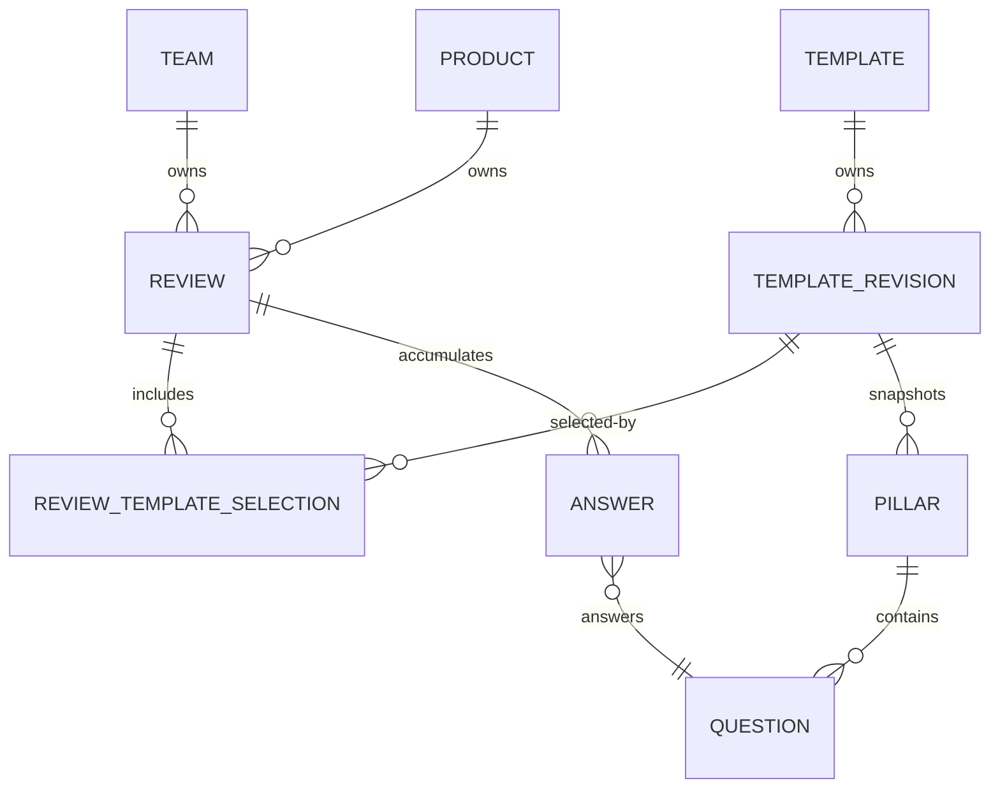
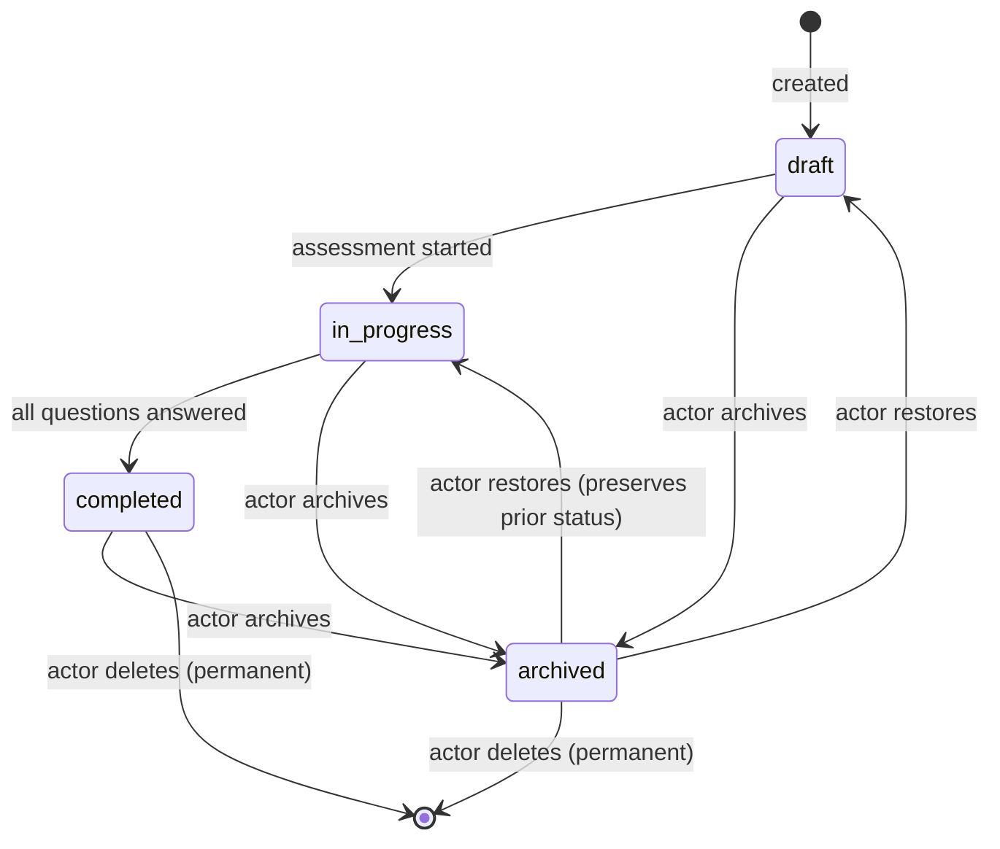

# Domain Model — Walkthrough

This walkthrough explains the core entities, the review lifecycle, how templates structure assessments, and what "readiness" means as a policy outcome rather than a score.

Short on time? Start with the [codebase reading map](./).

It is intentionally progressive:

1. understand the core aggregates and how they relate
2. understand the subject model and how a review knows what it belongs to
3. follow the review lifecycle through its states
4. understand how stable Templates and complete Revisions structure assessments
5. understand the distinction between a review container and an assessment act
6. understand the participant model and the max-2-advisors rule
7. understand what "readiness" means

---

## 1. The core aggregates



| Entity | What it is | Key fields |
| --- | --- | --- |
| **Team** | A group of engineers who collectively own the review | `id`, `name`, `orgId`, `memberCount` |
| **Product** | A system or service that teams own and review | `id`, `name`, `teamIds`, `componentIds`, `status` |
| **Review** | A time-boxed assessment container belonging to a subject | `id`, `subjectId`, `name`, `status` |
| **Template** | The stable, long-lived catalog aggregate | `id`, `name`, `description`, `status`, `ownerTeamId` |
| **Template Revision** | A complete metadata, pillar, and question snapshot | `id`, `templateId`, `status`, `revisionNumber`, publication provenance |

A review is always owned by exactly one subject — a team or a product. A Template keeps its identity while its Revisions capture authored snapshots. Reviews attach exact Revision IDs at creation time via `reviewTemplateSelections`; the join table (`review_template_selections`) stores `(review_id, template_revision_id)` and a unique position from 0 through 2. Neither a Review nor a Template owns the other.

---

## 2. The subject model

A review carries a `subjectId` that references an entry in the `subjects` table. The subject type (`"team"` or `"product"`) is stored in `subjects.type` and is the authoritative source — it does not need to be derived from the ID format.

```typescript
// shared/db/schema/subject.ts
export const subjectType = ["team", "product", "organization"] as const;

export const subjects = sqliteTable("subjects", {
  id:   text("id").primaryKey(),
  type: text("type", { enum: subjectType }).notNull(),
  name: text("name").notNull(),
  slug: text("slug").notNull().unique(),
  // ...
});
```

Route parameters supply the `subjectId` directly — the teams routes pass the team's ID and the products routes pass the product's ID. When a local query needs to resolve a route reference to a canonical subject ID (for example, resolving a catalog slug to a local UUID), `resolveLocalSubjectId` handles it:

```typescript
// app/services/entity/resolveLocalSubjectId.ts
return withDatabase(async (db) => {
  const rows = await db
    .select({ id: subjects.id })
    .from(subjects)
    .where(or(eq(subjects.id, subjectReference), eq(subjects.slug, subjectReference)))
    .limit(1);
  return rows[0]?.id ?? null;
});
```

The upside is that subject IDs are stable UUIDs (or catalog slugs for externally-sourced entities) and the type is always explicit in the schema. The trade-off is that any code path that creates a review must supply the correct `subjectId` — the schema cannot infer the type from the ID alone.

---

## 3. Review lifecycle states



| Status | Meaning |
| --- | --- |
| `draft` | Created but not yet started; no answers recorded |
| `in_progress` | At least one answer has been recorded; assessment is underway |
| `completed` | All required questions have been answered |
| `archived` | Soft-hidden by an authorized actor; can be restored |
| _(deleted)_ | Permanently removed; a `ReviewDeleted` domain event is emitted before the row is destroyed |

Status transitions are enforced inside `app/services/entity/ReviewMutations.ts`. The `restore()` method preserves the status the review had before archiving — if it was `in_progress`, it comes back as `in_progress`, not reset to `draft`. Delete is irreversible and always emits a typed event so the audit trail survives even after the row is gone.

---

## 4. Template anatomy

A Template is a stable aggregate. Its authored content lives in complete Revisions:

```text
Template (stable identity, owner Team, active | archived)
└── Template Revision (draft | published | retired)
    └── Pillar (e.g. "Reliability", "Security")
        └── Question (yes/no or checklist)
            ├── text
            ├── type: "yes-no" | "checklist"
            ├── importance (reason the question exists)
            ├── leadingPractices
            ├── helpfulLinks
            └── riskLevel
```

A Revision snapshots its own name and description as well as every Pillar and Question. Draft publication fields are null. Published and retired Revisions have a positive `revisionNumber`, `publishedAt`, and `publishedByActorId`; those snapshots are immutable. A Template can have at most one draft and one current published Revision. Retiring the current Revision preserves it for historical reads.

A new Review can select between one and three current published Revisions from distinct active Templates. Draft and retired Revisions, archived Templates, repeated Revisions, and two Revisions from the same Template are rejected. Each `reviewTemplateSelections` row records an exact `templateRevisionId` and a unique position, so the order is stable.

Answers use Revision-specific Question IDs. Existing Reviews continue loading the exact selected snapshot even if that Revision later retires; they never follow the Template's current published Revision or infer Question continuity across Revisions.

---

## 5. Assessment vs Review

The distinction matters:

- A **Review** is the persistent container. It has a name, a status, a subject, and a set of template selections. It is created once and accumulates answers over its lifetime.
- An **Assessment** is the act of answering questions within a review. Assessments produce `Answer` records and track progress per pillar.

Operationally, "doing a review" means "performing an assessment within a review container." The UI uses "assessment" to name the screen (`assessment.vue`) and the composable (`useAssessment`), while the database row being updated is `reviews`.

Sessions (`review_sessions`) track discrete save points within the assessment — a checkpoint that records progress, a comment, and a pillar-level snapshot. Sessions are write-once; they form the history of work within a review.

---

## 6. Participants and the max-2-advisors rule

Reviews involve two participant roles:

| Role | Who | What they do |
| --- | --- | --- |
| **Team** | Engineers who own the product or service | Perform the self-assessment; answer questions and provide evidence |
| **Advisors** | Experienced engineers external to the team | Provide guidance, historical context, and incident knowledge |

The business rule is strict: **a review must have at most 2 advisors**, regardless of how many templates it includes. This rule exists to keep guidance focused, prevent diluted accountability, and ensure advisors have capacity for meaningful engagement.

The UX principle that flows from this is **team over individuals**: the UI attributes activity to the team, not to named individuals, in summary views. Individual names may appear in expanded or detail views for accountability, but no leaderboards, contribution counts, or individual rankings are shown.

This applies to session history, activity feeds, event metadata display, and any future feature that surfaces who did what.

---

## 7. What "readiness" means

Readiness is a **policy-based outcome**, not a score.

An assessment does not produce a numeric grade. Instead, the combination of answers, risk levels, and organizational policy determines whether a system is ready to release. The possible outcomes are:

| Outcome | Meaning |
| --- | --- |
| `READY` | No critical issues; system is deployable |
| `READY_WITH_RISKS` | Deployable with acknowledged risks and appropriate approvals |
| `NOT_READY` | Blocked from release due to critical issues |

These statuses are derived from the assessment state; they are not directly set by users. The derivation logic lives in the projection layer (`app/services/review/ReviewProjection.ts`), which reads answers and risk levels to compute the outcome.

A parallel projection, `app/services/review/ImprovementPlanProjection.ts`, reads the same answer state and classifies every non-passing answer into an attention item — the input for the improvement plan pages. Both projections are pure functions with no side effects; see the [Improvement Plan walkthrough](../product/improvement-plan.md) for the full breakdown.

The upside of a policy-based model is that the rules can change (new risk weights, new approval gates) without changing the question data or the review schema. The trade-off is that the derivation logic must be kept in sync with the policy that the organization actually operates under.

---

## Scope

This walkthrough covers entities, the subject model, review lifecycle states, template anatomy, the assessment/review distinction, participants, and readiness as a policy outcome.

It defers to the [local-first data model walkthrough](../local-first/data-model) for:

- the full SQL table definitions and column types
- the independent PostgreSQL and SQLite schema authorities and the behavior-tested contracts they share
- SQLite migration files and how new migrations are applied
