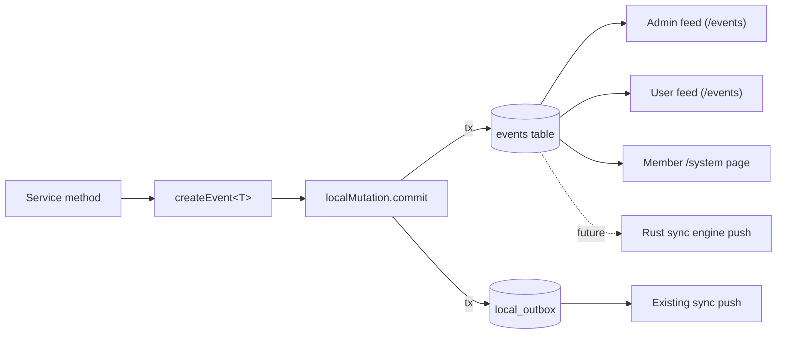
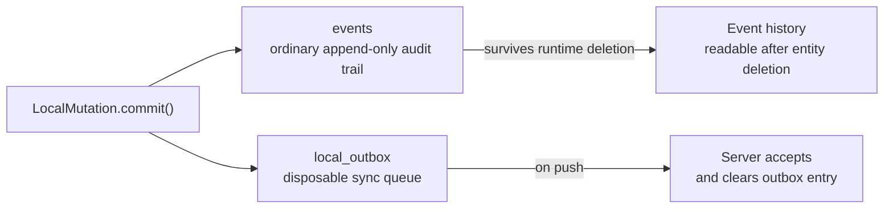
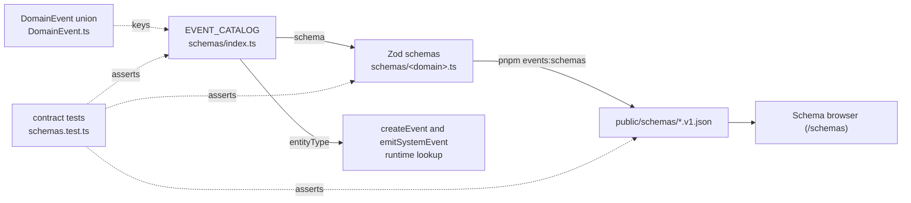
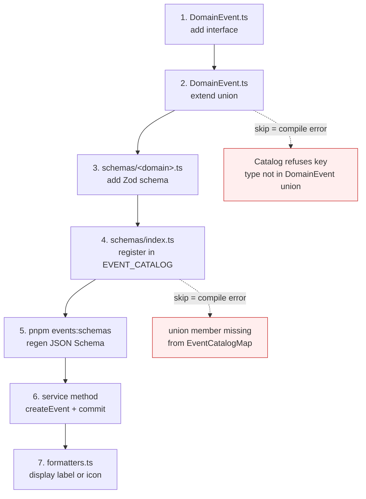

# Domain Events — Walkthrough

This walkthrough explains why Peaky uses typed domain events, how the `DomainEventEnvelope` is structured, and what happens to events after they are written.

Short on time? Start with the [codebase reading map](./).

It complements:

- [Architecture](./architecture) — where `LocalMutation.commit()` sits in the request path
- [Authorization](./authorization) — who is permitted to trigger the events discussed here
- [Domain Events reference](../../events/index.md) — full event catalog with JSON Schema links
- [local-first auditing](../local-first/auditing) — the full deep-dive on how events are persisted, synced, and surfaced in the admin feed

---

## 1. Why typed events

Significant mutations on event-enabled paths write a typed domain event to the `events` table. We keep the audit trail queryable and displayable instead of opaque, so operators, the admin feed, and future event-driven features all read the same structured shape.

There are two bounded exceptions. `LocalMutation.localOnly()` persists current Template/draft Revision/Pillar/Question authoring in one state-only SQLite transaction with no event, outbox row, or push trigger until issue #137 enables transport. The approved Preview Template/Revision migration also deletes only its explicitly enumerated legacy Template/Review audit and replay rows; it does not change ordinary runtime retention.

The upside is a consistent audit trail for enabled operations. We pay for it with one upfront cost: each new audited operation defines its event type before we wire the mutation, and breaking payload changes need a version bump.



One write inside `localMutation.commit` fans out to four reading surfaces. The event row stays put when the entity is deleted — that's the invariant that keeps the audit trail trustworthy.

---

## 2. DomainEventEnvelope

Every domain event is a `DomainEventEnvelope` — a CloudTrail-style record that describes what happened, who did it, to which entity, and when.

```typescript
// app/services/events/DomainEvent.ts
export interface DomainEventEnvelope {
  id: string;              // UUIDv7, generated
  type: string;            // discriminator, e.g. "ProductCreated.v1"
  specversion: "1.0";      // CloudEvents spec version (required)
  dataschema?: string;     // URL to JSON Schema for data payload
  source: "peaky.client" | "peaky.sync" | "peaky.system";

  // Extension attributes (top-level per CloudEvents spec)
  actorId: string;
  actorType: "user" | "integration" | "system";
  entityType: string;      // e.g. "review", "product"
  entityId: string;        // stable ID of the entity
  reviewId?: string;       // cross-entity correlation key
  clientId?: string;       // browser session identifier

  time: string;            // ISO 8601 timestamp
  data: Record<string, unknown>;  // typed payload, narrowed by `type`
}
```

The `source` field distinguishes events written by the browser client (`"peaky.client"`) from events received during a sync pull (`"peaky.sync"`) or generated by automated processes (`"peaky.system"`). This matters for the admin feed: operators can filter to see only locally-originated events if they want to understand what a specific user did.

The `reviewId` field is the cross-entity correlation key. Answer events have `entityType: "review_answer"`, but they carry `reviewId` so the admin feed can group all activity on a review regardless of entity type.

The `dataschema` field is a URI pointing to the JSON Schema for the event's `data` payload, following the [CloudEvents spec](https://cloudevents.io/). Example: `https://orr-sample.vercel.app/schemas/ProductCreated.v1.json`. These schemas are generated from Zod and committed to the repo — see [section 6](#6-json-schema-catalog) below.

---

!!! info "CloudEvents conformance"
    The envelope is [CloudEvents v1.0.2](https://github.com/cloudevents/spec/blob/v1.0.2/cloudevents/spec.md) compliant. Core attributes (`id`, `type`, `specversion`, `source`, `time`, `dataschema`, `data`) match the spec; the rest are spec-allowed extensions kept top-level. Any CloudEvents-aware router can match on our events without parsing nested objects.

---

## 3. Event type naming

Event types follow the `EventName.v1` convention — PascalCase entity and action name, plus a version suffix. Examples:

- `ProductCreated.v1`
- `ReviewCheckpointSaved.v1`
- `TemplatePillarDeleted.v1`

The version suffix lets future consumers pin routing rules to a specific schema generation. Breaking changes get a `.v2` instead of mutating `.v1`.

Narrowing on `event.type` gives a fully typed `event.data` without any cast:

```typescript
if (event.type === "ProductCreated.v1") {
  // event.data is { name: string; teamIds: string[]; componentIds: string[];
  //                 origin: "bespoke" | "open-source" | "vendor"; isExternal: boolean; ... }
}
```

---

## 4. Event taxonomy

We group events into four families:

- **Review operations** — answers, notes, attachments, progress; one event per user action inside a review.
- **Lifecycle** — active review/product lifecycle types plus retained legacy Template/template-draft types.
- **Template authoring (legacy/dormant)** — retained pillar and question CRUD types from the removed mutable-draft path.
- **System** — local-engine internals: DB lifecycle, OPFS storage, sync cycles, entitlements. Source `peaky.system`.

The schema browser at `/schemas` is the source of truth for shape; the `DomainEvent` discriminated union in `app/services/events/DomainEvent.ts` is the source of truth for types. The full row-by-row reference lives behind the toggle below.

??? note "Full event catalog (39 types)"

    | Domain | Event type | Entity type | Key data fields |
    | --- | --- | --- | --- |
    | Review operations | `ReviewAnswerRecorded.v1` | `review_answer` | questionId, answer, naReason, pillarSlug?, templateId? |
    | Review operations | `ReviewCheckpointSaved.v1` | `review_checkpoint` | templateId, questionsAnswered, overallProgress, pillarSnapshots |
    | Review operations | `ReviewNoteRecorded.v1` | `review_note` | scopeType, scopeId, content |
    | Review operations | `ReviewNoteDeleted.v1` | `review_note` | scopeType, scopeId |
    | Review operations | `ReviewAttachmentUploaded.v1` | `review_attachment` | attachmentId, filename, mimeType, fileSize |
    | Review operations | `ReviewAttachmentDeleted.v1` | `review_attachment` | attachmentId, filename, mimeType, fileSize — captured before deletion |
    | Review operations | `ReviewProgressUpdated.v1` | `review` | pillarSlug, progress |
    | Review lifecycle | `ReviewCreated.v1` | `review` | legacy transported header payload: name, subjectId, subjectType, templateIds, scope, applicationIds, teamIds; not exact Revision selections |
    | Review lifecycle | `ReviewArchived.v1` | `review` | name |
    | Review lifecycle | `ReviewRestored.v1` | `review` | name |
    | Review lifecycle | `ReviewDeleted.v1` | `review` | name — emitted before the row is destroyed |
    | Product lifecycle | `ProductCreated.v1` | `product` | name, teamIds, componentIds, origin, isExternal, productManagerId?, engineeringLeadId?, roadmapUrl?, documentationUrl?, supportChannel? |
    | Product lifecycle | `ProductUpdated.v1` | `product` | changes map |
    | Product lifecycle | `ProductArchived.v1` | `product` | previousStatus |
    | Product lifecycle | `ProductRestored.v1` | `product` | previousStatus |
    | Product lifecycle | `ProductDeleted.v1` | `product` | name |
    | Template lifecycle | `TemplateDraftCreated.v1` | `template_draft` | name |
    | Template lifecycle | `TemplateDraftUpdated.v1` | `template_draft` | changes map |
    | Template lifecycle | `TemplateDraftDeleted.v1` | `template_draft` | name |
    | Template lifecycle | `TemplatePublished.v1` | `template_draft` | name (`publishedAt` is `time` on the envelope) |
    | Template lifecycle | `TemplateImported.v1` | `template_draft` | name, pillarCount, questionCount |
    | Template authoring | `TemplatePillarCreated.v1` | `template_pillar` | templateId, name |
    | Template authoring | `TemplatePillarUpdated.v1` | `template_pillar` | templateId, changes map |
    | Template authoring | `TemplatePillarDeleted.v1` | `template_pillar` | templateId, name |
    | Template authoring | `TemplateQuestionCreated.v1` | `template_question` | templateId, pillarSlug, questionId, questionText, questionType, position |
    | Template authoring | `TemplateQuestionUpdated.v1` | `template_question` | templateId, pillarSlug, questionId, changes map |
    | Template authoring | `TemplateQuestionDeleted.v1` | `template_question` | templateId, pillarSlug, questionId |
    | System (DB lifecycle) | `LocalDbInitializing.v1` | `local_db` | opfsAvailable |
    | System (DB lifecycle) | `LocalDbReady.v1` | `local_db` | coldStartMs, opfsAvailable |
    | System (DB lifecycle) | `LocalDbBootstrapStarted.v1` | `local_db` | isRecreate |
    | System (DB lifecycle) | `LocalDbRecreated.v1` | `local_db` | triggeredBy |
    | System (DB lifecycle) | `LocalDbMigrationFailed.v1` | `schema` | migrationId, errorMessage (sanitised) |
    | System (DB lifecycle) | `ClientSchemaMigrated.v1` | `schema` | migrationsApplied[], schemaVersion |
    | System (storage)      | `OpfsQuotaWarning.v1` | `storage` | usageBytes, quotaBytes, usagePct |
    | System (storage)      | `OpfsStorageMeasured.v1` | `storage` | usageBytes, quotaBytes, supported |
    | System (sync ops)     | `SyncCycleStarted.v1` | `sync_cycle` | cycleId |
    | System (sync ops)     | `SyncCycleSucceeded.v1` | `sync_cycle` | cycleId, eventsPushed, eventsPulled, durationMs |
    | System (sync ops)     | `SyncCycleFailed.v1` | `sync_cycle` | cycleId, errorMessage (sanitised), durationMs |
    | System (sync ops)     | `EntitlementsRefreshed.v1` | `entitlements` | hasDowngrades, changeCount |

!!! warning "Template rows above are legacy and dormant"
    The `TemplateDraft*`, `TemplatePublished`, `TemplateImported`, `TemplatePillar*`, and `TemplateQuestion*` schemas remain in the catalog so historical records and type references stay readable. Current stable Template/draft Revision authoring uses `LocalMutation.localOnly()` and emits none of them. Publication and Template lifecycle writes are frozen, and #140 adds no replacement event types.

!!! note "Teams aren't here"
    Teams are managed externally and don't emit lifecycle events. Team IDs do appear as `subjectId` in `ReviewCreated.v1` when a review is team-scoped.

### `local: true` catalog flag

System events that describe per-browser state (DB lifecycle, OPFS storage, the recreate-DB action) are flagged `local: true` in `EVENT_CATALOG` (`app/services/events/schemas/index.ts`). `LocalMutation.commit()` and `emitSystemEvent()` insert these rows with `status: "local"`, and any future event push pipeline (the Rust sync engine, when it lands) MUST filter `WHERE status != 'local'` so flagged events stay on the device by design.

Sync-ops events (`SyncCycle*`, `EntitlementsRefreshed`) deliberately omit the flag — they default to `status: "pending"` so postmortems can correlate which session synced what once the engine ships.

---

## 5. The events table

Events are written to the `events` table, which is separate from `local_outbox`. This separation is intentional and must be preserved. The two tables have **independent status pipelines** — `SyncEngine.pushChanges()` reads/writes `local_outbox` only and never touches `events.status`. Event status is advanced by a separate (future) event push pipeline owned by the Rust sync engine.

!!! info "Why the table is called `events`"
    It used to be `domain_events`. The `rename-domain-events-table` change renamed it once we added system events (DB lifecycle, sync ops, OPFS) — the old name implied "user mutations only", which was no longer accurate.

The full CloudEvents v1.0.2 envelope is persisted: `id`, `type`, `specversion`, `source`, `dataschema` (URL to the JSON Schema for `data`), `actor_id`, `actor_type`, `entity_type`, `entity_id`, `review_id`, `client_id`, `time`, `status`, `synced_at`, `data`. The status enum is `pending | synced | failed | local`.



| Property | `events` | `local_outbox` |
| --- | --- | --- |
| Purpose | Append-only runtime audit record | Sync transport queue |
| Deleted after sync? | No | Yes, cleared on push |
| CASCADE delete? | No — must survive entity deletion | Yes |
| Queryable for history? | Yes | No — payloads are opaque |

The `events` table has no CASCADE delete relationship to the `reviews` table. During ordinary runtime deletion, a Review row can disappear while its lifecycle events — including `ReviewDeleted.v1` — remain. The only bounded exception is the explicit Template/Revision Preview migration manifest, which removes matching legacy Template/Review audit and replay rows to prevent old identities from being resurrected while preserving unrelated events and migration logs.

---

## 6. JSON Schema catalog

Every event type has a machine-readable JSON Schema for its `data` payload, committed to `public/schemas/` and served at its `dataschema` URL:

```text
https://orr-sample.vercel.app/schemas/ProductCreated.v1.json
```

The schemas are defined as Zod objects in `app/services/events/schemas/`, with `.describe()` on every field. Shared field builders (e.g. `scopeTypeField`, `changesField`, `templateIdField`) live in `app/services/events/schemas/shared.ts` to eliminate duplication.

A generator script converts them to JSON Schema Draft-07:

```bash
pnpm events:schemas   # regenerate after any schema change
```

The catalog in `app/services/events/schemas/index.ts` is the single source of truth for the mapping between event-type names, Zod schemas, JSON Schema artifacts, and entityType. Contract tests in `tests/unit/services/events/schemas.test.ts` keep the four surfaces in sync.



The base URL for `dataschema` is configured via `NUXT_PUBLIC_BASE_URL` (falls back to `localhost:3000` in dev and `orr-sample.vercel.app` in production). See `app/utils/baseUrl.ts`.

### Schema browser

A browsable UI is available at `/schemas` — lists every event type with search, domain filter, and source filter. Clicking any row opens the detail page (`/schemas/ProductCreated.v1`) with the full metadata, property table, and a realistic CloudEvents example envelope.

---

## 7. Reading surfaces — admin feed, user feed, /system

Three surfaces read the same `events` table for three different audiences.

### Admin feed

The admin events page (`app/pages/admin/events.vue`) is powered entirely by typed domain events. The composable `app/admin/useAdminEventsFeed.ts` reads from `events` across all actors and formats the feed using the typed shapes in `app/admin/events.ts`. It exposes a `subjectTypeFilter` / `subjectTypeOptions` pair so the admin page can filter by resource area (Product, Team Review, Product Review, etc.).

Because every event has a stable `type`, `entityType`, `entityId`, `actorId`, and `time`, the feed can filter, sort, and correlate without any guessing.

The live tail variant (`app/admin/useAdminEventsLiveTail.ts`) polls for new events and appends them reactively — no page reload required.

Endpoints:

- `GET /api/admin/events` — all events across all actors (admin-only)
- `GET /api/admin/events/stream` — SSE live tail (admin-only)

### User feed

Non-admin users have a scoped view of their own activity:

- `GET /api/events` — returns events where `actorId` matches the current authenticated user
- `/events` — the "My Events" page, with category, action, and resource-type filters
- The sidebar Events link routes to `/events` for members and `/admin/events` for admins

### Member /system page

`/system` is the third reading surface — implemented as `app/pages/system.vue` + `app/composables/system/useSystemStatus.ts` + four components under `app/components/system/`. It reads the latest `peaky.system` events plus the local outbox depth and renders four glanceable tiles (Database, Sync, Storage, Schema), a session-scoped Recent Activity table, and one Maintenance action ("Recreate local DB").

No HTTP calls, no admin gate — support is a member need. The page deliberately omits snapshot export, raw SQL, and sync-cursor reset (security review: exfil traceability; JBTBD: add per real need).

For the user-facing intro, see [System Health page](../../../user-guide/power-user/system.md). For the operator-side surface across actors, defer to [local-first auditing](../local-first/auditing).

---

## 8. Adding a new event

The four sources of truth split across one file per domain so a new event lives near its siblings — review events in `review.ts`, product events in `product.ts`, etc. The central catalog (`schemas/index.ts`) ties them together.

```text
app/services/events/
├── DomainEvent.ts           ← TypeScript interfaces + the DomainEvent union
└── schemas/
    ├── review.ts            ← Zod schemas for review.* events
    ├── product.ts           ← Zod schemas for product.* events
    ├── template.ts          ← Zod schemas for template.* events
    ├── system.ts            ← Zod schemas for peaky.system events
    ├── shared.ts            ← reusable field builders
    └── index.ts             ← EVENT_CATALOG keyed by event type
```



Follow the steps in order. The compiler is your friend — skip step 2 or 4 and the build breaks before you can run the app.

**Step 1.** Define the interface in `app/services/events/DomainEvent.ts` (or extend an existing domain block):

```typescript
export interface ReviewCompleted extends DomainEventEnvelope {
  type: "ReviewCompleted.v1";
  entityType: "review";
  data: {
    name: string;
    completedAt: string;
  };
}
```

**Step 2.** Add the new interface to the `DomainEvent` union at the bottom of the same file. **Skipping this step makes the catalog refuse the entry** — `EVENT_CATALOG` is `satisfies EventCatalogMap`, and `EventCatalogMap` is keyed by `DomainEvent["type"]`, so a key the union doesn't know about is a compile error.

**Step 3.** Add a Zod schema in the matching domain file (`schemas/review.ts` for `Review*` events, `schemas/product.ts` for `Product*`, etc.). Every field gets `.describe()`. Reuse builders from `shared.ts` where applicable:

```typescript
// app/services/events/schemas/review.ts
export const reviewCompletedDataSchema = z.object({
  name: z.string().describe("Display name of the completed review."),
  completedAt: z.string().datetime().describe("ISO 8601 timestamp when the review was completed."),
});
export type ReviewCompletedData = z.infer<typeof reviewCompletedDataSchema>;
```

**Step 4.** Import the schema in `app/services/events/schemas/index.ts` and register the event by adding a key to `EVENT_CATALOG`:

```typescript
import { reviewCompletedDataSchema } from "./review";

export const EVENT_CATALOG = {
  // ...
  "ReviewCompleted.v1": {
    description: "Emitted when a review is marked complete.",
    sources: ["peaky.client"],
    schema: reviewCompletedDataSchema,
    local: false,  // sync to server (vs `local: true` for per-browser system events)
    entityType: "review",  // narrowed to whatever entityType the matching DomainEvent member declares
  },
} satisfies EventCatalogMap;
```

!!! tip "What the compiler enforces"
    The `satisfies EventCatalogMap` clause gives us five guarantees in the same line:

    1. The key must be a real member of `DomainEvent["type"]` — typo → compile error.
    2. Every member of `DomainEvent["type"]` must appear as a key — forget to register → compile error.
    3. `local` is required, no silent push-eligible default.
    4. `sources` is constrained to `"peaky.client" | "peaky.sync" | "peaky.system"`.
    5. `entityType` is narrowed per-key — `"ReviewCompleted.v1": { entityType: "product" }` is a compile error. Call sites no longer pass entityType; `createEvent` and `emitSystemEvent` look it up here.

**Step 5.** Regenerate the JSON Schema artifacts: `pnpm events:schemas`. Commit the resulting `public/schemas/<EventType>.v1.json` file.

**Step 6.** For an event-enabled operation, call `createEvent<ReviewCompleted>()` inside the service method, then pass the event to `localMutation.commit()` (or use `emitSystemEvent()` for non-mutation contexts like DB lifecycle and sync ops). Do not invent an event/outbox for an explicitly approved state-only path such as frozen Template draft authoring; use `LocalMutation.localOnly()` and document the bounded exception instead.

**Step 7.** If the event should appear in the admin feed with a custom label or icon, add a display formatter in `app/admin/formatters.ts`.

The contract tests in `tests/unit/services/events/schemas.test.ts` will catch catalog gaps, missing `local` flags, schema-rejection regressions, and drift between the union and the catalog.

**Important — capture data before deletion.** If the operation deletes a record (for example, removing an attachment), read and snapshot the data you want to log *before* applying the deletion. See `ReviewAttachmentDeleted.v1` as the canonical example: `filename`, `attachmentId`, `scopeType`, and `scopeId` are read from the attachment row before the row is removed.

---

## 9. GDPR considerations — what the codebase enforces

The event store is append-only, so the right to erasure plays out as in-place redaction, not deletion. Two rules apply when adding events:

1. **Minimise free-text in `data`.** Prefer counts, IDs, and deltas. `ReviewNoteRecorded.v1` is the explicit exception — `content: string` is captured because notes are short and the redaction path below handles PII without losing audit integrity.
2. **Keep `actorId`, erase `actorName`.** The stable principal ID stays under legitimate interest (GDPR Recital 49); the human-readable name is what gets tombstoned by `redactEventPii(eventId, byActorId)`. User-ID fields inside `data` (e.g. `productManagerId`) are treated like `actorId` — they're identifiers, not names, so they're not overwritten.

The full operator-side flow (admin redaction endpoint, idempotency, the `piiRedactedAt`/`piiRedactedBy` markers, audit-integrity invariants) lives in [local-first auditing §11a](../local-first/auditing). This walkthrough holds the codebase shape; auditing.md holds the runtime behaviour.

---

## Scope

This walkthrough covers why typed events exist, the `DomainEventEnvelope` structure, the `createEvent<T>()` factory, the event taxonomy, the JSON Schema catalog, the `events` / `local_outbox` separation, the admin feed, and the steps for adding a new event.

It defers to the [local-first auditing walkthrough](../local-first/auditing) for:

- how events are synced to the server during a push cycle
- how the server validates event integrity on receipt
- how the admin events operator surface queries across all actors and all sync sources
- failure modes and what to check when events stop appearing
