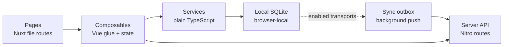

# Codebase — Walkthroughs

If you are new to the codebase and only have five minutes, start here.

The file tree tells the architecture. Services are plain TypeScript classes with no Vue imports. Composables are the Vue glue that wraps service calls in reactive refs. Pages are thin: they import two to four composables and delegate almost everything to them. The sync arrow is conditional: enabled mutations use state + event + outbox, while current Template/draft Revision authoring uses an atomic state-only path. If you can hold that mental model, the rest of the codebase unfolds predictably.

## Read this in order

| If you want to understand... | Read... |
| --- | --- |
| the six layers and where code lives | [Architecture](./architecture) |
| entities, lifecycle states, and templates | [Domain](./domain) |
| who may act and how permissions work offline | [Authorization](./authorization) |
| typed domain events and the audit trail | [Events](./events) |
| how members self-serve diagnose the local engine | [Events §7 — `/system`](./events#member-system-page) |
| how pages and composables are composed | [UI](./ui) |
| how to add a feature end-to-end, quality gates, and the contribution checklist | [Contributing](./contributing) |
| the runtime persistence and sync layer in depth | [local-first series](../local-first/) |
| what changes about security in local-first (trust boundary, threat model) | [local-first Security](../local-first/security) |

## Short reading paths

=== "5 minutes"

    1. [Architecture](./architecture) — skim the layers table and the directory tree
    2. [Domain](./domain) — skim the entity diagram and lifecycle state diagram

=== "30 minutes"

    1. [Architecture](./architecture)
    2. [Domain](./domain)
    3. Pick one of: [Authorization](./authorization), [Events](./events), or [UI](./ui)

=== "Deep dive"

    1. [Architecture](./architecture)
    2. [Domain](./domain)
    3. [Authorization](./authorization)
    4. [Events](./events)
    5. [UI](./ui)
    6. [Contributing](./contributing)
    7. [local-first series](../local-first/) — the sync and persistence runtime

## This series vs the local-first series

This series covers the application layer — architecture, domain, authorization, events, and UI patterns. If you want to understand the runtime persistence and sync layer in depth, the [local-first series](../local-first/) picks up where this one leaves off.

The local-first series explains how SQLite WASM is initialised in the browser, how enabled transports use the outbox, why Template draft authoring currently creates no event/outbox work, how entitlement snapshots are refreshed on reconnect, and how PostgreSQL and SQLite keep independent active schema authorities. Start here; go there when you are ready to reason about the persistence runtime.

## Trade-offs to remember

### Services are plain TypeScript, composables are Vue glue

Domain logic lives in `app/services/`. No Vue imports are permitted there. The test tells you which layer a piece of code belongs in: if you can test it without mounting a Vue component, it belongs in a service.

Composables hold reactive state and call services. They are the boundary between Vue lifecycle and business logic. A composable that grows its own business logic is a signal to extract a service.

### The file tree tells the architecture

`app/services/entity/` holds per-entity mutation services. `app/services/review/` holds review-specific projection and governance logic. `app/composables/local/` holds reactive wrappers over those services. `app/reviews/`, `app/products/`, `app/assessment/` hold domain-level composables that compose local wrappers and remote fetches. A new contributor should be able to find a feature by navigating the folder tree before searching.

### Typed events over ad-hoc reconstruction

Event-enabled mutations emit a typed domain event via `createEvent<T>()` and commit it atomically alongside state and outbox work. Stable Template/draft Revision authoring is the explicit temporary exception: `LocalMutation.localOnly()` writes state with no event or outbox. Upside: each path is atomic and truthful about transport. Trade-off: local-only unpublished Template work has no audit or server recovery.

### Shift-left quality gates over CI-only checks

All quality gates run locally via `make mr` before code reaches CI: linting (oxlint + eslint + security plugin), docs linting (rumdl), typecheck, dependency audit, unit tests with coverage ratchet, and integration tests. Git hooks enforce a subset on every commit (lint-staged) and push (tests + typecheck). Upside: contributors catch issues in seconds, not after a 10-minute CI round trip. Trade-off: local tooling must be kept in sync, and the pre-push hook adds ~30s to every push. See [Contributing](./contributing) for the full pipeline.
