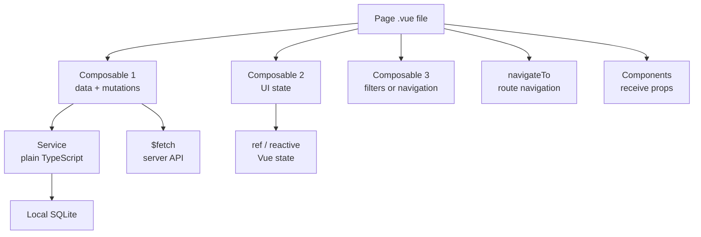
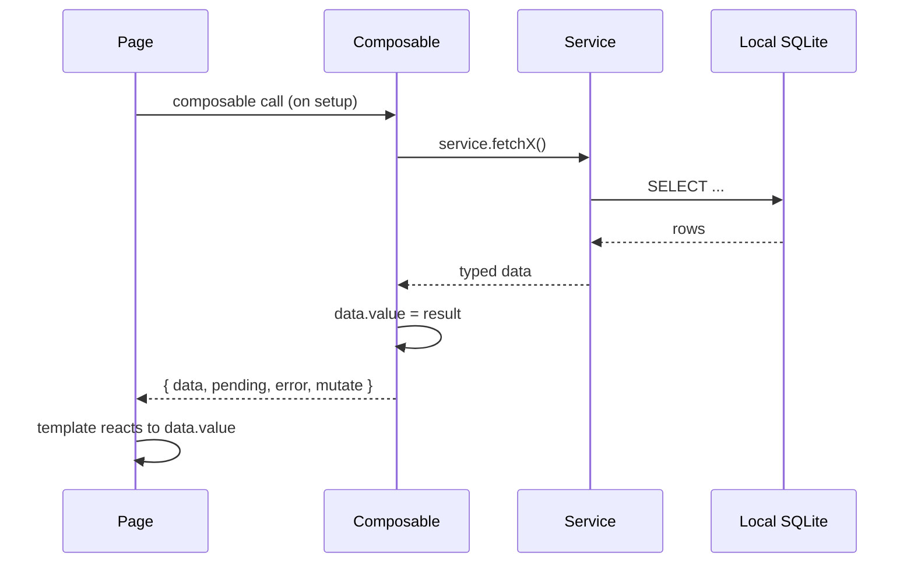
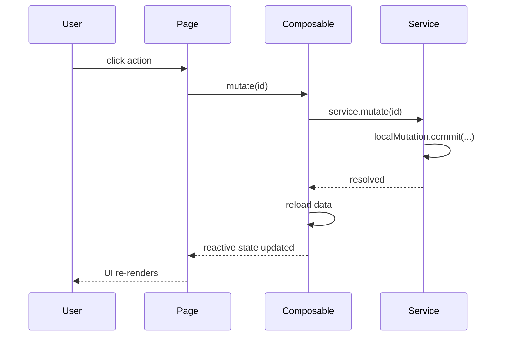

# UI Patterns — Walkthrough

This walkthrough explains how Nuxt pages are composed from composables, what each composable layer is responsible for, and where the common UI patterns — command palette, page headers, filters — are implemented.

Short on time? Start with the [codebase reading map](./).

It is intentionally progressive:

1. understand the page composition pattern
2. understand the four composable layers
3. understand the local-first composable contract
4. walk through a concrete page example
5. understand the command palette, page header, and filter patterns
6. understand the thin-composable design principle

---

## 1. Page composition pattern

A Nuxt page is intentionally thin. It imports two to four composables, passes data as props to components, and handles navigation. It does not contain business logic.



The page's `<script setup>` section should be readable without knowing the codebase: it declares route params, calls composables, and wires the results to component props. If business logic starts accumulating in a page's script block, it belongs in a composable or a service.

---

## 2. Composable layers

There are four distinct layers of composables, each with a clear responsibility boundary.

### Local wrappers — `app/composables/local/`

These are reactive wrappers over entity services. They expose `ref`-backed state and delegate all DB operations to services.

| Composable | Wraps |
| --- | --- |
| `useLocalReview.ts` | Review read from local SQLite |
| `useLocalProduct.ts` | Product read from local SQLite |
| `useLocalTeam.ts` | Team read from local SQLite |
| `useLocalNote.ts` | Note mutations (delegates to `NoteMutations`) |
| `useLocalAnswer.ts` | Answer state and mutations |
| `useLocalTemplateDraft.ts` | Template draft editing |

### Navigation UI state — `app/composables/nav/`

These composables manage the persistent app chrome — the frame that wraps every page regardless of feature.

| Composable | What it does |
| --- | --- |
| `useCommandPalette.ts` | Opens/closes the command palette; registers and clears commands |
| `usePageHeader.ts` | Lets pages announce their title and subtitle to the shared layout header |
| `useBreadcrumbs.ts` | Lets pages declare their breadcrumb trail |

### Table utilities — `app/composables/table/`

Generic, domain-free utilities for tabular list views.

| Composable | What it does |
| --- | --- |
| `useFilterState.ts` | Search + filter state; used by products, teams, and applications lists |
| `useSortState.ts` | Sortable column state for data tables |

### Feature modal and panel state — `app/ui/`

Composables for individual UI surfaces (modals, panels) that are specific to a feature context but carry no domain mutation logic.

| Composable | What it does |
| --- | --- |
| `usePillarNotes.ts` | Controls the pillar notes panel open/close state |
| `useBulkSelection.ts` | Multi-select row state |
| `useNAModal.ts` | Not-applicable reason modal open/close + selected question |
| `useSaveModal.ts` | Promise-based save progress modal |
| `useMoreInfoPanel.ts` | Question detail side panel |

### Domain composables — `app/composables/{domain}/`

These compose local wrappers, `$fetch` calls, and service calls into a domain-specific API that pages consume. They are the primary surface for page authors.

| Domain | Location | Key composables |
| --- | --- | --- |
| Reviews | `app/composables/reviews/` | `useSubjectReviews` (list + lifecycle), `useReviewData`, `useReviewSessions`, `useReviewWorkspace`, `useReviewWizard` |
| Products | `app/composables/products/` | `useProducts`, `useProductDetails`, `useProductCreation`, `useProductFilters`, `useProductDashboardLifecycle` |
| Teams | `app/composables/teams/` | `useTeams`, `useTeamDetails`, `useTeamFilters` |
| Assessment | `app/composables/assessment/` | `useAssessment` (orchestrator), `useAssessmentFetch`, `useAssessmentMutate`, `useAssessmentAnswers`, `useAssessmentProgress`, `useAssessmentNavigation`, `useLocalProgress` |
| Templates | `app/composables/templates/` | `useTemplateStudio` (studio/), `useTemplateCatalog` (domain/), `useTemplatePersistence` (storage/) |
| Applications | `app/composables/applications/` | `useApplications`, `useApplicationFilters` |
| Admin | `app/composables/admin/` | `useAdminEventsFeed`, `useAdminEventsLiveTail` |
| Catalog | `app/composables/catalog/` | `useCatalogMirrorResource` (base), `useCatalogUserSearch`, `useCatalogGroupSearch`, `useCatalogComponentSearch`, `useCatalogSearch` (generic) |
| Sync | `app/composables/sync/` | `useSyncClient` (SyncEngine adapter), `usePendingReviewQueue` (conflict resolution) |

---

## 3. The local-first composable contract

The pattern inside domain composables is consistent:



A mutation follows the same pattern in reverse:



The composable never writes SQL. The service never touches `ref`. That boundary is the discipline that keeps the codebase testable.

---

## 4. A concrete example: the review assessment page

`app/pages/teams/[teamId]/reviews/[reviewId]/assessment.vue` is one of the most active pages in the application. The page itself is remarkably short:

```vue
<!-- app/pages/teams/[teamId]/reviews/[reviewId]/assessment.vue -->
<template>
  <AssessmentPage :review-id="reviewId" />
</template>

<script setup lang="ts">
definePageMeta({ name: "team-review-assessment", breadcrumb: { label: "Assessment" } });
const route = useRoute();
const reviewId = computed(() => String(route.params.reviewId));
</script>
```

All composition moves into `app/components/assessment/AssessmentPage.vue`, which uses `useAssessment(reviewId)` — the orchestrator composable. That orchestrator is composed of five focused modules:

| Module | What it provides |
| --- | --- |
| `useAssessmentFetch` | `review`, `questionsData`, `pending`, `error`, `refresh` |
| `useAssessmentAnswers` | `answers`, `setAnswer`, `clearAnswer`, `getAnswer`, `hasAnswer` |
| `useAssessmentProgress` | Computed progress percentages per pillar |
| `useAssessmentNavigation` | `currentPillar`, `nextPillar`, `previousPillar`, `goToPillar` |
| `useAssessmentMutate` | `saving`, `saveAnswer`, `saveProgress`, `createSession` |

The page author calls `useAssessment(reviewId)` and receives a single well-typed object. The five underlying composables are an implementation detail of the orchestrator.

The screen-level UI is wired separately. The `AssessmentPage` component also calls:

- `usePageHeader` to set the page title
- `useBreadcrumbs` to declare the breadcrumb trail
- `usePillarNotes` to control the notes panel
- `useQuestionInfo` to open the question detail panel
- `useNAModal` to handle not-applicable reason capture

---

## 5. Command palette

The command palette is a global keyboard-accessible action surface (`Cmd+K` / `Ctrl+K`). It is implemented in two parts:

- `app/plugins/commandPalette.client.ts` — the Nuxt plugin that registers the global shortcut listener on the client side
- `app/composables/nav/useCommandPalette.ts` — the composable that pages use to register and clear commands

Pages call `useCommandPalette()` during setup to push context-aware commands (e.g., "Archive this review", "Export as CSV") into the palette. Commands are cleared automatically when the component unmounts, so the palette always reflects the current page context.

---

## 6. Page header and breadcrumbs

Pages announce their title to the shared layout header through `usePageHeader`, and their breadcrumb trail through `useBreadcrumbs`. Both composables use Vue's `provide`/`inject` pattern internally so the layout can react without receiving props from every page.

```typescript
// In a page or component
const { setHeader } = usePageHeader();
setHeader({ title: review.value?.name ?? "Review", subtitle: "Assessment" });

const { setBreadcrumbs } = useBreadcrumbs();
setBreadcrumbs([
  { label: "Teams", href: "/teams" },
  { label: team.value?.name ?? "", href: `/teams/${teamId}` },
  { label: "Reviews", href: `/teams/${teamId}/reviews` },
]);
```

The simpler route is `definePageMeta` with a static `breadcrumb` label for leaf pages that do not need dynamic breadcrumbs. Both approaches work; use `definePageMeta` when the label is a constant string, and `useBreadcrumbs` when it depends on loaded data.

---

## 7. Filter pattern

`app/composables/table/useFilterState.ts` is a generic search and filter composable used by the products list, teams list, and applications list. It accepts a typed array of entities and a set of filter criteria, and returns a reactive filtered result.

```typescript
// Generic signature
function useFilterState<T>(
  items: MaybeRef<T[]>,
  options: FilterOptions<T>
): { filtered: ComputedRef<T[]>; query: Ref<string>; activeFilters: Ref<...> }
```

Each domain that uses it supplies its own filter definitions (which fields to search, which fields to use as filter axes). The composable holds no domain knowledge; it is a pure reactive filter engine.

This pattern avoids duplicating search/filter logic across domain composables. The upside is consistent filtering behavior across all list views. The trade-off is that domain-specific filter requirements (e.g., filtering teams by org membership) must be expressed as options rather than hard-coded inside the composable.

---

## 8. Design principle: thin composables, services hold logic

The recurring principle across the codebase is that composables should be thin. A composable holds reactive state and calls services; it does not contain business rules.

The diagnostic question: **can you test this without Vue?**

- If yes — it belongs in `app/services/`
- If no, but it is navigation chrome (page header, breadcrumbs, command palette) — it belongs in `app/composables/nav/`
- If no, but it is a modal or panel tied to a specific feature — it belongs in `app/ui/`
- If no, and it involves domain data — it belongs in the appropriate `app/composables/{domain}/` folder

A composable that has grown large methods with conditional logic is a signal to extract a service. The service becomes independently testable, and the composable becomes a thin wrapper that calls it.

The module types table from `app/frontend.md` is a useful reference for composable granularity:

| Module type | Purpose |
| --- | --- |
| Fetch | GET operations and caching |
| Mutate | POST / PUT / DELETE via service or `$fetch` |
| State | Domain state and transitions |
| Navigation | Current position, next/prev |
| Computed | Pure calculation, no side effects |
| Validation | Input and domain checks |
| Draft | Editing state, dirty tracking |
| Orchestrator | Composes modules, public API for the page |

---

## Scope

This walkthrough covers the page composition pattern, the four composable layers, the local-first composable contract, the assessment page as a concrete example, the command palette, page header and breadcrumbs, the filter pattern, and the thin-composable principle.

It defers to the [architecture walkthrough](./architecture) for the full request path from composable through service to SQLite.
