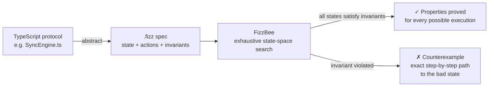
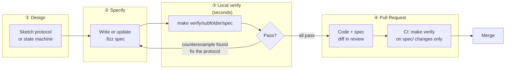
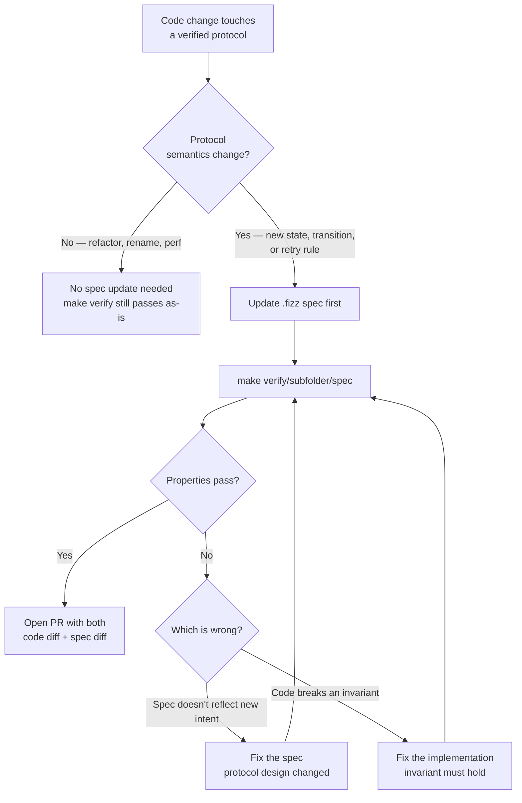
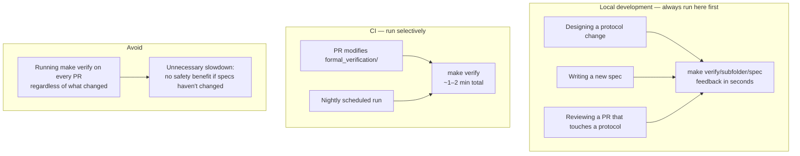

# Formal Verification — Walkthrough

This walkthrough explains why Peaky uses formal verification, what FizzBee is, how the specs tie into the SDLC, and how to read and extend them.

If you are new to formal verification, start here. If you are already familiar with model checking and just want to add a new spec, jump to [Writing a new spec](#8-writing-a-new-spec).

---

## 1. Why formal verification?

Peaky's local-first architecture has a small set of protocols that are:

- **Safety-critical** — a bug here silently corrupts user data or freezes sync
- **Hard to test exhaustively** — they involve concurrent tabs, non-deterministic network events, and multi-step state machines
- **Not fully covered by unit or E2E tests** — those tests only check the paths you thought to write

Traditional tests check the paths you imagined. Model checking checks every path that exists.

A test might verify that `ConcurrencyController.onFailure()` halves the batch size. A formal spec proves that under *every possible sequence* of successes and failures — including 1000 consecutive failures from `batch_size=1` — the value never falls below 1. That is the specific bug the spec catches: `Math.floor(1 / 2) == 0` would freeze sync permanently.

### What "formal verification" means here

We use **finite-state model checking**: write a compact model of the protocol, tell the tool what must always be true, and let it exhaustively explore every reachable state. If it finds a counterexample, it prints the exact sequence of actions that led to the violation.

This is different from theorem proving (which requires mathematical proof certificates) or fuzzing (which samples randomly). Model checking is exhaustive within the state space defined by your model.

### Mental model



This is the key difference from unit tests: unit tests verify the paths *you wrote*; model checking verifies every path that *exists* — including interleavings and failure sequences you never thought to write.

---

## 2. Why FizzBee?

Several tools exist for model checking. Here is the comparison we evaluated:

| Tool | Syntax | Install | CI setup | Learning curve |
|---|---|---|---|---|
| **FizzBee** | Starlark (Python subset) | Single self-contained CLI | `fizz <spec>` | Low |
| Quint | TypeScript-like | `npm install -g` | Needs Node + npm | Medium |
| TLA+ / TLC | ASCII math | Java JAR | Needs JRE | High |
| Alloy | Relational logic | GUI-focused | CLI mode limited | Medium |

**FizzBee wins for Peaky** for three reasons:

1. **Single dependency** — one CLI, no language runtime, no package manager, no global install.
2. **Python-like syntax** — the spec body is Starlark, so it maps directly to how Peaky's protocols are already described in plain English in the failure-domains walkthrough.
3. **Expressiveness** — state machines, safety invariants, and liveness properties cover everything Peaky currently needs. Quint's extra power would add complexity without benefit.

---

## 3. The specs

Specs are organised by concern so you can find them by the area you want to understand, not by filename:

```text
formal_verification/
├── resilience/
│   ├── aimd_concurrency_controller.fizz       — adaptive batch-size controller
│   └── sqlite_single_writer_coordination.fizz — multi-tab write safety
├── storage/
│   └── local_db_migration_idempotency.fizz    — browser migration runner
└── sync/
    ├── local_mutation_atomicity.fizz           — commit and state-only transaction atomicity
    ├── outbox_item_lifecycle.fizz              — sync outbox state machine
    ├── root_scope_alignment.fizz               — pull-root entitlement scoping
    ├── sse_channel_alignment.fizz              — LISTEN/NOTIFY channel contract
    └── sync_engine_push_pull.fizz              — bootstrap, push, pull, HLC convergence
```

- **`resilience/`** — error-recovery and concurrency protocols: how the system degrades and recovers under failure or concurrent access.
- **`storage/`** — local SQLite layer: bootstrap, migration, and schema consistency.
- **`sync/`** — the outbox-driven sync protocol: mutation atomicity and item lifecycle.

Add a **`product/`** subfolder when you add specs for product-level behaviour (e.g. what must hold when a new review is created, or when a product record transitions between states).

### What each spec guards against

| Spec | Failure mode | Properties |
|---|---|---|
| `resilience/aimd_concurrency_controller` | `floor(1/2) == 0` freezes sync permanently | `BatchSizeInBounds`, `NeverZero` |
| `resilience/sqlite_single_writer_coordination` | Two browser tabs write to SQLite simultaneously, corrupting WAL | `NoDataCorruption`, `LockConsistency` |
| `storage/local_db_migration_idempotency` | Migration marks "complete" before all are applied, or applies one twice | `AppliedNeverExceedsTotal`, `CompleteOnlyWhenFull`, `StatusIsValid` |
| `sync/outbox_item_lifecycle` | Outbox item reaches invalid status or retries infinitely | `StatusIsValid`, `RetryCountBounded`, `EventuallyTerminal` |
| `sync/local_mutation_atomicity` | `commit()` leaves a partial three-write transaction or `localOnly()` emits transport rows | `WriteConsistency`, `NoPartialCommit`, `StagedWritesWellFormed`, `LocalOnlyHasNoTransport` |
| `sync/root_scope_alignment` | A family wildcard widens the pull filter and leaks another family's events | `I1_WildcardScopedToFamily`, `I2_ChildRidesAlongWithRoot`, `I3_WildcardWithinFamilyTotal`, `I4_ExactRefIsolation` |
| `sync/sse_channel_alignment` | LISTEN and NOTIFY channels diverge, so the doorbell never rings | `I1_NoLiteralWildcardListen` … `I7_PersistedChangeNotifies` |
| `sync/sync_engine_push_pull` | Bootstrap inherits a remote cursor and skips events; HLC conflict resolution loses a write | `BootstrapNeverSetsRemoteCursor`, `NewerAlwaysWins`, `HlcMonotonic`, `FieldVersionConverges`, … |

---

## 4. Running the specs

### Prerequisites

```bash
brew install fizzbee        # model checker + the fizz wrapper
brew install fizzbee-mbt    # optional: model-based testing runner/server
```

No `brew tap` step: both formulas are mirrored in Adyen's internal Homebrew and `brew
tap` is disabled by the organisation. The upstream instructions
(`brew tap fizzbee-io/fizzbee`) apply outside Adyen only.

Use `fizz`, not `fizzbee`. `fizz` parses a `.fizz` file into a JSON AST and then runs
the model checker on it; the bare `fizzbee` binary accepts only the already-parsed AST
and fails with `Error unmarshalling JSON: proto: syntax error` on a spec file.

To try a different build without touching PATH:

```bash
make verify FIZZ=/path/to/fizzbee-vX.Y.Z-macos_arm/fizz
```

### Run all specs

```bash
make verify
```

`make verify` automatically finds every `.fizz` file under `formal_verification/` (recursively), so adding a spec to any subfolder is enough — no Makefile change needed. The full sweep takes about 70 seconds, nearly all of it in `sync/sync_engine_push_pull` (~109k states).

### Run a single spec

Use the folder-relative path without the `.fizz` extension:

```bash
make verify/sync/outbox_item_lifecycle
make verify/resilience/sqlite_single_writer_coordination
make verify/storage/local_db_migration_idempotency
```

### Why the Makefile parses the output

`fizz` exits **0 even when an invariant is violated** — only a parse error yields a
non-zero status. The `verify/%` target therefore requires a `PASSED` line in the
output before it considers a spec green. Never call `fizz` directly in CI without
that check, or violations will pass silently.

Run artefacts (`graph.dot`, node/link protobufs) go to the gitignored
`.fizzbee-out/<spec path>/`. Running `fizz` by hand writes them to `out/` next to
the spec instead; use `--output-dir` to keep the tree clean.

### There is deliberately no `fizz.yaml`

Every run prints `fizz.yaml not found. Using default options`. That is informational,
not a problem — and we keep it that way on purpose.

`fizz` looks for a `fizz.yaml` **in the spec's own directory** and uses it as the base
config; a spec's own YAML frontmatter then merges over it key by key. So a `fizz.yaml`
silently supplies every option the spec does not mention: a file setting
`deadlock_detection: false` would disable that check for every spec in the folder,
invisible to anyone reading the spec. It is also per-directory, so `resilience/`,
`storage/` and `sync/` would each need a copy, free to drift.

Checker options therefore live in the frontmatter of the one spec that needs them
(only `sync/outbox_item_lifecycle.fizz` does today). The defaults —
`max_actions: 100`, `max_concurrent_actions: 2` — are what the suite is validated
against, and `max_concurrent_actions` is inert here anyway: every action in these
specs is `atomic`, so there are no yield points to interleave (raising it to 3
produces identical state counts).

---

## 5. Reading a spec

Here is the outbox lifecycle spec annotated for a reader new to FizzBee:

```python
# (header comment omitted — see the file for the full explanation)

---
deadlock_detection: false         # (1)
---

MAX_RETRIES = 3                   # (2)

action Init:                      # (3)
  status = "pending"
  retry_count = 0

atomic fair action StartSync:     # (4)
  require status == "pending"     # (5)
  status = "syncing"

atomic fair action MarkSynced:
  require status == "syncing"
  status = "synced"

atomic action RetryItem:
  require status == "syncing"
  require retry_count < MAX_RETRIES
  retry_count = retry_count + 1
  status = "pending"

atomic action MarkFailed:
  require status == "syncing"
  require retry_count >= MAX_RETRIES
  status = "failed"


always assertion StatusIsValid:   # (6)
  return status in ["pending", "syncing", "synced", "failed"]

always assertion RetryCountBounded:
  return retry_count <= MAX_RETRIES

eventually always assertion EventuallyTerminal:   # (7)
  return status in ["synced", "failed"]
```

1. YAML frontmatter carries checker options. `synced` and `failed` are genuinely terminal for one outbox row, so deadlock detection is switched off here — without that, FizzBee reports the absence of an enabled action in a terminal state as a deadlock. Prefer modelling the re-entry that really exists (see `local_db_migration_idempotency.fizz`, where a cold start follows a completed run) and only disable detection when a lifecycle truly ends.
2. Top-level assignments are frozen constants. Read-only config belongs here, not in `Init`: constants are not part of the state space.
3. `action Init` is the one initialising action — it matches the INSERT into `local_outbox` with `status="pending"`. There is no wrapper block; actions are top level.
4. `atomic` applies the whole body as one indivisible step (a serial action, the default, has yield points between statements where other actions can interleave). `fair` means the action cannot be starved forever — that is what makes the liveness property below checkable.
5. `require` is a precondition — the action is simply *disabled* if it does not hold. It never raises, so it must never be used as an assertion.
6. `always assertion` is a safety invariant. The body is a function, so it must `return` a bool. FizzBee checks it in every state it reaches; a violation halts exploration and prints the path that caused it.
7. `eventually always assertion` is a liveness property: every execution must reach a terminal status and stay there — no infinite deferral. Liveness only works with `fair` actions, and the header of each spec documents the fairness assumptions ("what must go right").

### Key insight

If you removed `require retry_count < MAX_RETRIES` from `RetryItem`, FizzBee would find a counterexample to `EventuallyTerminal`: an execution where the item bounces between `syncing` and `pending` forever. That is exactly the bug the spec guards against.

The same trick is how you prove a spec is not vacuous: break the model on purpose in a scratch copy, confirm the checker names the property you expected, then revert.

---

## 6. How this fits into the SDLC

Formal verification is a **design-time and review-time tool**, not a runtime test.

### Where it fits in the development workflow



The rule of thumb: **fix the protocol, not the spec**. If FizzBee finds a counterexample, that means the protocol has a real reachable bad state. The spec is doing its job. Change the code.

### Handling drift — when implementation and spec diverge

The risk is that the implementation evolves without the spec. The spec becomes a historical document rather than a live guarantee.



**What a passing `make verify` does and does not tell you.** The model checker never
reads the implementation — it explores the `.fizz` model only. So a green sweep after a
code change proves the *model* still satisfies its own properties, and nothing at all
about the code. If you changed protocol semantics and the spec still passes untouched,
that is not a safety signal; that is what a stale spec looks like.

`make verify` can only fail because of a change *to a spec*, and then one of two things
is wrong — the spec no longer reflects the intended design, or the design it now
describes really is broken. It is not always the spec.

Today the model and the implementation are connected by human review alone. See
[Handling drift](#handling-drift--when-implementation-and-spec-diverge) above for the
workflow, and note that model-based testing (`fizz mbt-scaffold`, which drives the
real system through sequences generated from the verified state space) is the only
mechanism that turns that link into something a machine checks.

### When to run FizzBee



FizzBee exhaustively searches a finite state space — runs take seconds to a few minutes depending on spec complexity. Triggering `make verify` on every PR regardless of what changed creates a slow feedback loop with no benefit when the specs themselves are unchanged. Run it locally first, then let CI gate on spec-file changes.

### When to write a new spec

Write a new spec when:

- You are adding a new stateful protocol (new outbox status, new migration path, new concurrency guard)
- You are changing the semantics of an existing protocol (e.g. adding a new retry policy)
- A production incident revealed a state that "should be impossible" — the spec documents the invariant formally

### When not to write a spec

Do not model implementation details (helper functions, logging, UI state). Model the **protocol** — the abstract state machine that the code implements. A spec that mirrors the code line-for-line adds no verification value.

---

## 7. Failure domain coverage

The specs track the [Failure Domains](./local-first/failure-domains.md) walkthrough. Here is the current mapping:

| Failure domain (failure-domains.md) | Spec file |
|---|---|
| §8 Mutation transaction integrity | `sync/local_mutation_atomicity.fizz` |
| §9 Retry and backoff | `sync/outbox_item_lifecycle.fizz`, `resilience/aimd_concurrency_controller.fizz` |
| Local DB bootstrap (§2, §3) | `storage/local_db_migration_idempotency.fizz` |
| Multi-tab SQLite write safety | `resilience/sqlite_single_writer_coordination.fizz` |
| Sync protocol (bootstrap, push, pull, HLC) | `sync/sync_engine_push_pull.fizz` |
| Pull authorization scoping | `sync/root_scope_alignment.fizz` |
| SSE doorbell channel alignment | `sync/sse_channel_alignment.fizz` |

Domains not yet covered by a spec (candidates for future specs):

- §6 Actor and authorization drift — entitlement snapshot staleness under concurrent reconnects
- Stale-tab migration race — an old-schema tab writes after a newer tab migrated
- Outbox retry backoff — `AdaptiveRetryPolicy` jitter under concurrent failures
- Product lifecycle — state transitions when a product is created, published, or archived

---

## 8. Writing a new spec

### Does this code need a spec?

Most of the codebase does not. The question is not "is this important?" but
**does the property have to hold over every interleaving, retry, or crash
point?** If a table-driven unit test can pin the behaviour, write that instead.

| Write a spec | Write a normal test |
|---|---|
| Two tabs or two actors racing for the same resource | One caller, deterministic result |
| A retry loop that must terminate, and in a terminal state | A function that returns the right value |
| Replay or restart that must be idempotent | Validation, formatting, mapping |
| Ordering or cursor monotonicity across pagination | A single query returning the right rows |
| A state machine where "can't happen" transitions matter | CRUD with no concurrency |

This judgement cannot be automated, and pretending otherwise produces a check
everyone mutes. What is automated is either side of it:

- **Already-modelled code changed** — every spec names its subjects in a
  `# MODELS` block, and the drift guard fails if those paths move or the mirrored
  constants diverge. Exact, no false positives.
- **Nothing modelled it yet** — the risk zone below is the small set of paths
  where interleaving bugs actually live. A change there with no
  `formal_verification/**` change is worth a sentence in the MR saying why not.

```text
app/services/sync/**            outbox, push/pull, retry, concurrency
app/local-db/migrations.ts      cold start, replay, OPFS wipe
shared/db/schema/sync.ts        the enums the specs mirror
services/internal/syncengine/** server-side ordering and cursors
```

Keep that list four entries wide. It is a prompt for the reviewer, not a gate.

### Steps

The `.factory/skills/fizzbee-spec` skill covers Peaky's conventions; the upstream
`fizz-spec` / `fizz-check` / `fizz-debug` skills and `fizzbee-docs/` reference
(installed by `fizz install-skills`) cover the language and the checker itself. The
short version:

1. **Read the source code** — never model from memory. Open the TypeScript file.
2. **Choose the right subfolder** — `resilience/` for error-recovery and concurrency, `sync/` for outbox/mutation protocols, `storage/` for the local DB layer, `product/` for product-level behaviour. Create a new subfolder if none fit.
3. **Name the file after the failure domain**, not the component.
4. **Add the required header comment** (WHY / WHAT WE MODEL / WHAT WE PROVE).
5. **Keep the model minimal** — only variables that matter for the property.
6. **Run** `make verify/<subfolder>/<spec_name>` to confirm FizzBee finds no counterexample.
7. **Prove the assertions bite** — break the model in a scratch copy and check the checker names the property, then revert.
8. **Add a row** to the table in §7 of this walkthrough.

`make verify` picks up new specs automatically — no Makefile changes needed.

---

## 9. Keeping specs honest: drift guard and model-based testing

The checker proves the model consistent with itself. Two mechanisms connect it to
the code.

### The drift guard (`tests/guards/`, runs in the fast suite)

`tests/guards/` holds repository lints written with vitest — assertions about
files rather than behaviour. They run in `make test` because they take
milliseconds, but they are not unit tests and are deliberately not filed as such.

`tests/guards/spec-drift.test.ts` reads every spec and asserts:

| Assertion | Catches |
|---|---|
| each spec declares a `# MODELS` block | a spec with no stated subject |
| every path in that block exists | renamed or deleted implementation files |
| at least one of those files mentions the spec | a link nobody editing the code can see |
| every declared property appears in the header | renamed properties, undocumented invariants |
| `StatusIsValid` equals the `outboxStatus` enum | a new outbox status the spec never models |
| `MAX_RETRIES` equals `AdaptiveRetryPolicy.maxAttempts` | a changed retry budget |
| `MIN_SIZE`/`MAX_SIZE`/initial equal the real `ConcurrencyController` clamps | changed batch-size bounds |

The reverse pointers are why files like `RetryPolicy.ts`, `write-gate.ts` and
`pull.go` carry a `Formal model: formal_verification/...` comment — the person
changing the code sees the obligation without reading this page.

This guard found real drift on its first run: the outbox spec bounded retries at 3
while `AdaptiveRetryPolicy.maxAttempts` defaults to 5, and the AIMD spec still
pointed at `SyncEngine.ts` after `ConcurrencyController` moved out of it.

**What it could not find**, and worth internalising: `ConcurrencyController.onSuccess`
grew the batch size by `Math.floor(n * 1.5)`, which is a no-op at `n = 1`, so a
controller that had collapsed to `min` pushed one item per cycle forever. Both
assertions still held (in bounds, non-zero) and the spec had copied the same
arithmetic from the code, so the model reproduced the stall instead of exposing it.
A model derived from an implementation inherits its bugs; only a property stated
independently of the code catches them.

### Model-based testing (the actual conformance check)

`make verify-mbt` replays traces generated from the checker's state space against
the real implementation — a sample of paths through that space, not the space
itself. FizzBee generates the action sequences, the adapter maps each action to a
real call, and after every step the runner compares the object's state against
the model's:

```bash
make verify-mbt        # default spec: resilience/aimd_concurrency_controller
```

```text
Sequential tests succeeded! Number of sequential runs: 200
```

The oracle is the spec, not the adapter — deliberately no `expect` calls in
adapter actions. Break the implementation and the run names the field:

```text
Validation failed: Role Controller#0, field 'batch_size'
Error: code:ACTION_ERROR_CODE_ROLE_STATE expected:{int_value:7}
Test failure after 3 trace(s).
To retry the same trace, use: --seq-seed=1785162173810370000
```

That example came from changing the growth factor from `1.5` to `1.6` — a change
no unit test in the suite covered.

**Two constraints learned the hard way:**

1. **Spec state must live in a role.** `fizzbee-mbt-server` 0.2.0 panics
   (`interface conversion: interface {} is nil`) when a top-level model adapter
   implements `getState()`. Without `getState()` it runs but compares nothing, so
   the test degrades to "no action threw". This is why
   `aimd_concurrency_controller.fizz` wraps its state in a `Controller` role.
2. **The scaffolder needs `python` on PATH.** `fizz mbt-scaffold` invokes
   `python`, which does not exist on macOS (only `python3`). Until the packaging is
   fixed, call the bundled generator directly:

   ```bash
   python3 "$(brew --prefix fizzbee)/libexec/mbt_gen.zip" \
     --lang typescript --gen-adapter \
     --out-dir formal_verification/mbt/<spec_name> \
     formal_verification/<subfolder>/<spec_name>.fizz
   ```

   `*_interfaces.ts` and `*_test.ts` are generated (do not edit); `*_adapters.ts`
   is hand-written and imports the real class.

Scope today is one spec. The sync-side specs need a harness that can drive
SQLocal/OPFS, which means Playwright rather than a node process — worth doing
next, and tracked with the CI gap in issue #29 (`fizz` and `fizzbee-mbt` are not
available to GitLab runners yet, so both `verify` and `verify-mbt` are
developer-machine gates for now).

---

## 10. Key insight

Peaky's local-first guarantees rest on a small number of protocols that are easy to describe in English but hard to test exhaustively. Formal verification turns those English descriptions into machine-checkable invariants. The specs live next to the code, and the drift guard plus model-based testing keep them tied to it, so they stay executable documentation of the failure domains every new maintainer should understand before touching the sync layer.
