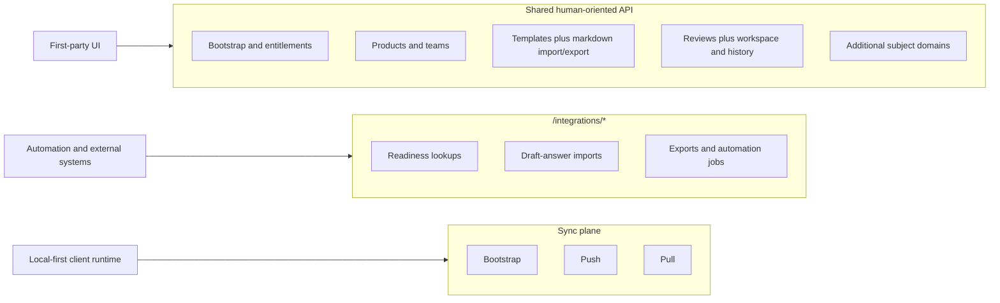
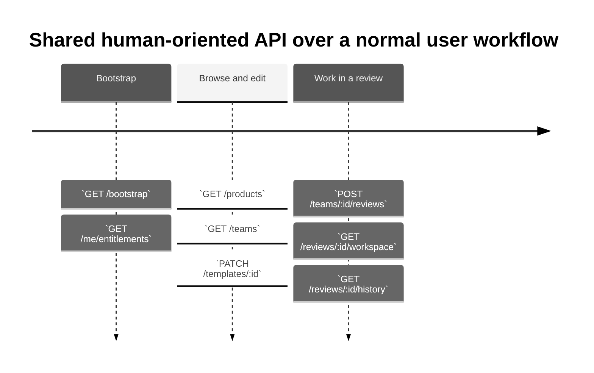
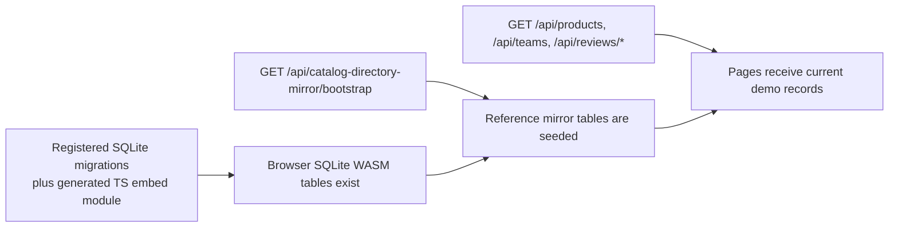

# API — Walkthrough

This walkthrough focuses on the API shape that supports Peaky's local-first architecture.

Short on time? Start with the [local-first reading map](./).

It complements two other documents:

- [Architecture](./architecture) — runtime and sync behavior
- [Data Model](./data-model) — domain model and entities

This document answers five practical API questions:

1. which API planes exist?
2. what belongs in the shared human-oriented API?
3. what belongs in `/integrations/*`?
4. how is the implemented route shape organized?
5. where do operator-facing audit routes fit?

This walkthrough uses provider-neutral field names. IDs such as `componentId` or `groupId` can still come from the external catalog, but the API does not hard-code the provider into first-party contracts.

---

## Real Go backend — `peaky-api`

The Nitro in-memory sync simulator has been replaced by two production-grade Go services, both deployed on AWS ECS Fargate:

- **`peaky-api`** — sync push/pull/bootstrap, catalog mirror, attachment auth; backed by PostgreSQL 17.
- **`peaky-sse`** — SSE fan-out; holds one dedicated PG `LISTEN` connection per pod and pushes cursor-pointer notifications to connected browser tabs so they call `pullChanges()` immediately rather than waiting for the 30s poll.

PostgreSQL was chosen over MySQL for two reasons: (1) the internal ARM-compatible vetted image is PostgreSQL only; (2) `LISTEN/NOTIFY` provides a native pub-sub primitive that eliminates the need for Redis or AppSync Events. When `peaky-api` accepts a push batch it calls `pg_notify('sync:{family}:catalog', '{"cursor":"...","family":"..."}')` once per distinct accepted family (`review`, `product`, or `template`). `peaky-sse` is already listening on that channel and fans the payload to entitled SSE streams within network RTT.

ECS Fargate was chosen over Lambda because SSE requires persistent HTTP connections; Lambda's cold-start concurrency model is cost-ineffective at connection scale.

**Interactive docs:** when running locally, browse to `http://localhost:3001/docs` for the Scalar API reference. The raw OpenAPI 3.1 spec is at `http://localhost:3001/docs/openapi.yaml`.

### Sync endpoints

| Method | Path | Description |
|--------|------|-------------|
| `GET` | `/api/sync/bootstrap` | Returns entitlement snapshot + unpushed events seeded for the actor |
| `POST` | `/api/sync/push` | Accepts outbox events; applies per-field HLC conflict resolution |
| `GET` | `/api/sync/pull` | Incremental pull of remote events since a cursor timestamp |
| `GET` | `/api/sync/entitlements` | Returns the actor's current entitlement set |

### Catalog mirror endpoints

| Method | Path | Description |
|--------|------|-------------|
| `GET` | `/api/catalog-directory-mirror` | Full embedded snapshot (raw bytes, no re-marshal) |
| `GET` | `/api/catalog-directory-mirror/meta` | Counts only (no arrays) |
| `GET` | `/api/catalog-directory-mirror/users` | Users array |
| `GET` | `/api/catalog-directory-mirror/groups` | Groups array |
| `GET` | `/api/catalog-directory-mirror/components` | Components array |

### SSE endpoints (`peaky-sse`, port 3002)

| Method | Path | Description |
|--------|------|-------------|
| `GET` | `/api/sse/events` | Persistent SSE stream; emits cursor-pointer on accepted push |
| `GET` | `/__health` | Liveness probe for the SSE service |

The SSE payload is a **cursor pointer only** — no domain data:

```jsonc
// data: <json>
{
  "cursor": "2026-05-31T12:00:00.000000000Z:evt-abc-123",
  "family": "review"
}
```

The SyncEngine calls `pullChanges()` immediately on receipt using its own stored cursor — the `cursor` field in the payload is not used directly. `family` identifies which entitlement family (`review`, `product`, or `template`) saw a change: the client exposes this via `incomingFamily` so pages can show a live "Receiving updates…" indicator scoped to their family, suppressing it when an unrelated family fires. While SSE is connected, scheduled polling is suppressed — SSE messages trigger sync cycles on demand. When SSE disconnects, the 30-second polling interval resumes automatically as a fallback. Push callbacks and visibility-change cycles run regardless of SSE state.

#### Why cursor-only — the design rationale

Sending only a cursor pointer rather than the actual changed data solves an entire class of problems at once:

| Problem class | How cursor-only solves it |
|---|---|
| **Data leakage** | `peaky-sse` never sees domain data; it cannot leak what it does not hold. A compromised SSE connection exposes only `{ cursor, family }` — nothing sensitive. |
| **Entitlement enforcement** | No access check is needed on the SSE side. The browser still calls `pullChanges()`, which is entitlement-gated on `peaky-api`. Even if an attacker subscribes to a channel they shouldn't, they receive only a wake-up signal; the subsequent pull is rejected. |
| **Stateless fan-out service** | `peaky-sse` holds zero domain state. It only maps actor entitlements to PG channel names. This makes it trivially horizontally scalable — any pod can serve any actor. |
| **Payload versioning** | The cursor format is a single timestamp string. It will never need a versioned schema, migration, or backwards-compatibility shim. Adding new entity types to the sync engine requires no SSE changes. |
| **Multi-tab convergence** | All tabs for the same actor receive the same wake-up and independently call `pullChanges()`. Each gets the full consistent view without the server needing to track per-tab state. |
| **No fan-out amplification** | A push batch touching 50 fields in one review sends one `pg_notify` → one SSE frame per connected actor. The data is pulled once per actor, not broadcast once per field. |
| **Page-level update indicator** | `family` lets the client show a "Receiving updates…" cue only on pages whose family matches the incoming change. Unrelated families trigger a silent background pull with no UI disruption. See `useSubjectUpdate` (family-scoped) + `SubjectUpdateIndicator.vue`. |

The deliberate trade-off is one extra round trip after the SSE wake-up. That is acceptable because the pull response is incremental (cursor-scoped, not a full refresh) and the latency improvement over 30s polling is still orders of magnitude.

Auth: Phase 1 — `x-actor-id` header (same trust model as `peaky-api`). Phase 3 — Okta JWT via `Authorization: Bearer` header validated against Okta JWKS.

### Other endpoints (`peaky-api`)

| Method | Path | Description |
|--------|------|-------------|
| `GET` | `/api/attachments/:id/download` | Entitlement-gated attachment download |
| `GET` | `/api/events` | Paginated event log for the actor |
| `GET` | `/__health` | Liveness probe (`{"status":"ok"}`) |
| `GET` | `/docs` | Scalar interactive API reference |
| `GET` | `/docs/openapi.yaml` | Raw OpenAPI 3.1 spec |

### Push wire format

```jsonc
// POST /api/sync/push
{
  "clientCursor": "2026-05-30T10:00:00.000Z",
  "events": [
    {
      "id": "01JVXXX...",
      "entityType": "review_answer",  // whitelisted; unknown types are rejected
      "entityId":  "01JVY...",
      "operation": "update",
      "pushedAt":  "2026-05-30T10:00:01.000Z", // validated; max 30 s in future
      "fields": [
        { "name": "answer", "value": "yes", "hlc": "2026-05-30T10:00:00.000Z_0001_clientA" }
      ]
    }
  ]
}
```

The server applies **per-field HLC conflict resolution**: each field's HLC is compared to the server's stored HLC for that field. Fields with a stale HLC are rejected individually; the event may be partially accepted. This is the key improvement over the previous simulator, which accepted or rejected entire events.

### Sync entity registry

The sync plane should stay one generic protocol, not one backend route per entity. `peaky-api` now resolves entity-specific behavior through a small registry:

```text
push event
  { entityType, entityId, operation, fields[] }
        │
        ▼
sync entity registry  (sync shape only — no authorization)
  ├─ is this entity type syncable?
  ├─ is this operation valid?
  ├─ is this a pull root (pulled on its own)?
  └─ which review owns the SSE fan-out, if any?
        │
        ▼
same HLC conflict resolver + event persistence
```

Authorization is not in that list: the sync engine forwards the raw entity to the authz boundary (`internal/authz`), which owns the resource mapping and the decision.

The known-type allow-list remains unchanged in #140: `review`, `review_checkpoint`, `review_answer`, `review_note`, `review_attachment`, `product`, `template`, `template_draft`, `template_draft_pillar`, and `template_draft_question`. The Template names are legacy protocol recognition only. Current stable Template/draft Revision authoring emits none of them, and only `review` and `product` are pull roots. Issue #137 owns complete draft bootstrap and later Template transport; recognizing a legacy string is not a durability or replay claim.

### Actor identity

The `x-actor-id`, `x-actor-type`, and `x-actor-client-id` request headers identify the caller. The middleware extracts and sanitizes these headers then places the actor on the request context. The `actor_id` in push events is overridden server-side — clients cannot impersonate other actors.

Phase 1 uses a JSON file (`ACTORS_FILE`) as the actor registry. Phase 3 will replace this with a Cedar policy engine (`authz` service stub in `docker-compose.yml`).

---

## 0. Implementation pattern

All API endpoints use the same repository pattern:

```typescript
// server/api/sync/bootstrap.get.ts

import { createRepositories } from "../../db";  // (1)!

export default defineEventHandler(async (event) => {
  // (2)! Each endpoint creates a repository set for this request
  const repos = createRepositories();

  // (3)! Use domain-specific repositories
  const snapshot = await repos.sync.getEntitlementSnapshot(actorId);
  const events = await repos.events.findPending();

  return { actorId, entitlements: snapshot, events };
});
```

1. Import factory from `server/db` — creates all repositories with shared database
2. No hidden globals — database dependency is explicit and can be swapped for testing
3. Repositories are domain-focused: `sync` for sync state, `events` for audit log, `subjects` for entities

### API folder structure

```text
server/api/
├── catalog-directory-mirror/
│   └── bootstrap.get.ts       # provider-neutral user/group/component mirror snapshot
│
├── reviews/
│   ├── [id]/
│   │   ├── workspace.get.ts     # Page-oriented projection
│   │   ├── history.get.ts       # Event-derived history
│   │   └── import-answers.post.ts # Draft imports with provenance
│   └── index.post.ts            # Create review
│
├── sync/
│   ├── bootstrap.get.ts         # Actor context + entitlements + cursors
│   ├── push.post.ts             # Accept local changes
│   ├── pull.get.ts              # Return remote changes since cursor
│   └── entitlements.get.ts      # Refresh on reconnect
│
├── products/
│   └── [id]/
│       └── index.get.ts         # Product detail
│
└── templates/
    └── [id]/
        ├── index.get.ts         # Template detail
        └── import-markdown.post.ts # Markdown import with conflict detection
```

Each endpoint creates its own `repos` instance via `createRepositories()`, ensuring explicit dependencies and testability.

---

## 1. The API is intentionally split into three planes, with an operator slice inside the shared API

Peaky is not heading toward one giant flat API surface.



Read the diagram like this:

- the **shared API** is where the first-party product spends most of its time
- the **operator-facing admin events routes** live inside that shared API, not as a separate sync protocol
- **`/integrations/*`** is intentionally narrower and machine-oriented
- the **sync plane** is not a user-facing CRUD surface; it is the runtime protocol for the local-first client

### Plane comparison

| Plane | Primary audience | Main purpose | Example routes |
| --- | --- | --- | --- |
| shared API | humans and first-party UI | CRUD-like resource access | `GET /products`, `POST /products/:id/reviews` |
| `/integrations/*` | machines and automation | stable online contracts | `POST /integrations/reviews/:id/draft-answers` |
| sync plane | the local-first client | bootstrap, push, pull-by-cursor | `GET /sync/bootstrap`, `POST /sync/push` |

### Operator-facing routes inside the shared API

These routes are part of the first-party product, but they are specifically for admins:

| Route | Purpose |
| --- | --- |
| `GET /api/admin/events` | read merged remote admin event feed |
| `GET /api/admin/events/stream` | SSE live tail for new remote events |

That split keeps the first-party app readable while still leaving room for machine-led use cases.

---

## 2. Shared API: the human-oriented contract

The shared API is the contract that powers the main Peaky UI and other human-driven workflows.

In the current demo seed, `GET /teams` feeds a **reviewed-teams** table rather than a full org directory. The endpoint derives team IDs from `reviews[]`, resolves names through the catalog-directory mirror, and only returns teams that already have at least one review. That is why the visible table is currently a single **Payments Scalability** row backed by three seeded reviews:

- **Demo Payments Scalability Security Review** → 1 template
- **Q4 2025 Peak Season Review** → 2 templates
- **Demo Payments Scalability Reliability Drill** → 3 templates

Starting a new team review does **not** depend on this list — the dashboard's team picker searches the full mirrored catalog separately.



That timeline is the important contrast with the other two planes:

| Plane | Optimized for | Mental model |
| --- | --- | --- |
| shared API | human product workflows | page and task oriented |
| `/integrations/*` | automation and machine contracts | narrow, stable online jobs |
| sync plane | local-first runtime replication | bootstrap, push, and pull-by-cursor |

### What belongs here

- Products that humans create and edit
- read-only deterministic Template aggregate/published Revision fixture projections
- process-local Review compatibility routes and human Review workflows

Current Template authoring does **not** belong to a remote write API. The browser stores stable Template metadata plus one draft Revision, Pillars, Questions, and import provenance locally through `LocalMutation.localOnly()`. Template create/update/publication/archive/restore/whole-draft-delete/permanent-delete routes fail closed with HTTP 503 and code `template_write_unavailable`; publication and lifecycle controls are absent. Issue #137 and the publication follow-up own the future server-authoritative contracts.

### Browser bootstrapping: migrations vs seed data

One subtle but important implementation detail: the browser does **not** hydrate a full copy of all demo domain data into SQLite on page load. Migrations install deterministic editable Template draft fixtures idempotently, but ordinary Product/Team/Review demo reads remain separate.

Instead, bootstrapping is split into two different jobs:



That separation explains the runtime behavior:

- **migrations** create the browser-local schema
- the SQL files remain the reviewed migration source; the generated TypeScript embed module is only the deployment-safe transport
- **catalog bootstrap** seeds the local reference tables for people, groups, and components
- **shared API reads** still supply the current demo products, teams, and reviews from the server-side demo sources

So if the local mirror bootstrap fails, pages may still fetch product or team rows from the server, but user search, team labels, owner labels, and component lookups can look empty because the browser-local reference tables were never seeded.

Two deployment details make that split reliable in production:

- the browser runtime consumes the generated SQLite migration embed module, so deployments never depend on runtime filesystem access to those `.sql` files
- `GET /api/catalog-directory-mirror/bootstrap` now serves a statically bundled snapshot JSON when one exists, instead of trying to read `catalog-directory-mirror.snapshot.json` from `process.cwd()` in a serverless runtime

That second detail matters because a deployment can otherwise look healthy while silently serving the tiny fallback demo mirror. The visible symptom is usually that products or teams still load, but user/team/component search only knows about the fallback subset.

There is also a client-side timing rule here: mirror-backed reads cannot assume the startup plugin already finished seeding SQLite. Mirror fetches now await the shared bootstrap promise, so early autocomplete requests still see the same seeded reference data instead of racing the browser bootstrap.

Finally, human-facing screens should not always block on local hydration.

- search pickers and owner-label lookups really do need the mirror tables ready
- dashboard reads such as `GET /api/teams` should paint with remote data first, then merge browser-local overlays afterward

That is why the deployed Teams dashboard can now render its reviewed team list before local hydration finishes, while the search surfaces still wait for mirror readiness.

!!! info "Independent schema authorities"
    The embedded SQLite migration content belongs only to the hand-written runtime Drizzle/SQLite path. PostgreSQL independently uses `services/schema.sql`, Goose migrations, and sqlc. Neither schema generates the other; persistence behavior tests align shared constraints. The PostgreSQL-to-Drizzle converter and `shared/db/schema/generated/` are unused, non-authoritative tooling pending issue #142.

    The Template/Revision Preview cutover is intentionally destructive but manifest-bounded: SQLite migration 0016 and Goose migration 008 remove enumerated Template/Review domain, audit, and replay state while preserving unrelated Products, Teams, catalog/cursor/migration data, and unrelated events.

### Example route map

| Area | Example routes |
| --- | --- |
| bootstrap | `GET /bootstrap`, `GET /me`, `GET /me/entitlements`, `GET /catalog-directory-mirror/bootstrap` |
| teams and products | `GET /teams`, `GET /products`, `GET /products/:id`, `PATCH /products/:id`, `DELETE /products/:id` |
| templates | `GET /templates/:id` reads deterministic aggregate/Revision fixtures; mutation-shaped routes return `template_write_unavailable` |
| reviews | `POST /teams/:id/reviews`, `POST /products/:id/reviews`, `PATCH /reviews/:id`, `DELETE /reviews/:id` |
| admin | `GET /admin/events`, `GET /admin/events/stream` |

### Archive and delete semantics

Archive is the soft-delete model for Peaky-owned records: it moves data into a warm, restorable tier instead of removing it.

- archive and permanent-delete actions are restricted to the subject owners plus admins; teams stay externally owned catalog subjects, so the UI does not expose team archive or delete actions
- products already use the shared `PATCH /api/products/:id` status transition with `{ "status": "archived" }`, and restore by moving back to `{ "status": "active" }` or `{ "status": "inactive" }`
- in the local-first path, product archive state lives on `subjects.status`; the client updates that local row first and queues an outbox `update` for sync
- Templates have stable aggregate lifecycle `active | archived`; Revisions separately use `draft | published | retired`
- Template archive, restore, whole-draft-delete, and permanent-delete transitions are modeled but unavailable to every actor and return `template_write_unavailable` before authorization or state work
- available Product and Review permanent deletes remain separate cleanup steps after archive and require their existing authorization/confirmation rules
- Reviews follow the warm-tier archive lifecycle; permanent Review deletion is tighter than Product cleanup, limited to admins and backed by audit records
- enabled Product/Review lifecycle changes leave an audit paper trail; frozen Template lifecycle calls perform no audit or state write
- archived records stay out of the default active surfaces while remaining queryable and restorable, which gives the system a warm lifecycle tier before any colder retention/export path; see [Auditing](./auditing) for the event trail behind those transitions

### Authorization bridge on lifecycle routes

The lifecycle routes use one actor shape across normal HTTP writes and the Admin Events SSE stream.

| Transport | Fields | Why it exists |
| --- | --- | --- |
| request headers | `x-actor-id`, `x-actor-name`, `x-actor-roles` | normal lifecycle and review writes |
| query params | `actorId`, `actorName`, `actorRoles` | keeps `EventSource` compatible with the same actor model |

These are read server-side by `getLifecycleActor(event)`. For the rule set behind them, see [Authorization](./authorization).

### Example: create a review through the shared API

=== "Request"

    ```http
    POST /api/teams/payments-scalability/reviews
    Content-Type: application/json

    {
      "name": "Demo Payments Scalability Follow-up",
      "templateRevisionIds": ["revision-peak-season-1", "revision-pci-dss-1"],
      "applicationIds": ["modificationqueueprocessor"]
    }
    ```

=== "Response"

    ```json
    {
      "id": "review-123456",
      "teamId": "payments-scalability",
      "name": "Demo Payments Scalability Follow-up",
      "status": "draft",
      "templateRevisionIds": ["revision-peak-season-1", "revision-pci-dss-1"],
      "templateRevisionNames": ["Peak Season v1", "PCI-DSS v1"],
      "applicationIds": ["modificationqueueprocessor"],
      "assessors": [
        { "id": "user-002", "name": "Marcus Johnson", "email": "marcus.j@example.com" },
        { "id": "user-005", "name": "Jordan Rivera", "email": "jordan.r@example.com" }
      ],
      "reviewers": [
        { "id": "advisor-004", "name": "Raj Sharma", "email": "raj.sharma@example.com" }
      ],
      "createdAt": "2026-03-17T08:10:00Z"
    }
    ```

The owner-specific Review creation routes are process-local fixture compatibility endpoints. They validate one to three exact current published Revision IDs from distinct active Templates and return 201 without claiming browser SQLite, PostgreSQL, or sync durability. Canonical browser creation instead writes the Review and ordered selection rows in one local SQLite transaction. The API still exposes these compatibility routes plus shared lifecycle routes:

- `POST /api/teams/:id/reviews`
- `POST /api/products/:id/reviews`
- `PATCH /api/reviews/:id`
- `DELETE /api/reviews/:id`

---

## 3. `workspace` is a page-oriented read model

`workspace` is not a new business entity. It is a projection designed to hydrate the assessment screen in one request.

### Why it exists

Without it, the UI tends to fan out into many reads:

- review metadata
- questions
- pillars
- answers
- notes
- permissions
- score state

With a workspace projection, the assessment view gets one payload shaped for that screen.

=== "Request"

    ```http
    GET /reviews/review_01JXYZ/workspace
    ```

=== "Response"

    ```json
    {
      "review": {
        "id": "review_01JXYZ",
        "name": "Q4 2025 Peak Season Review",
        "status": "draft"
      },
      "subject": {
        "id": "payments-scalability",
        "type": "team",
        "name": "Payments Scalability"
      },
      "templates": [
        {
          "templateId": "template-peak-season",
          "templateRevisionId": "revision-peak-season-3",
          "name": "Peak Season",
          "revisionNumber": 3
        }
      ],
      "questions": [],
      "answers": [],
      "notes": [],
      "attachments": [],
      "latestReadiness": null,
      "capabilities": {
        "canEdit": true,
        "canPublish": false
      },
      "recentHistory": []
    }
    ```

The workspace hydrates from exact selected immutable Revision snapshots; later Template/draft edits cannot change it. Locally, `review_template_selections` stores those ordered references. #140 does not add selection outbox fields, Go push validation, inbound replay, or PostgreSQL Review projection, so remote hydration cannot yet reconstruct a complete Review aggregate on a fresh client. Generic Sync Hardening owns that gap.

---

## 4. `/integrations/*`: machine-led contracts only

This namespace is intentionally narrow and explicit.

### What belongs here

- machine lookups by component id
- draft-answer import from automation
- scorecard exports
- machine-only jobs that should not leak UI-oriented workflow details

### Example route map

| Use case | Example route |
| --- | --- |
| readiness by component id | `GET /integrations/readiness/components/:componentId` |
| readiness history by component id | `GET /integrations/readiness/components/:componentId/history` |
| draft-answer import | `POST /integrations/reviews/:id/draft-answers` |
| campaign automation | `POST /integrations/campaigns` |

### Example: draft-answer import

=== "Request"

    ```http
    POST /integrations/reviews/review_01JXYZ/draft-answers
    Authorization: Bearer <integration-token>
    Content-Type: application/json

    {
      "source": "ci-cd",
      "runId": "pipeline-1842",
      "answers": [
        {
          "questionId": "ops-12",
          "answer": "yes",
          "confidence": 0.81,
          "evidence": [
            "https://ci.example/pipelines/1842",
            "git:abcdef123456"
          ]
        }
      ]
    }
    ```

=== "Response"

    ```json
    {
      "reviewId": "review_01JXYZ",
      "importedCount": 1,
      "mode": "draft-fill",
      "recordedAt": "2026-03-17T08:20:00Z"
    }
    ```

The key point is that this remains a machine contract with full provenance, not just another generic PATCH route.

---

## 5. Sync plane: not a human CRUD API

The sync plane is the protocol used by the local-first client.

It is not meant to be a general-purpose integration surface.

| Operation | Purpose |
| --- | --- |
| bootstrap | load actor context, entitlement snapshot, cursors, and initial sync hints |
| push | send `localOutbox` items (sync transport) since the last acknowledged client cursor |
| pull | return `events` (audit data) since the client's last remote cursor |

Push and pull are separate concerns: push drains the outbox queue, pull receives the permanent audit trail. They use different source tables and have different durability semantics.

The sync client uses two layers of backoff. Per-item: `AdaptiveRetryPolicy` (exponential backoff with decorrelated jitter, capped at 60s). Per-endpoint: `BackoffGate` instances — `syncGate` (30s–5 min) for peaky-api, `sseGate` (1s–2 min) for peaky-sse. Gates are per-endpoint to avoid conflating independent failure domains. After access revocation, retries stop and the item moves to the pending queue. Batch sizes adapt via `ConcurrencyController`: start at 5, increase 50% on full success, halve on any failure.

### Example sync flow

=== "Bootstrap"

    ```http
    GET /sync/bootstrap
    ```

=== "Push"

    ```http
    POST /sync/push
    Content-Type: application/json

    {
      "clientCursor": "c_102",
      "events": []
    }
    ```

=== "Pull"

    ```http
    GET /sync/pull?after=r_88
    ```

The simulator already speaks this language so storage and transport details can change without redesigning the protocol.

### Sync plane implementation

The sync endpoints use the same repository pattern as other APIs:

=== "Bootstrap"

    ```typescript
    // server/api/sync/bootstrap.get.ts

    export default defineEventHandler(async (event) => {
      const repos = createRepositories();  // (1)!

      // (2)! Get entitlement snapshot for offline work
      const entitlements = await repos.sync
        .getEntitlementSnapshot(actorId);

      // (3)! Get cursors for incremental sync
      const cursor = await repos.sync.getCursor(actorId);

      // (4)! Return bootstrap payload
      return { actorId, entitlements, cursor, ... };
    });
    ```

    1. Create repository set — same pattern as all endpoints
    2. Entitlement snapshot enables offline editing decisions
    3. Cursors enable incremental push/pull instead of full sync
    4. Bootstrap gives client everything needed to start local-first work

=== "Push"

    ```typescript
    // server/api/sync/push.post.ts

    export default defineEventHandler(async (event) => {
      const repos = createRepositories();
      const body = await readBody(event);  // (1)!

      for (const syncEvent of body.events) {
        // (2)! Check entitlements before accepting
        const entitlement = await checkEntitlement(repos, syncEvent);

        // (3)! Apply to appropriate repository
        await applyEventToRepository(repos, syncEvent);

        // (4)! Record audit event for history
        await repos.events.save({
          id: syncEvent.id,
          eventType: `${syncEvent.entityType}:${syncEvent.operation}`,
          actorId, data: syncEvent.payload, status: "synced"
        });
      }

      // (5)! Update cursors after successful sync
      await repos.sync.saveCursor({ actorId, localCursor, remoteCursor });

      return { accepted, rejected, newClientCursor, remoteCursor };
    });
    ```

    1. Client sends events since last acknowledged cursor
    2. Rejected events go to pending-review queue on client
    3. Routes to correct repository based on entity type
    4. Every sync event becomes an audit event
    5. Cursors advance so next push/pull is incremental

=== "Pull"

    ```typescript
    // server/api/sync/pull.get.ts

    export default defineEventHandler(async (event) => {
      const repos = createRepositories();
      const afterCursor = getQuery(event).after;  // (1)!

      // (2)! Get events since cursor
      const pendingEvents = await repos.events.findPending();
      const relevantEvents = pendingEvents
        .filter(e => e.time > afterCursor);

      // (3)! Advance cursor
      const newCursor = relevantEvents.at(-1)?.time;
      await repos.sync.saveCursor({ actorId, remoteCursor: newCursor });

      return { cursor: newCursor, events: relevantEvents, hasMore };
    });
    ```

    1. Client passes cursor from last pull — "give me everything after this"
    2. Filter to events the client hasn't seen yet
    3. Update cursor so next pull starts from here

---

## 6. Route organization

The implemented review surface splits into two shapes:

### Review hydration

```text
GET /api/reviews/:id/workspace
GET /api/reviews/:id/history
```

These page-oriented routes return the projections the review workspace actually needs.

### Review creation compatibility and lifecycle

```text
POST /api/teams/:id/reviews
POST /api/products/:id/reviews
PATCH /api/reviews/:id
DELETE /api/reviews/:id
```

The owning-subject creation routes remain process-local fixture compatibility. Canonical browser creation is local SQLite authority; exact Revision selection transport and PostgreSQL projection remain deferred. Available lifecycle actions converge on the shared Review routes.

### Operator-facing audit slice

The API includes a small operator slice for the admin events UI.

```text
GET /api/admin/events
GET /api/admin/events/stream
```

That is part of the first-party admin surface over audit data, not the sync protocol itself.

A separate "admin pull events API" — for admins viewing other actors' synced events from the server — is **decision deferred** in the roadmap (custom API vs Looker). It would only become relevant once the Rust sync engine pushes `*` events to the server. Until then, every member's `/admin/events` view is sourced from their own session's local events table.

`/system` does NOT add HTTP routes — it reads `peaky.system` events from the local events table directly via `useSystemStatus`. No sync-plane involvement.

---

## 7. Scope boundary

This walkthrough documents the implemented API surface only.

When new subject domains are added, they should plug into the same shared review lifecycle and sync contracts instead of creating parallel review subsystems.

---

## 8. API summary

```text
The shared API is for human-driven product workflows.
/integrations/* is for machine-led automation.
The sync plane is for the local-first client runtime.
Workspace is a page-oriented projection, not a new business entity.
The route tree stays split by API plane and by the page projections each workflow needs.
```

### API architecture at a glance

```text
server/api/
├── admin/                   # Operator-facing audit feed
│   ├── events.get.ts        # merged remote admin events
│   └── events/
│       └── stream.get.ts    # SSE live tail for admins
│
├── sync/                    # Sync plane (local-first client)
│   ├── bootstrap.get.ts     # → repos.sync + repos.events
│   ├── push.post.ts        # → repos.sync + repos.events + repos.*
│   ├── pull.get.ts         # → repos.events + repos.sync
│   └── entitlements.get.ts # → repos.sync
│
├── reviews/                 # Shared lifecycle API (humans)
│   └── [id].{patch,delete}.ts
│
├── products/                # Shared API (humans)
│   ├── index.{get,post}.ts
│   ├── [id].{patch,delete}.ts
│   └── [id]/reviews.{get,post}.ts
│
├── teams/                   # Shared API (humans)
│   └── [id]/reviews.{get,post}.ts
│
└── templates/               # Shared API (humans)
    ├── index.post.ts
    └── [id].{put,delete}.ts
```

Every endpoint follows the same pattern:

1. `const repos = createRepositories()`
2. Use domain-specific repositories (`repos.sync`, `repos.events`, etc.)
3. Return response

For the domain model that underlies these APIs, see [Data Model](./data-model).
