# Local-First Architecture — Walkthrough

This walkthrough explains the implemented local-first architecture linearly, from user interaction down to local persistence, the Go sync backend, and the independent PostgreSQL/SQLite schema authorities.

!!! note "Sync simulator retired"
    The Nitro in-memory sync simulator has been replaced by `peaky-api`, a production Go binary backed by PostgreSQL 17. A second service, `peaky-sse`, fans cursor-pointer notifications to connected browsers via PG `LISTEN/NOTIFY` → Server-Sent Events. The section at the bottom of this page titled "What the sync simulator is for" is preserved for historical context. See the [API walkthrough](./api.md#real-go-backend--peaky-api) for the current endpoint shape, push wire format, and field-level HLC conflict resolution.

Short on time? Start with the [local-first reading map](./).

It is intentionally progressive:

1. start with the product reason for the architecture
2. understand the architecture layers and runtime path
3. follow a single edit through the system
4. understand reconnect and permission drift
5. understand the implemented system boundary

---

## 1. Terminology

Most common terms used in its simplest form are

- **local-first**. Save here first, sync later *(outbox)*
- **entitlement**. What am I allowed to do?
- **simulator**. Practice remote sync contract, not real production storage
- **CRDT**. Last resort for hard concurrent-edit problems *(conflict resolution optimized data types)*

??? "All terms explained"

    | Term                 | Brief meaning in Peaky                                                                                                             |
    | -------------------- | ---------------------------------------------------------------------------------------------------------------------------------- |
    | local-first          | The browser-local database is the user's immediate source of truth; remote sync happens in the background                          |
    | reactive query layer | The layer that turns local database rows into live UI-ready projections without polling                                            |
    | outbox               | A queue of local mutations waiting to be synchronized remotely                                                                     |
    | entitlement          | The effective permissions a user has to view or edit resources, derived from authenticated identity and group or role resolution   |
    | entitlement snapshot | The cached local copy of those permissions used while offline                                                                      |
    | catalog              | The external system that supplies component, group, or ownership identifiers to Peaky, *e.g., Launchpad*                           |
    | simulator            | A non-production remote sync rehearsal service that validates protocol behavior, not durability                                    |
    | cursor               | A position marker used for incremental push/pull sync instead of full refetches                                                    |
    | CRDT                 | A conflict-friendly replicated data structure that remains deferred unless structured optimistic collaboration proves insufficient |

This walkthrough intentionally uses provider-neutral names. Current providers can change later without forcing Peaky's core field names or APIs to change with them.

---

## 2. Why local-first

Peaky optimizes for two key needs:

- **Instant UX**. An instant UI experience for reviews, products, and template authoring, regardless of their location.
- **Resilience**. Adapt to current Postgres failover scenarios, allowing offline and partial replication workflows.

Enabled domains commit locally first, then sync in the background. Here's the normal transported path:

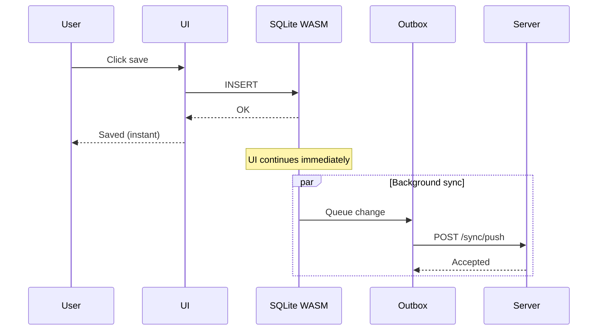

This addresses both the Instant UX and Resilience needs. For users, their remote location and workflows are prioritized:

- reviews that track readiness work over time
- products that define ownership, linked components, and supporting context
- Template drafts that evolve locally before publication becomes available

Template authoring deliberately stops after the local SQLite commit: stable Template metadata plus one draft Revision, its Pillars, Questions, and import provenance are written through `LocalMutation.localOnly()` with no event, outbox row, or push trigger. Clearing local data or losing the device therefore loses unpublished work. Publication, archive, restore, and deletion are frozen until trusted server-authoritative follow-ups.

Reviews select one to three exact current published Revisions from distinct active Templates. Their local ordered selection rows remain immutable, but #140 adds no selection outbox fields, Go validation, inbound replay, or PostgreSQL Review projection. Generic Sync Hardening owns complete aggregate transport.

The Template/Revision Preview cutover is intentionally destructive but bounded. SQLite migration 0016 and PostgreSQL Goose migration 008 remove enumerated Template/Review domain, audit, field-history, and replay state while preserving Products, Teams, catalog data, cursors, migration logs, and unrelated events. This one-time manifest does not permit ordinary runtime audit deletion.

Enabled transports can survive temporary outages, PostgreSQL maintenance windows, poor network conditions, and partial degradations. The local-only Template boundary provides offline authoring, not server durability.

---

## 3. Local-first scope

The implemented local-first architecture includes:

- browser-local SQLite via SQLocal + SQLite WASM + OPFS
- reactive local projections for products, reviews, and templates
- outbox-based background sync for enabled entity fields
- entitlement snapshots and pending-review handling
- audit/event streams plus the Admin Events operator surface
- `peaky-api` and `peaky-sse` Go services that serve the push/pull/bootstrap and SSE fan-out contracts

The deliberate boundary: the browser concerns itself with local persistence and protocol; the Go services own durability and conflict resolution.

The sync protocol is intentionally entity-generic. Domain-specific behavior is attached through the sync entity registry instead of new push/pull routes per product area:

```text
Domain mutation
  │
  ▼
Local adapter writes projection + outbox event
  │
  ▼
POST /api/sync/push { entityType, entityId, operation, fields[] }
  │
  ▼
Go sync entity registry  (sync shape)
  ├─ validates entity + operation
  └─ keeps SSE fan-out review-scoped where needed
  (authorization is the authz boundary's call, not the registry's)
  │
  ▼
Generic HLC conflict resolution
```

That boundary keeps future transport work additive, but known registry names alone do not mean a domain is transported. #140 leaves the recognized legacy types `template`, `template_draft`, `template_draft_pillar`, and `template_draft_question` unchanged while current Template authoring emits none of them; only Review and Product are pull roots. Issue #137 must bootstrap complete draft state before any incremental Template transport is enabled.

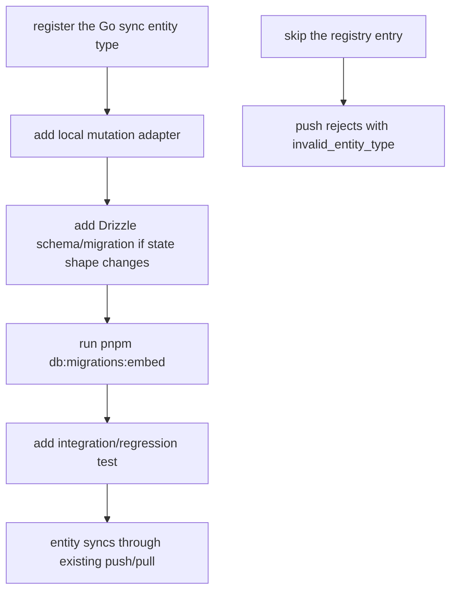

---

## 4. Architecture layers

Before looking at composables or repositories, the most useful mental model is keeping these areas in mind:

| Layer                        | Purpose                                                    | Implementation approach                                                                                                                                                                                         |
| ---------------------------- | ---------------------------------------------------------- | --------------------------------------------------------------------------------------------------------------------------------------------------------------------------------------------------------------- |
| **Domains**                  | define product, team, review, and template behavior        | Nuxt `pages/`, `components/`, plus `app/products`, `app/teams`, `app/reviews`, `app/templates`                                                                                                                  |
| **Domain Services**          | business logic, projections, hydration, governance. No Vue imports. | `app/services/` — ReviewProjection, ReviewHydration, ReviewGovernance, ReviewRepository, SyncEngine, EntitlementService, PendingQueueService, TemplateCatalog, TemplatePersistence, TemplateValidation, AssessmentOrchestrator, entity mutation services |
| **Authorization**            | decide what the actor may view or edit, even while offline | `app/services/review/ReviewGovernance.ts`, entitlement snapshots, pending review queue; composables are thin Vue adapters that delegate to services                                                            |
| **Actor identity**           | keep the browser's current user/profile consistent         | `useCurrentActor`, local profile picker in navigation, `server/utils/lifecycleActor.ts`                                                                                                                         |
| **Catalog-directory mirror** | keep user / group / component labels available locally     | `app/catalog-directory-mirror/*`, `server/data/catalog-directory-mirror.ts`, shared `catalog-directory` schema                                                                                                  |
| **Local-first data system**  | save local state immediately and expose it back to the UI  | [SQLocal](https://sqlocal.dev/), [SQLite WASM](https://sqlite.org/wasm/), [OPFS](https://developer.mozilla.org/en-US/docs/Web/API/File_System_Access_API), [Drizzle](https://orm.drizzle.team/), local adapters |
| **Sync boundary**            | turn local mutations into background sync traffic          | outbox tables, `app/services/sync/SyncEngine.ts`, sync API endpoints                                                                                                                                            |
| **Schema authorities**       | maintain equivalent behavior through each active database path | PostgreSQL: `services/schema.sql` + Goose/sqlc; SQLite: hand-written `shared/db/schema/*` + registered SQLite migrations                                                                                     |

Those pieces are different responsibilities, not just different folders.

Enabled Product and Review lifecycle actions cut across those boundaries, which is why they are easy to get wrong if you only think about the button.

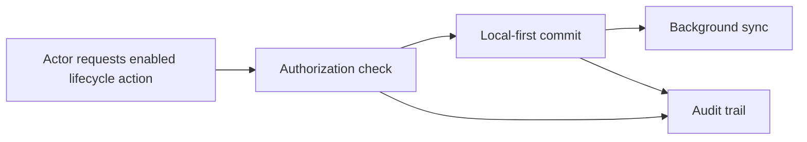

Template lifecycle follows a different boundary during this stage. Remote archive, restore, whole-draft-delete, permanent-delete, create, update, and publication requests return `template_write_unavailable` before authorization, local state, event, outbox, timestamp, or fixture work. Neither admin role, owning Team, actor provenance, nor draft-edit entitlement bypasses the freeze.

The deeper policy rules live in [Authorization](./authorization). Keep this walkthrough as the architecture map, not the full policy reference.
The event catalog and naming index live in [Auditing](./auditing), since that walkthrough owns the taxonomy and paper trail.

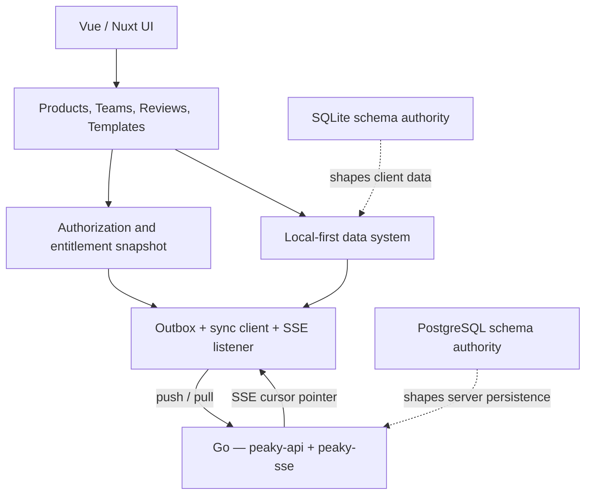

Read the diagram as a map of responsibility boundaries. The sections below explain what each layer owns and why it exists.

### How the storage technologies fit together

These names are easy to blur together, but each one has a different role:

| Technology             | What it is                                          | Why it exists here                                                         |
| ---------------------- | --------------------------------------------------- | -------------------------------------------------------------------------- |
| SQLite WASM            | the SQLite engine compiled to WebAssembly *(<1MB)*  | lets the browser execute real SQL locally                                  |
| OPFS                   | the browser's private file system                   | gives SQLite a durable place to store local data; survives refresh/closure |
| SQLocal                | a wrapper around SQLite WASM + OPFS                 | hides low-level browser storage setup and exposes a typed client           |
| Drizzle                | the typed query layer on browser SQLite             | gives the client a hand-written runtime schema independent of PostgreSQL   |
| outbox                 | a table-backed queue of unsynced local mutations    | preserves local-first UX while sync happens later; powers auditing too     |
| authorization snapshot | cached local permissions                            | allows offline work without forgetting who can edit what with expiration   |

The client storage stack from highest to lowest layer looks like:

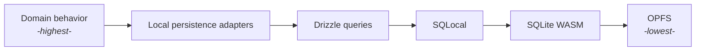

That stack matters because "local-first" is not one technology choice. It is the combination of:

- Local SQL engine
- Durable browser storage
- Queue for later sync
- Permission model that still works when the network disappears
- Cross-tab coordination so multiple windows stay consistent without racing each other

??? tip "Resources to dive into local-first"
    For deeper background on local-first principles and implementation challenges, see:

    - [Local-First Software](https://www.inkandswitch.com/local-first/) — the foundational essay by Ink & Switch
    - [Building data-centric apps with a reactive relational database](https://riffle.systems/essays/prelude/) — Riffle's technical deep-dive
    - [CRDTs: The Hard Parts](https://www.youtube.com/watch?v=x7drE24geUw) — Martin Kleppmann's talk on conflict-free replicated data types

### Folder structure by architecture layer

```text
app/
├── pages/                    # route entrypoints
├── components/               # Vue UI pieces
├── catalog-directory-mirror/ # local catalog + directory bootstrap and mappers
├── products/                 # product domain behavior
├── teams/                    # team domain behavior
├── reviews/                  # review domain behavior
├── templates/                # template domain behavior
└── services/                 # domain services (no Vue imports)
    ├── review/               # ReviewProjection, ReviewHydration, ReviewGovernance, ReviewRepository
    ├── sync/                 # SyncEngine, EntitlementService, PendingQueueService
    ├── template/             # TemplateCatalog, TemplatePersistence, TemplateValidation
    └── assessment/           # AssessmentOrchestrator, entity mutation services

app/composables/
├── useCurrentActor.ts        # browser-local actor/profile selection
├── useCatalog*.ts            # mirror-backed people/group/component lookup
├── useLocalUIStore.ts        # transient UI-only state
└── local/                    # local persistence adapters (thin Vue wrappers over services)
    ├── useLocalProduct.ts
    ├── useLocalReview.ts
    └── useLocalTemplateDraft.ts

app/local-db/
├── client.ts                 # SQLocal + Drizzle wiring
├── helpers.ts                # query safety helpers
└── migrations.ts             # client migration runner

shared/db/
├── schema/                   # hand-written runtime SQLite tables
│   └── catalog-directory.ts  # mirror metadata + directory/catalog tables
└── migrations/sqlite/        # ordered, registered SQLite SQL files

server/
├── api/catalog-directory-mirror/ # browser bootstrap for mirror data (Nuxt route)
└── utils/lifecycleActor.ts   # shared actor header/query parsing

services/                     # PostgreSQL schema authority + Go services
├── schema.sql                # PostgreSQL desired end state
├── internal/dbmigrate/       # Goose migrations
├── cmd/peaky-api/            # sync push/pull/bootstrap, catalog mirror, attachments
├── cmd/peaky-sse/            # SSE fan-out — PG LISTEN/NOTIFY → EventStream
├── cmd/peaky-ctl/            # management CLI: migrate, seed
└── internal/
    ├── authz/                # Authorizer contract + actor registry (auth, no Fuego)
    ├── syncengine/           # sync engine — HTTP layer at top: handler.go, push.go,
    │   │                     #   pull.go, models.go, routes.go (reads like a flat feature)
    │   ├── conflict/         #   sub-pkg: HLC resolution (no Fuego)
    │   ├── entity/           #   sub-pkg: entity registry (new entities land here)
    │   ├── repo/             #   sub-pkg: ports.go, postgres.go, fake.go
    │   └── db/               #   sub-pkg: sqlc-generated
    └── sse/                  # hub.go (fan-out), handler.go, routes.go
```

## 5. Runtime layers

Once the architectural pieces are clear, the runtime path becomes easier to follow:

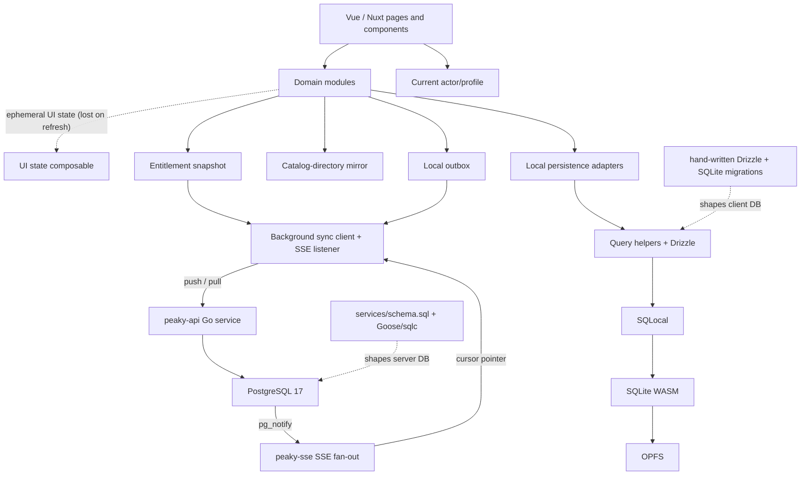

This is the runtime path from user action to local persistence to background sync for enabled transports. PostgreSQL and SQLite do not generate one another: persistence behavior tests enforce their shared contract. The unused PostgreSQL-to-Drizzle converter and `shared/db/schema/generated/` are non-authoritative pending issue #142.

The table below turns that path into concrete responsibilities.

### Runtime responsibilities

The system is built in layers, each with a clear job:

| Layer                      | What it does                                  | Where to find it                                                    |
| -------------------------- | --------------------------------------------- | ------------------------------------------------------------------- |
| **Vue/Nuxt UI**            | render screens and handle user interactions   | Nuxt pages and components                                           |
| **Domain modules**         | coordinate feature behavior and derived state; composables are thin Vue adapters that delegate to services | `app/products/*`, `app/teams/*`, `app/reviews/*`, `app/templates/*` |
| **Domain services**        | pure business logic, projections, hydration, governance with no Vue imports | `app/services/` |
| **UI composables**         | hold transient screen state (lost on refresh) | `useLocalUIStore`                                                   |
| **Actor profile**          | expose the current browser-local actor        | `useCurrentActor.ts` + navigation profile modal                     |
| **Catalog-directory mirror** | resolve user/group/component labels locally | `app/catalog-directory-mirror/*` + `useCatalog*Search.ts`           |
| **Authorization snapshot** | check if local actions are still allowed      | `app/services/sync/EntitlementService.ts` + `entitlement_snapshots` |
| **Local adapters**         | read and write browser-local rows             | `app/composables/local/useLocal*`                                   |
| **Query helpers**          | keep Drizzle access defensive and readable    | `app/local-db/helpers.ts` + `withDatabase()`                        |
| **SQLite WASM + OPFS**     | durable browser-local SQL execution           | `app/local-db/client.ts` via SQLocal                                |
| **Outbox**                 | queue local mutations for background sync     | `local_outbox` table in client SQLite                               |
| **Sync engine**            | manage sync cycles, adaptive retry, concurrency control | `app/services/sync/SyncEngine.ts`                          |
| **Go sync backend**        | push/pull/bootstrap, HLC conflict resolution, SSE fan-out | `services/cmd/peaky-api`, `services/cmd/peaky-sse`, PostgreSQL 17 |
| **PostgreSQL schema**      | desired server state plus Goose/sqlc pipeline | `services/schema.sql`, `services/internal/dbmigrate/`               |
| **SQLite Drizzle schemas** | hand-written browser runtime schema            | `shared/db/schema/*`                                                |
| **SQLite migrations**      | ordered, registered client schema evolution   | `shared/db/migrations/sqlite/*.sql`                                 |

### Lifecycle states are part of the storage strategy

Local-first lifecycle is not only about UX cleanup.
It is also how the system separates the hot working set from colder data.

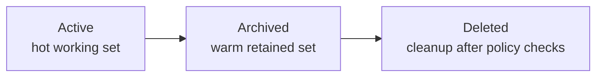

The point of `archived` is not cosmetic.
It gives the model a safe middle state:

| State    | What it means                                                | Why it exists                                         |
| -------- | ------------------------------------------------------------ | ----------------------------------------------------- |
| active   | frequently accessed operational data                         | normal product flow                                   |
| archived | hidden from default views but still restorable and queryable | warm retention without losing identity                |
| deleted  | explicit cleanup after safety checks                         | final removal for cold-retention or test-data cleanup |

Today that means:

- Products move through `archive` before permanent delete
- Reviews also move through archive first, but with stricter audit expectations around removal
- Templates model `active | archived`, but no archive, restore, or delete transition is currently exposed
- Teams stay externally owned, so Peaky does not archive or delete them directly

The rule of thumb is simple:

```text
if dependents still matter, stop at archived
if policy and dependency checks pass, delete becomes available
```

### Domain modules vs domain services vs local adapters vs UI composables

This is the distinction that usually trips up new maintainers:

| Layer                                                                                  | Owns                                                                   | Examples                                                                   |
| -------------------------------------------------------------------------------------- | ---------------------------------------------------------------------- | -------------------------------------------------------------------------- |
| **Domain modules** <br/> `app/products` `app/teams`<br/> `app/reviews` `app/templates` | feature-level orchestration, fallback rules, progressive hydration, and UI-ready derived data; composables are thin Vue adapters that delegate to domain services | `useProductDetails`, `useTeams`, `useReviewWorkspace`, `useTemplateStudio` |
| **Domain services** <br/> `app/services/`                                              | pure business logic, projections, hydration, and governance with no Vue imports | `ReviewProjection`, `ReviewGovernance`, `SyncEngine`, `EntitlementService`, mutation services |
| **Mirror and identity composables** <br/> `app/catalog-directory-mirror` `app/composables` | provider-neutral lookup data and current actor state                  | `useCatalogUserSearch`, `useCatalogGroupSearch`, `useCurrentActor`         |
| **Local persistence adapters** <br/> `app/composables/local/useLocal*`                 | direct reads and writes against local SQLite tables                    | `useLocalProduct`, `useLocalReview`, `useLocalTemplateDraft`               |
| **UI composables** <br/> `app/composables`                                             | transient screen state that should disappear on refresh                | `useLocalUIStore`                                                          |

Rule of thumb:

```mermaid
flowchart TD
    Q1[Pure business logic, no Vue?] --> SVC[Domain service<br/>app/services/]
    Q2[Vue lifecycle, refs, watch, computed?] --> COMPOSABLE[Composable]
    Q3[Enabled DB mutation?] --> UOW[Via LocalMutation.commit()]
    Q3B[Frozen Template draft authoring?] --> LOCALONLY[Via LocalMutation.localOnly()]
    Q4[Which panel is open right now?] --> UI[UI composable]
```

## 6. Admin events visibility

Auditing events are surfaced at `/admin/events`, in a CloudTrail-style operator view. That page merges:

- remote lifecycle audit events
- `review-event` history
- local-first outbox-derived events that have not synced yet
- an SSE live-tail stream for new remote events

The mental model is:

- architecture explains where the data comes from
- [Authorization](./authorization) explains who may act
- [Auditing](./auditing) explains what gets recorded
- the Admin Events UI is the operator-facing read surface over those layers

### `/system` is the member-facing read surface

Alongside `/admin/events` (operator-only), `/system` exists as a member-facing diagnostic surface available to every authenticated member. It reads `peaky.system` events from the local events table directly — no HTTP calls — and renders four tiles (Database, Schema, Storage, Sync) plus a single Recreate-DB action.

| Surface | Audience | What it shows |
| --- | --- | --- |
| `/admin/events` | admins / operators | every event across actors with full envelope details |
| `/events` | individual members | their own activity (`actorId == currentUser`) |
| `/system` | every authenticated member | engine status (DB / Schema / Storage / Sync) + recent `peaky.system` events + recovery action |

Implementation lives at `app/pages/system.vue` + `app/composables/system/useSystemStatus.ts` + `app/components/system/`. See the [Failure Domains](./failure-domains) scan map for which symptoms route to `/system`, and [Upgrades — recovery surface](./upgrades#the-system-page-is-the-recovery-surface) for the recreate flow.

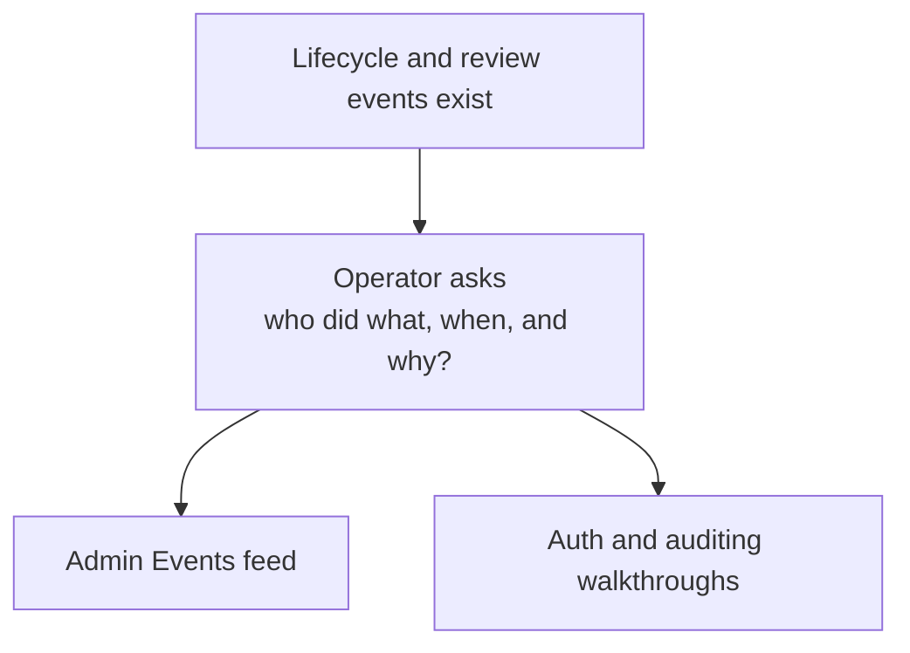

The surface exists.
The remaining work is to deepen the operator experience and the surrounding policy visibility.

| Question                                            | Why it matters                  |
| --------------------------------------------------- | ------------------------------- |
| who archived or permanently deleted this?           | destructive accountability      |
| which actor was treated as an admin?                | policy correctness              |
| which dependents were still attached?               | lifecycle safety                |
| which events are still only local and pending sync? | local-first operational clarity |

So the next iteration is about richer operator experience and clearer policy evolution.

### Why independent schema authorities matter

The two active databases deliberately have separate sources:

| Runtime | Driver | Active authority |
| --- | --- | --- |
| Browser client | SQLocal + Drizzle + SQLite WASM | hand-written `shared/db/schema/*` plus registered `shared/db/migrations/sqlite/*` |
| Go backend | PostgreSQL + sqlc | `services/schema.sql` desired state plus Goose migrations and sqlc queries/models |

Neither authority generates the other. Shared domain constraints are kept aligned through persistence behavior tests against fresh and upgraded PostgreSQL and SQLite. The unused `scripts/generate-drizzle-from-sql.ts` converter and `shared/db/schema/generated/` output are non-authoritative pending issue #142.

### Migration flow

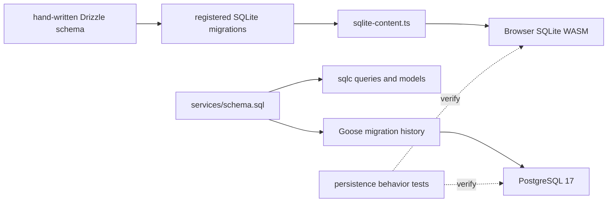

For PostgreSQL changes, update `services/schema.sql`, add the Goose migration, and regenerate sqlc where queries/models change. For SQLite changes, update the hand-written Drizzle schema, add and register the SQL migration, then run `pnpm db:migrations:embed`. Historical migrations remain immutable.

The browser-local path no longer depends on runtime filesystem reads. Checked-in SQLite SQL remains reviewable, while the deterministic `sqlite-content.ts` embed is its deployment-safe transport.

The same packaging rule applies to the catalog-directory mirror snapshot. The checked-in `server/data/catalog-directory-mirror.snapshot.json` is statically imported into the server bundle instead of being read from `process.cwd()` at request time. That avoids a subtle serverless failure mode where the build succeeds, but the runtime cannot see the snapshot file and silently falls back to the smaller demo seed.

### Browser startup: migrate first, seed second

The browser does **not** start by copying the whole server demo database locally. The deterministic editable Template draft fixtures are the narrow exception and are installed idempotently into local SQLite.

It does two narrower things on startup:

1. open browser-local SQLite WASM through SQLocal
2. apply the registered SQLite migrations to create the local tables
3. fetch the catalog-directory mirror bootstrap snapshot
4. seed the local reference tables used by search, labels, and ownership lookups

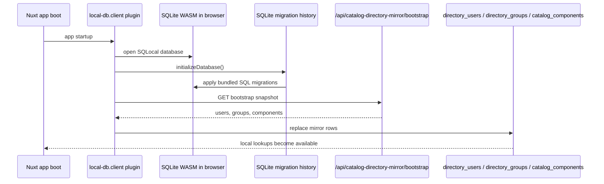

Read that flow carefully:

- **migrations** create the local table shape
- **bootstrap seeding** fills the mirror tables with reference data
- **domain data** such as the current demo products, teams, and seeded reviews still comes from the normal server APIs unless the user has created local-first records in this browser

So the browser startup seed is intentionally **reference-data focused**, not a full copy of every remote row.

One more runtime detail matters in production: pages can reach mirror-backed search composables before the startup plugin has finished seeding the mirror tables. Because of that, mirror reads now wait on a shared bootstrap promise instead of assuming app startup already completed. That keeps user, team, and component search from racing the initial browser seed.

### What is seeded into browser SQLite today

| Category | Seeded into browser SQLite on boot? | Source |
| --- | --- | --- |
| schema history and deterministic editable Template draft fixtures | yes | bundled SQLite SQL plus idempotent fixture installation |
| catalog users / groups / components | yes | `GET /api/catalog-directory-mirror/bootstrap` |
| locally created Products / Reviews / Template draft Revisions | yes, if they already exist in this browser | browser-local SQLite itself; Template drafts have no server recovery |
| server demo products / teams / seeded reviews | no bulk preload | fetched on demand from the normal `/api/*` routes |

That split is why the catalog mirror is so important. A page can receive a product from `/api/products`, but still need the browser-local mirror tables to resolve `productManagerId`, `engineeringLeadId`, `teamIds`, or component ownership labels into human-friendly names.

### Where the browser seed snapshot comes from

The mirror bootstrap payload is provider-neutral, but the demo currently builds it from one of two server-side sources:

```mermaid
flowchart LR
    SNAPSHOT[Checked-in directory snapshot<br/>catalog-directory-mirror.snapshot.json]
    FALLBACK[Fallback demo seed builders<br/>server/data/catalog-directory-mirror-fallback.ts]
    SERVER[server/data/catalog-directory-mirror.ts]
    API[/api/catalog-directory-mirror/bootstrap]
    BROWSER[Browser-local mirror tables]

    SNAPSHOT --> SERVER
    FALLBACK --> SERVER
    SERVER --> API
    API --> BROWSER
```

In other words:

- if a checked-in snapshot is available, Peaky serves that
- otherwise it falls back to the provider-neutral demo seed builders
- the checked-in snapshot is bundled into the deployment artifact instead of being fetched from the runtime filesystem
- the browser stores the resulting snapshot locally for lookup/search use

This is the mechanism behind team names, LDAP-style user lookup, product owner labels, and search dropdowns in the local-first UI.

### Progressive hydration on mixed remote/local screens

Not every screen should wait for browser-local hydration before showing useful data.

The Teams dashboard is the clearest example:

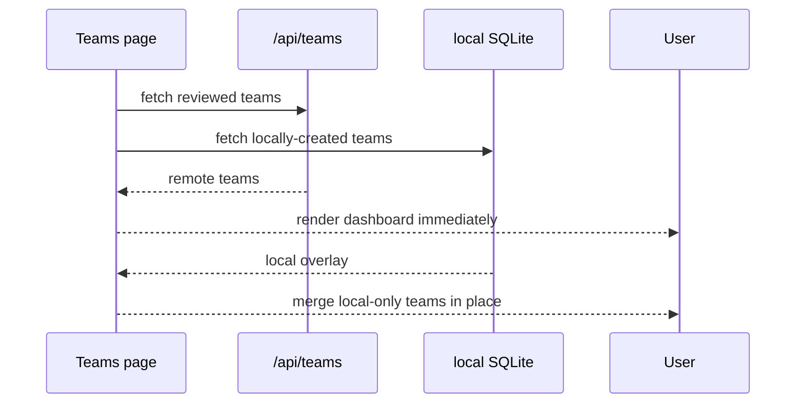

That split is intentional.

- remote data gives the user the first meaningful paint
- local hydration enriches the page afterward
- local failure should degrade to "remote-only for now", not hold the whole dashboard behind a spinner

This is why `useTeams()` no longer blocks on `Promise.all(remote, local)`. The page renders the server result first, then folds local teams in afterward.

## 6. Server data boundary

The server side has one job here: speak the sync contract without leaking raw database details into every endpoint.

That is why the Go backend uses a repository interface — `SyncRepo` — backed by `PostgresSyncRepo` in production and `FakeSyncRepo` in tests.

`PostgresSyncRepo` uses sqlc-generated query functions for all simple SQL (`GetFieldVersion`, `UpsertFieldVersion`, `GetCursor`, `SaveCursor`, `SaveEvent`, `FindAttachmentReview`, `ReviewSubject`). sqlc parses `services/internal/syncengine/repo/queries.sql` against `services/schema.sql` at code-generation time, so any column rename or table drop breaks the build before it reaches production. Two queries that build variable-length `IN` clauses dynamically remain hand-written in `postgres.go` with explanatory comments. Run `make gen:sqlc` after editing `queries.sql`.

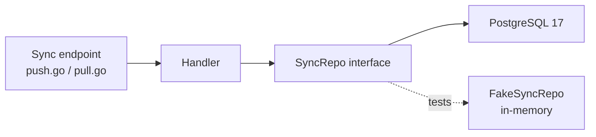

That flow keeps endpoint code thin and pushes data access into a smaller, easier-to-test boundary.

Why this shape:

- endpoints stay focused on request and response logic
- the repository interface is the boundary — swap `FakeSyncRepo` in tests, no DB required
- `PostgresNotifier` fires `pg_notify` after accepted pushes; `NoopNotifier` silences it in tests
- the server driver can change without touching handler logic

If you are tracing server-side behavior, start here:

| If you want to understand... | Read...                                          |
| ---------------------------- | ------------------------------------------------ |
| sync HTTP contract           | `services/internal/syncengine/`               |
| field-level HLC conflict resolution | `services/internal/syncengine/conflict/`       |
| PG queries and schema        | `services/internal/syncengine/repo/queries.sql` (source) → `services/internal/syncengine/db/` (generated by sqlc) |
| SSE fan-out                  | `services/internal/sse/hub.go`, `handler.go`     |
| catalog/directory mirror     | `server/api/catalog-directory-mirror/` (Nuxt)    |
| DB migrations                | `services/migrations/` (goose DDL, run by `peaky-ctl`) |

---

## 7. UI state vs domain truth

The simplest rule in this architecture is:

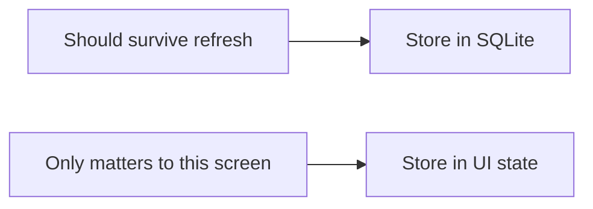

| Store in SQLite                      | Store in UI state             |
| ------------------------------------ | ----------------------------- |
| reviews, answers, notes, attachments | selected tab, expanded panels |
| products, teams, templates           | filters, sort order           |
| entitlements, cursors, outbox        | sync banners, modal state     |

That is why `useLocalUIStore` exists, but only for transient state.
It is not a second source of truth for domain data.

Attachment storage needs one extra nuance.

- attachment **metadata** belongs in SQLite because the review should immediately show who uploaded what, when, and whether it is still pending sync
- attachment **binary file contents** do not automatically belong in durable browser storage just because the metadata does

The current direction is intentionally narrower:

- keep attachment metadata local-first
- show a small `not synced` label until the remote upload finishes
- hand off the actual binary upload to a background worker using presigned URLs

That trade-off avoids a more expensive default where every browser keeps durable copies of potentially large files just to be able to upload them later. Full local blob persistence sounds attractive, but it can silently consume a user's storage quota with files they may never need offline again.

Something like [Pinia](https://pinia.vuejs.org/) would mostly duplicate responsibilities here, so persisted state lives in SQLite and short-lived state lives in composables.

## 8. A normal edit flow

When a user answers a question, the system works in this order:

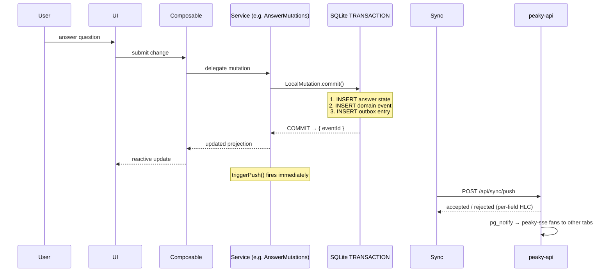

The important part is what does **not** happen:

- the user does not wait for the network
- the UI does not wait for `peaky-api`
- sync failure does not erase the local save
- a crash between state write and outbox write cannot produce a partial record — `LocalMutation.commit()` wraps all three writes in one SQLite transaction

That is the core local-first promise.

## 9. Reconnect and entitlement drift

The hard part is not just syncing data.
It is syncing permissions.

Peaky keeps a local entitlement snapshot so the app can keep working offline. When the user reconnects, that snapshot can differ from reality, *e.g., ownership changed*.

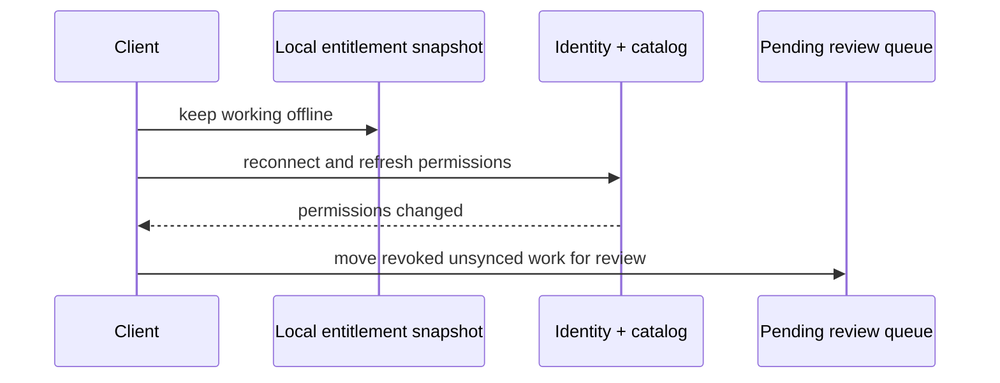

Product rule:

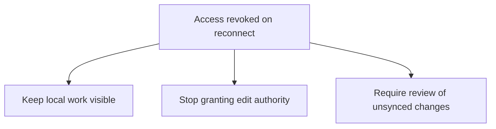

This avoids the two worst outcomes:

- silently losing work
- silently allowing edits the user does not have permission to make

### What the pending review queue is

The pending review queue is not a future idea.
It already exists as a local table plus composable helpers.

Think of it as a holding area for local changes that should stay visible, but should not auto-sync without human review.

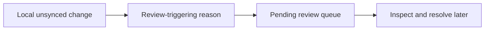

| Reason           | Meaning                                                                        |
| ---------------- | ------------------------------------------------------------------------------ |
| `access_revoked` | the user changed something locally, then lost permission before sync completed |
| `conflict`       | the local and remote versions need a human decision                            |
| `rejected`       | the server refused the mutation and the local change needs review              |

At the moment, the queue is more of a developer and system boundary than a polished product surface.
The dedicated review UI can come later, but the storage and inspection path already exists.

### How to inspect it

There are already two ways to inspect the queue with this change:

| If you want...                                 | Start here                                         |
| ---------------------------------------------- | -------------------------------------------------- |
| app-level access to unresolved items           | `app/composables/usePendingReviewQueue.ts`         |
| direct browser inspection of stored queue rows | `window.peakyDB.dumpTable('pending_review_queue')` |

Useful entry points:

- `usePendingReviewItems()` returns unresolved items, count, and grouping by reason
- `usePendingReviewItem(id)` reads one item
- `resolvePendingReviewItem()` and `discardPendingReviewItem()` already exist as the operational hooks the UI can call

So the queue is already real in the data model.
What is still missing is the user-facing workflow for browsing and resolving it comfortably.

## 10. Historical: what the sync simulator was for

!!! note "Simulator retired"
    The Nitro in-memory sync simulator has been replaced by `peaky-api` + `peaky-sse`. This section is preserved to explain the design principles that shaped the protocol contract still in use today.

The simulator was a rehearsal environment, not a durability environment.

| It is for                            | It is not for                        |
| ------------------------------------ | ------------------------------------ |
| bootstrap and reconnect flows        | proving durability guarantees        |
| push/pull cursor behavior            | simulating Postgres WAL or failover  |
| outbox retry behavior                | production performance claims        |
| permission drift and rejection paths | operational confidence about the sync contract |

That boundary matters because this architecture should build confidence in the contract, not false confidence in the infrastructure.

## 11. Sync contract shape

`peaky-api` speaks a deliberately small contract. The same shape the simulator rehearsed is now what the production backend implements:

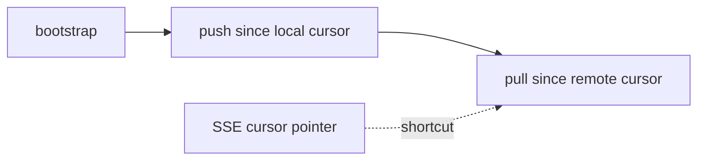

That keeps the sync boundary legible:

- the domain model stays independent from transport details
- PostgreSQL and SQLite keep independent authorities with behavior-tested shared contracts
- the repository shape stays narrow at the server boundary
- SSE is an optimisation on top of the contract, not a change to it — a client that ignores SSE still converges via 30s polling

## 12. Selective replication

Peaky should not sync everything.

| Replication level | What belongs there                                                                                         |
| ----------------- | ---------------------------------------------------------------------------------------------------------- |
| enabled full transport | registered Review/Product fields and the metadata needed to use them offline |
| local-only state | stable Template plus one draft Revision/Pillars/Questions; no event, outbox, push, pull, or replay yet |
| metadata only | broad discovery lists, search helpers, navigation context |
| fetch later | bodies outside the user's editable scope |

The reason is simple: startup cost matters, and the dataset will grow.

## 13. Why CRDTs are not in this architecture

CRDTs are powerful, but they are not the first tool to reach for.

This implementation takes a cheaper and more legible approach for templates:

- store drafts as structured parts: metadata, pillars, and questions
- give those parts stable ids
- use ordering keys instead of treating the whole draft as one blob
- resolve same-entity collisions through review, not through blanket CRDT machinery

That fits the collaboration pattern we actually expect: a small number of people editing different areas, with only occasional direct collisions.

CRDTs should come back only if real usage proves that same-entity conflicts are common enough to justify the extra complexity.

## 14. Appendix: options we discarded early

These were reasonable options, but not the right fit for this architecture.

| Option                                                      | Why we did not choose it                                                                                                                     | Trade-off we are comfortable with now                                                             |
| ----------------------------------------------------------- | -------------------------------------------------------------------------------------------------------------------------------------------- | ------------------------------------------------------------------------------------------------- |
| **[Pinia](https://pinia.vuejs.org/)**                       | it would create a second client-state authority next to SQLite                                                                               | composables are enough for transient UI state                                                     |
| **[ElectricSQL](https://electric-sql.com/)**                | it would commit us to a larger sync product before proving `bootstrap`, `push`, and `pull` ourselves                                          | we can compare ElectricSQL, PowerSync, or other options later once the core contract is validated |
| **[Zero](https://zero.rocicorp.dev/)**                      | it was not production-ready for this foundation and brings its own custom query model into the stack                                         | we are comfortable keeping SQL and Drizzle as the main query surface for now                      |
| **[PGlite](https://pglite.dev/)**                           | it is a nice PostgreSQL-in-browser story, but the client already needed a SQLite-first path                                                    | SQLite in the browser now and PostgreSQL on the server later is a trade-off we accept             |
| **[Node `sqlite3`](https://www.npmjs.com/package/sqlite3)** | it helps the simulator, but not browser-local persistence                                                                                    | different drivers per runtime are fine if schema and migrations stay canonical                    |

The common trade-off is intentional:

- keep the system small enough to reason about
- prefer explicit boundaries over more infrastructure than we need yet
- share schema definitions, not runtime storage

## 15. Where to look next

If you are navigating the implementation, use this quick map:

| Question                             | Start here                                                          |
| ------------------------------------ | ------------------------------------------------------------------- |
| How does a feature behave in the UI? | `app/products/*`, `app/teams/*`, `app/reviews/*`, `app/templates/*` |
| Where does business logic live?      | `app/services/` — domain services, no Vue imports                   |
| How is local data stored?            | `app/composables/local/useLocal*`, `app/local-db/*`                 |
| How does sync work?                  | `app/services/sync/SyncEngine.ts`, `services/internal/syncengine/push.go` |
| Where is entitlement logic?          | `app/services/sync/EntitlementService.ts`                           |
| Where is review governance?          | `app/services/review/ReviewGovernance.ts`                           |
| Where is the schema defined?         | `shared/db/schema/*`                                                |
| Where do migrations live?            | `shared/db/migrations/sqlite/*`                                     |
| How does peaky-api persist data?     | `services/internal/syncengine/repo/queries.sql` (SQL source) → `services/internal/syncengine/db/` (sqlc-generated) → `postgres.go` (wraps generated queries + two hand-written dynamic queries) |
| How does SSE fan-out work?           | `services/internal/sse/hub.go`, `services/cmd/peaky-sse/main.go`   |

Companion walkthroughs:

- [Data Model](./data-model) — domain model and entity relationships
- [API](./api) — API planes and endpoint design
- [Authorization](./authorization) — policy rules, actor resolution, and lifecycle permissions
- [Auditing](./auditing) — event model, admin feed, and provenance
