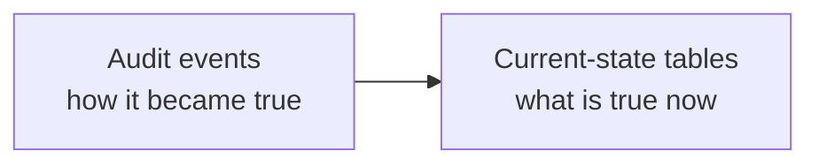
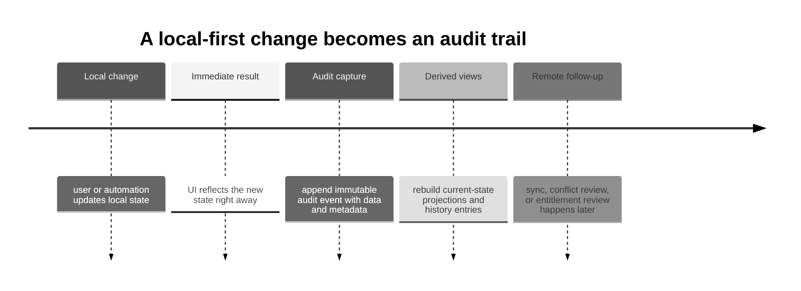
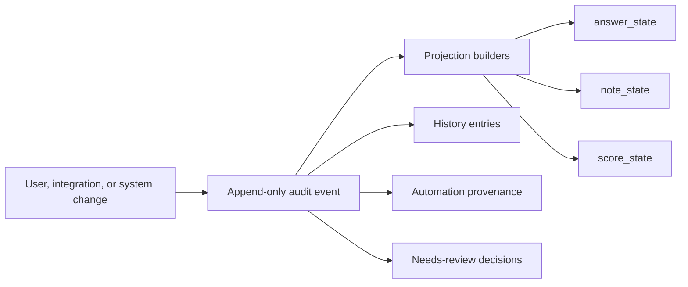
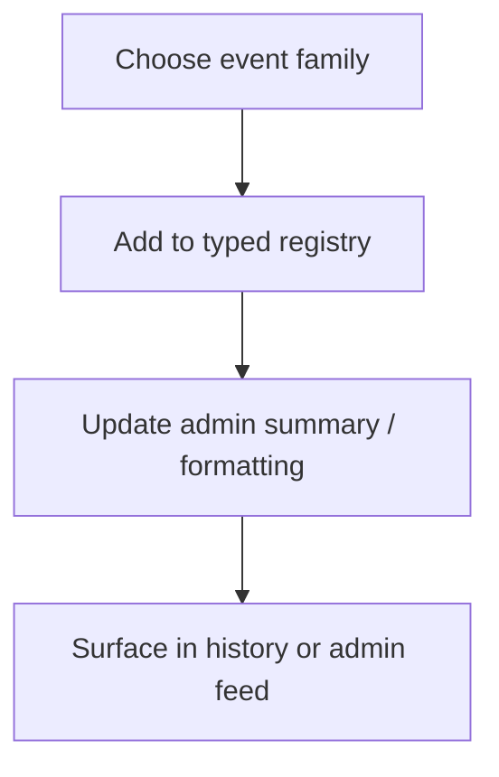
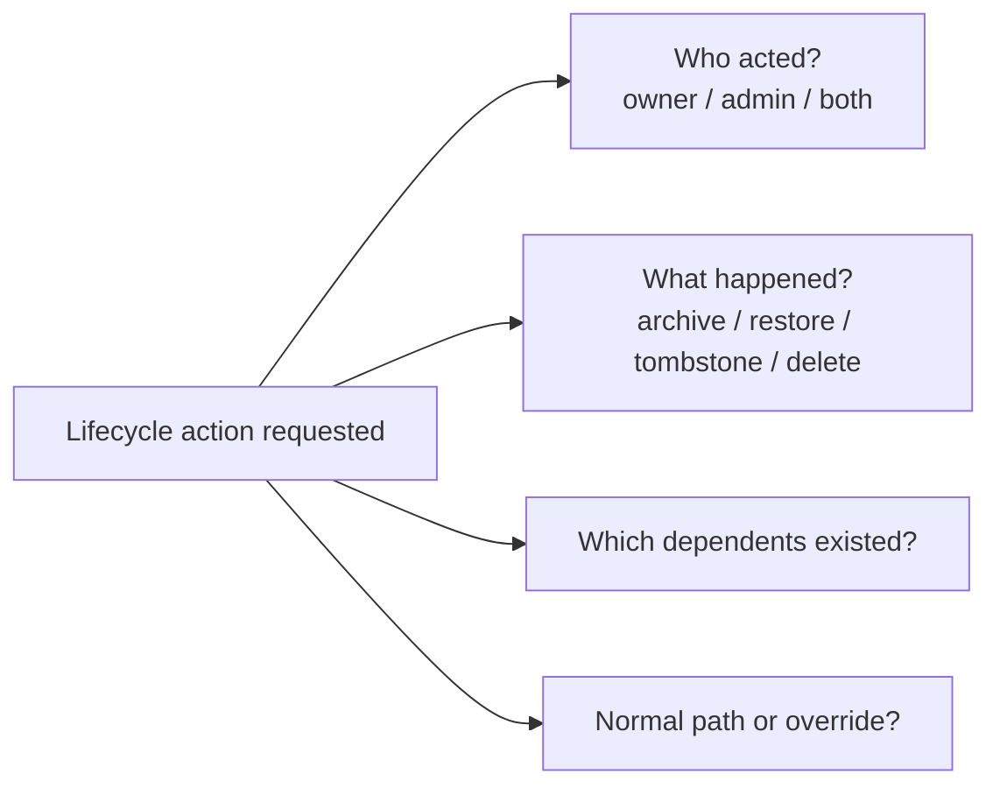
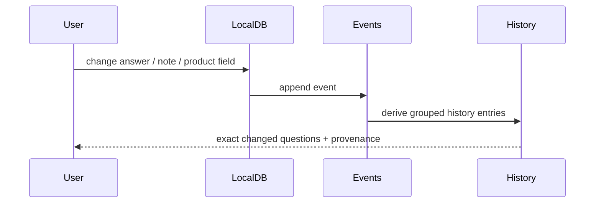
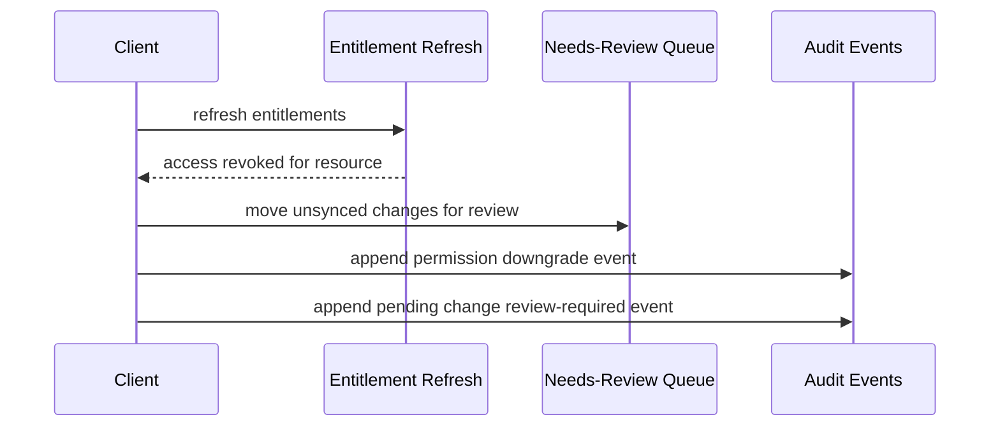
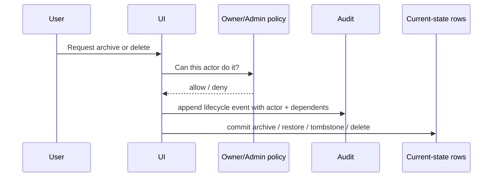
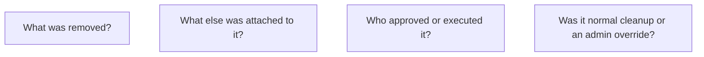
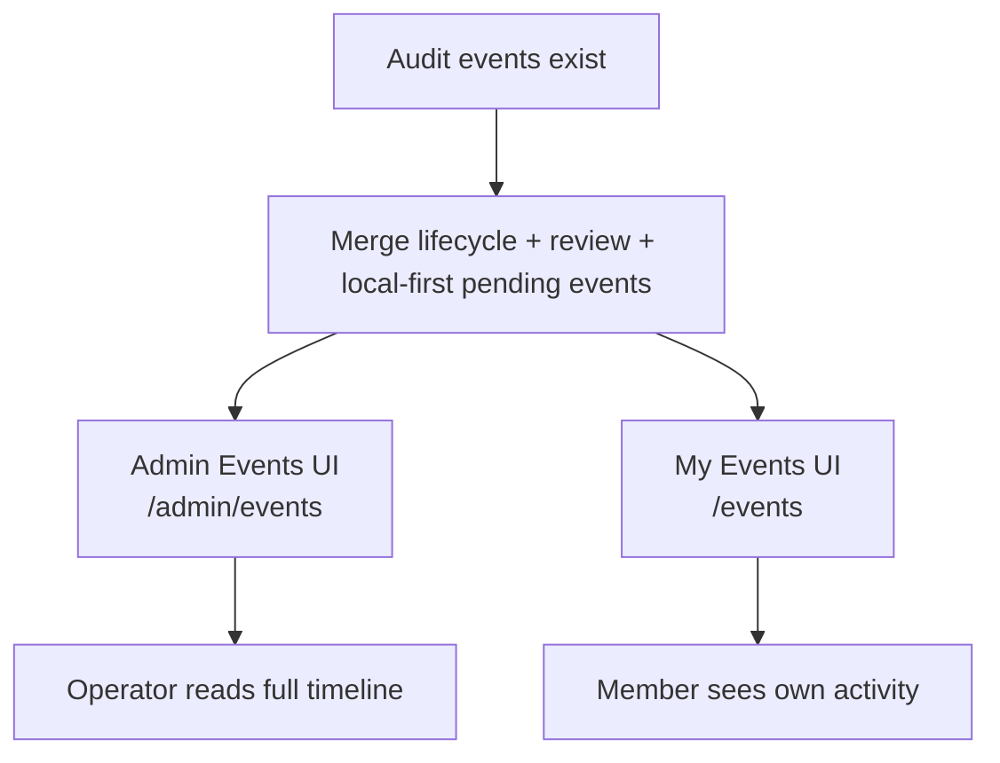

# Auditing — Walkthrough

This walkthrough explains how auditing fits into Peaky's local-first architecture.

Short on time? Start with the [local-first reading map](./).

It complements:

- [Architecture](./architecture) — where auditing sits in the runtime
- [Authorization](./authorization) — who is allowed to trigger the sensitive actions discussed here

audit events tell us how it became true
The short version is:



That distinction is what lets Peaky support:

- CloudTrail-like auditability for meaningful changes
- visible provenance for machine-generated actions
- review history derived from immutable events
- reconnect review queues when permissions drift

---

## 1. Why local-first makes auditing more important

In a server-first app, most interesting actions already pass through the server, so auditability can be bolted onto request handling.

In a local-first app, the sequence changes:

1. change happens locally first
2. user sees the result immediately
3. remote sync catches up later



That means auditing has to be a first-class part of the data model, not just an HTTP concern.

!!! warning "Two bounded exceptions"
    Current Template and draft Revision/Pillar/Question authoring uses `LocalMutation.localOnly()`: one state-only SQLite transaction with no event, outbox row, or push trigger. The UI must describe that unpublished work as local-only until issue #137 adds transport.

    SQLite migration 0016 and PostgreSQL Goose migration 008 also perform an approved one-time Preview reset of explicitly enumerated legacy Template/Review domain, audit, field-history, and replay rows. They preserve migration logs and unrelated domain/system events. Neither exception permits ordinary runtime deletion of audit history.

---

## 2. The three layers: state, events, and outbox



The important idea is that the event is not just a logging side effect.

It feeds multiple downstream views at once:

- fast current-state projections
- human-readable history
- machine provenance
- reconnect and conflict-review workflows

### Events

Immutable records of what happened.

### Projections

Materialized views used for fast reads.

events are the explanation layer we do not want to lose
If you remember one line, remember this:

| Layer | Keep because... | Can rebuild? |
| --- | --- | --- |
| projections | the UI needs fast current-state reads | yes |
| events | they are the explanation and audit layer | no |

### Why there are three layers, not two

State tables and domain events solve different problems. The outbox is a third concern entirely:

| Layer | Table | Role | Durability |
| --- | --- | --- | --- |
| State | `review_answer_state`, `note_state`, etc. | Current values, mutable | Survives ordinary sync and refresh; migrations may explicitly reset a bounded domain |
| Domain events | `events` | Permanent audit trail, append-only | Survives ordinary entity deletion; only an approved migration manifest may remove bounded legacy rows |
| Outbox | `localOutbox` | Sync transport queue, disposable after push | May be replaced by PowerSync Streams |

The `events` table has no CASCADE delete from reviews. During ordinary runtime deletion, a Review can be permanently deleted while its events remain as a paper trail. The approved Template/Revision Preview reset is narrower and explicit: it removes only enumerated Template/Review identities and event types needed to prevent legacy resurrection. The outbox is a temporary queue whose purpose ends once the change is acknowledged by the server.

### Exact Preview reset boundary

SQLite migration 0016 and PostgreSQL Goose migration 008 remove the legacy Template/Review domain and dependent Review answer/note/attachment/score/participant/import/evidence rows that exist on each platform. Operational cleanup uses the exact entity-type allow-list:

```text
review, review_checkpoint, review_answer, review_note, review_attachment,
template, template_version, template_pillar, template_question,
template_draft, template_draft_pillar, template_draft_question
```

That allow-list applies to applicable outbox, pending-review, current field-version, and field-history rows. Event cleanup additionally matches non-null `review_id` and the exact legacy `Review*`/`Template*` types enumerated by the migration. SQLite invalidates all entitlement snapshots because their embedded JSON grants cannot be filtered safely.

The reset preserves Products, Teams, catalog-directory data, sync cursors, migration tables/logs, and unrelated domain/system events. It uses no broad `CASCADE` to hide unknown dependencies. The migration exception does not authorize runtime services to delete audit history.

---

## 3. Actor model

Peaky needs to distinguish three actor classes.

| Actor type  | Examples                                              | Why it matters                |
| ----------- | ----------------------------------------------------- | ----------------------------- |
| user        | engineer, PM, EL, leadership user                     | human accountability          |
| integration | CI/CD, catalog sync, automation job                   | machine-led provenance        |
| system      | entitlement downgrade handler, score recompute worker | internal process traceability |

### Minimal actor fields

| Field | Shape | Why it exists |
| --- | --- | --- |
| `actor_type` | `user` / `integration` / `system` | separates human, automation, and internal process actions |
| `actor_id` | stable provider-neutral principal id | lets the audit trail point back to the actor without encoding vendor names |

`actor_id` should stay provider-neutral. If Peaky ever needs to show where the identity came from, that belongs in separate metadata rather than in values like `provider:username`.

This is especially important once `/integrations/*` exists because machine changes must never look like they came from a human browser session.

---

## 4. Event anatomy

A useful audit event needs more than a timestamp and a verb.

Every event conforms to the `DomainEventEnvelope`:

```text
id: string           // "evt_..." — UUIDv7 with evt_ prefix, stable event identity
type: string         // "ReviewAnswerRecorded.v1" — PascalCase + version suffix
version: 1           // payload schema version — increment on breaking data changes
source: string       // "peaky.client" | "peaky.sync" | "peaky.system"
actorId: string      // stable provider-neutral principal id
actorType: string    // "user" | "integration" | "system"
entityType: string   // "review" | "review_answer" | "product" | "template_draft" | ...
entityId: string     // the id of the changed entity
time: string         // ISO 8601 — CloudEvents `time` attribute
dataschema?: string  // URL to the JSON Schema for this event's data payload
reviewId?: string    // cross-entity correlation key (top-level extension per CloudEvents spec)
clientId?: string
data: (typed per event)  // the event-specific facts that changed
piiRedactedAt?: string   // ISO 8601 — set when a GDPR erasure has been applied
piiRedactedBy?: string   // actorId of the admin who processed the erasure
```

### Event types (current catalog)

The canonical event type list is the `DomainEvent` union in `app/services/events/DomainEvent.ts`. All types follow the `PascalCase.v1` convention. The full catalog is browsable at `/schemas`.

```text
# Active domain events (user mutations) — local: false, sync-eligible
ReviewCreated.v1          ReviewArchived.v1         ReviewRestored.v1
ReviewDeleted.v1          ReviewAnswerRecorded.v1   ReviewNoteRecorded.v1
ReviewNoteDeleted.v1      ReviewAttachmentUploaded.v1  ReviewAttachmentDeleted.v1
ReviewProgressUpdated.v1  ReviewCheckpointSaved.v1
ProductCreated.v1         ProductUpdated.v1         ProductArchived.v1
ProductRestored.v1        ProductDeleted.v1

# Legacy/dormant Template event schemas — retained, not emitted by current authoring
TemplateDraftCreated.v1   TemplateDraftUpdated.v1   TemplateDraftDeleted.v1
TemplatePublished.v1      TemplateImported.v1
TemplatePillarCreated.v1  TemplatePillarUpdated.v1  TemplatePillarDeleted.v1
TemplateQuestionCreated.v1  TemplateQuestionUpdated.v1  TemplateQuestionDeleted.v1

# System events (peaky.system) — DB lifecycle + storage are local: true
LocalDbInitializing.v1    LocalDbReady.v1           LocalDbBootstrapStarted.v1
LocalDbRecreated.v1       LocalDbMigrationFailed.v1 ClientSchemaMigrated.v1
OpfsQuotaWarning.v1       OpfsStorageMeasured.v1

# System events (sync ops) — local: false, sync to server
SyncCycleStarted.v1       SyncCycleSucceeded.v1     SyncCycleFailed.v1
EntitlementsRefreshed.v1
```

The Template names above remain in the type/schema catalog so historical records stay readable; their catalog flags do not make the current authoring path active. Stable Template/draft Revision writes emit no legacy or replacement event.

**The `local` flag**: `EventCatalogEntry` requires every entry to set `local: true | false` explicitly. `local: true` means the event is inserted with `status: "local"` and the future event-push pipeline (Rust sync engine) MUST skip it. DB lifecycle and storage events stay on the device by design — they describe per-browser state that's meaningless to other actors. Sync-ops events default to push-eligible (`local: false`) so postmortems can correlate which session synced what.

### Event data enrichment

Events carry enough fields to be self-contained — the reader does not need to cross-reference current-state tables that may have changed or been deleted:

| Event type | Key `data` fields |
| --- | --- |
| `ReviewCreated.v1` | Legacy transported header payload: `name`, `subjectId`, `subjectType`, `templateIds`, `scope`, `applicationIds`, `teamIds`; it does not carry exact `templateRevisionIds` |
| `ReviewArchived/Restored/Deleted.v1` | `name` — captured at the time of the action |
| `ReviewCheckpointSaved.v1` | `templateId`, `questionsAnswered`, `overallProgress`, `pillarSnapshots` (typed: slug, name, progress, totalQuestions, answeredQuestions) |
| `ReviewAttachmentUploaded/Deleted.v1` | `attachmentId`, `filename`, `mimeType`, `fileSize` — deleted variant captured **before** removal |
| `ProductCreated.v1` | `name`, `teamIds`, `componentIds`, `origin`, `isExternal`, `productManagerId?`, `engineeringLeadId?`, `roadmapUrl?`, `documentationUrl?`, `supportChannel?` |
| `TemplateQuestionCreated.v1` | Legacy/dormant payload: `templateId`, `pillarSlug`, `questionId`, `questionText`, `questionType`, `position` |

### Naming convention

Event types follow the `EntityAction.v1` pattern — PascalCase entity + action, plus a version suffix. The version suffix makes breaking payload changes explicit and aligns with EventBridge routing patterns, which allows future consumers to pin routing rules to a specific schema version.

| Domain | Pattern | Examples |
| --- | --- | --- |
| Review lifecycle | `Review<Action>.v1` | `ReviewCreated.v1`, `ReviewArchived.v1` |
| Review operations | `Review<Sub><Action>.v1` | `ReviewAnswerRecorded.v1`, `ReviewCheckpointSaved.v1` |
| Product lifecycle | `Product<Action>.v1` | `ProductCreated.v1`, `ProductUpdated.v1` |
| Legacy Template lifecycle | `Template<Sub><Action>.v1` | `TemplateDraftCreated.v1`, `TemplatePillarDeleted.v1` (dormant) |

The source of truth is the `DomainEvent` discriminated union — extending the event system means adding to that union and its corresponding Zod schema, not scattering ad-hoc strings through the product. See [Adding a new event](../codebase/events#8-adding-a-new-event) for the full checklist.

### How the taxonomy scales



Rule of thumb:

| If the event describes... | Put it in... |
| --- | --- |
| review work, provenance, checkpoints, permission downgrades | review event types registry |
| Product/Review lifecycle, or a retained historical Template type | the matching active or legacy event registry |
| enabled Product lifecycle; historical Template lifecycle records | `server/data/lifecycle-audit.ts` |
| how operators group/filter those events | `server/data/admin-events.ts` + `app/admin/events.ts` |

That keeps the audit space extensible without forcing every new product event into one giant unsorted list.

For lifecycle actions, the audit layer should capture more than the verb.
It should also capture the safety context around the decision.



If one of those boxes is missing, the event becomes much less useful during an incident review or compliance question.

---

## 5. Automation provenance is not optional

Peaky explicitly wants machine-generated draft answers.

That means the UI needs to show more than just the answer value.

### Provenance fields to preserve

| Field         | Example                             |
| ------------- | ----------------------------------- |
| source system | `ci-cd`, `catalog-sync`, `docs-bot` |
| source run id | pipeline execution id               |
| timestamp     | when automation produced the draft  |
| confidence    | optional confidence score           |
| evidence      | commit SHA, URL, document, artifact |

### Why the UI must surface this

```text
Without provenance:
  "why is this answer here?"

With provenance:
  "CI imported this draft 2 hours ago from pipeline 1842 with 0.81 confidence"
```

This is the difference between automation feeling trustworthy and automation feeling spooky.

---

## 6. History becomes event-derived

Peaky already has a useful instinct here: history should tell people what changed, not just that "N questions changed".

Local-first auditing enables that.



### Important nuance

Peaky can still preserve a "Save Progress" concept.

It just stops being a mutable session table and becomes one of:

- a checkpoint event
- an event grouping marker
- a derived milestone over a slice of events

That keeps the UX while making the architecture cleaner.

---

## 7. A concrete review-history model

One practical history model is:

```text
raw events
   -> grouped by checkpoint / save marker / sync batch
   -> rendered as history entries
   -> diff view shows exact field/question changes
```

### History entry fields

| Field                     | Purpose                                 |
| ------------------------- | --------------------------------------- |
| entry id                  | stable history item id                  |
| time range                | when the grouped changes happened       |
| actor summary             | user/integration/system label           |
| affected questions/fields | exact changed scope                     |
| checkpoint note           | optional save comment                   |
| provenance summary        | visible machine context when applicable |

---

## 8. Reconnect review queue is also an audit problem

When entitlements change on reconnect, some local changes may stop being allowed to sync.

Those changes should not just fail silently.



This gives Peaky a traceable answer to:

- what local changes were blocked?
- why were they blocked?
- who needs to review them?

The policy side of that flow lives in [Authorization](./authorization).
This walkthrough stays focused on the recorded explanation layer.

## 9. Lifecycle controls are also audit controls

The recent archive and permanent-delete flows make this explicit.



That ordering matters.
If the system mutates state without leaving a lifecycle event behind, then the most sensitive operations in the product become the hardest ones to explain later.

For permanent delete, the event needs to answer four questions cleanly:



This is one reason Review deletion is more sensitive than Product deletion. Reviews often carry answers, notes, evidence, and historical judgments, so removing them without a strong paper trail is much harder to defend.

Template lifecycle and deletion are currently frozen for every actor: calls return `template_write_unavailable` before authorization or audit/state work. Historical Template lifecycle records remain readable, but no current Template archive, restore, whole-draft-delete, permanent-delete, or publication event is emitted.

Today the active lifecycle paper trail flows through the `events` table and is split across two concrete source registries:

| Source | What it records |
| --- | --- |
| `server/data/lifecycle-audit.ts` | enabled Product lifecycle plus historical Template records |
| review + lifecycle event registries | Review lifecycle plus broader Review history |

The Admin Events feed then merges those streams into one operator-facing timeline.

---

## 10. The boundary between audit and analytics

Audit events are not the same thing as analytics.

### Audit is for

- accountability for user, integration, and system actions
- history that explains how a review evolved
- provenance that shows where an automated change came from
- conflict review when local work and remote rules disagree
- evidence of what changed and when it changed

### Analytics is for

- portfolio summaries across many teams or products
- organization-wide trends over time
- leadership reporting and scorecard views
- historical dashboards over larger server-side datasets

In local-first systems, analytics should remain server-side even if audit events feed it later.

---

## 11. Admin + Events as the read surface

The audit model has two dedicated read surfaces: one for operators and one for individual users.



### Admin feed

The admin feed is for operators and shows all events across all actors:

- `GET /api/admin/events` returns the merged remote feed for admins
- `GET /api/admin/events/stream` provides an SSE live tail for admins
- `/admin/events` renders that feed and also merges browser-local pending events from the outbox

Both the admin page and the user page include an "All areas" resource-area filter (Product, Team Review, Product Review, etc.) powered by the `subjectTypeFilter` / `subjectTypeOptions` in `useAdminEventsFeed`.

This operator surface should make at least three things obvious:

1. the event timeline for sensitive lifecycle actions
2. the admin and ownership picture
3. unresolved mismatches between policy, entitlements, and human expectations

### User feed

Non-admin users have their own scoped view:

- `GET /api/events` returns events where `actorId` matches the current authenticated user (review events and lifecycle events they triggered)
- `/events` renders the "My Events" page with category, action, and resource-type filters
- The sidebar Events link routes to `/events` for members and `/admin/events` for admins

The split keeps the admin timeline clean for operators while giving individual users a self-service activity log without exposing other users' actions.

---

## 11a. GDPR and data protection

The event store is an append-only audit log. That creates a tension with GDPR rights: once written, events should not be deleted, but some events may contain personal data.

Peaky resolves that tension at two levels: data minimization at write time, and a surgical erasure path for residual PII.

### Data minimization — NOTE_RECORDED

`NOTE_RECORDED` events do not store note content.

Instead they store:

- `contentLength` — number of characters in the note
- `contentHash` — first 16 characters of a SHA-256 digest of the content

**Rationale:** GDPR Art. 5(1)(c) data minimization. The event log needs to prove a note was saved and detect tampering — it does not need to reproduce the content. The note itself lives in the notes store. The hash is short enough to be non-reversible and long enough to detect accidental overwrites.

### Right to erasure — redactEventPii

For events that do carry actor names or other free-text PII (for example, `actorName` on lifecycle events, or legacy `content` / `note` fields), Peaky provides a surgical erasure path.

The `redactEventPii(eventId, byActorId)` function:

1. Overwrites `actorName` with `[Redacted]`
2. Tombstones any residual `content` or `note` free-text fields with `[Redacted — GDPR erasure]`
3. Sets `piiRedactedAt` (ISO 8601) and `piiRedactedBy` (actorId of the admin) on the event record

The endpoint is `POST /api/admin/events/:id/redact`. It is idempotent and self-auditable — each call records who processed the erasure and when.

The admin events slideover shows a GDPR notice and an "Apply erasure" button for admins. After erasure, affected events show a `PII redacted` badge and a shield icon in the actor column.

### What is kept, what is erased

| Field | After erasure |
| --- | --- |
| `actorId` | **Kept** — legitimate interest basis for audit integrity (GDPR Recital 49) |
| `actorName` | Overwritten with `[Redacted]` |
| `eventType`, `time`, `entityId`, `entityType` | **Kept** — structural audit fields, contain no PII |
| `data.content`, `data.note` | Tombstoned with `[Redacted — GDPR erasure]` |
| `piiRedactedAt`, `piiRedactedBy` | Written fresh — makes the erasure itself auditable |

The principle: the event record survives for audit integrity. Only the PII fields are overwritten. The audit trail still proves that the event happened, who (by stable ID) triggered it, and when.

**Known gap:** `actorId` is intentionally not erased. The legal basis is legitimate interest under GDPR Recital 49 — audit logs that cannot be correlated to a principal are not meaningful audit logs. If a data subject requests full erasure of their `actorId`, that is an edge case that requires a manual legal review, not an automated tombstone.

## 12. What the audit layer supports

The event model already supports several adjacent capabilities without redesigning the system:

- CloudTrail-like event browsing for detailed audits
- machine-readable `/integrations/*` exports for automation
- better diff views that explain exact changes
- checkpoint timelines built from immutable event markers
- override review workflows with explicit justification
- campaign-level completion reasoning tied back to review events

The same audit model remains useful for markdown imports and conflict-review flows too: the event trail should show what was imported, what conflicted, and which resolution was chosen.

---

## 13. Summary

```text
Audit events are not a side table.
They are the narrative layer of the local-first system.

State says: what is true now?
Audit says: why is it true, who changed it, and can we trust it?
```

That is the mental model to keep while working in this architecture.
