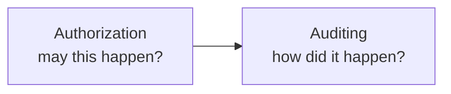
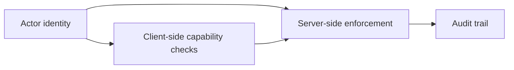
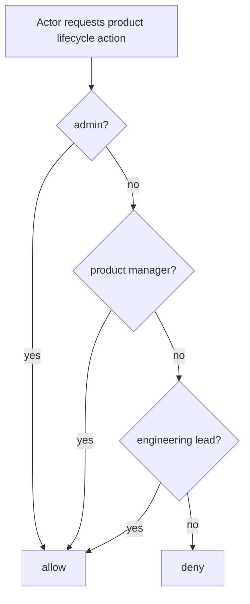
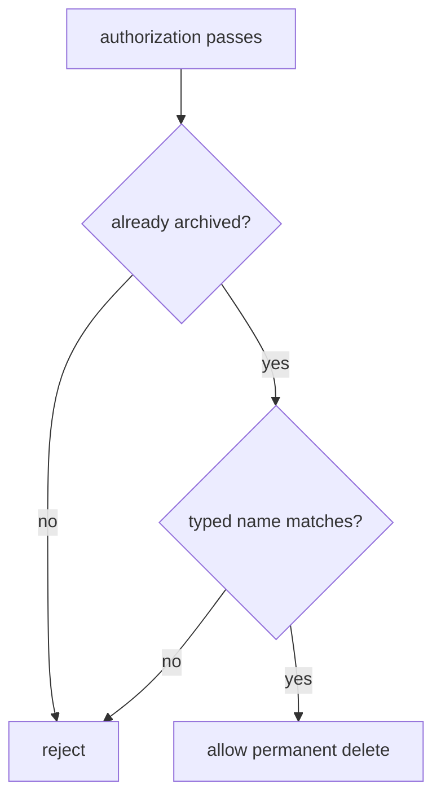

# Local-First Authorization — Walkthrough

This walkthrough explains how Peaky decides who may act, both in the browser-local path and on the server.

Short on time? Start with the [local-first reading map](./).

It complements these walkthroughs:

- [Architecture](./architecture) — runtime layers and where authorization sits
- [Auditing](./auditing) — the paper trail left after a decision
- [API](./api) — the HTTP boundary that enforces the same rules remotely

The short version is:



---

## 1. Why authorization has its own walkthrough

The authorization model includes:

- owner-or-admin lifecycle rules for products
- a fail-closed Template publication and lifecycle freeze for every actor
- advisor-or-admin rules for team reviews
- owner-or-admin rules for product reviews
- admin-only access to the Admin Events surface
- typed-confirmation gates before available permanent deletes

That is enough policy surface that authorization needs its own mental model instead of living half inside architecture notes and half inside audit notes.

---

## 2. The three authorization layers



| Step | Purpose |
| --- | --- |
| identify the actor | establish who is trying to act |
| hide or show affordances locally | keep the UI honest and ergonomic |
| enforce on the server | apply the real security boundary |
| append audit context | explain the sensitive transition later |

The UI check improves ergonomics. The server check is the real boundary.

---

## 3. How actor identity is represented

The shared runtime actor shape is intentionally small.

```ts
type LifecycleRole = "admin" | "member";

interface LifecycleActor {
  id: string;
  name: string;
  roles: LifecycleRole[];
}
```

### Where it comes from

| Runtime | Entry point | Notes |
| --- | --- | --- |
| client reactive UI | `useCurrentActor()` | reads and updates the browser-local actor/profile stored in local storage |
| client non-reactive helpers | `readPersistedActor()` / `readPersistedReviewActor()` | used by domain services and review helpers outside Vue setup; still exported from `useCurrentActor.ts` but has no Vue dependency |
| HTTP server | `getLifecycleActor(event)` | reads `x-actor-*` headers and, for SSE, `actor*` query params, then falls back to the same default actor |
| review routes | `normalizeReviewActor()` | now in `app/services/review/ReviewGovernance.ts` — review lifecycle uses its own narrower actor helper |

### Transport shape

| Field | Used by | Notes |
| --- | --- | --- |
| `x-actor-id` | normal HTTP writes | stable actor identifier |
| `x-actor-name` | normal HTTP writes | display name for audit + lifecycle surfaces |
| `x-actor-roles` | normal HTTP writes | comma-separated lifecycle roles |
| `actorId` / `actorName` / `actorRoles` | SSE query params | same actor model for `EventSource` requests |

Those headers let local-first and server-side paths share the same authorization intent.

### Why the actor is browser-local today

Peaky does not have real authentication wired in yet, so the current actor is explicit UI state rather than an opaque session.

- the left-navigation profile picker lets the operator choose a user from the catalog-directory mirror
- that picker can temporarily elevate the actor to `admin` in the current browser
- `useCurrentActor()` keeps the UI reactive while persistence helpers read the same stored actor snapshot outside component setup

That gives the local-first client one consistent actor model across:

- lifecycle buttons in the UI
- local outbox events
- server-side lifecycle routes
- the Admin Events SSE stream

---

## 4. Product lifecycle and the Template freeze

### Products



Implementation anchor:

- `canManageProductLifecycle(actor, product)`

### Templates

Template lifecycle is modeled but unavailable while Template authority is local-only. Every remote create, update, publication, archive, restore, whole-draft-delete, or permanent-delete request fails closed with HTTP 503 and code `template_write_unavailable` before authorization or state work. The UI exposes none of those controls, and setting the publication flag cannot restore the removed promotion path.

Each Template instead stores one immutable `ownerTeamId`, selected from the last successfully persisted directory-group snapshot, plus separate Template/Revision creator and updater provenance and Revision publisher provenance. Those IDs explain ownership and authorship; they grant no permission. Draft-edit entitlement, admin role, creator/updater/publisher identity, and owning-Team identity all fail to bypass the lifecycle freeze. Ownership transfer is also unavailable in this stage.

---

## 5. Review lifecycle rules are intentionally different

Reviews are more sensitive because deletion affects judgment history, notes, and evidence.

### Team reviews

```text
archive / restore => assigned advisors or admins
permanent delete  => admins only
```

### Product reviews

```text
archive / restore => product owners or admins
permanent delete  => admins only
```

The server routes make that split explicit:

- `PATCH /api/reviews/:id` handles archive / restore
- `DELETE /api/reviews/:id` handles permanent delete

And the permission checks differ by review type. Internally the review model still stores advisors in `review.reviewers`, but the UI and walkthroughs use the user-facing **Advisors** term.

| Review type | Archive / restore | Permanent delete |
| --- | --- | --- |
| team review | assigned advisors or admins | admins only |
| product review | product owners or admins | admins only |

### Advisor maturity overrides

Maturity override transitions (`review_maturity_override` sync events) are authorized by an **action-specific** server policy, not a bare capability check: `MaturityOverridePolicy` (`services/internal/authz/override.go`). Create, supersede, and revoke each require:

1. Review edit access on the owning Review (the shared `Authorizer`), and
2. a current persisted `reviewer` participant row — the role product surfaces label Advisor — resolved through a server-side `ReviewParticipantLookup`, never from client-supplied claims.

Unknown or missing actions, participant-lookup errors, and edit-access-only actors all fail closed, and a denied event writes no transition fields. A view-or-edit capability answer without the action parameter and participant lookup is never sufficient. Any current Advisor may transition an override; the stream stays append-only.

### Provider handoff choke point

The handoff UI is always available — no public flag gates it — and copy-text plus existing-ticket association never call a provider. Any future provider operation must pass `ProviderHandoffPolicy` (`services/internal/authz/provider.go`) **before** constructing or invoking an adapter:

- the private capability `PROVIDER_HANDOFF_INTEGRATION_ENABLED` (`services/internal/app/config.go`, exact `true`, default disabled) must be enabled — otherwise the policy denies without even consulting the authorizer; and
- the actor must hold Review edit access on the owning Review.

The capability is server-only configuration: it never appears in public runtime config or client code, so handoff UI availability alone can never authorize a provider operation. No provider route registers today; the policy exists so the first future route has exactly one guard to call.

---

## 6. Admin Events is also an authorization surface

The Admin Events UI is not just another page.
It is an operator surface for sensitive lifecycle and review history.

```mermaid
flowchart LR
    UI[/admin/events page]
    FEED[GET /api/admin/events]
    STREAM[GET /api/admin/events/stream]
    ADMIN{actor has admin role?}

    UI --> FEED
    UI --> STREAM
    FEED --> ADMIN
    STREAM --> ADMIN
```

Rule:

```text
only admins can read the admin events feed
only admins can open the SSE live-tail stream
```

That is enforced server-side in:

- `server/api/admin/events.get.ts`
- `server/api/admin/events/stream.get.ts`

---

## 7. Available permanent deletes add a second gate

Authorization alone is not enough for enabled Product and Review permanent deletes. Template deletion does not reach this gate: it returns `template_write_unavailable` before authorization, reference counts, confirmation, or writes.

Available deletion paths also require an explicit confirmation step:



This is why permanent delete paths check all three:

1. actor may manage this lifecycle
2. record is already archived
3. typed confirmation matches the subject name exactly

Implementation anchor:

- `assertLifecycleConfirmation()`

---

## 8. Local-first authorization vs remote enforcement

The browser can decide whether to show an action, but it cannot be the final authority.

| Layer | What it does | Why it exists |
| --- | --- | --- |
| local UI checks | hides buttons, blocks obvious bad paths | faster UX, clearer affordances |
| local-first writes | records user intent instantly | offline-first workflow |
| remote enforcement | accepts or rejects the authoritative API call | real permission boundary |
| pending review queue | keeps blocked local work visible after reconnect | avoid silent data loss |

This means local-first does not weaken authorization.
It just moves part of the user experience earlier.

---

## 9. Security implications of local-first authorization

In a local-first app, **the browser is untrusted**. An attacker with DevTools can:

- Modify the entitlement snapshot in OPFS to grant themselves `canEdit: true`
- Bypass UI permission gates (these are UX, not security)
- Forge `x-actor-id` headers (Phase 1 limitation — trusted behind an internal network boundary)

**What protects the system:**

1. **Server re-validates entitlements on every sync push** — `push.go` checks the server-side actor registry, not the client's snapshot
2. **`canEditReviewContent()` enforces review-level access** — even with valid entitlements, the actor must be an assigned advisor or admin
3. **Go struct validation + whitelist** — unknown entity types, unknown operations, and payloads more than 30s in the future are rejected before touching any repository
4. **DevTools globals are dev-only** — `window.peakyDB` and `window.__peakySeed` are guarded by `import.meta.dev`

**What is not yet protected (Phase 1):**

| Gap | Risk | Production fix (Phase 3) |
|-----|------|--------------------------|
| Actor identity from headers | Spoofable without network boundary | Okta JWT validation in Actor middleware |
| No push deduplication | Replay writes a duplicate events row | Processed-events idempotency table |
| SSE auth via query params (actorId/actorName/actorRoles) | Spoofable without network boundary | Okta JWT validation in Actor middleware for SSE (or header-based `Authorization: Bearer` when available) |

These are tracked in the roadmap under Phase 3 (Okta integration).

---

## 10. Boundary of this walkthrough

This walkthrough documents the implemented authorization layer.

The architecture walkthrough should summarize the layer and point here for the rule details.

---

## 11. Summary

```text
authorization is the policy layer
auditing is the explanation layer

local checks improve UX
server checks remain authoritative
available permanent delete needs both permission and explicit confirmation
Template publication and lifecycle remain unavailable to every actor
```
