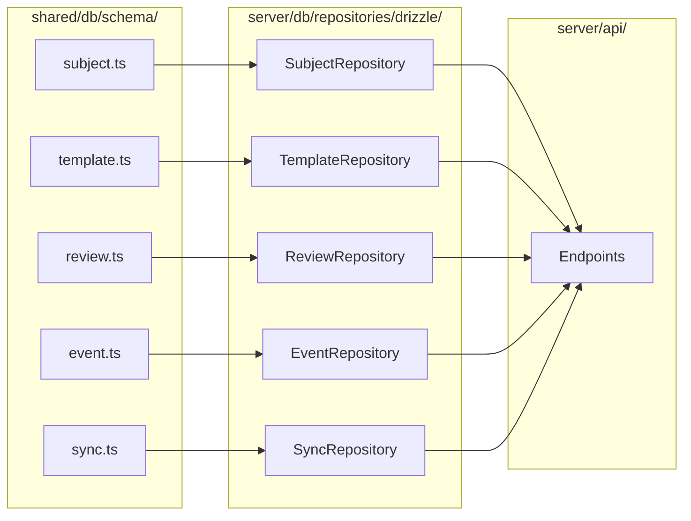
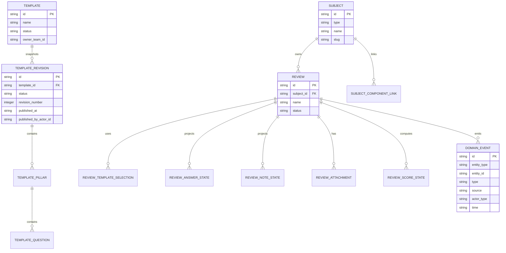
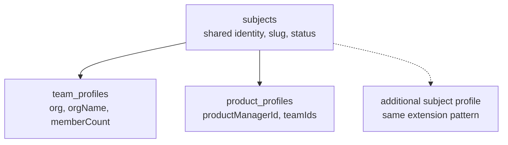
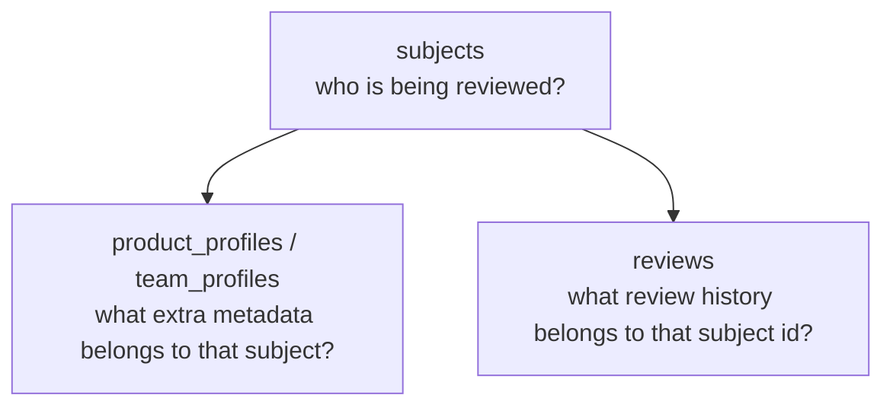
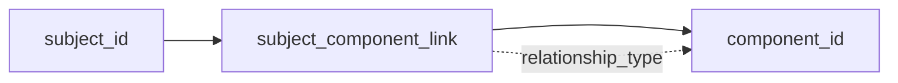
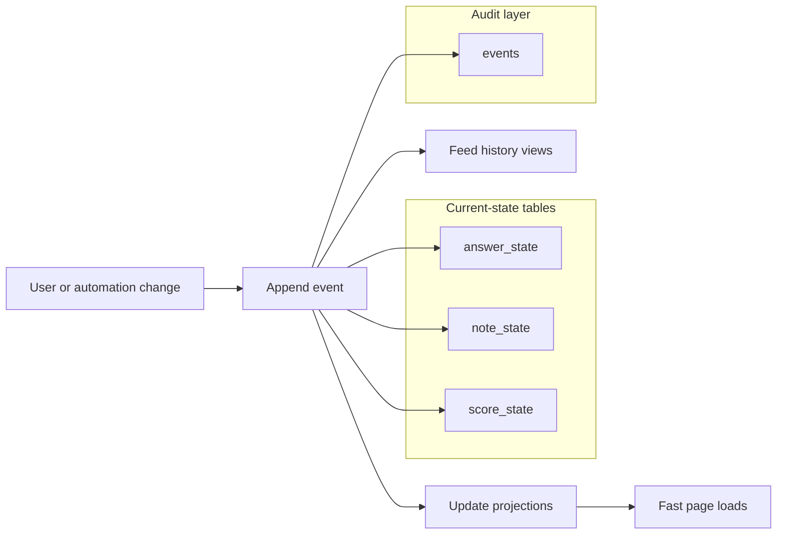

# Data Model — Walkthrough

This walkthrough focuses on the backend domain model behind Peaky's local-first architecture.

Short on time? Start with the [local-first reading map](./).

It deliberately focuses on the model itself, not the runtime mechanics of local-first sync. For that, read the companion walkthrough:

- [Architecture](./architecture)

This document answers four narrower questions:

1. what are the main entities?
2. how do teams, products, and additional subject types fit the same ownership model?
3. why are current-state tables and events both needed?
4. where do campaigns, Template Revisions, and component links fit?

This walkthrough uses simple, provider-neutral identifiers:

- use `...Id` and `...Ids` in core tables and APIs
- keep provider names out of first-party field names
- treat current catalog and identity providers as adapter concerns, not domain-model concerns

---

## 0. Implementation layer

The backend implements this data model using:

- **PostgreSQL 17** as the durable sync store (`peaky-api` + `peaky-sse`)
- **Raw SQL** in `services/internal/syncengine/repo/postgres.go` — no ORM on the Go side
- **goose** DDL migrations applied at deploy time by `peaky-ctl migrate`

The client has an independent runtime SQLite authority:

- **SQLocal + Drizzle** for browser-local SQLite access
- **hand-written `shared/db/schema/*.ts` definitions** for runtime queries
- **explicit SQLite migration files** for client bootstrapping
- **generated TypeScript migration embed module** so browser/serverless runtimes do not depend on filesystem reads
- **catalog-directory mirror tables** so people, groups, and components still resolve while offline

PostgreSQL and runtime SQLite intentionally do not generate one another. PostgreSQL is governed by `services/schema.sql`, Goose migrations, and sqlc generation; SQLite is governed by the hand-written Drizzle schema and explicit SQLite migrations. Persistence behavior tests enforce agreement for the contracts they share. The legacy `scripts/generate-drizzle-from-sql.ts` and `shared/db/schema/generated/` path is unused and non-authoritative; do not run or extend it.

The deployed model also depends on two checked-in transport artifacts:

- `shared/db/migrations/sqlite-content.ts` carries the reviewed SQL migration history into browser/serverless runtimes without runtime file reads
- `server/data/catalog-directory-mirror.snapshot.json` carries the full mirrored directory into the server bundle without depending on `process.cwd()` at request time

### Folder structure

```text
shared/db/
├── schema/                    # Hand-written runtime SQLite authority
│   ├── subject.ts             # subjects, component links
│   ├── template.ts            # templates, Revisions, pillars, questions
│   ├── review.ts              # reviews, exact Revision selections, state projections
│   ├── event.ts               # domain + system events (events table), imports, provenance
│   ├── sync.ts                # outbox, entitlement snapshots, cursors
│   ├── catalog-directory.ts   # provider-neutral user/group/component mirror
│   ├── local.ts               # product/team profiles and local import provenance
│   └── index.ts
│
├── migrations/
│   ├── index.ts
│   ├── sqlite-content.ts        # generated from .sql files for runtime embedding
│   └── sqlite/
│       ├── 0000_legacy_inline_client_upgrade.sql
│       ├── 0001_initial.sql
│       ├── ...
│       └── 0016_template_revisions.sql
│
server/db/
├── schema/index.ts            # Re-export of shared schema
├── repositories/drizzle/      # Class-based repositories with DI
│   ├── subject.ts             # SubjectRepository
│   ├── template.ts            # TemplateRepository
│   ├── review.ts              # ReviewRepository
│   ├── event.ts               # EventRepository
│   ├── sync.ts                # SyncRepository
│   └── index.ts               # createRepositories() factory
│
├── connection.ts              # better-sqlite3 + Drizzle (Nitro non-sync routes only)
└── index.ts                   # Barrel export

app/catalog-directory-mirror/
├── local.ts                   # bootstrap + mirror fetches from local SQLite
└── mappers.ts                 # snapshot/row conversion helpers

scripts/
└── generate-sqlite-migration-content.mjs  # deterministic SQL -> TS embed generation

server/data/
├── catalog-directory-mirror.ts            # chooses bundled snapshot or fallback seed
├── catalog-directory-mirror.snapshot.json # checked-in full mirror used for real deployments
└── catalog-directory-mirror-fallback.ts   # tiny provider-neutral fallback dataset
```

### Deployment-safe data transport is part of the model

The model is not only the table definitions. It also includes how those definitions and reference datasets reach constrained runtimes.

```mermaid
flowchart LR
    SQL[shared SQL migrations] --> EMBED[sqlite-content.ts]
    SNAP[full mirror snapshot JSON] --> BUNDLE[server bundle]
    EMBED --> CLIENT[Browser SQLite]
    EMBED --> SERVER[Nuxt test / Nitro runtime]
    BUNDLE --> MIRRORAPI[/api/catalog-directory-mirror/bootstrap]
```

This is why two files that look like build artifacts are actually architectural:

- the migration embed module prevents browser/serverless startup from depending on `.sql` filesystem reads
- the bundled mirror snapshot prevents deploys from degrading to the fallback demo directory when the runtime cannot see checked-in files on disk

### How schemas and repositories connect



Each repository imports the shared schema and exposes domain-focused methods like `findById()`, `save()`, and `update()`.

---

## 1. The core shape: review ownership is subject-oriented

The implemented model uses a shared review core owned by a **subject**.



### Why this helps

It keeps the user-facing language simple:

- a team-owned review
- a product-owned review
- an organization-owned review when that subject type is enabled

At the same time, it lets the backend share one consistent core for:

- assessment behavior
- history and auditing
- readiness and maturity scoring
- ownership and lifecycle rules

---

## 2. Subject does not mean one giant table

`subject` is the shared identity layer, not the entire domain stuffed into one record.

Today that identity layer is already paired with type-specific local-first profile tables for the domains that need extra fields.



### Implemented shape

The `subjects` table is the single source of identity.
Profiles extend it with type-specific metadata instead of replacing it.

=== "Shared identity"

    ```typescript
    export const subjects = sqliteTable("subjects", {
      id: text("id").primaryKey(),
      type: text("type", { enum: ["team", "product", "organization"] }),
      name: text("name").notNull(),
      slug: text("slug").notNull().unique(),
      status: text("status", { enum: ["active", "inactive", "archived"] }),
      createdAt: text("created_at").notNull(),
      updatedAt: text("updated_at").notNull(),
    });

    export const subjectComponentLinks = sqliteTable("subject_component_links", {
      id: text("id").primaryKey(),
      subjectId: text("subject_id").notNull().references(() => subjects.id),
      componentId: text("component_id").notNull(),
      relationshipType: text("relationship_type").notNull().default("contains"),
    });
    ```

=== "Type-specific profiles"

    ```typescript
    export const productProfiles = sqliteTable("product_profiles", {
      id: text("id").primaryKey(),
      subjectId: text("subject_id").notNull(),
      productManagerId: text("product_manager_id").notNull(),
      teamIds: text("team_ids").notNull().default("[]"),
    });

    export const teamProfiles = sqliteTable("team_profiles", {
      id: text("id").primaryKey(),
      subjectId: text("subject_id").notNull(),
      orgId: text("org_id").notNull(),
      orgName: text("org_name").notNull(),
      memberCount: integer("member_count").notNull().default(0),
    });
    ```

### Status and ownership boundaries

The current model keeps lifecycle semantics explicit without pretending every subject is Peaky-owned.

- products use `subjects.status` as a soft-delete/status transition; `archived` hides them from default active views but keeps the same identity for restore and sync
- Templates have a stable aggregate lifecycle of `active | archived`; their Revisions separately use `draft | published | retired`
- the schema models Template archive/restore separately from Revision publication and retirement, but all Template lifecycle and publication writes are currently frozen
- direct server create, update, publish, archive, restore, and delete calls fail closed with HTTP 503 and code `template_write_unavailable`; no disabled control can mutate data
- reviews follow an archive-first lifecycle instead of treating deletion as the primary cleanup path; their hard-delete path is narrower, admin-only, and audit-backed
- lifecycle transitions outside the frozen Template boundary append audit events, so the data model keeps both current state and the paper trail that explains it

That split keeps the shared ownership model clean: one identity anchor, but different lifecycle authority depending on the subject type.

### Identity vs route key

Every subject now carries two identifiers with different jobs:

| Field | Role | Example |
| --- | --- | --- |
| `id` | canonical durable identifier used in rows and foreign keys | `product_0195b0c6-8af2-7f56-9d80-0d7d4f8d4f84` |
| `slug` | public route key and human-friendly URL fragment | `product-checkout-0195b0c6` |

This keeps sync identity stable while letting URLs stay shorter and readable.

### Query shape

When reading data, the mental model is:



Examples:

- product details
  - join `product_profiles` to `subjects`
  - then derive review stats from `reviews.subject_id`
- team details
  - join `team_profiles` to `subjects`
  - then merge remote and local review summaries by `subject_id`
- review details
  - start from `reviews.id`
  - use `reviews.subject_id` to understand ownership

### How the queries look in code

=== "Server repository view"

    ```typescript
    // server/db/repositories/drizzle/subject.ts

    async findByType(type: Subject["type"]): Promise<Subject[]> {
      return this.db
        .select()
        .from(subjects)
        .where(eq(subjects.type, type));
    }
    ```

=== "Client local-first view"

    ```typescript
    // app/composables/local/useLocalProduct.ts

    const result = await db
      .select({
        subjectId: productProfiles.subjectId,
        subjectName: subjects.name,
        productManagerId: productProfiles.productManagerId,
        updatedAt: productProfiles.updatedAt,
      })
      .from(productProfiles)
      .innerJoin(subjects, eq(subjects.id, productProfiles.subjectId))
      .where(eq(productProfiles.subjectId, id.value))
      .limit(1);
    ```

That is the main mental model to keep:

| Layer | Job |
| --- | --- |
| subject | identity and ownership anchor |
| profile | type-specific local-first metadata |
| review | operational state attached to a subject id |

Teams and products already use local-first profile tables. Additional subject types should extend the same identity-plus-profile shape.

## 3. Component links remain first-class

Even after the Applications UI disappears, linked components still matter.

They are still the bridge for:

- readiness lookups from CI/CD
- scorecard and sync use cases in the external catalog
- campaign targeting based on ownership of specific components
- products that still contain many underlying applications or services



This keeps the boundary clean:

- Peaky owns operational state and review data
- the external catalog remains the source of group and component identity

### Example component link

```json
{
  "subjectId": "product_0195b0c6-8af2-7f56-9d80-0d7d4f8d4f84",
  "componentId": "checkout-api",
  "relationshipType": "contains"
}
```

---

## 4. Review state is intentionally split into projections and events

The review model has two layers because they solve different problems.



=== "Current-state tables"

    Fast reads and page hydration:

    | Table | Purpose | Query pattern |
    | --- | --- | --- |
    | `review_answer_state` | Current answer per question | `WHERE review_id = ? AND question_id = ?` |
    | `review_note_state` | Latest note per scope | `WHERE review_id = ? AND scope_type = ?` |
    | `review_attachment` | Attachment metadata | `WHERE review_id = ?` |
    | `review_score_state` | Latest score breakdown | `WHERE review_id = ?` |

=== "Append-only events"

    Auditability and history:

    | Table | Purpose | Query pattern |
    | --- | --- | --- |
    | `events` | Immutable action record with the full CloudEvents v1.0.2 envelope (`id`, `type`, `specversion`, `source`, `dataschema`, `actor_id`, `actor_type`, `entity_type`, `entity_id`, `review_id`, `client_id`, `time`, `status`, `data`) | `WHERE entity_type = ? AND entity_id = ? ORDER BY time` |

    The `events` table has no CASCADE delete from reviews. Events survive entity deletion and any future sync engine migration. Index on `(entity_type, time)` supports cross-domain queries. Do not add sync-coupled columns to this table.

    The `status` enum is `pending | synced | failed | local`. Events whose `EventCatalogEntry` declares `local: true` (DB lifecycle, OPFS storage, recreate-DB) are inserted with `status: "local"` and the future event-push pipeline (Rust engine) MUST skip them. The flag is required on every catalog entry — no silent default.

| Question | Answered by |
| --- | --- |
| what is true now? | current-state tables |
| how did it become true? | append-only event history |

That split is useful even outside local-first. It is simply a cleaner model for Peaky's audit and history needs.

### Sync technology note

The `localOutbox` table exists today as a sync queue. When the future Rust sync engine replaces the custom outbox, this table may be replaced. The `events` table is independent — it persists as the local audit trail regardless of sync technology.

### Example: state row vs event row

=== "Current answer state"

    ```json
    {
      "reviewId": "review_peak-season-2026_checkout",
      "questionId": "ops-12",
      "answer": "yes",
      "updatedAt": "2026-03-17T08:20:00Z"
    }
    ```

=== "Audit event"

    ```json
    {
      "id": "019b3c4d-5e6f-7a8b-9c0d-0a1b2c3d4e5f",
      "type": "ReviewAnswerRecorded.v1",
      "specversion": "1.0",
      "source": "peaky.client",
      "entityType": "review_answer",
      "entityId": "review_peak-season-2026_checkout",
      "actorType": "user",
      "actorId": "heitorl",
      "time": "2026-03-17T08:20:00Z",
      "data": {
        "questionId": "ops-12",
        "answer": "yes"
      }
    }
    ```

---

## 5. Notes and attachments become scope-aware resources

Instead of hard-coding notes too deeply into one route shape, the model treats notes and attachments as scoped resources.

=== "Notes"

    ```text
    review_note_state
    - review_id
    - scope_type    review | pillar | question
    - scope_id
    - content
    ```

=== "Attachments"

    ```text
    review_attachment
    - review_id
    - scope_type    review | pillar | question
    - scope_id
    - filename
    - object_key
    ```

This gives Peaky room for:

- whole-review notes that capture broad context
- pillar notes that group operational observations
- question-level evidence when the proof needs to be more precise

without redesigning the model every time.

### Example scoped records

=== "Pillar note"

    ```json
    {
      "reviewId": "review_peak-season-2026_checkout",
      "scopeType": "pillar",
      "scopeId": "reliability",
      "content": "Runbook exists, but on-call handoff still needs cleanup."
    }
    ```

=== "Question attachment"

    ```json
    {
      "reviewId": "review_peak-season-2026_checkout",
      "scopeType": "question",
      "scopeId": "ops-12",
      "filename": "incident-runbook.pdf",
      "objectKey": "example-object-key"
    }
    ```

---

## 6. Templates split stable identity from complete Revisions

The implemented shape is:

```text
template
  -> long-lived identity, owner Team, active | archived

template_revision
  -> complete metadata and content snapshot, draft | published | retired
    -> template_pillar
      -> template_question
```

A Revision includes its own name, description, provenance, Pillars, and Questions. Drafts have null `revision_number`, `published_at`, and `published_by_actor_id`. Published and retired Revisions require all three publication fields, with a positive number; the UI renders that number as `vN`. `revision_summary` is optional, trimmed, empty-normalized to null, and limited to 120 characters.

Partial unique indexes allow at most one draft and one current published Revision per Template, while `(template_id, revision_number)` keeps published numbering unique. Published and retired snapshots are immutable. `created_by_actor_id`, `updated_by_actor_id`, and `published_by_actor_id` record provenance but grant no permissions, and `owner_team_id` cannot be transferred by the current authoring flow.

### Local-only authoring boundary

The editable draft is structured rather than stored as one JSON document:

- Template metadata stays separate from Revision, Pillar, and Question rows
- each authoring unit keeps a stable ID
- Pillar and Question ordering uses durable `order_key` values instead of raw array indexes
- Template Studio Markdown import/export round-trips metadata, Pillars, Questions, Question types, checklist items, leading practices, and helpful links through the in-memory draft and normal structured save

Template Studio creates and edits the one draft Revision through `LocalMutation.localOnly()`. Each save is an atomic state-only SQLite transaction: it creates no event, no outbox row, and no push trigger. Template draft push, pull, SSE, replay, and cross-device collaboration are not implemented. This temporary local-only boundary also means unpublished authoring is not recoverable from the server if the browser database is cleared or lost.

Publication and remote Template create/update/archive/restore/delete remain fail-closed until the server-authoritative publication stage. API calls return HTTP 503 with `template_write_unavailable`, and matching client services fail before a write.

### Exact Review selections

`review_template_selections` points directly to `template_revisions` with composite identity `(review_id, template_revision_id)`, unique positions from 0 through 2, and `ON DELETE RESTRICT` for the selected Revision. New Reviews accept one to three current published Revisions from distinct active Templates. Existing Reviews continue to read their exact snapshots after retirement, and answer or Improvement Plan logic uses Revision-specific Question IDs without inferring continuity across Revisions.

### Example published Revision record

```json
{
  "id": "revision_peak-season-v3",
  "templateId": "template_peak-season",
  "name": "Peak Season Readiness",
  "description": "Readiness checks for peak traffic",
  "status": "published",
  "revisionNumber": 3,
  "revisionSummary": "Refresh capacity and failover checks",
  "publishedByActorId": "actor-system",
  "publishedAt": "2026-03-01T10:00:00Z"
}
```

### Why archived matters beyond the UI

`archived` is the lifecycle state of the stable Template aggregate, not a Revision status. It can remove a Template from current selection without changing the identity or any historical Revision. `retired` serves the corresponding historical role for a previously published Revision: new Reviews cannot select it, but Reviews already pinned to it remain readable. The current freeze prevents archive, restore, retirement, and permanent deletion writes.

---

## 7. Score state is not the same as answer state

Peaky will increasingly need to answer two different questions:

1. what did people answer?
2. what does that mean for readiness or maturity?

That is why a separate score projection matters.

```text
review_score_state
- review_id
- score_type
- numeric_score?
- band
- score_breakdown
- computed_at
```

This keeps scoring flexible enough for:

- current readiness outcomes
- maturity score builder behavior
- richer integration payloads later

When the score family is known, projections should prefer explicit names such as `readinessByPillar` instead of vague names like `breakdownPayload`.

### Example score state

```json
{
  "reviewId": "review_peak-season-2026_checkout",
  "scoreType": "readiness",
  "numericScore": 78,
  "band": "ready-with-risks",
  "readinessByPillar": {
    "reliability": 82,
    "operations": 74,
    "security": 79
  },
  "computedAt": "2026-03-17T08:40:00Z"
}
```

---

## 8. Scope boundary

This walkthrough documents the implemented model only.

Additional planning/governance domains should compose on top of the subject-and-review core instead of creating a parallel ownership model.

---

## 9. Data model summary

```text
Subjects own reviews.
Stable Templates own complete Revisions.
Reviews use exact Template Revision snapshots.
Current-state tables power fast reads.
Events explain meaningful synced changes; local-only Template drafts are the explicit exception.
Linked components stay first-class for integrations.
Additional domains should reuse the same subject-oriented ownership model.
```

For the API surface that exposes this model, see [API](./api).
