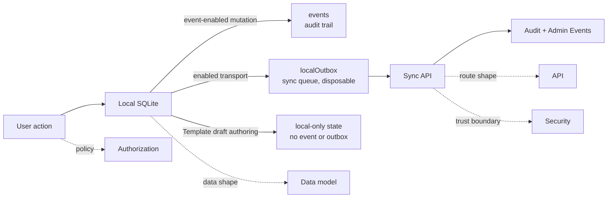

# Local-First — Walkthroughs

If you are tired and only need the shape of the system, start here.

## Read this in order

| If you want to understand... | Read... |
| --- | --- |
| the mental model and runtime path | [Architecture](./architecture) |
| tables, entities, and the aligned PostgreSQL/SQLite contracts | [Data Model](./data-model) |
| HTTP routes, sync plane, and operator endpoints | [API](./api) |
| who can archive, restore, delete, or access admin events | [Authorization](./authorization) |
| what changes about security in local-first and where the trust boundary is | [Security](./security) |
| what gets recorded and how operators inspect it | [Auditing](./auditing) |
| how this can fail in production and what to check first | [Failure Domains](./failure-domains) |
| how schema migrations are rolled out to existing clients | [Upgrades](./upgrades) |
| field-level conflict resolution, clock sync, and the four protection layers | [HLC](./hlc) |
| how members self-serve diagnose the local engine | the `/system` page (composable + components + tests in `app/composables/system/`, `app/components/system/`, `tests/unit/composables/system/`) |

## Short reading map

=== "5 minutes"

    1. [Architecture](./architecture)
    2. skim the diagram in [Data Model](./data-model#2-subject-does-not-mean-one-giant-table)
    3. skim the API plane diagram in [API](./api#1-the-api-is-intentionally-split-into-three-planes-with-an-operator-slice-inside-the-shared-api)

=== "15 minutes"

    1. [Architecture](./architecture)
    2. [Data Model](./data-model)
    3. [API](./api)

=== "Deep dive"

    1. [Architecture](./architecture)
    2. [Data Model](./data-model)
    3. [API](./api)
    4. [Authorization](./authorization)
    5. [Security](./security)
    6. [Auditing](./auditing)
    7. [Failure Domains](./failure-domains)
    8. [Upgrades](./upgrades)

## Trade-offs to remember

### Deployment-safe artifacts over runtime filesystem reads

Peaky deliberately ships generated migration content and the bundled catalog-directory snapshot inside the deployment artifact instead of reading them from disk at runtime. The upside is that browser/serverless deployments stay predictable; the trade-off is that maintainers must remember the generated transport files are part of the runtime contract, not disposable build noise.

### Progressive hydration over one giant blocking bootstrap

Some screens, such as the Teams dashboard, render remote data first and fold local overlays in afterward instead of waiting for every local-first dependency before first paint. The upside is faster perceived load and less spinner time; the trade-off is that engineers must reason about mixed remote/local states during the first seconds of a page lifecycle.

### Local-first metadata over full offline blob storage

Attachments currently treat metadata as local-first while leaving full binary upload/download to the remote storage path. The upside is lower browser storage pressure and simpler sync behavior; the trade-off is that an attachment can exist locally as a pending record before the real file has finished uploading, which is why the UI needs an explicit `not synced` state.

### Typed domain events over ad-hoc audit reconstruction

Event-enabled domain operations emit typed events (`DomainEventEnvelope` with a versioned envelope and discriminated payload) into a dedicated `events` table. Upside: a consistent audit trail that supports future event-driven features. Trade-off: every new audited operation must define its event type upfront; schema evolution requires versioning. Template draft authoring is the explicit temporary no-event exception.

### Explicit mutation modes over sequential best-effort inserts

Enabled transports use `LocalMutation.commit()` to atomically write state, a domain event, and an outbox entry. Current Template and draft Revision/Pillar/Question authoring instead uses the explicit `LocalMutation.localOnly()` mode for one state-only transaction. Upside: both paths prevent partial writes while reporting transport truthfully. Trade-off: local-only unpublished work has no audit or server recovery and is lost when local data is cleared.

## What lives in this folder

Only the clearly local-first walkthroughs live here.

- runtime architecture
- sync and API boundaries
- independent PostgreSQL/SQLite schema authorities and the subject-oriented model
- lifecycle authorization
- security threat model and trust boundary
- audit/event behavior
- failure domains and on-call debugging map
- upgrade mechanics and migration rollout

Domain-specific walkthroughs such as `products.md` stay in the parent `walkthroughs/` folder.
