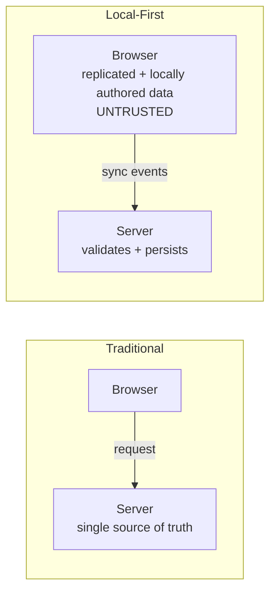
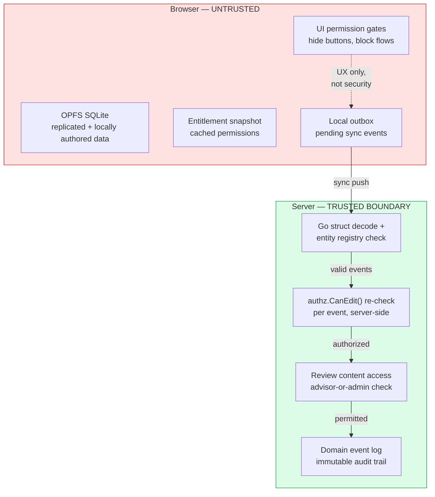

# Local-First Security — Walkthrough

This walkthrough explains what changes about security when your application stores data in the browser and syncs later. It is the narrative companion to the [threat model](../../threat-model), which is the canonical record of the current posture: the security stack, the formal verification coverage, the known-gaps ledger, and the review checklist all live there.

Short on time? Start with the [local-first reading map](./).

It complements these walkthroughs:

- [Architecture](./architecture) — runtime layers and where the trust boundary sits
- [Authorization](./authorization) — who may act, and where that is enforced
- [API](./api) — the sync protocol that replaces traditional REST
- [Formal verification](../formal-verification) — the FizzBee specs that model-check the invariants this document leans on

Facts in this document that can be checked mechanically — file paths, entity
types, caps and limits — are enforced by `tests/guards/threat-model-drift.test.ts`,
which runs in the fast vitest suite. If you change a constant this document
cites, that guard fails and points you back here.

---

## 1. Why security needs its own walkthrough

In a traditional server-rendered app, the server is the only place that stores data and makes decisions. Security means protecting that server.

In a local-first app, the browser stores replicated and locally authored data and makes UX decisions locally. Not every aggregate is completely replicated: enabled Review/Product fields use sync, while unpublished Template authoring currently remains only in local SQLite. The server sees enabled changes when the client syncs. This inverts the trust model:



**The browser is untrusted.** An attacker with DevTools can read every row in OPFS, modify entitlement snapshots, forge sync events, and bypass every UI gate. The server must be the last line of defense.

---

## 2. The trust boundary

Everything in the browser can be inspected and modified. Everything on the server is under your control. Since the Go sync engine shipped, the boundary for *synced* data sits in `services/`, not in Nuxt server routes: `nuxt.config.ts` proxies `/api/sync/**` to `peaky-api`. That qualifier matters — 19 mutating routes still ship under `server/api/`, 8 of them unauthenticated, and they are not behind that boundary. Four additional Template mutation-shaped routes are fail-closed 503 boundaries rather than authorities (see the HIGH row in the [threat model](../../threat-model)).



**Rule:** UI checks improve ergonomics. Server checks are the real security boundary. Never rely on the browser to enforce access control.

---

## 3. What an attacker can do (and what stops them)

### Attack: Forge entitlements in OPFS

The client caches an entitlement snapshot in local SQLite. An attacker can open DevTools, access the OPFS database, and change `canEdit: false` to `canEdit: true`.

**Mitigation:** The push handler (`services/internal/syncengine/push.go`) calls `authz.CanEdit()` for **every event** against the server-side registry. The client's copy is irrelevant — it only affects the local UI.

```text
Client sends sync event with forged entitlements
  → Server resolves the event to its authorization root
  → Server checks its own registry: CanEdit is false
  → Event rejected with "access_revoked"
```

Two formal specs pin this boundary down: `formal_verification/sync/root_scope_alignment.fizz` proves a family wildcard (`product:*`) never leaks another family's events and an exact entitlement never grants a sibling root's data, and `formal_verification/sync/sse_channel_alignment.fizz` proves pull remains the sole authorization gate (see the [threat model](../../threat-model) for the full STRIDE mapping).

### Attack: Enable Template publication or invoke remote lifecycle

An attacker can edit `runtimeConfig.public.templatePublishingEnabled` or call mutation-shaped routes directly. No current UI control consumes that public value; it is inert browser-visible configuration reserved for future UX and cannot enable writes. Nitro has no remote Template write authority: create, update, publish, archive, restore, whole-draft-delete, and permanent-delete behavior remains fail-closed with `template_write_unavailable`. The only remote Template behavior retained is deterministic catalog and published-fixture reading. Private and public defaults derive from `NUXT_TEMPLATE_PUBLISHING_ENABLED`, and `server/plugins/template-publishing-config.ts` rejects startup if runtime overrides make them disagree.

### Attack: Lose unpublished Template work

Template drafts, Pillars, Questions, and import provenance are deliberately local-only during the transport freeze. They create no event or outbox row, so clearing site data, recreating the local database, OPFS corruption, device loss, or the destructive Preview cutover permanently removes unpublished work. Deterministic demo drafts can be reinstalled, but user-authored drafts have no recovery path until issue #137 bootstraps complete draft state before Template sync is enabled.

### Attack: Claim another Team as Template owner

`ownerTeamId` is currently an association, not an authorization grant. First save checks only that the chosen ID exists in the browser's last persisted `directory_groups` snapshot. Because OPFS is untrusted and the mirror contains no trustworthy actor-membership relation, that check cannot prove that the author belongs to the Team. Remote Template writes and lifecycle actions remain frozen, so false attribution stays local and unpublished today. A future server authority must revalidate Team identity and membership rather than trust this browser-selected value.

### Attack: Repush legacy state after the Preview reset

Migration 0016 and Goose migration 008 intentionally delete legacy Template and dependent Review state, matching transport/history records, and selected audit evidence. They preserve Product, Team, catalog, cursor, migration, and unrelated history classes. This is destructive: there is no legacy identity mapping and rollback recreates empty historical shapes.

The cutover does not introduce a protocol floor. Because the Go registry still recognizes the pre-existing Template entity names, a stale tab can theoretically repush old field state after the purge. Reload/version prompts reduce the window, but Generic Sync Hardening owns authoritative stale-client rejection.

### Attack: Inject malformed sync events

An attacker can craft a sync push request with invalid payloads — wrong types, missing fields, oversized batches — hoping to crash the server or corrupt other clients' data.

**Mitigation:** Go struct validation in `services/internal/syncengine/push.go`:

- Batches are capped at `500` events<!-- drift:maxPushEvents --> (`maxPushEvents`) and `100` fields per event<!-- drift:maxFieldsPerEvent --> (`maxFieldsPerEvent`)
- `entityType` must be in the registry-recognized set, extended by the maturity-score change with three review children (`review_maturity_override`, `review_handoff_practice`, `review_handoff_association`) that resolve to the owning Review as their authorization root and register no new pull root (`services/internal/syncengine/entity/registry.go`): <!-- drift:entity-types -->`review`, `review_checkpoint`, `review_answer`, `review_note`, `review_attachment`, `review_maturity_override`, `review_handoff_practice`, `review_handoff_association`, `product`, `template`, `template_draft`, `template_draft_pillar`, `template_draft_question`
- `operation` must be one of <!-- drift:operations -->`create`, `upsert`, `update`, `delete`
- Child entity IDs must resolve to a parent authorization root; unparsable IDs are rejected
- `pushedAt` must parse as RFC3339 and cannot be more than 30 seconds in the future
- Fields with a non-array `fields` payload are rejected as `legacy_fields_format`
- Handoff practice and association fields carry the versioned `handoff-limits/v1` contract, re-validated in Go (`services/internal/syncengine/handoff/limits.go`) with the same constants the TypeScript domain enforces (`app/services/handoff/limits.ts`): rationale at `2000` characters<!-- drift:handoff-rationale-chars -->, external and evidence identifiers at `128`<!-- drift:handoff-identifier-chars --> characters each, https-only URLs at `2048` characters<!-- drift:handoff-url-chars -->, `10` helpful links<!-- drift:handoff-links-per-practice --> and `20` evidence identifiers<!-- drift:handoff-evidence-per-practice --> per practice, and `50` practices<!-- drift:handoff-practices-per-handoff --> per handoff. Limits count Unicode code points, never encoded bytes; rejection is atomic and field-addressable with no truncation; both runtimes prove parity against `tests/fixtures/handoff-limits.v1.json`
- Invalid requests return 400 before touching any field version storage

There is no static `allowedEntityTypes` set — the gate is `entities.Knows()` against `entity.DefaultRegistry()`. New entity types register there, which is why the [review checklist](../../threat-model) points at the registry, not at `push.go`.

Registry extensions stay protocol-compatible while they keep the existing roots: the maturity-score review children resolve to the owning Review and register no new pull root. The Template/Revision transport freeze still holds — `LocalMutation.localOnly()` emits none of those Template events, and there is no `template_revision`, `template_pillar`, or `template_question` sync type. Issue #137 and Generic Sync Hardening own future transport and stale-client cutover.

### Integrity gap: Sync a Review without its Revision selections

Canonical local Review creation atomically writes the Review row and ordered `review_template_selections`, but its outbox still contains only `subjectId`, `name`, and `status`. The Go generic push path does not validate `templateRevisionIds`; inbound `ReviewHandler` ignores that field and PostgreSQL generic sync writes field history rather than Review domain rows. A fresh client can therefore receive a Review header without enough information to reconstruct the assessment. #140 deliberately leaves this unchanged; Generic Sync Hardening owns atomic Review-selection transport and projection.

### Attack: Override a maturity result without an Advisor assignment

An attacker with Review edit access — but no Advisor assignment — pushes a `review_maturity_override` event, or a current Advisor pushes an action the model does not define.

**Mitigation:** Override events route through the action-specific `MaturityOverridePolicy` (`services/internal/authz/override.go`) at the push boundary, not through a bare capability check. Authorization requires Review edit access **and** a current persisted `reviewer` participant row (the role product surfaces label Advisor) resolved through a server-side `ReviewParticipantLookup` — never from client-supplied claims. Unknown or missing actions, participant-lookup errors, and edit-access-only actors all fail closed, and a denied event writes no transition fields. Any current Advisor may create, supersede, or revoke; history stays append-only.

### Attack: Invoke a provider handoff operation directly

An attacker calls a provider-integration endpoint, or assumes the always-available handoff UI implies a reachable provider adapter.

**Mitigation:** No provider route, adapter, or provider-shaped sync entity type ships. The single choke point is `ProviderHandoffPolicy` (`services/internal/authz/provider.go`): it denies **before** any adapter or network invocation unless the private server capability `PROVIDER_HANDOFF_INTEGRATION_ENABLED` (`services/internal/app/config.go` — exact `true`, default disabled) is enabled **and** the actor holds Review edit access on the owning Review. The capability is server-only configuration, never serialized to public runtime config or client code, so handoff UI availability alone can never authorize a provider operation. `tests/guards/handoff-provider-boundary.test.ts` proves every handoff module does no network I/O, touches only `navigator.clipboard`, and that the capability has exactly one choke point.

### Attack: Read handoff drafts and override explanations from OPFS

The three review children replicate to browser SQLite (`review_maturity_overrides`, `review_handoff_practices`, `review_handoff_associations` in `shared/db/schema/review.ts`), so handoff draft snapshots and rationale, existing-ticket association references (provider, external ID, https URL), and override explanations are readable to anyone with device or DevTools access.

**Mitigation:** None of that data is secret or authoritative. Snapshots exclude provider credentials, session tokens, and unrestricted ticket bodies by contract, and the server re-validates shape, Review ownership, field limits, URL schemes, and mutation authorization on push. Residual device-theft exposure is the existing OPFS disclosure rows in the [threat model](../../threat-model), not a new one. Clipboard copy is user-directed, carries the same non-secret data, and happens only from an explicit gesture.

### Attack: Dump the local database via DevTools

If `window.peakyDB` is exposed, an attacker can call `peakyDB.dumpTable('entitlementSnapshots')` to see every cached permission, or `peakyDB.dumpTable('subjects')` to see all products and reviews.

**Mitigation:** The debug globals are guarded by `runtimeConfig.public.testHelpersEnabled`, not by `import.meta.dev`:

- `window.peakyDB` — `app/plugins/local-db.client.ts`
- `window.__peakySeed` — `app/plugins/test-seed.client.ts`

`testHelpersEnabled` is true for local development **and Vercel preview deployments** (E2E tests need it) and false only when `VERCEL_ENV=production`. This is deliberate: preview deployments intentionally expose these globals and must not be treated as a production trust boundary. Anything secret enough that a preview URL leaking it would hurt does not belong in preview seed data.

The Review workspace route requires a sealed authenticated session but deliberately does not enforce participant scope while Reviews are in-memory demo fixtures. Any signed-in pre-Beta user can open those Reviews and receives capabilities based on Review status. This must change before the route serves real data. Mutation routes that use `reviewContentAccess.ts` still require a participant, owner, or Admin. The workspace exception does not invent a Go sync entitlement snapshot, so the profile can truthfully report shared sync authorization as unavailable.

### Attack: Spoof actor identity

Both `peaky-api` and `peaky-sse` read actor identity from the `x-actor-id` and `x-actor-roles` request headers. An attacker who can reach the services directly can set any header they want. The real behavior is **worse than "the header is trusted"**, and worth stating precisely:

- `x-actor-roles: admin` mints a wildcard admin: `buildAdminActor()` in `services/internal/middleware/actor.go` grants CanView+CanEdit on `review:*`, `product:*`, and `template:*` for **any** actor ID, known or not.
- An unknown `x-actor-id` is **not rejected**: `authz.Registry.Get()` (`services/internal/authz/registry.go`) silently falls back to the `actor_dev` entry, which `services/seed/actors.json` grants wildcard `review:*` and `product:*` CanView+CanEdit. There is no 403 for a forged ID — a forged ID becomes a fully entitled dev actor.
- A missing `x-actor-id` defaults to `actor_dev` outright.

What the middleware does do: `sanitizeHeader()` truncates header values to 256 characters and strips control characters, closing log-injection and response-splitting tricks.

**Why the roles header exists at all:** the self-admin path is a local-testing affordance — it lets a developer validate role-gated workflows against locally running services without an IdP. It is interim by design: once the AuthZ engine ships, test roles become seeded policy data and the header has no reason to exist. Until then, it must never be forwardable from outside.

**The Nuxt surface is already closed.** Okta is implemented and fails closed: `getLifecycleActor()` (`server/utils/lifecycleActor.ts`) resolves identity from the sealed OIDC session first — `validateIdToken()` in `server/utils/auth/okta.ts` verifies IdP signatures against Okta's remote JWKS with audience checks, and admin is derived from the IdP `groups` claim, not from anything the client asserts. In production, or whenever OIDC is enabled and no session is present, the request gets a 401 — never an anonymous `member` actor. The `x-actor-*` header fallback on this surface is reachable **only when OIDC is intentionally unset** (dev / tests / E2E), which is what closed the merge-check B-1 `x-actor-roles` spoofing finding.

**The Go boundary is not.** `peaky-api` and `peaky-sse` sit behind ALB path routing in production (the Nitro proxy is dev-only), and their identity remains a deployment contract the Go code cannot enforce: the layer in front of them **must strip `x-actor-roles` and re-inject `x-actor-id` from the authenticated session**. If that contract is broken, the bullets above are a trivially reachable privilege escalation.

**Production fix (Phase 3):** Bring the same verified-claim identity to the services — Okta JWT validation in `actor.Middleware` (`services/internal/middleware/actor.go`), the single point to change; `peaky-sse` validates the same JWT so SSE subscriptions carry the same identity guarantee as push/pull. With the AuthZ engine alongside it, the unknown-actor fallback and the roles header are deleted outright — not bypassed — and every HIGH threat in the ledger ceases to exist in the same change.

### Attack: Unauthorized SSE subscription

An attacker who knows the SSE endpoint URL connects with a forged `x-actor-id` to receive cursor-pointer notifications for entities they have no entitlement to see.

**Mitigation (and one honest caveat):** `peaky-sse` calls `entitlementChannels(actor)` at connection time and only subscribes to the family catalog channels (`sync:{family}:catalog`) the actor's CanView entitlements resolve to. An actor with no entitled channels is refused with 403, so no stream is opened. The caveat follows from the identity gap above: a forged actor ID is not rejected — it falls back to `actor_dev`, whose wildcard entitlements *do* resolve to channels. Until Phase 3, SSE subscription control is only as strong as the deployment contract on the identity headers.

What makes this tolerable is that the frame is worthless: the SSE payload is a cursor pointer only — `{ cursor, family }` — with no domain data. `peaky-sse` never holds or transmits entity content, so even a wrongly opened SSE connection exposes nothing sensitive. The doorbell is intentionally family-scoped (over-notification is accepted); the subsequent `pullChanges()` call is entitlement-gated on `peaky-api` and strips anything the actor cannot see. This is no longer just a design argument: `formal_verification/sync/sse_channel_alignment.fizz` proves the invariant (`I3_PullRemainsAuthoritative` — the notification channel carries zero domain data, pull is the authorization boundary) along with six others covering under-notification, cross-family wake, and rejected-event silence. See the [API walkthrough](./api.md#sse-endpoints-peaky-sse-port-3002) for the endpoint rationale.

### Attack: Replay sync events

A buggy client (or an attacker) re-sends the same batch of sync events after a network timeout.

**Mitigation (partial):** HLC conflict resolution at the field level means replaying an already-accepted event produces the same winning field version — no corruption. `formal_verification/sync/sync_engine_push_pull.fizz` proves this (`PushIdempotent`, `NewerAlwaysWins`, `NoLostAcceptedEvent`): a replayed push is a data no-op. But a duplicate `events` row is still written and a duplicate `pg_notify` still fires (the client pulls again, sees nothing new, and stops). Full deduplication using a processed-events table is tracked in the roadmap; until then an exact populated replay may surface as an HLC conflict rather than an idempotent accept.

---

## 4. How this differs from traditional web security

| Concern | Traditional app | Local-first app |
|---------|----------------|-----------------|
| **Where data lives** | Server database | Browser OPFS for replicated and locally authored state; server for enabled transports |
| **Who makes auth decisions** | Server only | Browser for UX, server for real |
| **API surface** | REST endpoints | Sync protocol (push/pull) |
| **XSS impact** | Session hijack, CSRF | All of that + full data access in OPFS |
| **Offline access** | None | Read/write for locally available state; entitlements cached and cold-load coverage incomplete |
| **Data exposure** | Requires server breach | DevTools on the user's machine |
| **Input validation** | On each REST endpoint | On the sync push (single funnel) — plus 19 mutating Nitro routes not yet retired and four fail-closed Template mutation-shaped routes |

The sync push endpoint is **the** security-critical API for synced data. In a traditional app you'd audit 20 REST endpoints; the local-first goal is to audit one sync handler and ensure every event type is validated. Peaky is not there yet — the legacy REST surface was never removed, so today you audit the sync handler, the 19 remaining mutating Nitro routes, and the invariant that the four Template mutation-shaped routes stay write-free.

---

## 5. Where the current posture lives

This walkthrough teaches the model; the [threat model](../../threat-model) records the posture. There you'll find:

- **The security stack** — runtime headers, session and identity controls, input validation, authorization enforcement, test-helper exposure
- **Formal verification coverage** — which FizzBee specs prove which STRIDE properties, and the honest limits of those proofs
- **The known-gaps ledger** — every open, accepted, or scheduled risk with its target phase
- **The /system page exclusions** and the **security review checklist**

The interactive deck at `explainers/stride-threat-model-explainer.html` presents the same posture as slides (press `P` to present).

---

## 6. Summary

```text
The browser is untrusted — everything there can be read and modified.
The sync push endpoint is the real API surface for synced data — validate there.
It is not the only write surface: 19 Nitro routes still write, 8 with no auth at all; four Template mutation-shaped routes are fail-closed 503 boundaries.
Unpublished Template authoring is local-only and creates no event, outbox, or server copy.
Exact Review Revision selections are local-only and cannot be reconstructed through current sync.
Migration 0016 and Goose 008 are a bounded destructive Preview reset with no stale-client protocol floor.
UI permission gates are UX, not security.
Server re-validates entitlements on every sync event — via a JSON registry today, Cedar later.
Nuxt identity is a verified OIDC claim that fails closed; Go-service identity is still a deployment contract until Phase 3's JWT lands.
Formal specs prove the scoping invariants — but only on machines that run them, and only against an honest client.
Test-helper globals are preview-visible by design; previews are not a trust boundary.
```
