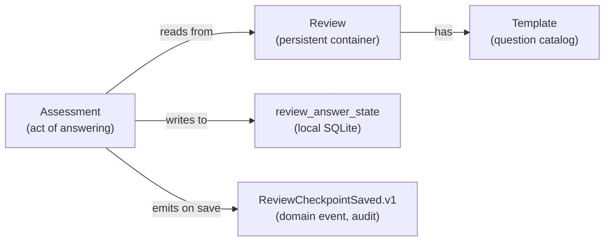
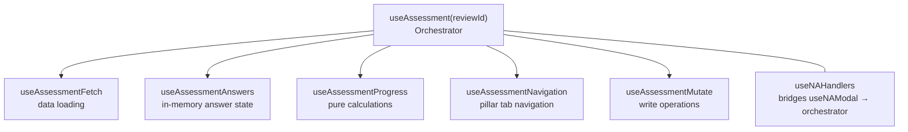
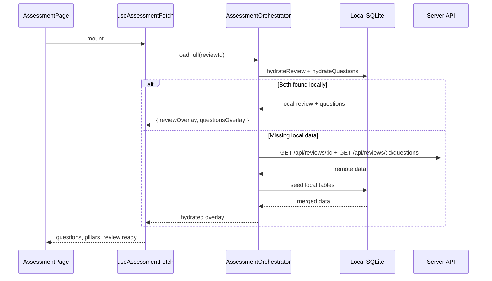
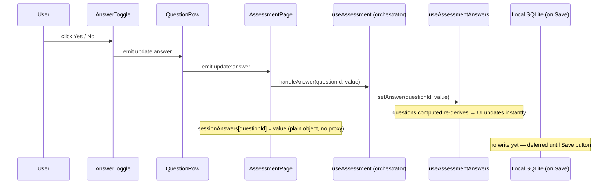
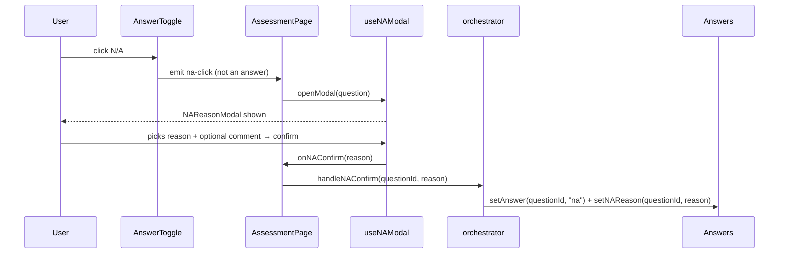
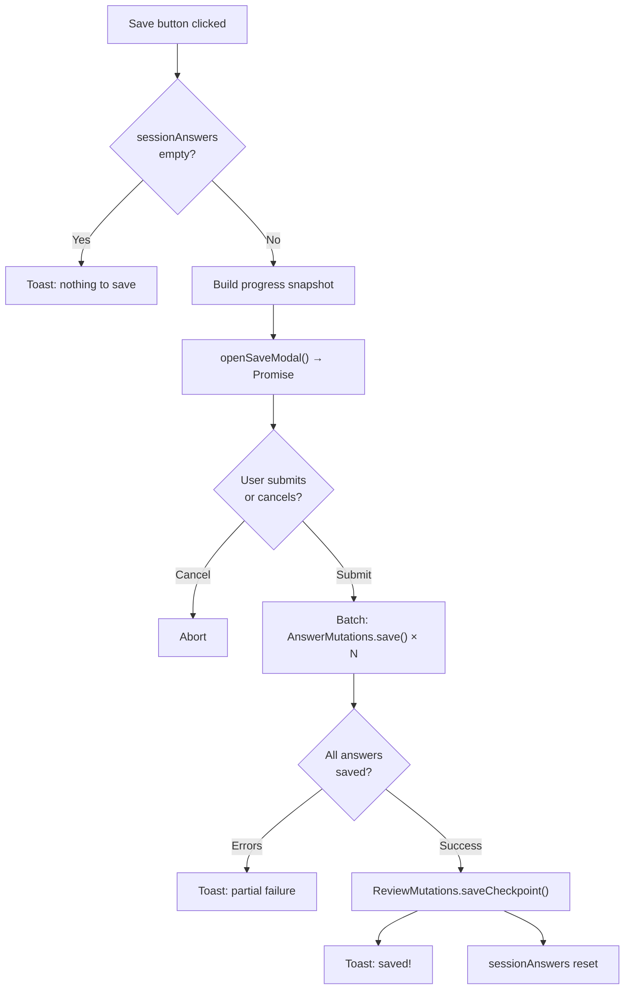

# Assessments — Walkthrough

An **assessment** is the act of answering review questions. It is a behavioral concept, not a database entity — there is no `assessments` table. Answers are stored in `review_answer_state`; checkpoints are domain events; progress is derived at runtime from the in-memory answer state.

> **User guide**: [Working with Reviews](../../../user-guide/reviews.md) shows the assessment flow from a reviewer's perspective.

---

## 1. Mental model



The review defines *what* is being evaluated. The assessment is *doing* the evaluation. Pages are thin — they receive a `reviewId` and delegate everything to `useAssessment(reviewId)`.

---

## 2. Three page routes, one component

All three assessment routes delegate to `AssessmentPage.vue`:

```text
pages/products/[productId]/reviews/[reviewId]/assessment.vue
pages/teams/[teamId]/reviews/[reviewId]/assessment.vue
pages/applications/[appId]/reviews/[reviewId]/assessment.vue
```

Each extracts `reviewId` from the route and renders `<AssessmentPage :review-id="reviewId" />`. The component never inspects the subject type.

---

## 3. Orchestrator pattern

`useAssessment(reviewId)` is the single composable consumed by `AssessmentPage`. It composes five focused sub-modules:



The orchestrator also owns a `questions` computed that merges the server-fetched question list with local in-memory answer state — the UI always reads from this merged view:

```typescript
const questions = computed<Question[]>(() =>
  questionsData.value.questions.map((q) => ({
    ...q,
    answer: getAnswer(q.id) !== undefined ? getAnswer(q.id) : q.answer,
    naReason: naReasons.value[q.id] ?? q.naReason,
    itemNAReasons: itemNAReasons.value[q.id] ?? q.itemNAReasons,
  }))
);
```

Local state always shadows server state, so progress bars update immediately on every answer toggle — before any save.

---

## 4. Composable and service layer

| Module                           | Layer                     | Purpose                                                                                |
| -------------------------------- | ------------------------- | -------------------------------------------------------------------------------------- |
| `useAssessment`                  | Composable (orchestrator) | Public API; composes sub-modules; owns N/A reason state; exposes `questions` computed  |
| `useAssessmentFetch`             | Composable                | Reactive data loading via `AssessmentOrchestrator.loadFull()`                          |
| `useAssessmentAnswers`           | Composable                | Pure in-memory answer state (Record\<questionId, answer\>); no API calls               |
| `useAssessmentMutate`            | Composable                | Write operations: `saveAnswer`, `saveNote`, `createSession` (→ checkpoint)             |
| `useAssessmentProgress`          | Composable                | Pure calc helpers: overall %, per-pillar %, `isComplete()`                             |
| `useAssessmentNavigation`        | Composable                | Pillar tab state: `currentPillarIndex`, next/prev/goTo                                 |
| `useNAHandlers`                  | Composable                | Bridges `useNAModal` singleton to orchestrator N/A handlers                            |
| `AssessmentOrchestrator`         | Service                   | Coordinates local-first load: SQLite → (fallback) remote API → `ReviewHydration` merge |
| `ReviewHydration`                | Service                   | Merges remote server data with local SQLite rows; local wins on answer fields          |
| `AnswerMutations`                | Service                   | Upserts `review_answer_state`; emits `ReviewAnswerRecorded.v1` + outbox                |
| `ReviewMutations.saveCheckpoint` | Service                   | Creates `ReviewCheckpointSaved.v1` event + outbox entry                                |

---

## 5. Page load: local-first hydration



The page renders from the first available source — typically local SQLite on repeat visits. On cold start the remote API is fetched and the result is seeded into SQLite for future visits.

---

## 6. Answer interaction flow



Answers are stored **only in memory** until the user clicks Save. This avoids write amplification on every keystroke while keeping the UI reactive.

---

## 7. N/A handling


N/A operates at two levels: question-level and checklist-item-level. Both routes through the `useNAModal` singleton.



For checklist items, the same flow runs but `openModal(question, itemId)` sets `currentItemId` in the modal — on confirm, `handleItemNAConfirm(questionId, itemId, reason)` updates the `ChecklistAnswerWithNA` sub-item array.

Clearing N/A: the modal's "Clear" button calls `handleAnswer(questionId, null)` which removes the N/A flag and reason.

---

## 8. Save/checkpoint flow

The "Save" button triggers `saveProgress()` in `AssessmentPage`:



Each `AnswerMutations.save()` call commits atomically:

```typescript
await localMutation.commit({
  stateWrite: async (tx) => {
    await tx.insert(reviewAnswerState).values({...}).onConflictDoUpdate({...});
  },
  event,   // ReviewAnswerRecorded.v1 → events table
  outbox,  // → local_outbox (background sync)
});
```

The checkpoint (`ReviewCheckpointSaved.v1`) is audit-trail only — it has no state table. It captures the session diff (which answers changed) and the comment for the history timeline.

---

## 9. Component tree


```text
AssessmentPage.vue
├── [sticky] progress bar (overallProgress %, answered/total count)
├── UTabs (pillar tabs — completion badges from localPillarStats)
│   └── AssessmentPillarSection (one per pillar)
│       ├── pillar header (name, progress %, answered/total)
│       ├── AssessmentQuestionRow × N
│       │   ├── [yes-no] article with AnswerToggle (Yes / No / N/A)
│       │   └── [checklist] ChecklistQuestionRow (per-item check / N/A)
│       └── PillarNotes (collapsible rich-text + attachments)
├── [footer] prev/next pillar navigation
└── [modals] NAReasonModal, SaveProgressModal
```

**`AnswerToggle`** never emits N/A as an answer — it emits `na-click` instead, which triggers the modal flow. This keeps the answer state clean (values are only `"yes"`, `"no"`, `"na"`, or `null`).

**`localPillarStats`** is a page-level computed that recalculates pillar progress from `questions.value` (in-memory, includes unsaved answers). The `pillars.value` from the server has stale progress until save — `localPillarStats` overrides it for display.

---

## 10. Pillar notes

`usePillarNotes(reviewId, pillarSlug)` is instantiated per pillar in `PillarNotes.vue`:

- **Load**: checks local SQLite first (`NoteMutations.fetchByScope()`). If found, renders immediately. If missing, fetches from `/api/reviews/:id/pillars/:slug/notes` and seeds SQLite.
- **Save**: writes via `NoteMutations.save()` — local-first, queued for sync.
- Notes are scoped: `scopeType = "pillar"`, `scopeId = pillarSlug`.

---

## 11. Testing strategy

| Layer | File                                                                     | What's covered                                     |
| ----- | ------------------------------------------------------------------------ | -------------------------------------------------- |
| Unit  | `tests/unit/assessment/assessment/useAssessmentAnswers.test.ts`          | In-memory answer state machine                     |
| Unit  | `tests/unit/assessment/assessment/useAssessmentChecklistAnswers.test.ts` | Checklist + item-level N/A variants                |
| Unit  | `tests/unit/assessment/assessment/useAssessmentMutate.test.ts`           | Save / checkpoint flow                             |
| Unit  | `tests/unit/assessment/assessment/useAssessmentNavigation.test.ts`       | Pillar tab navigation                              |
| Unit  | `tests/unit/assessment/assessment/useAssessmentProgress.test.ts`         | Progress percentage calculations                   |
| Unit  | `tests/unit/assessment/assessment/useAssessment.test.ts`                 | Orchestrator integration (sub-module wiring)       |
| Unit  | `tests/unit/assessment/assessment/useReviewSessions.test.ts`             | Checkpoint history rendering                       |
| Unit  | `tests/unit/services/entity/AnswerMutations.test.ts`                     | SQLite write + `ReviewAnswerRecorded.v1` emit      |
| E2E   | `tests/e2e/assessment-persistence.spec.ts`                               | Answers survive page reload (local-first contract) |
| E2E   | `tests/e2e/checklist-critical-flows.spec.ts`                             | Checklist question flows + N/A handling            |

**Strategy**: sub-composables are tested individually in unit tests — the orchestrator test (`useAssessment.test.ts`) checks that sub-modules are wired correctly but relies on their individual tests for detailed coverage. `AnswerMutations.test.ts` uses an in-memory SQLite database to verify the atomic 3-part commit. E2E tests are the primary guard for N/A modal flows and answer persistence, which are hard to cover in unit tests without a browser context.

---

## 12. Where to find things

| Question                                     | Look here                                                                   |
| -------------------------------------------- | --------------------------------------------------------------------------- |
| How the answer state machine works           | `app/composables/assessment/useAssessmentAnswers.ts`                        |
| How local-first load works                   | `app/services/assessment/AssessmentOrchestrator.ts`                         |
| How answers are written atomically           | `app/services/entity/AnswerMutations.ts` + `app/services/local-mutation.ts` |
| How the save modal promise works             | `app/ui/useSaveModal.ts`                                                    |
| How the N/A modal singleton works            | `app/ui/useNAModal.ts`                                                      |
| How pillar notes are stored                  | `app/ui/usePillarNotes.ts` + `app/services/entity/NoteMutations.ts`         |
| How checkpoints appear in the review history | `app/composables/reviews/useReviewSessions.ts`                              |
| How saved answers become plan items | [Improvement Plan walkthrough](./improvement-plan.md) |

---

## 13. After the assessment: improvement plan

Saving a checkpoint does not end the workflow. The Review Details page links directly to the improvement plan — a derived view built from the same answer state written in the assessment.

The plan classifies every non-passing answer into one of four states (`follow-up`, `checklist-gap`, `not-assessed`, `documented-exception`) and provides a deep link back to the exact question so reviewers can return to the assessment with context.

See the [Improvement Plan walkthrough](./improvement-plan.md) for how the projection service, composables, and pages are structured.
