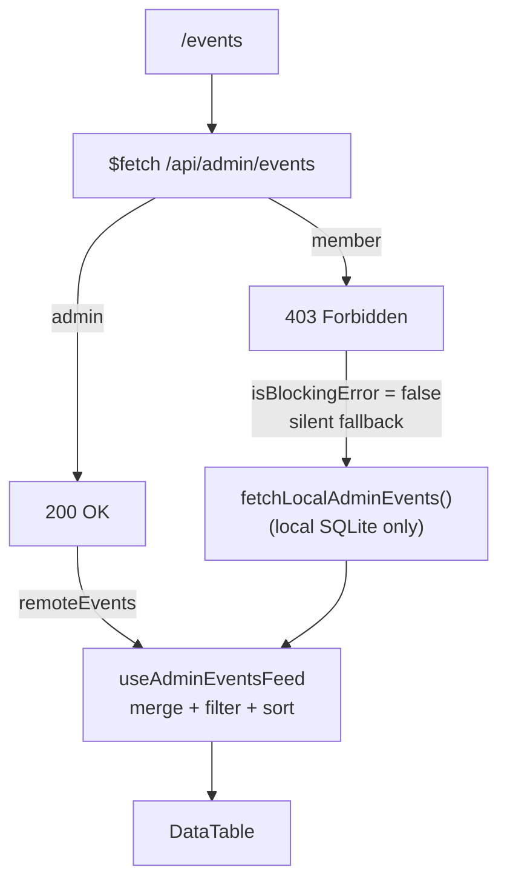
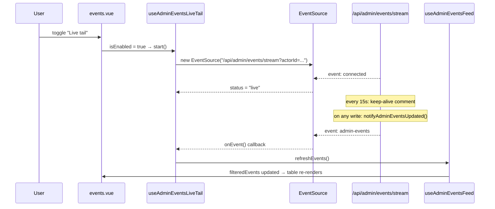

# Events — Walkthrough

The `/events` page is Peaky's CloudTrail-style activity feed. It serves both members (their own activity) and admins (all actors) — the same URL, the same component, differentiated only by which API data is available.

For the underlying event system — `DomainEventEnvelope`, the full event taxonomy (39 events), how to add a new event type, and GDPR rules — see the [codebase/Events walkthrough](../codebase/events.md). This walkthrough covers the product feature: what the page shows, how the composables are structured, and how live tail works.

> **User guide**: [Events & Audit Trail](../../../user-guide/power-user/events.md) shows the page from an admin's perspective with annotated screenshots.

---

## 1. What the page shows

The page header: *"CloudTrail-style visibility for lifecycle decisions and review activity."*

**Stats row** (4 tiles above the table):

| Tile               | Drives it                                                           |
| ------------------ | ------------------------------------------------------------------- |
| Total events       | `filteredEvents.length`                                             |
| Lifecycle events   | events where `category === "lifecycle"`                             |
| Destructive events | events where `action === "delete"` or `action.endsWith(".deleted")` |
| Pending sync       | events with `status === "pending"`                                  |

**Data table columns**: When · Event (category badge + action label + summary) · Resource (subject name + type + ID) · Actor (name + type badge + GDPR shield if redacted) · Status (sync status badge + source label) · Actions (view details eye icon).

---

## 2. One page, two audiences

**Key design**: `isBlockingError` excludes 403 from the error banner — a 403 is not a failure, it's an entitlement signal. Members see a fully functional page with their own local events; they just never see other actors' data.

---

## 3. Data sources

The page merges three sources via `useAdminEventsFeed`:

=== "Remote: /api/admin/events (admin only)"

    `server/data/admin-events.ts → listAdminEvents()` merges:

    1. **Lifecycle events** — archive/restore/delete events for products and templates
    2. **Review events** — review lifecycle, answer records, checkpoints, integration events

    Returns: `AdminEventRecord[]` sorted by time descending.

=== "Remote: /api/events (member fallback)"

    Same shape as admin feed but filtered to `actorId === currentUser.id`. Called when the admin endpoint returns 403.

=== "Local: fetchLocalAdminEvents()"

    Queries browser-local SQLite directly:

    1. **`local_outbox` rows** → shown as pending/failed/synced create operations. Synced entries are suppressed if the matching remote event is already present (dedup by `entityId`).
    2. **`events` rows** (last 200) → all domain events from the local events table.

    This is what members see (403 fallback), plus admins get it merged with remote data.

---

## 4. Composable architecture

### `useAdminEventsFeed(remoteEvents)`

The central composable. Owns all filter, sort, and detail panel state.

| Reactive state                                                           | Purpose                                                         |
| ------------------------------------------------------------------------ | --------------------------------------------------------------- |
| `searchQuery`                                                            | Free text: actor, subject, action, summary                      |
| `categoryFilter` / `actionFilter` / `statusFilter` / `subjectTypeFilter` | Four independent filters                                        |
| `sortBy` / `sortDirection`                                               | Column sort state (time / action / subject / actor / status)    |
| `localEvents`                                                            | Local SQLite events, refreshed on mount and on live tail update |
| `isDetailsOpen` / `selectedEventId`                                      | Details slideover state                                         |

**Derived counts** (`totalEvents`, `lifecycleCount`, `destructiveCount`, `pendingCount`) drive the stats tiles.

**`filteredEvents`** applies all four filters + search, then sorts. All filter options are built dynamically from the current event set — only values present in the data appear as options.

### `useAdminEventsLiveTail(actor, onEvent)`

Manages the SSE connection to `/api/admin/events/stream`.

| State         | Values                                                        |
| ------------- | ------------------------------------------------------------- |
| `status`      | `idle` / `connecting` / `live` / `error`                      |
| `statusColor` | `primary` (connecting) / `secondary` (live) / `error` (error) |

`start()` opens an `EventSource`, listens for `connected` and `admin-events` events, calls `onEvent()` callback on each. Auto-stops on `onBeforeUnmount`. Refreshes on `window focus` and `visibilitychange → visible`.

---

## 5. Live tail

**SSE endpoint** (`GET /api/admin/events/stream`):

- Admin role required — 403 otherwise.
- Sends `event: connected` on open, `event: admin-events` on notify, `: keep-alive` comment every 15 seconds.
- Cleans up on `close` or `error`.

**UI indicators**: pulsing dot in the toggle button when active; a status description alert below the header showing "connecting…" / "Connected — listening for new events" / "Connection error."

---

## 6. Event detail slideover

`AdminEventDetailsSlideover.vue` — right-side panel, `max-w-2xl`, `z-[60]`.

Sections (top to bottom):

1. GDPR alert (if `piiRedactedAt` is set)
2. Header card: category + status badges, action label, summary
3. Resource / actor / source / time grid
4. Actor roles
5. Raw event details (JSON)
6. GDPR erasure action (admin only, if not already redacted)

**GDPR redaction** (`POST /api/admin/events/:id/redact`): admin-only; overwrites PII fields; renders shield icon in Actor column; hides erasure section after redaction.

---

## 7. Filter options

All four filters are built dynamically from `filteredEvents` (after search but before filters apply):

| Filter       | Source                                         |
| ------------ | ---------------------------------------------- |
| Category     | Unique `event.category` values in current data |
| Subject type | Unique `event.subjectType` values              |
| Action       | Unique `event.action` values                   |
| Status       | Unique `event.status` values                   |

This means filters show only what's present in the current dataset — no phantom options for empty categories.

---

## 8. Three event reading surfaces

| Surface            | Route                    | Data scope                 | Auth                      |
| ------------------ | ------------------------ | -------------------------- | ------------------------- |
| Member feed        | `/events` (403 fallback) | Local events only          | All authenticated members |
| Admin feed         | `/events` (200 path)     | Remote + local, all actors | Admin role                |
| System diagnostics | `/system`                | `peaky.system` events only | All authenticated members |

The `/system` page is a completely separate surface — see [System Health](./system-health.md) for its walkthrough.

---

## 9. Testing strategy

| Layer | File                                             | What's covered                                           |
| ----- | ------------------------------------------------ | -------------------------------------------------------- |
| Unit  | `tests/unit/admin/formatAdminEventLabel.test.ts` | Event label formatting for each category                 |
| Unit  | `tests/unit/services/events/createEvent.test.ts` | `DomainEventEnvelope` factory + field validation         |
| Unit  | `tests/unit/services/events/schemas.test.ts`     | JSON Schema compliance for all 39 event types            |
| E2E   | `tests/e2e/admin-events.spec.ts`                 | Events page: filters, sort, row click, details slideover |

**Strategy**: `schemas.test.ts` is the schema contract test — it instantiates a sample payload for every event type and validates it against the published JSON Schema. This is the guard that prevents event schema drift. The E2E spec covers the member vs admin data split indirectly: it runs as an admin, so if you need to verify the 403 fallback path, do it manually or add a separate spec with a non-admin fixture.

---

## 10. Where to find things

| Question                                 | Look here                                                             |
| ---------------------------------------- | --------------------------------------------------------------------- |
| Full event taxonomy (39 events)          | [codebase/Events §4](../codebase/events.md#4-event-taxonomy)          |
| How to add a new event type              | [codebase/Events §8](../codebase/events.md#8-adding-a-new-event) |
| GDPR PII minimisation rules              | [codebase/Events §9](../codebase/events.md#9-gdpr-considerations--what-the-codebase-enforces) |
| How local events are fetched from SQLite | `app/admin/localEvents.ts`                                            |
| How the SSE stream works                 | `server/api/admin/events/stream.get.ts`                               |
| How category badges are styled           | `app/admin/events.ts` — `AdminEventRecord.category`                   |
| `/system` events source                  | `app/services/events/emitSystemEvent.ts`                              |
