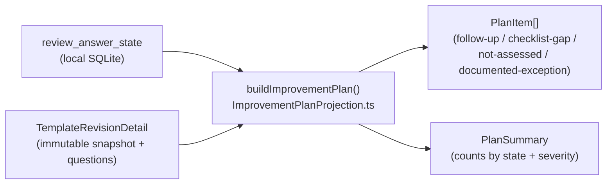
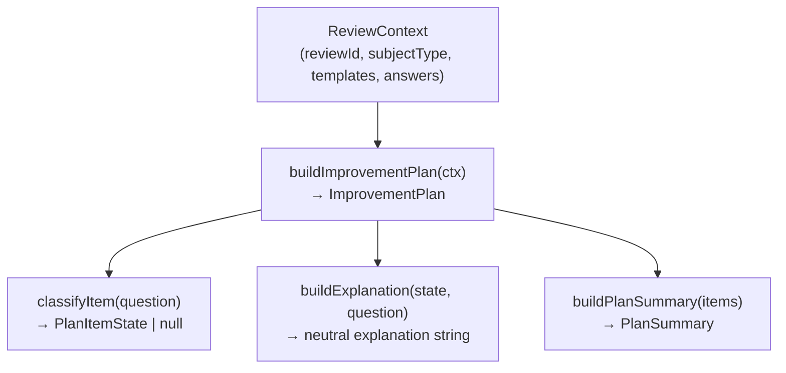
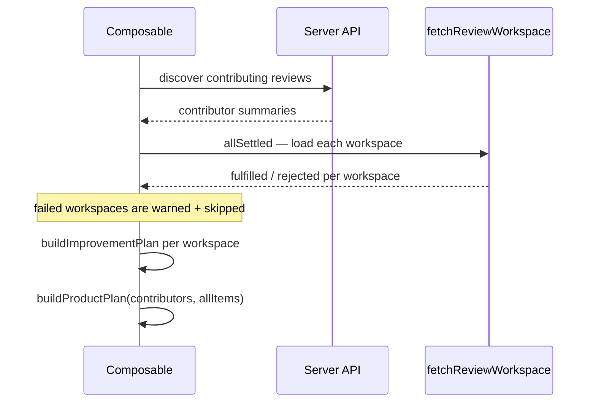
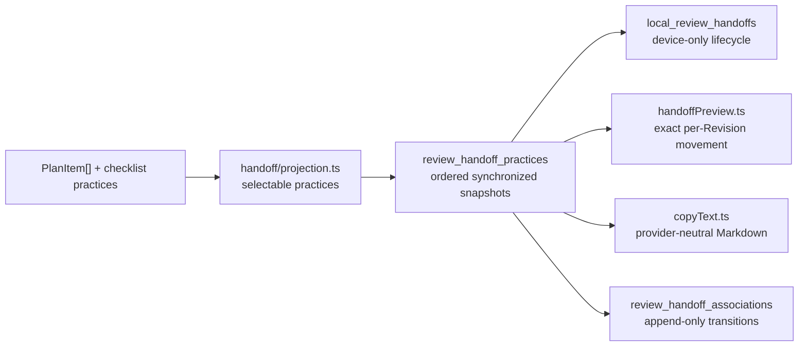

# Follow-ups and the ImprovementPlan read model

**Follow-ups** is the visible product name. The existing `/plan` routes, `ImprovementPlan` types, and `buildImprovementPlan()` names stay in code for compatibility. The read model is derived from review answers and discarded when the page unmounts; no `improvement_plans` table exists.

> **User guide**: [Working with reviews](../../../user-guide/reviews.md) covers the reviewer perspective.

---

## 1. Mental model

`ImprovementPlan` classifies answer evidence. Review Follow-ups then combines that evidence with per-Revision maturity position and handoff state. Follow-up placement is only a grouping rule. It does not make earlier stages complete or assign aspiration, priority, prerequisites, or schedule.



The internal read model has four non-passing states:

| State | Trigger |
| --- | --- |
| `follow-up` | Yes/No question explicitly answered **No** |
| `checklist-gap` | Recorded checklist answer with applicable unchecked practices, including an explicit empty answer |
| `not-assessed` | Question has no stored answer; it is never treated as unmet |
| `documented-exception` | Whole question marked N/A |

Per-practice N/A is excluded from checklist gaps. A whole checklist marked N/A excludes every practice. Documented exceptions remain available to the internal plan for context, but primary totals and severity counts exclude them.

---

## 2. Projection service

`app/services/review/ImprovementPlanProjection.ts` is a collection of **pure functions** — no Vue, no I/O, no database. Every function takes plain data and returns plain data. This makes them safe to call from SSR, workers, and unit tests.

### Core build path



`buildImprovementPlan` iterates selected Revisions → pillars → Revision-specific questions, overlays answer state from a `Map<questionId, AnswerStateLike>` for O(1) lookup, then calls `classifyItem` for each question. Questions that return `null` (passing answers) are skipped. Question IDs identify immutable rows in one Revision; equivalent wording in another Revision is not treated as the same question.

### Filtering and sorting

Both are intentionally separate from building so the UI can re-filter without rebuilding the full plan:

```typescript
// Sort first, then filter to keep the helper's order stable.
const sorted = sortPlanItems(plan.items);
const visible = filterPlanItems(sorted, filters);
```

`sortPlanItems` uses two rank tables for callers that request answer-state ordering. The routed per-Revision result view does not turn Follow-up placement into priority; it keeps all three relation groups visible.

The helper ranks by:

- `SEVERITY_RANK`: critical (0) → high (1) → medium (2)
- `STATE_RANK`: follow-up (0) → checklist-gap (1) → not-assessed (2) → documented-exception (3)

### Severity normalisation

Low severity was removed from the schema. Items that still carry `"low"` in older answer data are normalised to `"medium"` by `normalizeSeverity()` in `usePlanItemSections.ts` before any display or grouping. The plan only surfaces critical, high, and medium.

### Assessment deep links

Every plan item carries enough identity to build a direct link back to the exact question in the assessment:

```typescript
assessmentDeepLink(identity)
// → { name: "team-review-assessment", params: { teamId, reviewId },
//     query: { templateRevisionId }, hash: "#question-{questionId}" }
```

The route name is derived from `subjectType` via `CONTEXT_ROUTE_CONFIG`. The hash scrolls the assessment page to the correct pillar and question without a separate API call.

### Cross-review rollups

`groupExactRollups(items)` groups plan items by the exact composite key `${templateRevisionId}::${questionId}`. Items group only when **both** immutable Revision identity and its Revision-specific Question row match. Equivalent text from another Revision or Template stays separate; Peaky never infers semantic continuity across Revisions. Explicit future Question lineage is tracked by issue #141. Single-occurrence items are excluded because rollups require at least two.

---

## 3. Composable layer

Three parallel composables hydrate plan data, one per context. All three call `buildImprovementPlan` from the projection service and delegate to `useReviewWorkspace` / `fetchReviewWorkspace` for data loading.

| Composable | Context | Discovery path |
| --- | --- | --- |
| `useReviewPlanData` | Single review | Wraps `useReviewWorkspace`, adapts to `ReviewContext` |
| `useProductPlanData` | Product rollup | `GET /api/products/:id/contributors` → parallel workspace fetches (capped at 10) |
| `useTeamPlanData` | Team rollup | `useSubjectReviews("team")` → parallel workspace fetches |

### Workspace adapter

`workspaceToReviewContext()` bridges the two data shapes. The workspace holds typed `QuestionAnswer` values; `buildImprovementPlan` expects serialised JSON strings (for `safeParse` inside the projection). The adapter serialises all answer fields:

```typescript
answers: workspace.answers.map((a) => ({
  questionId: a.questionId,
  answer: a.answer !== null ? JSON.stringify(a.answer) : null,
  // ...
}))
```

### Product and team rollup composables

Both follow the same three-phase load:



`Promise.allSettled` is intentional — a single failed workspace (e.g. a review the user can't access) should not block the rest of the plan.

---

## 4. Page routes

### Review-level Follow-ups routes

Three `/plan` routes keep their internal names and share one component:

```text
/teams/:teamId/reviews/:reviewId/plan        → ReviewPlanPage subjectType="team"
/products/:productId/reviews/:reviewId/plan  → ReviewPlanPage subjectType="product"
/applications/:appId/reviews/:reviewId/plan  → ReviewPlanPage subjectType="application"
```

`ReviewPlanPage.vue` composes the visible Follow-ups page (maturity-score/REQ-018):

- `ReviewPlanTemplateTabs` renders visible Revision tabs on desktop, a compact mobile selector, or static identity when one Revision is pinned. Nothing combines scores.
- The cut mat keeps effective percentage, stage, and coverage together. A selected-handoff preview appears only inside the Stage popover.
- `followUpQueue.ts` projects explicit gaps into Critical, High, then Medium question groups. Each eligible practice uses one full-row **Add to handoff** / **In handoff** control and shows its calculated potential. Unanswered evidence appears once per question; N/A does not appear.
- Refine opens a right-side panel for Handoff status, pillar, and severity. Available practices show by default; prior handoffs stay grouped behind the Handoff status filter. **Question details** keeps guidance in context and provides the exact assessment action.
- `HandoffComposer` stays beside the queue. It owns optional notes, reorder, removal, atomic Clear all, exact potential movement, Copy Markdown, local closing, history, and existing-ticket association. A crossed threshold says Reached; rounded values cannot fill the bar before the exact crossing. Its practice list scrolls within the viewport while actions remain visible. Narrow layouts switch between Needs attention and Handoff without a fixed overlay or draft slideover.

The queue gives authored stage placement no priority or schedule meaning. A recorded empty checklist produces explicit gaps; a missing answer remains Unanswered. Revisions without a definition, without an applicable answered question, or over the ten-question limit render explicit `MaturityEntryStateCard` states instead of an invented stage.

### Team and product Follow-ups routes

The aggregate routes keep `/plan` internally:

```text
/products/:productId/plan  → contributor table + repeated-item rollups
/teams/:teamId/plan        → the same structure for team reviews
```

`useProductPlanData` and `useTeamPlanData` attach compact per-Revision maturity entries to each contributor. `ProductPlanContributorsTable.vue` renders every contributor Revision, while `ProductPlanRollups.vue` shows only the Revision that owns the repeated question. Repeated items rank by contributing-review count, and the source table is labelled Contributor factors. Neither route calculates a team or product maturity score.

---

## 5. Composable and service reference

| Module | Layer | Purpose |
| --- | --- | --- |
| `ImprovementPlanProjection.ts` | Service | Pure functions: build, filter, sort, rollup, deep-link |
| `useReviewPlanData` | Composable | Hydrates single-review plan from workspace |
| `useProductPlanData` | Composable | Aggregates product plan from contributors API |
| `useTeamPlanData` | Composable | Aggregates team plan from subject reviews |
| `usePlanItemSections` | Composable helper | Groups `PlanItem[]` into severity sections for rendering |
| `useCollapsibleSections` | Composable helper | Manages collapse state: first section expanded, rest collapsed |
| `ReviewPlanPage.vue` | Component | Shared review-level Follow-ups shell on `/plan` routes |
| `ReviewPlanTemplateTabs.vue` | Component | Desktop Revision tabs, mobile selector, cut-mat result, and Stage preview |
| `followUpQueue.ts` | Service | Severity-first explicit gaps plus question-level Unanswered projection |
| `ReviewPlanTemplateView.vue` | Component | Severity queue, available-value Refine controls, Question details, and narrow view switch |
| `HandoffComposer.vue` | Component | Ordered practices, potential movement, notes, Copy Markdown, completion, history, and association |
| `handoffPreview.ts` | Service | Exact per-Revision current, projected, delta, stage, and per-practice potential |
| `localLifecycle.ts` | Service | Device-only handoff sequence, ownership, completion, and analytics |
| `ProductPlanContributorsTable.vue` | Component | Contributor factors with every compact per-Revision maturity context |
| `ProductPlanRollups.vue` | Component | Repeated items ranked by review count with matching Revision context per source |
| `improvement-plan.ts` | Model | All plan types — `PlanItem`, `PlanSummary`, `ProductPlan`, … |
| `planDisplay.ts` | Constant | `SEVERITY_DISPLAY` — shared label + colour config |

---

## 6. Practice handoff

Review Follow-ups is the entry point for handing off explicit unmet practices to an external tracker. Synchronized practice snapshots and association transitions remain Review children. Sequence and completion history stay on the current device:



### Selectable practices and the draft

`app/services/handoff/projection.ts` turns explicit answer gaps into independently selectable practices. Each applicable unchecked practice in a recorded checklist is its own row with deterministic identity `(review_id, template_revision_id, question_id, practice_id)`; an explicitly empty checklist selects from every applicable practice. A negative Yes/No question reuses its question ID as practice ID. Missing answers project nothing selectable and remain Not assessed. Whole-question and per-practice N/A are excluded. Follow-up placement does not affect eligibility.

Selection writes a `review_handoff_practice` row with an order key, immutable practice snapshot, optional rationale, selection state, and device-only `local_handoff_id`. The local owner never enters the sync payload. The active heading is **Handoff** and has no editable title. Completed history uses sequence numbers to distinguish cycles. Snapshots preserve what was handed off when template wording later changes.

### Copy Markdown is the primary action

`renderHandoffMarkdown` in `app/services/handoff/copyText.ts` renders a review-derived heading, optional review link, ordered summary table, and detailed practice sections. It escapes user content and keeps Revision, question, rationale, resources, and assessment links. `useHandoffCopy.ts` writes from a user gesture and reports success or failure.

### Device-only lifecycle

The first selection creates the next `local_review_handoffs` sequence. A partial unique index allows one active row per Review. A practice has at most one active owner. Removed practices remain reselectable within their active cycle. Manually closing releases unresolved practices for a later handoff while the closed snapshot keeps their history.

Assessment saves close the active handoff when at least one practice is selected and every selection is met or N/A. Manual closing remains available while work is selected. Unresolved work requires a note. Closing records the transfer without changing assessment answers or marking practices complete. Completion freezes selected IDs, time, actor, mode, note, and unresolved count. History derives duration from those timestamps. The latest manually closed handoff can reopen while no newer handoff is active. None of this lifecycle state is sent to Go or PostgreSQL in this MR.

### Existing-ticket association only

`review_handoff_association` transitions record which **existing** work item covers a practice: a bounded provider name, external ID, and an `https`-only URL. The form asks only for the URL, then derives Jira, GitLab, or YouTrack details, or falls back to the hostname and final path segment. There is no creation control and no provider-observed status. The current association resolves on read as the latest non-revoked transition; confirmation is atomic across the whole handoff (every conflict reported, no partial success), duplicates surface with their current reference, and replacement is explicit with immutable history. Completing the assessment never changes association state and emits no outbound behavior.

### Limits and the provider boundary

All bounded fields follow the versioned `handoff-limits/v1` contract (`app/services/handoff/limits.ts`, mirrored in Go at `services/internal/syncengine/handoff/limits.go`): rationale 2,000 characters, identifiers 128, URLs 2,048 (https only), 10 helpful links and 20 evidence identifiers per practice, 50 practices per handoff — characters, never bytes, with atomic field-addressable rejection. Both runtimes prove parity against `tests/fixtures/handoff-limits.v1.json`.

No provider adapter, route, or sync entity type exists. Any future provider operation must pass `ProviderHandoffPolicy` (`services/internal/authz/provider.go`) — a private, default-disabled server capability composed with Review edit access — before any network invocation. `tests/guards/handoff-provider-boundary.test.ts` pins that boundary.

### Degraded sync

Draft editing (select, reorder, rationale) is local-first and always available. The existing-ticket form remains openable so users can inspect the requirement. Association and replacement confirmation claim shared uniqueness across clients, so `handoffSyncGate` (`app/services/handoff/syncGate.ts`) disables confirmation while sync is degraded or offline. The form explains that duplicate prevention needs a current shared association view.
