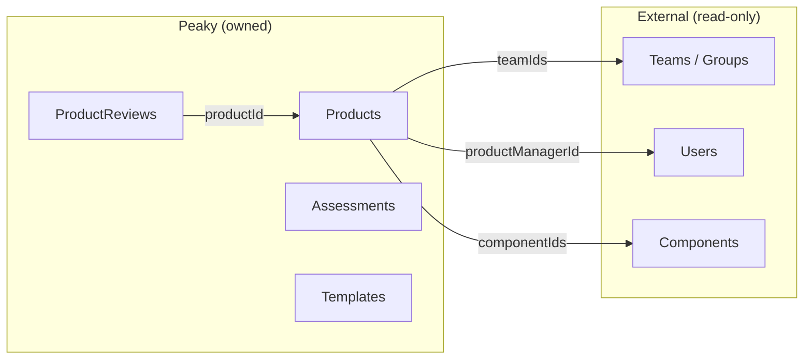
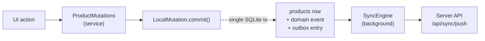
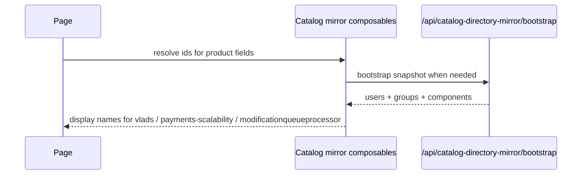
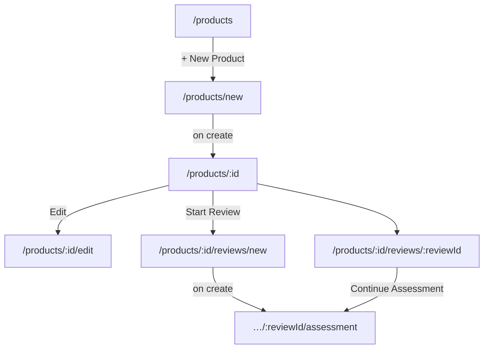
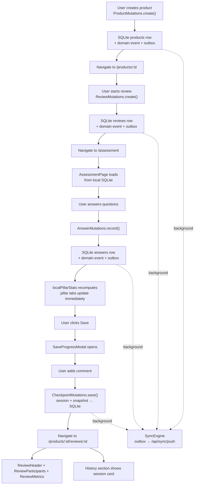

# Products — Architecture Walkthrough

This document walks through the full Products feature linearly, from data model to UI. It covers every layer and the key architectural decisions made along the way.

> **User guide**: see the [Product Tour](../../../user-guide/product-tour.md) and [Working with Reviews](../../../user-guide/reviews.md) for the customer-facing perspective.

---

## 1. The core model split

Teams come from the catalog-directory mirror — Peaky has no control over their existence, membership, or naming. Products are **user-created** — someone in Peaky decides "we have a thing called Demo Payments Scalability, let me describe it."



A Product stores only **short external IDs** for anything that lives outside Peaky — `productManagerId: "vlads"`, `teamIds: ["payments-scalability"]`, `componentIds: ["modificationqueueprocessor"]`. Display names are resolved in the browser at render time, never on the server. In the current demo that keeps **Demo Payments Scalability** lightweight while still linking back to the mirrored **Payments Scalability** team and its application catalog entries.

---

## 2. The data layer

Products are local-first. Every write commits to browser SQLite first via `LocalMutation.commit()`, which atomically writes the state row, a domain event, and an outbox entry. The outbox syncs to the server in the background.

```text
shared/db/schema/
  product.ts           → products table (Drizzle schema — shared by client + server)

app/services/entity/
  ProductMutations.ts  → create, update, archive, restore, delete (plain TypeScript, no Vue)

app/composables/local/
  useLocalProduct.ts   → reactive Vue wrapper over local SQLite reads

server/api/products/   → REST endpoints (list, get, create, update)
server/db/repositories/drizzle/
  productsRepository.ts → Drizzle query layer for server-side reads/writes
```



The schema in `shared/db/schema/product.ts` is the single source of truth — both the browser SQLite and the server Drizzle queries use the same table definitions.

---

## 3. The API surface

```text
GET  /api/products           → list all products (remote, used on cold start)
POST /api/products           → create product (also written locally first)
GET  /api/products/:id       → get one product
PATCH /api/products/:id      → partial update

GET  /api/products/:id/reviews   → list product reviews
POST /api/products/:id/reviews   → create product review
```

Review-level reads (workspace, pillars, sessions) are served from local SQLite during an active assessment. The sync plane (`/api/sync/push` and `/api/sync/pull`) carries local mutations to the server — see the [API walkthrough](../local-first/api.md) for the full sync contract.

---

## 4. The frontend composable layer

The product feature follows a service + composable split. Domain logic lives in `app/services/` with no Vue imports; composables in `app/composables/local/` are thin Vue adapters that delegate to those services.

| Module                         | Layer                                    | Purpose                                                                                                    |
| ------------------------------ | ---------------------------------------- | ---------------------------------------------------------------------------------------------------------- |
| `ProductMutations`             | Service (`app/services/entity/`)         | create, update, archive, restore, delete mutations via `LocalMutation.commit()`                            |
| `useLocalProduct`              | Composable (`app/composables/local/`)    | Vue adapter over local product state from SQLite                                                           |
| `useProducts`                  | Composable (`app/composables/products/`) | Product list — parallel remote + local fetch with local-wins merge (Pattern A bridge)                      |
| `useProductDetails`            | Composable (`app/composables/products/`) | Single product — local-first with remote fallback on cold start (Pattern B bridge)                         |
| `useProductCreation`           | Composable (`app/composables/products/`) | Reactive form state; `submitCreateLocal()` / `submitUpdateLocal()` commit to SQLite via `ProductMutations` |
| `useProductFilters`            | Composable (`app/composables/products/`) | Filter and search state for the products list                                                              |
| `useProductDashboardLifecycle` | Composable (`app/composables/products/`) | Archive / restore / delete flow with confirmation modal                                                    |
| `useSaveModal`                 | Composable (`app/ui/`)                   | Promise-based save progress modal — `open()` returns `Promise<string \| null>`                             |

### Catalog-directory resolution

The product pages resolve user, team, and application labels from the catalog composables in `app/composables/catalog/`: `useCatalogUserSearch`, `useCatalogGroupSearch`, and `useCatalogComponentSearch`.



If a lookup is missing the raw ID is shown, so the page remains usable even when a display-name mapping is unavailable.

---

## 5. Pages and their relationships



### Products dashboard (`/products`)


The dashboard shows a summary row per product: origin badge, owning teams (first 2 chips + overflow tooltip), review count, and last activity (relative date). In the current demo seed, that surface is centered on **Demo Payments Scalability** and its mirror-backed **Payments Scalability** team. Stats cards at the top give a quick pulse — total products, active reviews, external count.

### Product creation wizard (`/products/new`)


The page opens with a short **keyed legend** — "What is a product?" plus four parts named after the wizard's own steps, each keyed by a small icon chip and carrying a few words plus the Checkout example as chips. It primes the reader before any field is filled, and folds away with a Show/Hide toggle that remembers the choice per browser.

The wizard itself is a **route rail beside a sheet on a cutting mat**. The rail's four waypoints track progress and repeat what was entered — "Checkout · Bespoke", "2 teams", "1 application" — and only walk back, never skip ahead. Steps 2 (Teams) and 3 (Applications) share the generic `StepEntityPicker.vue`: search, a two-column card grid that previews 6 and reveals more on demand with a K-of-N count, and a selection tray whose pills remove on click. Step 3 is skippable, and it scopes itself to applications owned by the teams picked in step 2 until you search. Step 4 is a manifest with a per-group Edit link back into the rail. On submit the product commits to the local database first (`useProductCreation.submitCreateLocal`), queues for sync, and navigation goes to `/products/:id`.

### Product details page (`/products/:id`)


The header carries the name, the origin as an identifier chip, and the created date; Edit and Follow-ups are ghost keys next to the one solid **Start new review**. Under it, the survey plate holds Active reviews, Total reviews, and Last activity. Then the **title block** (`ProductTitleBlock.vue`) — a ruled panel drawn the way a map or engineering drawing carries its title block: an outer frame, an inset neatline, a caption row with the drawn-by field, and four ruled cells for Contacts, Teams, Applications, and References. Empty fields show a dashed pill. The reviews sheet fills the lower half with its own search, filter chips, sort, and count. The screenshot above shows a product created through the wizard with two reviews started on it; the demo seed's **Demo Payments Scalability** renders the same way with its own data.

### Review wizard (`/products/:id/reviews/new`)


Two steps only: **Templates** (select 1–3 from paginated cards) → **Scope & Confirm** (full product or specific applications + review name). The product flow itself starts with one lightweight seeded product review, while the richer **Payments Scalability** team demo exercises the shared review UI with three seeded reviews that cover 1-, 2-, and 3-template states. On create, navigation goes directly to `/assessment` — no redundant landing on the empty review detail page.

| Scope                     | Behaviour                                     |
| ------------------------- | --------------------------------------------- |
| **Full product**          | All `componentIds` pre-selected automatically |
| **Specific applications** | Per-app picker populated from `componentIds`  |

---

## 6. Review detail page — shared components


The review detail page is built from three extracted components (used identically by both team and product review pages) plus two page-specific sections:

```text
ReviewHeader          ← inline rename, status badge, template label, created date, Continue CTA
ReviewParticipants    ← assessor + advisor avatar stacks
ReviewMetrics         ← 4 cards: overall progress, actions needed, questions answered, last activity
─────────────────────── (page-specific below)
Breakdown             ← pillar DataTable, filterable by template tab
History               ← SessionTimeline + SessionCards
```

The current team-side demo is where the shared layout is easiest to see:

- **Demo Payments Scalability Security Review** → 1 template
- **Q4 2025 Peak Season Review** → 2 templates
- **Demo Payments Scalability Reliability Drill** → 3 templates

| Component            | Props                                                                                  | Responsibility                                 |
| -------------------- | -------------------------------------------------------------------------------------- | ---------------------------------------------- |
| `ReviewHeader`       | `name`, `status`, `templateNamesLabel`, `createdAt`, editing state                     | Inline rename, status badge, created date, CTA |
| `ReviewParticipants` | `assessors[]`, `reviewers[]`                                                           | Team and advisor avatar stacks with overflow   |
| `ReviewMetrics`      | `overallProgress`, `actionsNeeded`, `answeredQuestions`, `totalQuestions`, `updatedAt` | 4 metric cards                                 |

The Breakdown and History sections stay in the page files because they have page-specific navigation logic (pillar row click navigates to assessment with a `#pillar-slug` hash) and different route param names (`teamId` vs `productId`).

---

## 7. AssessmentPage — shared across all review types


`AssessmentPage.vue` is used by team reviews, product reviews, and application reviews. It receives a `reviewId` prop and calls the unified `/api/reviews/:id/*` endpoints — it never needs to know which type of review it's working with.

### Three things that make it work for product reviews

=== "Answer tracking"

    `answers.value` from `useFetch` is a **readonly ref** — `Object.entries()` on it crashes. Solution: a plain object alongside it.

    ```typescript
    // plain object — no Vue proxy, no readonly restriction
    const sessionAnswers: Record<string, QuestionAnswer | null> = {}

    const handleAnswerWithTracking = (id: string, value: QuestionAnswer | null) => {
      handleAnswer(id, value)      // updates composable state (display)
      sessionAnswers[id] = value   // tracks this session's changes
    }
    ```

=== "Immediate pillar progress"

    Pillar tabs must update on every answer, not just after save.

    ```typescript
    // ❌ pillars.value — server state, stale until save
    // ✅ localPillarStats — derived from questions.value (includes unsaved answers)

    const localPillarStats = computed(() =>
      pillars.value.map(p => {
        const qs = questions.value.filter(q => q.pillar === p.slug)
        const answered = qs.filter(q => q.answer != null).length
        return {
          ...p,
          progress: qs.length > 0 ? Math.round(answered / qs.length * 100) : 0
        }
      })
    )
    ```

=== "Save flow"

    
    

    The modal shows what changed in this session — questions answered, progress delta, per-pillar bars — and prompts for an optional session note that becomes the audit trail entry. Ctrl+Enter submits without reaching for the mouse.

    ```mermaid
    sequenceDiagram
        participant User
        participant AssessmentPage
        participant SaveProgressModal
        participant SQLite as Local SQLite
        participant Outbox

        User->>AssessmentPage: clicks Save
        AssessmentPage->>AssessmentPage: build snapshot (progress + per-pillar stats)
        AssessmentPage->>SaveProgressModal: open(context) → Promise
        SaveProgressModal-->>User: shows diff (N questions, progress delta, pillar bars)
        User->>SaveProgressModal: types comment, clicks Save
        SaveProgressModal-->>AssessmentPage: resolves with comment string
        AssessmentPage->>SQLite: AnswerMutations.record() × N
        Note over SQLite: each commit: answer row + domain event + outbox entry
        AssessmentPage->>SQLite: CheckpointMutations.save() — session + snapshot
        SQLite-->>AssessmentPage: committed
        AssessmentPage-->>User: toast "Progress saved!"
        Note over Outbox: SyncEngine pushes outbox entries in background
    ```

---

---

## 8. End-to-end data flow



---

## Testing strategy

| Layer | File                                                     | What's covered                                |
| ----- | -------------------------------------------------------- | --------------------------------------------- |
| Unit  | `tests/unit/products/products/useProductFilters.test.ts` | Filter + search state machine                 |
| Unit  | `tests/unit/services/entity/ReviewMutations.test.ts`     | Review create / archive / restore mutations   |
| Unit  | `tests/unit/services/local-mutation.test.ts`             | Atomic 3-part SQLite transaction              |
| E2E   | `tests/e2e/product-flow.spec.ts`                         | Full product → review → assessment happy path |
| E2E   | `tests/e2e/local-first-writes.spec.ts`                   | Answers persist through page reload           |
| E2E   | `tests/e2e/empty-state-flows.spec.ts`                    | Empty state and first-run flows               |

**Strategy**: unit tests cover pure logic (filter predicates, mutation services) in isolation without mounting Vue. E2E tests cover the full happy path against a real Nuxt server — `product-flow.spec.ts` is the canonical flow test; run it first when debugging a product regression.

---

## Key insight

The assessment flow is **review-type-agnostic**. `AssessmentPage.vue` reads from local SQLite and delegates all mutations to typed service classes — it does not need to know whether the review belongs to a product or a team. Adding a new review subject type requires schema and routing work; the assessment infrastructure is unchanged.
