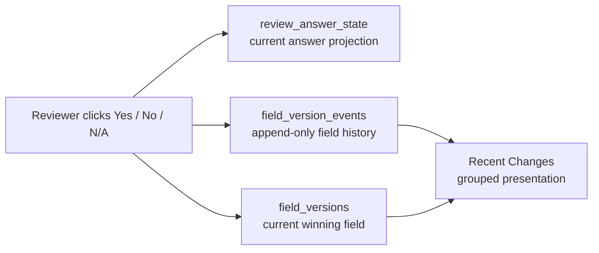
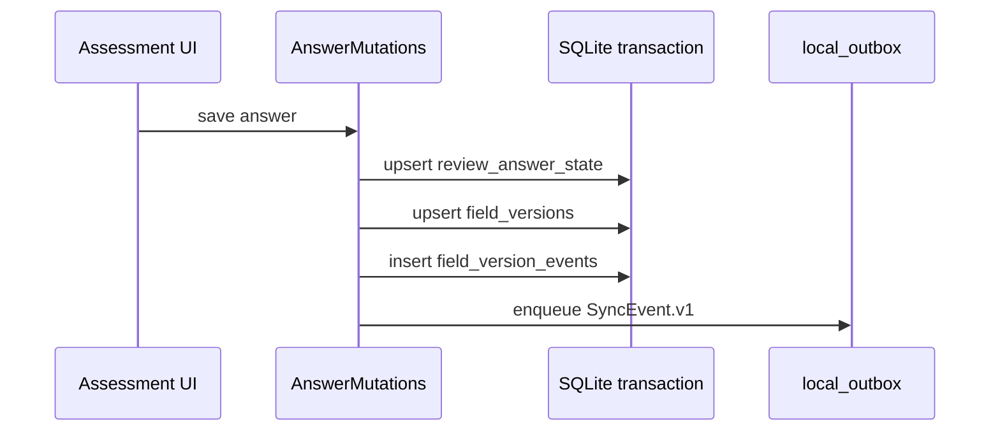
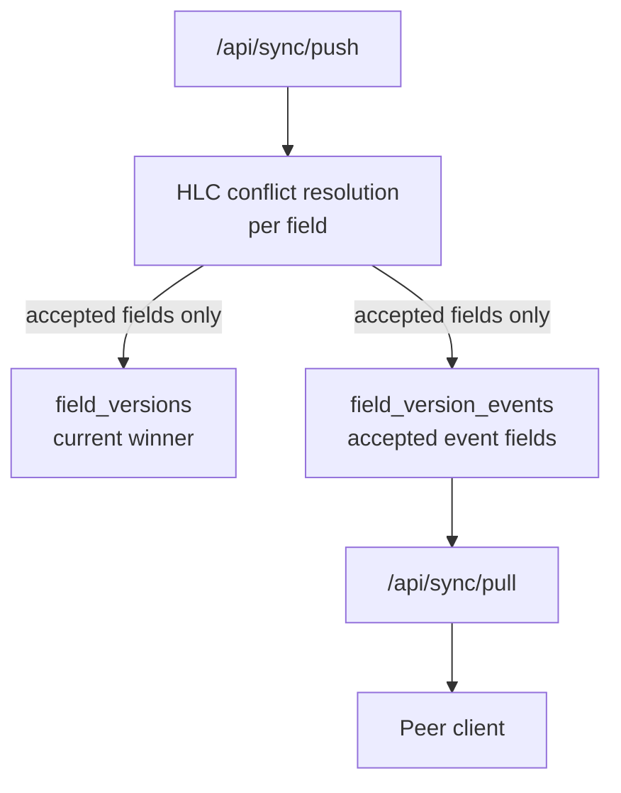

# Reviews — Walkthrough

Reviews are the persistent container around assessment work: exact Template Revision scope, participants, progress metrics, session history, and the **Recent Changes** feed. A Review selects one to three ordered, immutable Revisions; it never points at mutable Template authoring content. The feed is the most sync-sensitive part of the review detail page because it must answer two questions at once:

- what is the winning answer now?
- how did the answer get there?

Those are different questions, so they use different storage surfaces.

> **Related walkthroughs**: [Assessments](./assessments.md) explains answer entry, [Events](./events.md) explains the global audit feed, and [HLC](../local-first/hlc.md) explains the ordering model that makes concurrent answer writes deterministic.

!!! info "Exact local selection, deferred transport"
    Local Review creation writes `reviews` and ordered `review_template_selections` in one SQLite transaction. Each selection uses the composite identity `(review_id, template_revision_id)`, has a unique contiguous position from `0` through `2`, and must name the current published Revision of a distinct active Template. Draft or retired Revisions, archived Templates, duplicates, and selections outside the one-to-three bound are rejected without partial rows.

    Existing Reviews stay pinned to their selected immutable snapshots, even after a Revision retires. Issue #140 does **not** add `templateRevisionIds` to Review outbox fields, Go push validation, inbound selection replay, or the PostgreSQL Review projection. Generic Sync Hardening owns that transport gap, so a fresh peer cannot yet reconstruct these selection rows from sync.

---

## 1. Mental model



`review_answer_state` answers "what should the assessment page show right now?".

`field_versions` answers "which actor's field value wins by HLC?".

`field_version_events` answers "which accepted field changes happened over time?".

The Recent Changes feed reads history, not just current state. It then groups related rows for readability.

---

## 2. Why previous fixes failed

The bug was not in table rendering. It was a data-model ambiguity: `field_versions` was doing two jobs at once.

| Attempt | Why it looked plausible | Why it failed |
| ------- | ----------------------- | ------------- |
| Store `previousValue` on `field_versions` | One row per field is compact and easy to diff | The row is mutable, so intermediate values are overwritten |
| Treat rapid edits as one write-side burst | The feed becomes less noisy | Audit/replay history is lost before the UI can decide how to present it |
| Pull old events with current field values | Event stream already existed | Every event arrived with the latest answer, so fresh clients saw `Yes → Yes → Yes` |
| Use `events` alone | Domain events are append-only | They do not carry accepted per-field HLC winners after conflict resolution |

The final fix is deliberately two-layered:

1. write-side correctness stores every accepted field change as history
2. read-side UX groups adjacent history rows into a human-friendly row

---

## 3. The storage split

### Current state: `field_versions`

One row per entity field:

```text
entity_type      review_answer
entity_id        review-1:security-q-1
field_name       answer
value            "yes"
hlc              1716220800000:0003
actor_id         actor_alice
updated_at       2026-06-01T10:00:02Z
```

This table is optimized for current-state reads and conflict resolution. It is intentionally mutable: a newer HLC replaces the older row.

### History: `field_version_events`

One row per accepted field change:

```text
event_id         evt-...
entity_id        review-1:security-q-1
field_name       answer
previous_value   "no"
value            "yes"
hlc              1716220800000:0003:actor_alice
actor_id         actor_alice
updated_at       2026-06-01T10:00:02Z
```

This table records accepted field history. It exists so Recent Changes can show intermediate transitions and fresh clients can replay recent history accurately. It should be bounded by a server retention policy because raw field-level churn is UX/sync history, not the durable compliance surface.

!!! note "What actually got optimized?"

    The optimization in this pass is **presentation and current-state discipline**, not removal of history storage.

    `field_versions` remains compact: one current row per field. `field_version_events` remains necessary while retained: it is the place that preserves intermediate values for Recent Changes. The Postgres migrations and Go sync changes are still required because peers and fresh browsers need historical field values, not just the latest snapshot.

---

## 4. Write path

Answer writes go through `AnswerMutations.save()` and `localMutation.draft()`.



The local history row uses the outbox id as its event id. When the server later echoes the same event back, the client can dedupe it instead of showing a duplicate Recent Changes row.

---

## 5. Server sync path

The server keeps the same distinction.



Important detail: pull attaches the field values accepted for **that event**. It no longer attaches the current `field_versions` value to every event.

That is what fixed the fresh-client failure mode.

---

## 6. HLC still decides the winner

Recent Changes is not the conflict resolver. HLC is.

For each pushed field, the server compares:

```text
new.hlc > current.hlc
or
new.hlc == current.hlc and new.actor_id > current.actor_id
```

Only accepted fields are written to `field_version_events`. Rejected fields stay out of history because they never became true in the shared state.

For the full protection model — client receive, drift guard, SQL race safety, and property tests — see [HLC](../local-first/hlc.md).

---

## 7. Read path: grouping without losing trail

The composable reads raw history rows sorted newest-first:

```text
field_version_events
  where entity_id like `${reviewId}:%`
  and field_name = "answer"
  order by updated_at desc
```

Then `groupRecentChangeEntries()` collapses only adjacent rows that are:

- same `entityId`
- same `actorId`
- within five seconds of the previous row in the group

The grouped row uses:

| Display field | Source |
| ------------- | ------ |
| row time | newest event |
| row actor | newest event |
| final answer | newest event value |
| previous answer | oldest event previous value |
| trail | all events in chronological order |

!!! example "How does one burst render?"

    ```text
    Raw history:
    10:00:02  No  → Yes
    10:00:01  Yes → No
    10:00:00  new → Yes

    Grouped row:
    10:00:02  new → Yes   "3 changes"

    Trail:
    new → Yes
    Yes → No
    No  → Yes
    ```

The user gets one scannable row by default, but the complete intermediate trail is still one click away.

---

## 8. UI component map

```text
SyncRecentChanges
└── DataTable (sheet: title, console filters, footer count + TTL note)
    ├── SyncRecentChangesQuestionCell
    ├── SyncRecentChangesAnswerCell
    │   ├── SyncRecentChangesChecklistPopover
    │   └── SyncRecentChangesTrailPopover
    └── SyncRecentChangesWhoCell
Load more row (outside the sheet)
```

The parent component owns orchestration only: load state, filters, table rows, and pagination.

Pure helpers live outside the component:

| Module | Role |
| ------ | ---- |
| `fieldVersionChangeFeed.ts` | parse values and group Recent Changes rows |
| `useRecentChangesFilters.ts` | search, filter options, TTL notice |
| `recentChangesChecklist.ts` | checklist diff and item view model |
| `recentChangesAnswer.ts` | answer label and color mapping |
| `recentChangesRows.ts` | DataTable row guard and actor display helper |

---

## 9. Why this design is durable

| Requirement | Where it is enforced |
| ----------- | -------------------- |
| Current answer reads are fast | `review_answer_state`, `field_versions` |
| Conflict resolution is deterministic | HLC comparison + SQL upsert guard |
| Intermediate accepted values survive | `field_version_events` |
| Fresh clients replay correctly | pull attaches event-specific field values |
| The feed stays readable | read-side grouping in `groupRecentChangeEntries()` |
| Trail remains inspectable | `RecentChangesTrailPopover` |

The key rule is: **never optimize away facts before the UI has a chance to decide how to present them**.

---

## 10. Testing strategy

| Layer | Tests |
| ----- | ----- |
| Grouping helper | same actor/question within five seconds, cross-actor split, outside-window split, boundary at exactly five seconds, conflict propagation, checklist trails |
| Component rendering | conflict badge, grouped change count, intermediate trail |
| SQLite migration | `field_version_events` table exists with required columns and indexes |
| Sync backend | pull returns historical values per event; save is idempotent |
| HLC core | Go + TypeScript unit/property/fuzz/integration tests described in [HLC](../local-first/hlc.md#testing) |

---

## 11. Codebase map

| Concern | Location |
| ------- | -------- |
| Recent Changes composable | `app/composables/sync/useFieldVersions.ts` |
| Grouping and value parsing | `app/composables/sync/fieldVersionChangeFeed.ts` |
| Recent Changes component | `app/components/sync/RecentChanges.vue` |
| Answer cell and trail popover | `app/components/sync/RecentChangesAnswerCell.vue`, `RecentChangesTrailPopover.vue` |
| Checklist diff popover | `app/components/sync/RecentChangesChecklistPopover.vue` |
| Local field write helper | `app/services/sync/inbound/helpers.ts` |
| Local answer mutation | `app/services/entity/AnswerMutations.ts` |
| Postgres sync repository | `services/internal/syncengine/repo/postgres.go` |
| Push handler accepted fields | `services/internal/syncengine/push.go` |
| Pull handler cursor and replay | `services/internal/syncengine/pull.go` |

---

## 12. Maturity results per pinned Revision

A Review pins one to three immutable Template Revisions, so maturity is calculated **per Revision** and never combined. The workspace exposes one maturity collection keyed by `templateRevisionId`; every consumer (Review Details, Improvement Plans, team/product compact context) reads from it.

The calculator (`app/services/maturity/calculate.ts`) is a pure function over the Revision's schema-versioned definition plus current answers:

- question weights derive from severity (Medium 1, High 2, Critical 3); there is no separate weight input
- all arithmetic is exact integer ratios compared by cross multiplication — no scaling, no floating point — while the UI displays whole percentages
- unanswered questions reduce coverage, earn zero, and keep their full weight available; whole-question N/A removes the full weight, while practice N/A removes only that exact share
- below full coverage the resolved stage carries the **provisional** qualifier (`MaturityStagePath.vue`), removed only at full coverage
- explicit non-results: `no-definition`, `no-scored-applicable-answer`, and a scoped `configuration-error` for an over-limit (eleven-plus question) pinned Revision that leaves sibling Revisions' results available

Definitions are immutable per published Revision. New definitions use boundaries at 5, 25, 50, and 75 percent plus equal practice shares; pinned legacy profiles remain valid. Stage names and canonical descriptions are application constants (`app/services/maturity/stages.ts`). Template Studio exposes numeric boundary editing, Follow-up placement, and a temporary scoring Preview. Calculation explanations render the returned trace rather than recomputing.

Review Details renders the active Revision through `ReviewMaturitySummary.vue` inside the existing Breakdown section. Its inline Maturity line connects the effective score, stage, and settled or provisional reason without exposing calculation mechanics. `ReviewPillarMaturity.vue` adds percentage and stage to each pillar row, with canonical meaning and one confidence statement in a viewport-contained popover. `ReviewBreakdownTemplateSelector.vue` keeps tabs on desktop and uses one labeled select below `sm`. Milestones and Recent Changes keep their existing behavior.

## 13. Advisor override stream

Overrides are an append-only stream of transitions (`review_maturity_overrides` locally, `review_maturity_override` sync events) keyed by Review and `templateRevisionId`. Each transition carries actor, action (`create` / `supersede` / `revoke`), reviewed stage and percentage, explanation, evidence, the prior transition, and time. The effective override resolves on read as the latest non-revoked transition — there is no mutable pointer — and replayed events with stable transition IDs cannot duplicate history.

Consumers project **effective** maturity (override when present) while retaining calculated maturity and the complete history; `MaturityEntryStateCard.vue` surfaces history as history. Authorization is action-specific and server-side: see [Authorization](../local-first/authorization.md#advisor-maturity-overrides) and the [threat model](../../threat-model.md).
