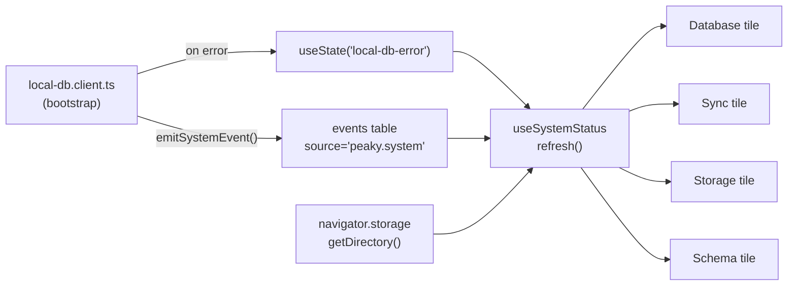
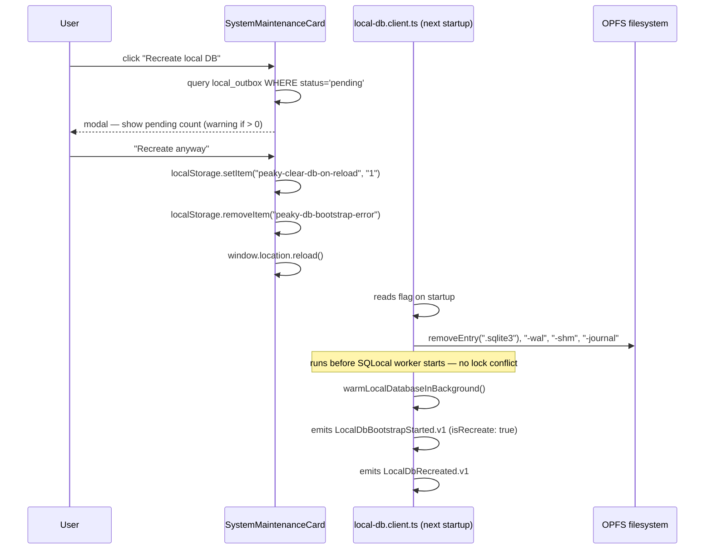

# System Health — Walkthrough

`/system` is a per-browser diagnostic surface available to **all authenticated members** — no admin gate. It answers "how is Peaky running on this device?" The page makes no HTTP calls; it reads entirely from local SQLite `peaky.system` events and OPFS file sizes.

> **User guide**: [Power User Guide — System Health](../../../user-guide/power-user/system.md) covers features and how advanced users could use them.

---

## 1. What the page shows

Four status tiles in a responsive grid (`1 → 2 → 4` columns), a session-scoped recent activity table, and two maintenance action cards.

The page header subtitle: *"How Peaky is running on this device."*

**Design decisions baked in**:

- No admin gate — "support is a member need"
- No snapshot export (exfil traceability concern)
- No raw SQL access
- No sync-cursor reset (JBTBD)
- Version numbers hidden on the happy path (Schema tile) — sequential migration counts read as semver to technical users, and "v10 is broken?" to non-technical ones

---

## 2. The four tiles

Each tile shows a headline state (e.g. "Healthy", "In sync"), a support line with details, and a collapsible "What is this?" explainer.

=== "Database"

    
    

    | State          | Color   | Meaning                                   |
    | -------------- | ------- | ----------------------------------------- |
    | `healthy`      | green   | SQLite bootstrapped successfully          |
    | `error`        | red     | Bootstrap or migration failed             |
    | `initializing` | neutral | Waiting for first `LocalDbReady.v1` event |

    **Drives it**: `useState('local-db-error')` takes precedence. If null, the tile queries for the latest `LocalDbReady.v1` vs `LocalDbMigrationFailed.v1` event — whichever is newer wins.

    **Support line**: `"Ready · 2 min ago · 87 ms"` — formats `readyAt` time + `coldStartMs` from event data.

=== "Sync"

    
    

    | State            | Color   | Meaning                              |
    | ---------------- | ------- | ------------------------------------ |
    | `in-sync`        | green   | Last sync < 2 minutes ago            |
    | `not-yet-synced` | neutral | No successful sync cycle yet         |
    | `stale`          | amber   | Last sync > 2 minutes ago            |
    | `failed`         | red     | Latest event is `SyncCycleFailed.v1` |
    | `paused`         | neutral | Database tile is in `error` state    |

    **Drives it**: latest `SyncCycleSucceeded.v1` + `SyncCycleFailed.v1` events + live outbox `pending` row count. Stale threshold: `STALE_SYNC_THRESHOLD_MS = 2 * 60 * 1000` (2 minutes).

    **Paused guard**: if `database.state === "error"`, sync tile skips its query and shows `"paused"` immediately.

=== "Storage"

    
    

    | State         | Color   | Meaning                           |
    | ------------- | ------- | --------------------------------- |
    | `ok`          | green   | OPFS usage < 80% of quota         |
    | `warning`     | amber   | OPFS usage ≥ 80% of quota         |
    | `unsupported` | neutral | `navigator.storage` not available |

    **Drives it**: `measureOpfs()` — reads actual SQLite file sizes from OPFS (`navigator.storage.getDirectory()`), summing `.sqlite3` + `-wal` + `-shm` files. Falls back to `navigator.storage.estimate().usage` if OPFS files are inaccessible.

    **Support line**: `"4.2 MB of ~2.0 GB quota"` or `"82% used · 1.6 GB of ~2.0 GB quota"`.

=== "Schema"

    
    

    | State        | Color | Meaning                                       |
    | ------------ | ----- | --------------------------------------------- |
    | `up-to-date` | green | `data.schemaVersion === SCHEMA_VERSION`       |
    | `stuck`      | amber | Client schema version < compile-time expected |

    **Drives it**: latest `ClientSchemaMigrated.v1` event. If `data.schemaVersion < SCHEMA_VERSION`, the tile shows `"Stuck — N updates pending"`.

    Version numbers are deliberately hidden on the healthy path. See the [design decision comment](https://github.com) in `app/pages/system.vue`.

---

## 3. How tiles derive state

`useSystemStatus` makes **no HTTP calls**. All signals are derived from:

1. `useState('local-db-error')` — set by `app/plugins/local-db.client.ts`
2. Local SQLite queries via `withDatabase()` — filtering `events` table by `source = "peaky.system"`
3. `measureOpfs()` — reads OPFS file sizes directly

`refresh()` runs the four tile derivations in sequence (database → schema → storage → sync). The page calls `status.refresh()` on mount and exposes a manual "Refresh" button in the header.

---

## 4. Emergency banner

**Trigger**: `useState('local-db-error')` is non-null.

**Set by**: `app/plugins/local-db.client.ts` in the `onError` callback. Also persisted to `localStorage` key `"peaky-db-bootstrap-error"` so the banner reappears immediately on reload, before the warmup completes.

**What it shows**:

- Red alert with title "Local database is having trouble"
- Reassurance that server data is safe
- Monospace error block with message, migration ID (if applicable), and timestamp

**Two actions**:

| Action              | What happens                                                                                            |
| ------------------- | ------------------------------------------------------------------------------------------------------- |
| "Recreate local DB" | `localStorage.setItem("peaky-clear-db-on-reload", "1")` → remove error key → `window.location.reload()` |
| "Try again"         | Remove error key only → reload (preserves local data; good for transient failures)                      |

---

## 5. Recreate local DB flow

The plugin owns the OPFS delete step. The component never touches OPFS directly. This is the critical invariant: the delete must happen before the SQLocal worker starts.

---

## 6. Maintenance cards

=== "Clear Cache"

    
    

    **Lighter recovery step** — clears service workers and Cache Storage. Does **not** touch the local database.

    Pre-flight: modal queries `navigator.serviceWorker.getRegistrations()` and `caches.keys()` to show counts of what will be cleared.

    Uses `clearAndHardReload()` from `~/utils/browserCache.ts`.

    Show first (before Recreate) — recommended as the first step when things look "off."

=== "Recreate Local DB"

    Higher-impact action. Shows unsynced change count as a warning. See §5 for the full technical flow.

    Uses `color="warning"` styling to signal higher impact.

---

## 7. Recent activity table

Powered by `useSystemRecentActivity`. Shows `peaky.system` events scoped to the **current browser session**.

**Session scoping**: on `init()`, the composable queries for the latest `LocalDbInitializing.v1` event time and uses it as a lower bound for all subsequent queries. Events from previous sessions are excluded.

**Pagination**: default page size = 10. "Load more" adds 10 per click. "See full history in Events →" links to `/events?source=peaky.system` (the main events page filtered to system events).

**Detail column** (`buildDetail()`):

| Event type                 | Detail shown                    |
| -------------------------- | ------------------------------- |
| `ClientSchemaMigrated.v1`  | `"3 migrations applied"`        |
| `LocalDbReady.v1`          | `"cold start · 87 ms"`          |
| `SyncCycleSucceeded.v1`    | `"4 pushed · 2 pulled"`         |
| `SyncCycleFailed.v1`       | error message string            |
| `OpfsStorageMeasured.v1`   | `"12% used"`                    |
| `OpfsQuotaWarning.v1`      | `"83% used"`                    |
| `EntitlementsRefreshed.v1` | `"2 changes"` or `"no changes"` |

---

## 8. Component breakdown

| Component               | File                 | Renders                                                                                 |
| ----------------------- | -------------------- | --------------------------------------------------------------------------------------- |
| `SystemStatusTile`      | `components/system/` | One glance tile: icon, label, headline, support line, tone, "What is this?" collapsible |
| `SystemEmergencyBanner` | `components/system/` | `UAlert` when `dbError` is set (conditional render in `system.vue`)                     |
| `SystemRecentActivity`  | `components/system/` | Session-scoped event table; exposes `refresh()` via `defineExpose`                      |
| `SystemClearCacheCard`  | `components/system/` | Clear cache maintenance action                                                          |
| `SystemMaintenanceCard` | `components/system/` | Recreate local DB action with unsynced-count confirmation                               |

The page holds a `ref` to `SystemRecentActivity` so `handleRefresh()` can trigger both `status.refresh()` and `recentActivity.value?.refresh()` together.

---

## 9. Testing strategy

| Layer       | File                                                            | What's covered                                        |
| ----------- | --------------------------------------------------------------- | ----------------------------------------------------- |
| Unit        | `tests/unit/composables/system/useSystemStatus.test.ts`         | Tile state derivation from `peaky.system` events      |
| Unit        | `tests/unit/composables/system/useSystemRecentActivity.test.ts` | Session scoping, pagination, detail column formatting |
| Unit        | `tests/unit/services/events/opfsMeasurement.test.ts`            | OPFS quota calculation + warning threshold            |
| Integration | `tests/integration/migrations.test.ts`                          | Migration log → `LocalDbReady.v1` event chain         |

**Strategy**: `useSystemStatus.test.ts` seeds the local SQLite `events` table directly and asserts the tile state machine — it is the primary guard for any change to the tile derivation logic. `useSystemRecentActivity.test.ts` verifies session scoping: it inserts events before and after a `LocalDbInitializing.v1` marker and confirms only post-init events appear. The recreate DB flow and emergency banner are not covered by automated tests (they require OPFS access); test them manually using the `/system` page with a seeded error state.

---

## 10. Where to find things

| Question                                  | Look here                                                                                          |
| ----------------------------------------- | -------------------------------------------------------------------------------------------------- |
| How system events are emitted             | `app/services/events/emitSystemEvent.ts`                                                           |
| What system events exist                  | [codebase/Events §4](../codebase/events.md#4-event-taxonomy) — filter by `source = "peaky.system"` |
| How tiles derive their state              | `app/composables/system/useSystemStatus.ts`                                                        |
| How the recreate flow works in the plugin | `app/plugins/local-db.client.ts`                                                                   |
| How OPFS measurement works                | `app/services/events/opfsMeasurement.ts`                                                           |
| How recent activity is session-scoped     | `app/composables/system/useSystemRecentActivity.ts`                                                |
| User-facing intro to the page             | [Power User Guide — System Health](../../../user-guide/power-user/system.md)                       |
