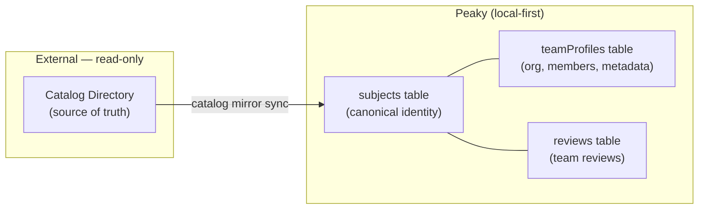
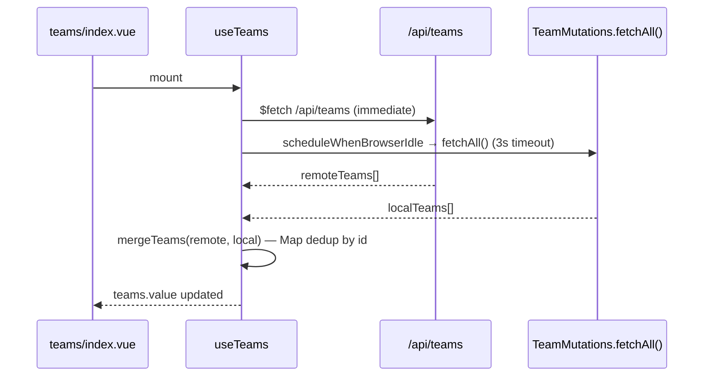
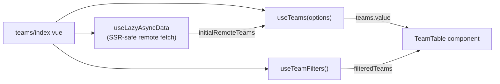

# Teams — Walkthrough

Teams are the second review subject in Peaky. Unlike Products (which are user-created), Teams are **read-only catalog-mirrored entities** — Peaky has no control over their existence, membership, or naming. The review infrastructure is identical to Products; only the data origin differs.

> **User guide**: the [Product Tour](../../../user-guide/product-tour.md) and [Working with Reviews](../../../user-guide/reviews.md) cover the team review workflow from the customer perspective. No team-specific screenshots exist yet — the review and assessment pages are identical to those in Products.

---

## 1. Key concept: catalog mirror, not user-created



A Team in Peaky is not created by a user. It flows in from the external catalog and lands in two local SQLite tables: `subjects` (canonical identity) and `teamProfiles` (org, member count, metadata). Review entities then reference the `subjectId` from `subjects`.

Peaky's role: attach reviews to teams. The catalog's role: define what teams exist.

---

## 2. Data model

```text
shared/db/schema/
  subject.ts       → subjects table (id, slug, name, type="team")
  teamProfile.ts   → teamProfiles table (subjectId FK, orgId, orgName, memberCount)
  review.ts        → reviews + ordered review_template_selections
```

| Table | Owned by | Key fields |
| --- | --- | --- |
| `subjects` | Catalog mirror | `id`, `slug`, `name`, `type` |
| `teamProfiles` | Catalog mirror | `subjectId`, `orgId`, `orgName`, `memberCount` |
| `reviews` | Peaky | `subjectId` (FK → subjects.id), `status` |
| `review_template_selections` | Peaky | composite `(reviewId, templateRevisionId)`, unique position `0..2` |

A new Team Review selects one to three current published Revisions from distinct active Templates. The exact ordered Revision IDs are immutable after creation, so later authoring or retirement cannot change the assessment snapshot. These rows are durable in local SQLite, but their cross-client transport and PostgreSQL Review projection remain deferred to Generic Sync Hardening.

Teams have **no create/update/delete mutations** in Peaky. `TeamMutations` is a read service only.

---

## 3. Composable layer

| Module              | Layer                                   | Purpose                                                                                    |
| ------------------- | --------------------------------------- | ------------------------------------------------------------------------------------------ |
| `TeamMutations`     | Service (`app/services/entity/`)        | `fetchAll()` / `fetchById()` — reads from local SQLite (teamProfiles ⋈ subjects ⋈ reviews) |
| `useLocalTeam`      | Composable (`app/composables/local/`)   | Reactive Vue wrapper over `TeamMutations.fetchById()`                                      |
| `useTeams`          | Composable (`app/composables/teams/`)   | List — parallel remote + local fetch with local-wins merge                                 |
| `useTeamDetails`    | Composable (`app/composables/teams/`)   | Single team — local-first with remote fallback on cold start                               |
| `useTeamFilters`    | Composable (`app/composables/teams/`)   | Search + org filter state for the teams dashboard                                          |
| `useSubjectReviews` | Composable (`app/composables/reviews/`) | Shared with Products: archive/restore/delete + list reviews                                |

### Fetch strategy

`useTeams` runs two fetches in parallel and merges the results. Remote teams win by default; local entries (from a cached previous sync) override if present.



`useTeamDetails` is more aggressive: it checks local SQLite first. If no local record, it falls back to `GET /api/teams/:id`. This means team detail pages render immediately from cached data on repeat visits.

---

## 4. Page structure

| Route                                         | File                                   | What it renders                                                                                            |
| --------------------------------------------- | -------------------------------------- | ---------------------------------------------------------------------------------------------------------- |
| `/teams`                                      | `pages/teams/index.vue`                | Dashboard: stats tiles (total, active reviews, pending actions), search + org filter, sortable `TeamTable` |
| `/teams/:teamId`                              | `pages/teams/[teamId]/index.vue`       | Team detail: header, review list, start review CTA                                                         |
| `/teams/:teamId/reviews/new`                  | `pages/teams/[teamId]/reviews/new.vue` | Three-step review wizard (Revisions → Applications → Confirm)                                              |
| `/teams/:teamId/reviews/:reviewId`            | (shared review detail layout)          | Review detail: header, metrics, pillar breakdown, history                                                  |
| `/teams/:teamId/reviews/:reviewId/assessment` | (shared AssessmentPage)                | Assessment: pillar tabs, questions, save flow                                                              |

The review wizard, review detail page, and assessment page are **shared with Products** — they operate on `reviewId` only and never need to know the subject type.

---

## 5. Teams dashboard



The page pre-fetches `GET /api/teams` during SSR via `useLazyAsyncData`, then passes the result as `initialRemoteTeams` to `useTeams`. This avoids a double-fetch: the SSR data seeds the composable, and `useTeams` only schedules the idle local hydration.

**Stats tiles** are derived computed values — `activeReviewsCount` is a `reduce` over `filteredTeams.value` on `team.activeReviewCount`. The "Pending Actions" tile multiplies active review count by 2 as a temporary placeholder.

**Organization filter** is built dynamically from the current team list — only orgs present in the data appear as options. Sorted alphabetically; "All organizations" is prepended.

---

## 6. Review wizard: team vs product difference

Both wizards start by selecting one to three current published Revision snapshots, but their remaining steps differ:

| Aspect | Product | Team |
| --- | --- | --- |
| Subject type | `product` | `team` |
| Flow | Revision Selection → Scope and Confirm | Revision Selection → Applications → Confirm |
| Scope | Full Product by default, or Specific Applications | Team-owned Review with zero or more linked applications |
| Navigation on create | → `/products/:id/reviews/:id/assessment` | → `/teams/:teamId/reviews/:reviewId/assessment` |

The Team wizard preserves state when navigating back, permits skipping application linking, and persists only after final confirmation. The shared `AssessmentPage.vue` component then reads the Review's exact Revision snapshots from local SQLite by `reviewId`.

---

## 7. Testing strategy

| Layer | File                                             | What's covered                             |
| ----- | ------------------------------------------------ | ------------------------------------------ |
| Unit  | `tests/unit/teams/teams/useTeamFilters.test.ts`  | Search + org filter state                  |
| Unit  | `tests/unit/teams/teams/useReviewWizard.test.ts` | Revision selection and wizard state        |
| E2E   | `tests/e2e/teams-flow.spec.ts`                   | Full team → review → assessment happy path |

**Strategy**: teams have minimal unit coverage by design — there is no Team mutation logic to test because Teams are read-only. Review-wizard tests cover exact Revision selection, application linking/skip, final confirmation, and the one-to-three selection bound. The E2E spec is the primary regression guard for the end-to-end Team flow.

---

## 8. Where to find things

| Question                                         | Look here                                                                                  |
| ------------------------------------------------ | ------------------------------------------------------------------------------------------ |
| How teams enter local SQLite                     | Catalog mirror sync — `server/catalog-directory-mirror/` + `app/catalog-directory-mirror/` |
| Why TeamMutations has no create/update           | Teams are externally owned; see data model section above                                   |
| How team reviews share code with product reviews | `app/composables/reviews/useSubjectReviews.ts`                                             |
| How the assessment flow works                    | [Assessments walkthrough](./assessments.md)                                                |
| How reviews are stored and synced                | [local-first Data Model](../local-first/data-model.md)                                     |
