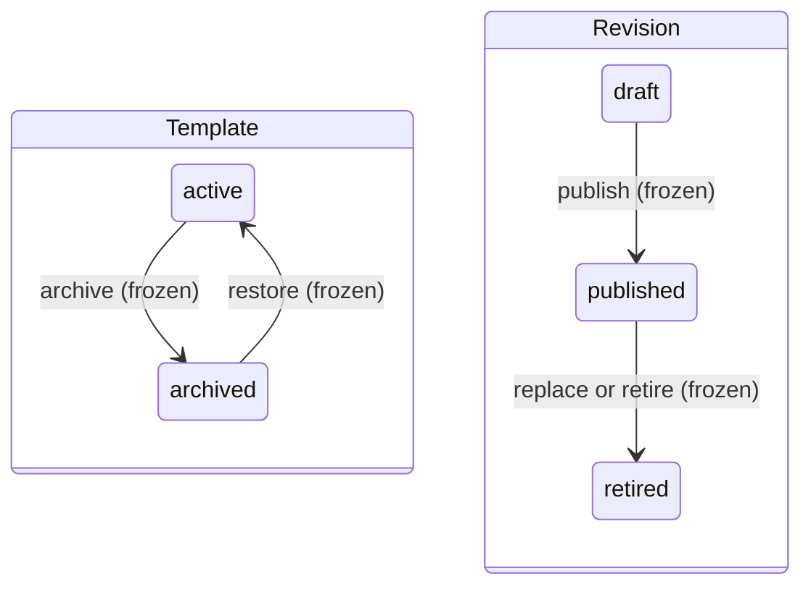
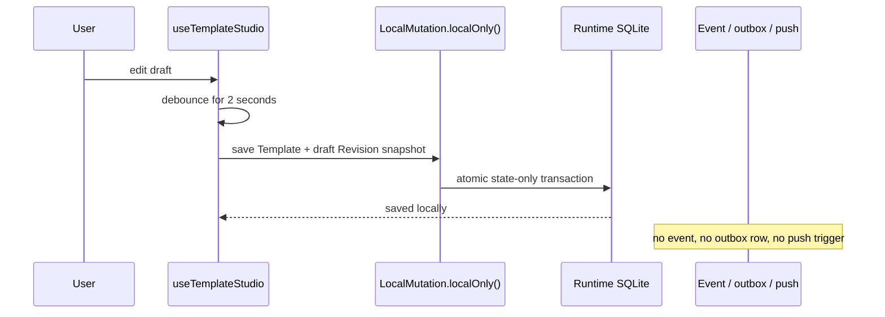
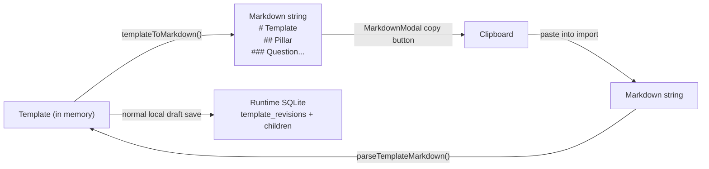

# Template Studio — Walkthrough

Templates are stable question-catalog identities with complete Revision snapshots—ordered Pillars, each containing typed Questions. Template Studio creates and edits one browser-local draft Revision; publication is intentionally unavailable until a trusted server authority exists.

> **User guide**: [Understanding Templates](../../../user-guide/templates.md), [Writing Great Templates](../../../user-guide/authoring-templates.md), and [Templates Advanced](../../../user-guide/power-user/templates-advanced.md) cover the author perspective.

---

## 1. Template and Revision lifecycles

The model separates the stable Template aggregate from its complete content snapshots:



| Record | Status | Meaning |
| --- | --- | --- |
| Template | `active` | Stable catalog identity; its current published Revision may be selected for a new Review |
| Template | `archived` | Not available for new Review selection; exact historical Review references remain |
| Revision | `draft` | Complete editable snapshot stored only in this browser |
| Revision | `published` | Immutable numbered snapshot available for new Reviews while current |
| Revision | `retired` | Immutable historical snapshot; existing Reviews remain pinned to it |

A Template has one stable ID, one immutable owning Team, and separate creator/updater provenance. It can have at most one draft and one current published Revision. Published and retired Revisions keep complete metadata, Pillars, Questions, Revision number, publication time, and publisher provenance.

!!! warning "Publication and lifecycle writes are frozen"
    Template Studio can create and edit a local draft, but it cannot publish it. Remote Template create/update, publish, archive, restore, and delete controls are unavailable. Direct API calls fail before writing with HTTP 503 and code `template_write_unavailable`.

---

## 2. Data model

```text
shared/db/schema/
  template.ts → stable Templates, Revisions, Revision Pillars, and Revision Questions
  local.ts    → local Template Revision import history
```

`templates` holds current aggregate metadata and ownership. `template_revisions` holds complete draft, published, and retired snapshots; Pillars reference `templateRevisionId`, and Questions belong to those Pillars. Draft metadata, Pillars, and Questions are separate structured rows. Pillars and Questions retain stable IDs and durable `orderKey` values so authoring does not depend on rewriting one monolithic JSON document.

Draft Revisions have null `revisionNumber`, `publishedAt`, and `publishedByActorId`. Published and retired Revisions require complete publication metadata and a positive Revision number. Published and retired content is immutable; only a draft Revision can be edited.

**Question slug** is derived at runtime: `{PILLAR_PREFIX_3CHARS}-{order}` (e.g. `SEC-1`, `REL-3`). Not stored.

**Question types:**

| Type        | Answer shape                                           |
| ----------- | ------------------------------------------------------ |
| `yes-no`    | Binary: Yes / No / N/A                                 |
| `checklist` | Array of sub-items, each independently checkable + N/A |

---

## 3. Two editing modes

The editing mode is stored in `localStorage` under `templateStudio.viewMode` and shared across the component tree via a module-level singleton in `useQuestionEditorMode`. Switching is instant — no data loss.

=== "Guided mode (default)"

    A six-section route that walks through one section at a time:

    1. **Question type** — Yes/No or Checklist
    2. **Question** — the core question string
    3. **Leading practices** or **Why this matters** — the first context section depends on question type
    4. **Why this matters** or **Leading practices** — the remaining context section
    5. **Resources** — helpful links with title and URL
    6. **Follow-up placement** — the final setting

    The header announces `Section n of 6`. Each section is Required,
    Recommended, Optional, or Setting. A Yes/No question has one placement
    control. A checklist has a bulk control and one control per practice.

=== "Compact mode"

    All fields appear inline. The expanded card becomes the active editor sheet,
    and no modal opens. Both question types use two bands:

    - Identity band, two columns. Type, Question, and Why this matters sit on
      the left; Resources sits alone on the right.
    - Answer band, full card width. Leading-practice rows use wrapping
      textareas. Checklist rows include per-practice Follow-up placement plus a
      bulk control; a Yes/No question gets one placement block under the list.

    These are live controls backed by stored stage associations, not reserved
    placeholders. No step-by-step flow appears in Compact mode.

---

## 4. Composable layer

| Module                       | Layer                  | Purpose                                                                                               |
| ---------------------------- | ---------------------- | ----------------------------------------------------------------------------------------------------- |
| `useTemplateStudio`          | Composable (singleton) | Core state machine: active Pillar, expanded Question, dirty tracking, auto-save, all draft mutation helpers |
| `useTemplateCatalog`         | Composable             | Merge remote published summaries with browser-local draft Revisions; lifecycle writes remain unavailable  |
| `useTemplatePersistence`     | Composable             | Persistence bridge: `saveLocalTemplateDraft()` writes the structured draft to runtime SQLite              |
| `useTemplatesMutate`         | Composable             | Loading/error wrapper; publication returns the explicit unavailable result                                |
| `useQuestionEditorMode`      | Composable (singleton) | `"guided"` vs `"compact"` stored in localStorage                                                          |
| `LocalMutation`              | Service                | `localOnly()` executes atomic state-only saves with no event, outbox row, or push trigger                  |
| `TemplateMutations`          | Service                | `publish()` fails closed with `TemplateWriteUnavailableError` before any write                             |
| `TemplatePersistence`        | Service                | Wrapper around local draft metadata and Markdown import/export/conflict resolution                         |

### The dirty-tracking primitive

Every mutation helper in `useTemplateStudio` calls `withTemplateMutation()`:

```typescript
function withTemplateMutation(mutator: (draft: TemplateDetail) => unknown) {
  if (!template.value) return false;
  const didMutate = mutator(template.value) !== false;
  if (!didMutate) return false;
  markDirty();
  return true;
}
```

`markDirty()` schedules an auto-save after a 2-second debounce. Every pillar, question, practice, checklist item, and link mutation goes through this path — ensuring the template is always saved within 2 seconds of any change.

---

## 5. Page routes


| Route                       | Purpose                                                                                 |
| --------------------------- | --------------------------------------------------------------------------------------- |
| `/templates`          | Template list: merge catalog and local drafts, search, filter by aggregate status, and sort. |
| `/templates/new/edit` | New local draft Studio. The first save creates a stable Template plus draft Revision, then redirects to `/templates/:revisionId/edit`. |
| `/templates/:id/edit` | Draft editor or immutable Revision reader: Pillar tabs, Questions, preview, Markdown, and share. |

Template Studio uses the `studio` layout and registers supported save, preview, share, Markdown, and Pillar-navigation actions in the command palette. Publication and aggregate lifecycle actions are intentionally absent.

---

## 6. Mutations reference

=== "Pillar mutations"

    All mutations call `withTemplateMutation()` which triggers auto-save.

    | Mutation                              | Effect                                                          |
    | ------------------------------------- | --------------------------------------------------------------- |
    | `addPillar(name, slug, description?)` | Appends to `template.pillars`, sets as active pillar            |
    | `updatePillar(slug, updates)`         | Partial-assigns to matching pillar                              |
    | `deletePillar(slug)`                  | Removes from array, re-assigns `order`, sets next active pillar |
    | `reorderPillars(from, to)`            | Immutable `.toSpliced()` + re-assigns `order`                   |

=== "Question mutations"

    | Mutation                                   | Effect                                                                      |
    | ------------------------------------------ | --------------------------------------------------------------------------- |
    | `addQuestion(pillarSlug, text, type?)`     | Creates question with default practice + resource, expands it               |
    | `updateQuestion(pillarSlug, qId, updates)` | Partial-assigns; initializes `checklistItems: []` if switching to checklist |
    | `deleteQuestion(pillarSlug, qId)`          | Removes from pillar, re-assigns `order`                                     |
    | `reorderQuestions(pillarSlug, from, to)`   | Immutable splice + re-order                                                 |

=== "Persistence and lifecycle boundary"

    | Action | What happens |
    | --- | --- |
    | First local save | Atomically inserts one stable Template and its draft Revision after a valid mirrored owner Team is selected |
    | `saveTemplateLocal()` | Calls `saveLocalTemplateDraft()` through `LocalMutation.localOnly()`; writes only structured SQLite state |
    | Import/conflict resolution | Updates the mutable draft and local Revision import provenance through state-only transactions |
    | Publish | Returns `template_write_unavailable`; no status, event, outbox, or content write occurs |
    | Archive / Restore / Delete | Unavailable in the UI; matching client and HTTP calls fail before writing |

---

## 7. Local save and publication freeze



This is an explicit temporary audit exception for unpublished authoring. Template draft push, pull, SSE, replay, cross-device visibility, and server recovery are not implemented.

If a caller bypasses the absent Publish control, the boundary still fails closed:

- `TemplateCatalog.publish()` returns `{ success: false, code: "template_write_unavailable" }`
- `TemplateMutations.publish()` throws `TemplateWriteUnavailableError`
- `POST /api/templates/:id/publish` returns HTTP 503 with the same code
- remote create, update, archive, restore, and delete use the same unavailable contract

No legacy draft-to-active promotion path remains.

!!! danger "Local draft data can be lost"
    A draft exists only in this browser's SQLite database. Clearing site storage, recreating the local database, or applying the destructive Preview migration `0016_template_revisions` permanently removes it. Export important work to Markdown before any reset or upgrade.

---

## 8. Maturity configuration (local draft)

The studio authors a draft Revision's maturity definition alongside ordinary question editing. Storage keeps the stage-association name; customer-facing copy uses Score stage and Follow-up placement.

- `MaturitySection.vue` composes `MaturityScoreSpectrum.vue` and `MaturityScoringReference.vue`. The raised spectrum keeps all five stage names and ranges visible; stage popovers reveal canonical descriptions. **Adjust score ranges** adds one proportional rail and four grippable seam sliders to the same plate. Each slider displays only its percentage and selects one fixed-lane editor labelled with the next stage, such as **Ad-hoc starts at**. Pointer, keyboard, and numeric input update the same start; **Use default ranges** restores all four atomically. The static scoring reference uses bare Formula, Question weights, and Answer rules rows with no answer-derived values.
- **Test maturity scoring** opens the ordinary Template Preview. Its resting line shows score, exact stage, coverage, and the provisional or no-result qualifier. **How scoring works** expands into a live earned ÷ weighted available = maturity equation. Its available operand names the question count. The compact **Current question mix** row shows only nonzero severity counts and multipliers. One wrapping **Scoring rules** row uses semantic icons without panels or dividers. The fixed Preview header states that answers are not saved and reload clears them. The live stage uses the same shared popover with current score position.
- `MaturityQuestionPanel.vue` writes stage associations through Follow-up placement. Compact and Guided both expose one control for a Yes/No question, plus bulk and per-practice controls for a checklist. Placement changes grouping, never scoring.
- Equal checklist weighting is the normal UI contract. No custom-share or guidance editor exists. Valid legacy custom weighting and guidance are preserved. Compatibility recovery offers **Use equal weighting** or removal of invalid hidden guidance.
- `MaturityPreview.vue`, inside the existing Template Preview, maps temporary unsaved answers through `workspaceAnswerToValue()` and `calculateMaturity()`. Unanswered questions remain available and unearned; N/A removes points. The component keeps the resting state compact and reveals the formula, weights, stage meaning, score-band position, and next threshold on demand.

Whole-question checklist N/A and per-practice N/A are excluded from score and gaps. A missing answer stays Not assessed and never becomes unmet. A recorded empty or partial checklist makes each applicable unchecked practice an explicit gap. Follow-up placement only changes its group; answers and severity-derived weights affect the score.

The definition commits atomically with the rest of the draft through `LocalMutation.localOnly()`. It lands in `template_revisions.maturity_definition` with no event, outbox row, or push trigger. Publication remains frozen, so locally authored configuration reaches reviews only after server-authoritative publication returns. Published Revisions keep the ranges and practice shares pinned at publication.

---

## 9. Import / export (Markdown)



**Export**: serializes draft metadata, Pillars, Questions, Question types, checklist items, leading practices, and helpful links to structured Markdown (`# name → ## pillar → ### question` with metadata blocks). It appears in the `MarkdownModal` with "Copy All."

**Import**: parses that complete supported structure into the in-memory draft. The normal local save then reconciles Template, Revision, Pillar, and Question rows atomically without publication, event, outbox, or push effects. Only a draft Revision is mutable. Legacy documents containing a `## Rules` section are rejected before partial Template state is applied.

---

## 10. Testing strategy

| Layer | File | What's covered |
| --- | --- | --- |
| Unit | `tests/unit/services/template/TemplateRevisionContracts.test.ts` | Revision state, summary normalization, provenance, and immutability contracts |
| Unit | `tests/unit/services/template/TemplateWriteFreeze.test.ts` | Fail-closed publication and Template lifecycle boundary |
| Unit | `tests/unit/composables/templates/storage/useTemplatePersistence.test.ts` | Atomic local-only draft persistence without transport |
| Unit | `tests/unit/templates/templateMarkdown.test.ts` | Supported Markdown round-trip and rejection of retired Rules data |
| Component | `tests/nuxt/components/template-studio/MarkdownModal.test.ts` | Import errors do not apply partial Template state |
| Component | `tests/nuxt/components/template-studio/MaturitySection.test.ts` | Exact ranges, static grouping example, disclosures, and compatibility recovery |
| Component | `tests/nuxt/components/template-studio/MaturityPreview.test.ts` | Production calculation, coverage states, shared gap buckets, and answer semantics |
| Component | `tests/nuxt/components/template-studio/QuestionCardCompactView.test.ts`, `tests/nuxt/components/template-studio/GuidedDraftingRoom.test.ts` | Follow-up placement in both editing modes |
| Integration | `tests/integration/template-revisions-schema.test.ts` | SQLite stable Template/Revision constraints and exact selections |
| Integration | `tests/integration/template-revisions-migration.test.ts` | Destructive Preview reset and unrelated-data preservation |
| E2E | `tests/e2e/template-studio-guided-mode.spec.ts` | Guided mode step-by-step authoring |
| E2E | `tests/e2e/template-import-export.spec.ts` | Markdown import/export workflow |

**Strategy**: pure validation and Markdown behavior stay in fast unit tests, schema and migration tests protect both fresh and existing browser databases, and E2E tests cover the user-visible local authoring flow. The 2-second auto-save debounce remains observable, while write-freeze tests prove publication and lifecycle calls cannot claim success or mutate state.

---

## 11. Where to find things

| Question                                      | Look here                                                                                                |
| --------------------------------------------- | -------------------------------------------------------------------------------------------------------- |
| How the singleton state machine works         | `app/composables/templates/studio/useTemplateStudio.ts`                                                  |
| How guided/compact modes share the preference | `app/composables/templates/useQuestionEditorMode.ts`                                                     |
| How local-only saves work                     | `app/services/local-mutation.ts` + `app/composables/templates/storage/useTemplatePersistence.ts`         |
| How publication and lifecycle fail closed     | `app/services/template/TemplateRevisionContracts.ts` + `server/utils/templateWriteUnavailable.ts`        |
| How import/export works                       | `app/utils/templateMarkdown.ts` + `app/components/template-studio/MarkdownModal.vue`                    |
| How exact Revisions appear in Reviews         | `app/services/template/TemplateRevisionSnapshotCache.ts` + `app/services/review/ReviewRepository.ts`     |
