---
hide:
  - toc
---

# Product Changes

What's new in Peaky — latest updates first.

## September 2026

### Maturity scores and practical handoffs

Reviews now explain capability maturity per selected template instead of stopping at answer completion. Each published template revision defines five score stages, and Peaky calculates the result from the evidence recorded in that revision. Assessment shows the percentage and stage as answers change, but hides severity labels and point arithmetic so people stay focused on evidence rather than optimizing the score.

At a glance:

- Review Details places the selected template and its maturity result together. Pillar Progress counts resolved checklist items, Answered shows question coverage, and Maturity shows the severity-weighted result.
- Template Authors can test scoring with temporary answers, inspect the exact calculation, tune stage thresholds, and see which technical details assessment participants will not see.
- Follow-ups keeps each template revision separate, groups recorded gaps by question severity, and shows unanswered questions without treating them as failed evidence.
- Refine filters by current Handoff status, pillar, and available severity. Previously handed-off work stays out of the available queue unless it still needs evidence and has been released for another handoff.
- Handoff turns selected gaps into an ordered delivery sequence with notes, exact potential maturity movement, Markdown copy, existing-ticket linking from one URL, local history, and Clear all.
- Closing a Handoff does not change Assessment evidence. Unresolved practices return to Available, and the latest manually closed Handoff can be reopened while no newer Handoff is active.

## August 2026

### A new look for Peaky

Peaky has a new visual identity ahead of Beta — light-first and drawn like a cartographer's worksheet: white canvas, ink text, sky-blue accents, and hairline borders in place of the old dark gradients. Dark mode isn't going anywhere — it's one click away on every page, including the landing page.

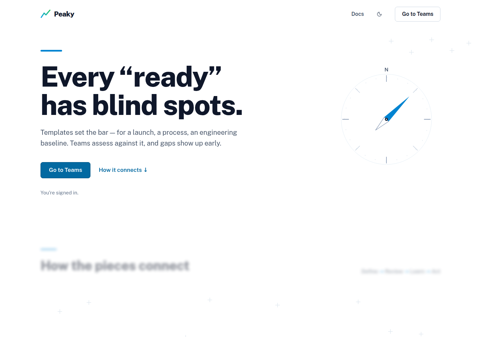

At a glance:

- Light mode is now the default everywhere; the theme toggle lives in the header and on the landing page
- The landing page was redrawn around Peaky's map theme — a compass rose, a hand-drawn route map of the assessment journey, and below-the-fold sections that come into focus as you scroll
- Every screen moved to the same calm surfaces: content sits directly on the page, tables read as printed sheets, and a single heavy ink line per screen marks what you're working on

**Template selection in a new review is now ranked, not a flat list.** The campaign template for the season sits front and center with its own Select button, your team's templates come next, everything else ranks by how many reviews actually used it, and unpublished drafts sit last — so you can try a draft in a real review before publishing makes it immutable. Cards carry the owner, version, and pillar/question counts, which puts an end to guessing between two templates with the same name. Search, filters, and your selection stay pinned while you browse, and long sections reveal a page at a time — the wizard stays navigable even when the catalog grows to a hundred templates.

**Editing a question opens the Guided Drafting Room.** Template Studio's guided editor is now laid out like a drafting table: a progress rail on the left tracks the question's sections, the question itself sits on a sheet of paper over a cutting mat, and a short entrance animation plays as the room opens — without ever blocking your typing. A section's waypoint turns green as soon as it has content.

**Creating a product is now a route, not a stepper.** The New product page puts a rail of four waypoints beside one sheet of paper on a drafting mat. The rail tracks where you are and repeats what you have entered as you go — "Checkout · Bespoke", "2 teams", "1 application" — so the summary is always in view and you can walk back to any step you have already passed. Picking teams and applications works like the review wizard: search, a two-column grid that shows a few and reveals more on demand, and a tray of what you picked that clears on click. The applications step scopes itself to the teams you chose and says so. The last step is a plain manifest with an Edit link on every group. The "customer-facing" toggle is gone — products are internal-only until the external products registry ships, and products already marked external keep their badge in the products list.

**A product's page opens with its title block.** Ownership and resources used to be two bordered panels; they are now one ruled panel drawn the way a map or an engineering drawing carries its title block — an outer frame, an inset neatline, a caption row naming who added the product, and four ruled cells for contacts, teams, applications, and references. Contacts come first, because the people are the point. A field with nothing in it shows a dashed marker rather than a blank.

Dozens of small things were tuned in the same pass — question rows align on one centerline with the question text leading, notes are readable in both themes, progress bars only show green when everything is actually answered, and the scope step says plainly when a review covers the team as a whole instead of implying something is missing.

**The last stock corners are gone.** Quick actions (Ctrl+K) now matches the rest of the app: an 8px radius, hairline dividers, a search field on the same well every other search uses, and the sky tint marking the highlighted command instead of a stock ring. Improvement Plans, the review wizards, the save-progress modal, the milestone cards, and the sync popovers all moved to the same radius, dropped their resting shadows, and replaced raw greys with the app's own text and border colours. Nothing about how they work has changed.

### Template Studio focuses on supported authoring

We removed the unfinished Template Rules canvas before the next Template model and collaboration work. Rules could be authored but were never evaluated during reviews, so removing them does not change answers, progress, or Improvement Plans.

At a glance:

- Template Studio now focuses on metadata, pillars, questions, practices, checklists, and resources
- Markdown export no longer includes Rules
- Legacy Markdown containing a `## Rules` section is rejected before any partial import is applied
- Existing Rule data is removed during database upgrade while Templates, pillars, and questions remain intact

## July 2026

### Operational Readiness Review 2026

This year's Operational Readiness Review (ORR) is now available as a Peaky template ahead of Beta.

To make this possible, we removed the upper limit on checklist items to accommodate its large checklists. This is a Beta compromise, not the model we intend for new templates. We will remove duplicate content now and revisit the template's questions and checklist options ahead of general availability.

At a glance:

- Checklist questions still require at least three checklist items, with no upper limit
- The Template Studio preserves checklist options when you import or export a template in Markdown

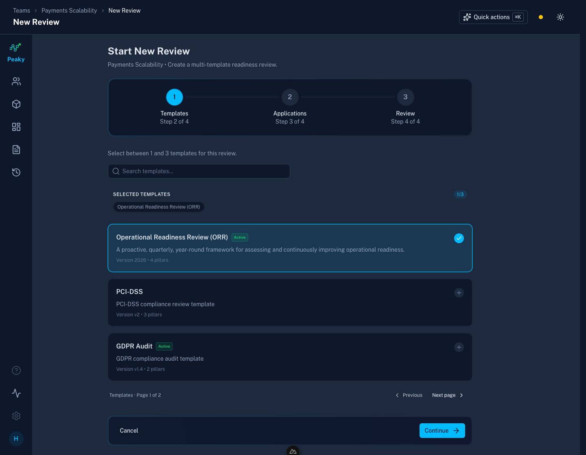

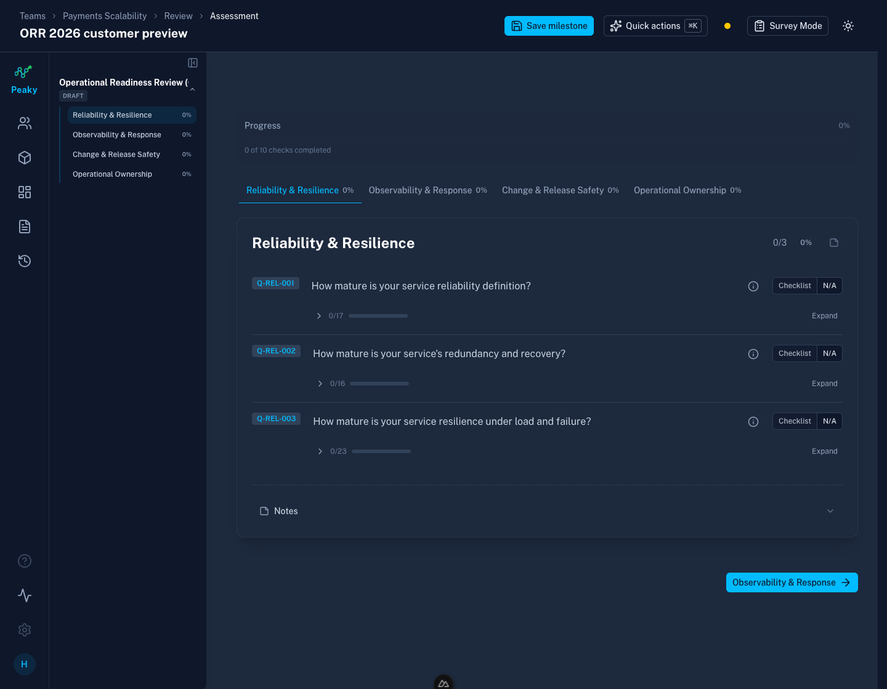

### Sync Engine — Visibility Filtering

You only see what's meant for you now — Peaky filters products, reviews, and everything inside them to what you're actually allowed to see as soon as they sync to your device.

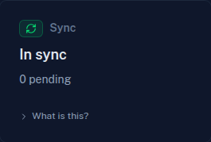

Before this change, a wildcard entitlement in one family (say, `product:*`) could pull scoped data from another family (like `review:review-999`) into your local database. Now the server filters events by root entity before they ever reach your device, so what you see is exactly what you're allowed to see — no leaks, no extra noise.

At a glance:

- If you can see every product but only a couple of reviews, syncing no longer blurs that line — what lands on your device matches exactly what you're allowed to see
- Join a review and its answers and notes are already there, no waiting for them to sync in separately
- Products now use the same visibility rules as reviews, so what you can see stays consistent everywhere in the app

That's it — no action needed on your part, these improvements are automatic.

## June 2026

### Sync Engine

Your team can now see each other's review updates without manual refreshes. Changes still save instantly on your device, then sync in the background so everyone stays on the same page.

At a glance:

- Changes save locally first, so answering a review still feels instant
- Review updates sync to the server in the background
- Other participants can receive fresh answers while they are already in the same review
- If the connection is partial, Peaky keeps your work queued and shows exactly what is paused

The new sync status indicator makes that state visible in plain language. Green means local saves, server sync, live updates, and Recent Changes are all working together.

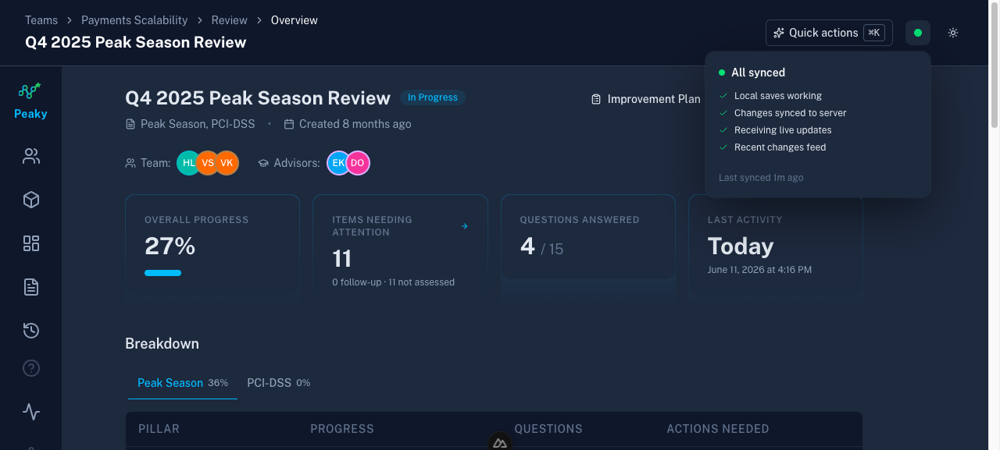

If Peaky cannot fully reach the server, the indicator turns amber instead of leaving you guessing. Your local saves keep working, queued changes stay safe, and the menu shows which live features will resume once the connection recovers.

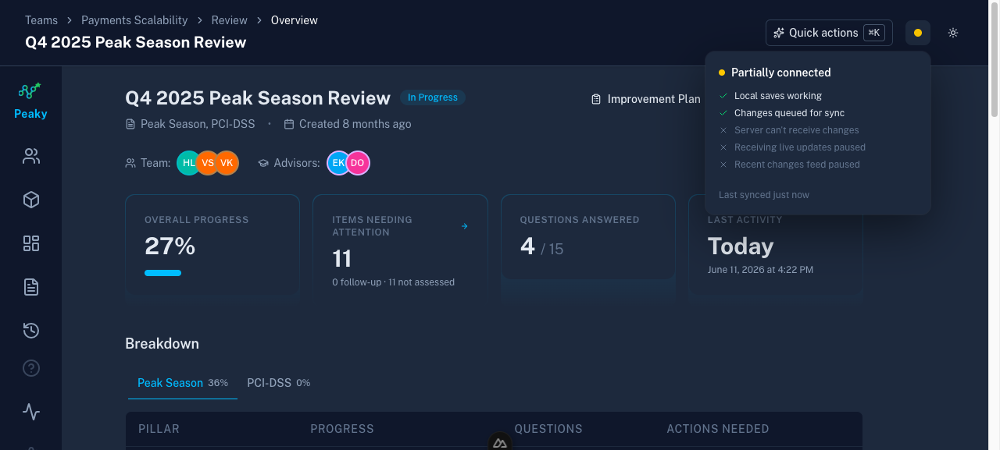

### Recent Changes

Recent Changes gives every review a per-answer history from everyone contributing to the review. Instead of guessing who changed what, you can see the latest answer change, when it happened, and who made it.

Because answers sync live, the feed keeps updating while your teammates work on the same review.

In a nutshell:

- **One entry per answer change** — each update gets its own history row
- **Clear before → after view** — first answers show as `new → Yes`, later edits show exactly what changed
- **Filters that matter** — narrow the feed by question text, answer state, or pillar
- **Shared visibility** — the feed reflects synced answers from everyone contributing to the review

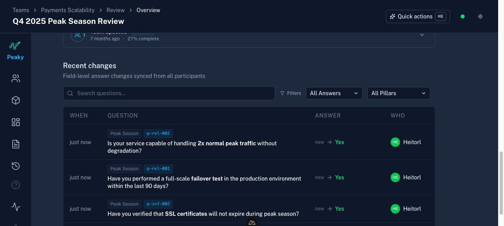

## May 2026

### Improvement Plans

Improvement Plans introduce detailed information on what to prioritize after a team or product assessment. It turns "Actions Needing Attention" into an actionable list for teams and leaders.

In a nutshell:

- "No" answers become follow-up items
- Unanswered questions are flagged as not assessed
- Partially answered checklist (gaps) show which practices still need review
- Every item needing attention links straight to the assessment page

By default, plans order and group items by severity. You can filter them by state, severity, pillar, and template.

Improvement Plans are also available at team or product level, helping you understand what exactly is contributing to the readiness level.

### Removed low risk severity level

This will help template authors be more intentional on whether the question should exist, improving templates overall quality.

To prevent data loss, questions marked as `low` in templates will be updated to `medium` severity.

### Events feed

The Events page is now the complete activity log for everything that happens in Peaky. Every change — review saves, answer updates, product edits, schema migrations, GDPR erasures — is recorded here and can be searched and filtered.

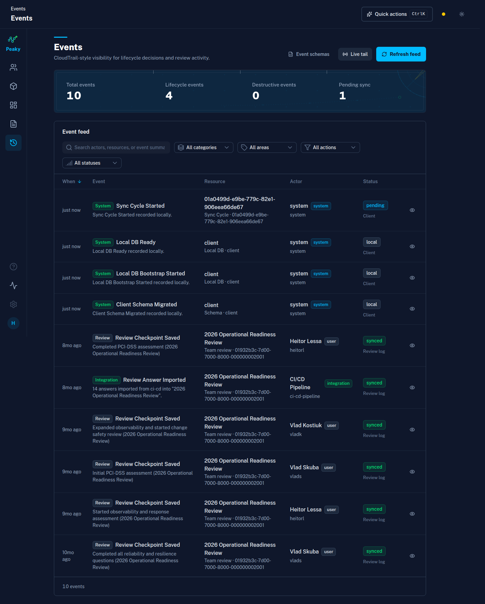

- **Stats at a glance** — counters for total events, lifecycle events, destructive events, and pending (locally-saved but not yet synced)
- **Live tail** — toggle it on and new server-side events stream in via SSE without a manual refresh. A status indicator shows whether the connection is live, connecting, or in a retry loop
- **Multi-dimensional filters** — search by actor, resource, or summary text; narrow by category, subject type, action, or status using the four dropdowns
- **Event detail slideover** — click any row to see the full event payload, subject metadata, and a GDPR erasure indicator when PII has been tombstoned
- **Event Schemas** — a quick-link to `/schemas` where every event type is documented with its Zod-generated JSON schema

### Self-service system page

A new `/system` page gives every authenticated member a live view of how Peaky is running on their device — no admin access required, no ticket needed.

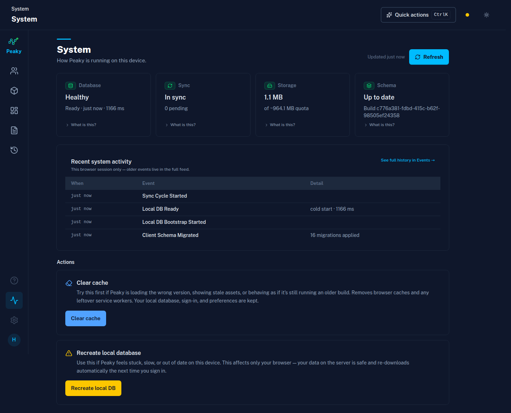

The page is designed around one question: *can I trust what I'm looking at right now?*

- **Four status tiles** — Database, Sync, Storage, and Schema each show a headline state (Healthy / In sync / 1.0 MB / Up to date) and a support line with timing or quota details. Each tile has a "What is this?" link that explains the concept in plain language for non-technical members
- **Recent system activity** — the last few system events from this browser session (app startup, updates, sync runs), with a link to the full history in Events
- **Clear cache** — the first recovery step when Peaky is loading a stale build or misbehaving. A confirmation prompt shows exactly how many background service registrations and cached files will be removed before anything is touched. Your local database, sign-in, and preferences are kept
- **Recreate local database** — the nuclear option. Wipes and re-downloads the local database for this device only; server data is untouched

---

## April 2026

### Applications

The applications view gives teams a single place to track the services and systems they own *(read-only)*.

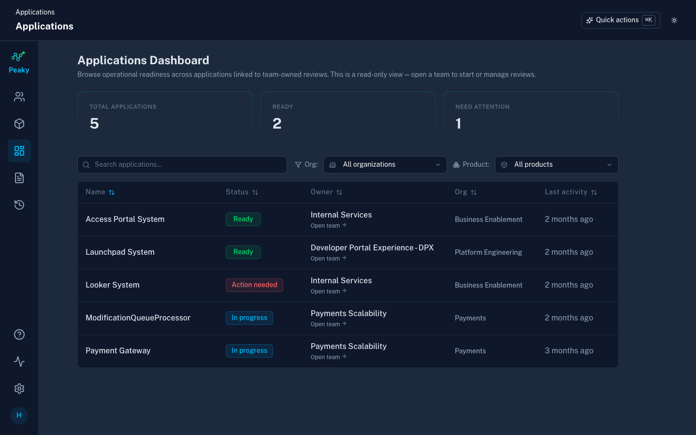

### Redesigned user guide

The user guide has been rewritten from the ground up for the people who actually use Peaky — not just engineers, but PMs, compliance leads, template authors, and first-time assessors.

<!-- markdownlint-disable -->

-   :material-account-hard-hat-outline:{ .lg .middle } **Assessor quickstart**

    2-minute orientation for anyone assigned a review — what to expect, how to answer, why "No" is a good answer.

-   :material-map-search:{ .lg .middle } **Product tour**

    Guided walk through the app organized by what you want to accomplish, not what buttons exist.

-   :material-pencil-ruler:{ .lg .middle } **Template authoring**

    Style guide with before/after examples, risk calibration guidance, and a complete annotated template.

-   :material-lightning-bolt:{ .lg .middle } **Power user guide**

    Keyboard shortcuts, events trail, template rules, and automation — now four focused pages.

<!-- markdownlint-enable -->

The guide speaks to multiple personas: assessors answering questions, PMs tracking progress, compliance leads mapping controls, and template authors designing assessments that produce real signals.

### Security hardening

Peaky now ships with production-grade security headers and input validation.

- **Content Security Policy** — strict CSP with WebAssembly support for local-first storage
- **HSTS, X-Frame-Options, rate limiting** — via the nuxt-security module
- **Input validation** — all API endpoints validate request bodies with Zod schemas, including the sync push endpoint (max 500 events per batch, field length limits)
- **Security walkthrough** — new documentation explaining how security works differently in a local-first app, including the trust boundary between browser and server

### Quality gates

A single command (`make mr`) now runs every quality check before submitting a merge request:

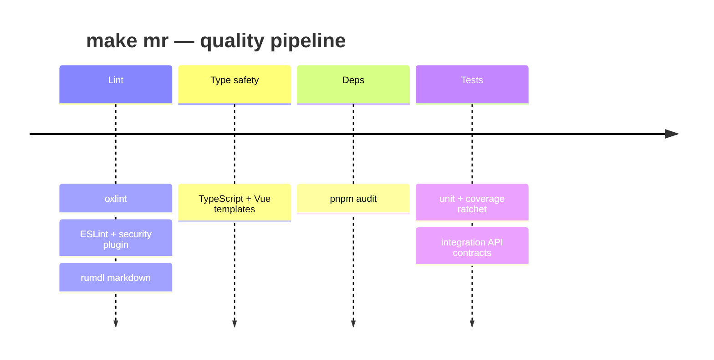

- **Linting** — oxlint (correctness, suspicious code, performance, complexity) + ESLint (TypeScript, Vue, security plugin)
- **Markdown linting** — rumdl checks documentation for broken links and formatting issues
- **TypeScript** — full type checking including Vue templates
- **Dependency audit** — checks for known vulnerabilities in production dependencies
- **Unit tests** — with coverage ratchet that prevents regression
- **Integration tests** — API contract tests against a real Nuxt server

Git hooks enforce a subset automatically: lint + format on every commit, tests + typecheck on every push.

### Faster formatting

Migrated from Prettier to oxfmt — a Rust-based formatter that is 30x faster with built-in Tailwind CSS class sorting. No plugins needed.

### Code coverage

Unit test coverage is now tracked with ratchet thresholds. Coverage can only go up — if someone adds code without tests, the build fails. Run `make test:coverage` to see the report.

---

## March 2026

### Local-first foundation (Stage 1)

The biggest architectural change in Peaky's history. All user actions now save locally first and sync in the background.

- **Instant saves** — edits commit to a browser-local SQLite database (WASM + OPFS) in milliseconds, regardless of network connectivity
- **Background sync** — a local outbox queues mutations for server synchronization when online
- **Offline support** — entitlement snapshots allow continued work without a connection for up to 7 days
- **Audit trail** — every mutation emits a typed domain event for a CloudTrail-inspired activity feed

### CloudEvents alignment

Domain events now follow the CloudEvents spec with versioned envelopes and a `source` field. A schema catalog page (`/schemas/:name`) shows Zod-generated JSON schemas for all event types.

### Entity mutation services

Mutation logic extracted from Vue composables into plain TypeScript service classes (`ReviewMutations`, `AnswerMutations`, `ProductMutations`, `TeamMutations`). These are testable without mounting Vue components and form the backbone of the local-first write path.

### Teams-first navigation

Homepage and navigation pivoted to Teams as the primary ownership model. Reviews are now native multi-template containers (1-3 templates per review). Organizations introduced as a first-class entity.

### Products

Full product lifecycle with a 4-step creation wizard, review scoping (full vs targeted), and unified review detail pages shared between team and product reviews.

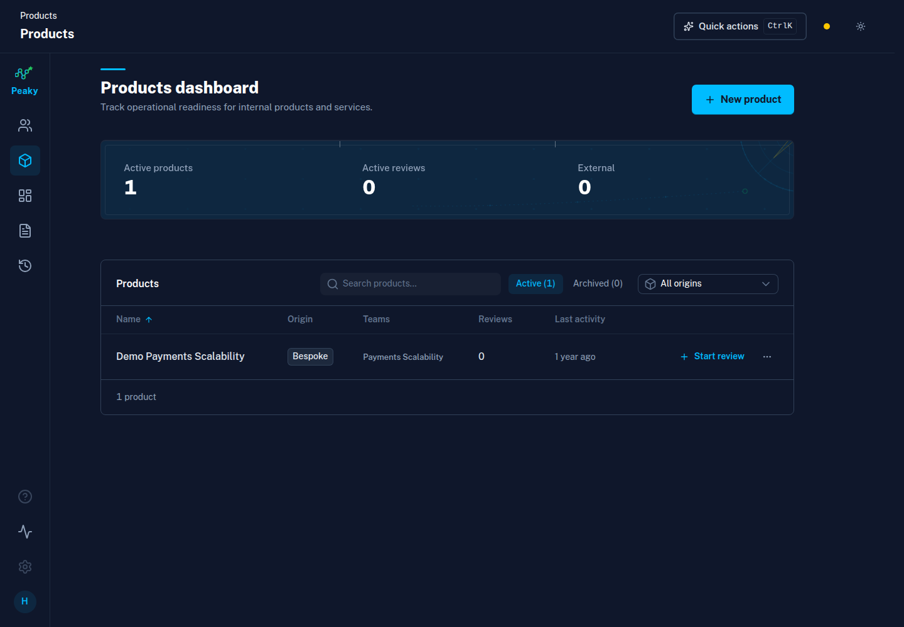

---

## February 2026

### Template Studio

A dedicated editor for creating and managing readiness assessment templates.

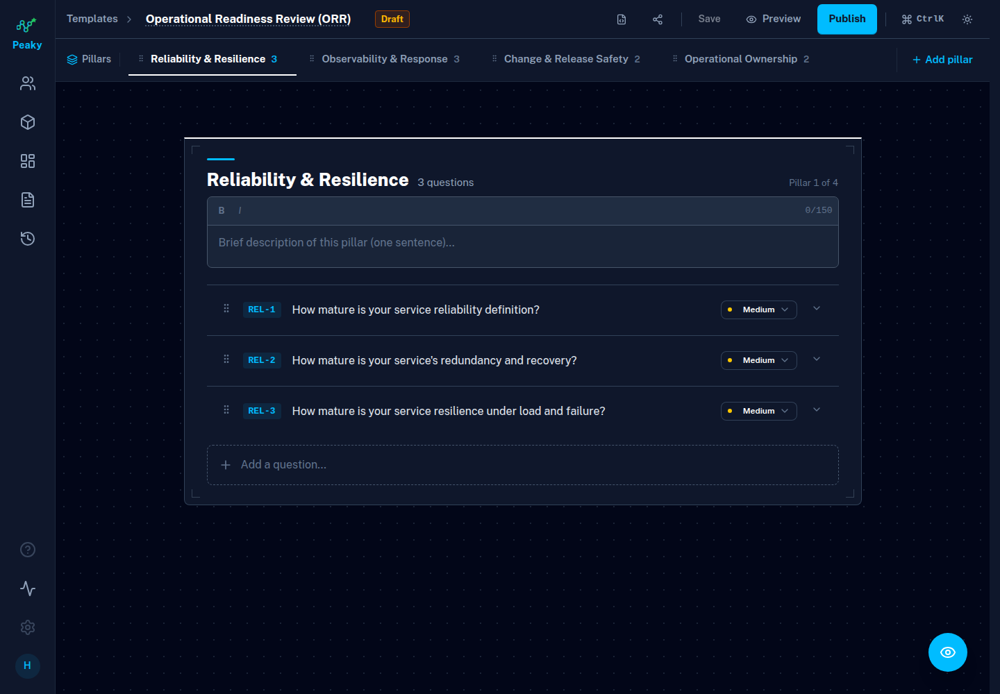

- **Guided Mode** — step-by-step question editing with Next/Back/Skip navigation (default for new users)
- **Compact Mode** — 2-column layout for experienced template authors
- **Checklist questions** — new question type with 3-5 selectable items, alongside the existing yes/no type
- **Rules Mode** — visual canvas (Vue Flow) for defining conditional logic with drag-and-drop question assignment, grouped conditions, and multi-rule warnings
- **Preview Mode** — live preview of how assessments will look to reviewers

### NuxtUI adoption

Replaced bespoke Tailwind components with NuxtUI primitives. Unified the color palette and improved accessibility contrast across all interactive elements.

### Per-pillar notes and attachments

Reviewers can now attach notes and files to each pillar of an assessment, with markdown editing and a collapsible UI.

---

## January 2026

### Initial release

- Application dashboard with bulk actions
- Review details with session history and progress tracking
- Assessment view with yes/no questions, N/A option, and template navigation
- Command palette for keyboard-driven navigation
- PWA support for installable app experience
- Dark mode with Discord-inspired sidebar layout
