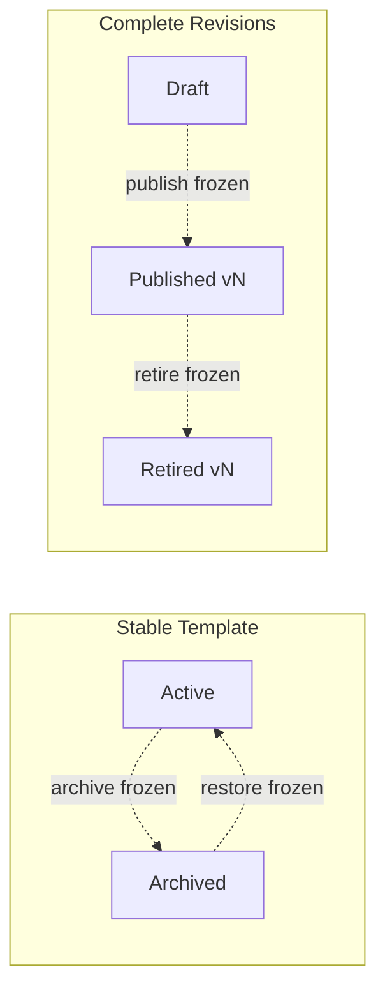

# Writing great templates

A well-written template produces useful signals about readiness — whether you're assessing a technical system, a compliance program, or a business process. A poorly-written one produces noise: assessors click through without thinking, and the results tell you nothing.

This guide helps you write templates that teams actually learn from.

!!! info "Question budget"
    Templates can have **no more than 10 scored questions**. This limit shapes pillar design, question granularity, and what to cut. Keep it in mind as you read.

## The Template Studio

The Template Studio is where templates are created and edited. It has two editing modes:

| Mode | Best for |
|------|----------|
| **Guided** (default) | New authors — shows one section at a time with Next/Back navigation |
| **Compact** | Experienced authors — all fields visible in a dense layout |

Each new draft creates a stable Template with an explicitly selected owning Team and one draft Revision. Auto-save writes the complete draft to this browser's local database after two seconds. It does not publish, upload, or sync the draft.

!!! danger "Export drafts before clearing local data"
    Unpublished drafts exist only in the browser where they were created. Clearing site storage, recreating the local database, losing the browser profile, or applying a destructive Preview reset permanently deletes them. Use Markdown export to keep a recoverable copy of important work.

!!! warning "Publication is currently unavailable"
    You can create, edit, import, export, and preview a local draft. Publish and Template archive, restore, and delete controls are frozen; direct calls fail without changing data.

!!! info "Maturity configuration is authored locally"
    A template revision can carry score boundaries, checklist weighting, and one Follow-up placement for every question or checklist practice. The definition stores that placement as a stage association. You edit it on the local draft revision; published revisions keep their pinned ranges and weighting.

## Maturity configuration

A maturity definition maps assessment answers to one of five ORR 2026 Score stages. It also says where explicit gaps appear in Follow-ups. These are separate settings.

**Score stages and ranges.** Stage names and descriptions are fixed. Names and ranges stay visible; hover or focus a stage for its meaning, proportional bands, range, and next threshold. The default stage starts are 5, 25, 50, and 75 percent, so **Not implemented** ends below 5 percent. Open **Adjust score ranges** to add four grippable handles to the same spectrum. Drag a handle, use Arrow keys, or select it and type the exact percentage where Ad-hoc, Defined, Measured, or Optimized starts. **Use default ranges** restores all four.

**Scoring.** Every question has available points. Medium has 1, High 2, and Critical 3. Answers earn those points; unanswered questions earn zero until answered. N/A removes the question or practice points. Maturity is points earned divided by available points. The live equation also shows how many template questions supply that available total.

**Follow-up placement.** Placement does not change the score. It only decides where an explicit gap appears in Follow-ups. In either Compact or Guided mode, a Yes/No question has one placement control. A checklist has one control per practice plus **Set all Follow-up placements**.

**Checklist weighting.** Practices divide their question's points equally. There is no custom-share editor. Template Studio preserves valid legacy custom weighting and hidden guidance. Custom weighting gets a compatibility notice and a **Use equal weighting** reset; invalid hidden guidance gets a removal action.

**Template Preview tests scoring without saving answers.** Choose **Test maturity scoring**, then answer the draft. The resting line shows the score, stage, coverage, and provisional state. **How scoring works** opens a live earned ÷ weighted available = maturity equation. The available total names its source-question count. A compact **Current question mix** shows only severities present in the draft, followed by one icon-led **Scoring rules** row. The **Note** below explains that assessment participants see the live result, but not severity labels, point totals, available points, or the question mix. Hover or focus the stage to see its meaning, your position in the score bands, and the next threshold. The fixed Preview header warns that answers are not saved and reloading clears them.

!!! warning "Local until publication"
    The definition is committed to the local draft revision together with the template content. It reaches reviews only when the revision is published. Publication is currently frozen, so server-authoritative publication must return before your draft configuration can reach a review.

## Choosing the right question type

=== "Yes / No"

    **Use when** the requirement has a clear binary answer.

    Good: "Do you have automated failover for your primary database?"

    Bad: "Is the system reliable?" — too vague, assessors will answer on gut feeling.

=== "Checklist"

    **Use when** the requirement has several leading practices that should all be confirmed.

    Good: "Incident response readiness: runbook exists, on-call rotation set, escalation path documented"

    Bad: A checklist with 1 leading practice (just use Yes/No) or 8+ (split into separate questions).

    !!! tip "Aim for 3-5 leading practices per checklist"
        Fewer than 3 should be a Yes/No. More than 5 means the question covers too much — split it.

## Writing effective questions

The difference between a question that produces signal and one that produces noise is usually specificity and context. Here are common anti-patterns and how to fix them.

---

!!! failure "Vague"
    **"Is the system reliable?"**

    "Reliable" means different things to different people. Assessors answer "Yes" based on feeling, not evidence.

!!! success "Specific and measurable"
    **"Do you have automated failover for your primary database with a tested RTO under 5 minutes?"**

    Clear requirement, measurable threshold, testable claim. A "No" tells you exactly what's missing.

---

!!! failure "Compound"
    **"Do you have monitoring and alerting?"**

    Two concerns in one question. A team with monitoring but no alerting can't answer honestly.

!!! success "Single concern"
    **"Do you have alerting with on-call routing for P1 incidents?"**

    One thing to assess. Pair with a separate question for monitoring coverage.

---

!!! failure "Leading"
    **"You have backups, right?"**

    Social pressure to answer "Yes." The phrasing assumes the answer.

!!! success "Neutral"
    **"Are database backups automated and tested with a documented restore procedure?"**

    Neutral tone. Adds specificity so "Yes" actually means something.

---

!!! failure "Missing context"
    **"Is encryption enabled?"**

    No risk level, no "why this matters," no leading practices. Assessors don't know what they're checking or why.

!!! success "Complete"
    **"Is data encrypted at rest using AES-256 or equivalent?"**

    With metadata: risk level High, "why this matters" explains the compliance and breach risk, leading practices point to managed encryption services, helpful links go to the org's encryption standard.

The common thread across these examples: be ^^specific^^, assess ^^one thing^^, and keep the tone ^^neutral^^. The same principles apply to checklists and risk calibration.

---

!!! failure "Bad checklist — mixed granularity"
    **"Monitoring checklist: dashboards exist, alerts configured, SLOs defined, retrospectives conducted quarterly, on-call documented"**

    Items range from a 5-minute check to a quarterly process. Assessors can't answer the whole thing in one sitting.

!!! success "Focused checklist"
    **"Alerting readiness: P1 alerts route to on-call, alert thresholds tested, runbook linked to each alert"**

    All items are verifiable in one session and relate to the same capability.

---

!!! failure "Everything is Critical"
    Five questions all marked Critical risk.

    If everything is critical, nothing is. Assessors can't prioritize.

!!! success "Calibrated risk levels"
    - **Critical**: "Automated failover for primary database" (outage impact)
    - **High**: "Load testing completed at 2x peak" (performance risk)
    - **Medium**: "Runbook reviewed in last quarter" (operational debt)
    - **Low**: "Dashboard links accessible to the team" (convenience)

### Handling "partially done" answers

Sometimes the answer isn't a clean Yes or No — the team ran a load test at 1.5x instead of 2x.

We handle this by being explicit in the question, not the answer:

**1/** Set clear thresholds in the question text: "at 2x peak traffic" makes the bar unambiguous.

**2/** Guide assessors in "Leading practices": "If testing was below 2x, answer No and note the actual multiplier in pillar notes."

**3/** Use ^^pillar notes^^ for context: assessors explain partial readiness, advisors see the nuance alongside the binary signal.

## Risk level guide

| Level | What it signals | If the answer is "No" |
|-------|----------------|----------------------|
| **Critical** | Failure causes outages, data loss, or major compliance violations | Stop — fix before proceeding |
| **High** | Significant risk if not addressed before the target date | Likely needs remediation |
| **Medium** | Operational debt that increases risk over time | Plan to address, not a blocker |
| **Low** | Best practice improvement | Track for next cycle |

!!! tip "Calibration rule"
    A well-calibrated template has roughly: 10-15% Critical, 25-30% High, 35-40% Medium, 20-25% Low. If more than half your questions are Critical, recalibrate.

## Designing pillars

Pillars organize questions into logical groups. Good pillar design makes the assessment flow naturally and helps teams divide work.

| Principle | Guidance |
|-----------|----------|
| **Number** | Aim for 4-8 pillars. Fewer than 3 is too broad. More than 8 and assessors lose context. |
| **Naming** | Use nouns: "Reliability", "Security", "Operations". Not verbs: "Be Reliable". |
| **Ordering** | Highest-risk pillars first. Assessors are most focused at the start. |
| **Balance** | Each pillar should have 3-10 questions. A pillar with 1 question should be merged. A pillar with 15 should be split. |

!!! warning "Avoid pillar bloat"
    If two pillars always get assessed by the same person, they probably belong together. Each pillar should represent a genuinely distinct area of concern.

## Example: a complete template

A simplified Peak Season template with 3 pillars and 8 questions:

| Pillar | # | Question | Type | Risk |
|--------|---|----------|------|------|
| **Reliability** | 1 | Automated failover with tested RTO under 5 minutes? | Yes/No | Critical |
| | 2 | Load testing completed at 2x projected peak? | Yes/No | High |
| | 3 | Circuit breaker readiness: timeout, fallback, alerts | Checklist | High |
| **Security** | 4 | Production access requires MFA and is logged? | Yes/No | Critical |
| | 5 | Dependencies scanned for known CVEs in last 30 days? | Yes/No | Medium |
| **Operations** | 6 | Incident response: runbook, on-call rotation, escalation path | Checklist | High |
| | 7 | Rollback procedure tested for current release? | Yes/No | High |
| | 8 | Key operational dashboards accessible to the full team? | Yes/No | Low |

**Why this works:** 3 pillars organized by concern. 8 questions — well under the 15-question limit, leaving room to add 2-3 more after the first cycle. 2 checklists for multi-part capabilities, 6 Yes/No for clear binary checks. Risk calibration: 2 Critical, 3 High, 1 Medium, 1 Low.

### Iterating after the first cycle

After the first assessment round, review the results:

- Questions where ^^>80% of teams answer Yes^^ — consider removing or graduating to automated checks
- Questions that are ^^always N/A^^ — not relevant for your context, remove or rephrase
- Questions where teams ^^leave qualifying notes^^ on a Yes — too vague, add thresholds
- Questions that produced ^^the most advisor discussion^^ — highest-value questions, keep and refine

## Compliance templates

If you're building a template to satisfy regulatory or compliance requirements, the structure is the same but the intent differs: each question maps to a ^^control^^ and needs to produce ^^evidence^^.

### Mapping controls to questions

| Framework element | Maps to | Example |
|-------------------|---------|---------|
| Control family | Pillar | "Access Control", "System Operations" |
| Individual control | Question | "Is data encrypted at rest using AES-256?" |
| Evidence requirement | "Why this matters" + "Leading practices" | "Evidence: encryption status output" |
| Control ID | Include in question text | Prefix with the control identifier |

### Evidence and audit trails

Every assessment in Peaky produces an audit trail:

- **Session history** shows who assessed what, when, with what result
- **Pillar notes** are the place to link evidence (dashboards, screenshots, tickets)
- **N/A reasons** are logged and visible — control delegation is traceable

!!! warning "Template Revisions for compliance"
    Published Revisions are complete immutable snapshots. A Review stores the exact Revision and Revision-specific Question IDs it selected, so later drafts cannot change its original control mappings. Do not infer that similarly worded Questions in different Revisions are the same control; make lineage explicit in your external control documentation.

## Publication-readiness checklist

Use this checklist to prepare the draft even while publication is frozen. Before a future publication, verify:

- [ ] Every question can be answered with evidence, not just opinion
- [ ] No compound questions — each question assesses one thing
- [ ] Risk levels are calibrated (not all Critical)
- [ ] "Why this matters" is filled in for every question
- [ ] Leading practices give actionable guidance
- [ ] Helpful links point to current, accessible resources
- [ ] Preview mode looks right — question order flows logically
- [ ] Total questions: aim for 10, hard limit 15
- [ ] Checklist questions have 3-5 leading practices each

## Template and Revision lifecycles

- **Active Template** — stable catalog identity that can supply a current published Revision to new Reviews
- **Archived Template** — excluded from new selection while historical Reviews remain intact
- **Draft Revision** — editable, unpublished, and local to one browser
- **Published Revision** — immutable complete snapshot; available to new Reviews while current
- **Retired Revision** — immutable historical snapshot; unavailable to new Reviews but still used by Reviews already pinned to it

Publication and every Template lifecycle transition are currently frozen. When server-authoritative publication becomes available, updating content will create a new published Revision under the same stable Template identity rather than mutating the snapshot used by an existing Review.
