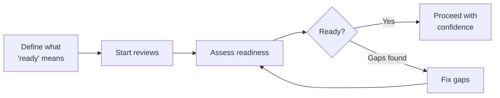

# Why readiness assessments matter

> **Every launch has blind spots. Be intentional with Peaky before your customers find them.**

Incomplete ^^go-to-market^^ checklists. Missing ^^regulatory^^ sign-offs. ^^Infrastructure^^ that doesn't scale. Inevitably, we answer the question **"are we ready?"** with gut feelings rather than evidence.

Peaky's mental model is to define, review, learn, and act on readiness at scale:

<!-- markdownlint-disable -->

-   :material-pencil-ruler:{ .lg .middle } **Define**

    ---
   
    Template authors set the readiness bar with questions, risk levels, and leading practices.

-   :material-clipboard-check-outline:{ .lg .middle } **Review**

    ---

    Teams choose template(s) to assess their products, processes, or services.

-   :material-lightbulb-outline:{ .lg .middle } **Learn**

    ---

    Questions surface leading practices, making assessments a knowledge transfer exercise.

-   :material-target:{ .lg .middle } **Act**

    ---

    Know exactly where the gaps are, prioritize what matters, and fix them before launch.

<!-- markdownlint-enable -->

## How Peaky works

**1/ Everything starts from a template**.

Template authors brainstorm ^^what ready means^^ for a major event, product launch, process, or team specific readiness. They define the questions, the risk each one represents, and why it matters. Each question includes leading practices and helpful resources so assessors know what good looks like.

**2/ A review uses one or more templates**

Teams are the ultimate owners. For a new review, they decide which template(s) to use. Teams also decide which questions are not applicable to their context during an assessment.

This helps remove noise from company-wide templates that may not be fully applicable to every team or situation.

**3/ Assessors and advisors work together**

In most cases, teams self-assess their readiness. For some, they might prefer to have a second pair of eyes - we call them ^^Advisors^^. They range from Staff+ engineers, product leaders, to individuals with deep experience in areas covered by the template(s).

We also assign Advisors to reviews that flag critical risks — they help resolve ambiguities and transfer knowledge across teams.

In all cases, teams own addressing gaps, tracking readiness progress, and making decisions on what to prioritize.

**4/ The assessment model works for any domain**

Peaky doesn't prescribe what readiness means — that's up to you. The same structure of templates, pillars, and questions works across contexts:

- ^^Engineering^^ readiness — failover, monitoring, load testing
- ^^Compliance^^ programs — control assessments, evidence collection, audit prep
- ^^Process^^ maturity — incident response, change management, onboarding
- ^^Business^^ initiatives — launch readiness, vendor evaluations, migration checklists

## Key concepts

| Concept | What it is | Examples |
|---------|-----------|---------|
| **Template** | A reusable assessment framework | "Peak Season 2026", "Compliance Controls", "Launch Readiness" |
| **Pillar** | A category within a template | Reliability, Compliance, Stakeholder Readiness |
| **Question** | A specific item to assess | "Automated failover tested?", "Evidence collected?" |
| **Product** | The thing being assessed — a system, process, or initiative | Payment Gateway, Vendor Onboarding Process |
| **Review** | A point-in-time assessment of a product or team | "Q4 Peak Season — Payments Team" |
| **Gap** | A question answered "No" — a risk to address before the target date | "No automated failover" → fix before peak |

## Start here

<!-- markdownlint-disable -->

-   :material-clipboard-check-outline:{ .lg .middle } **Assigned a review?**

    ---

    2-minute quickstart — what to expect, how to answer, what "No" means

    [:octicons-arrow-right-24: Assessor quickstart](assessor-quickstart.md)

-   :material-compass-outline:{ .lg .middle } **First time using Peaky?**

    ---

    Screen-by-screen tour from dashboard to first assessment

    [:octicons-arrow-right-24: Product tour](product-tour.md)

-   :material-pencil-ruler:{ .lg .middle } **Creating a template?**

    ---

    Style guide for writing questions that produce real signals

    [:octicons-arrow-right-24: Authoring guide](authoring-templates.md)

-   :material-lightning-bolt:{ .lg .middle } **Already know the basics?**

    ---

    Keyboard shortcuts, survey mode, bulk actions, advanced features

    [:octicons-arrow-right-24: Power user guide](power-user/index.md)

<!-- markdownlint-enable -->
