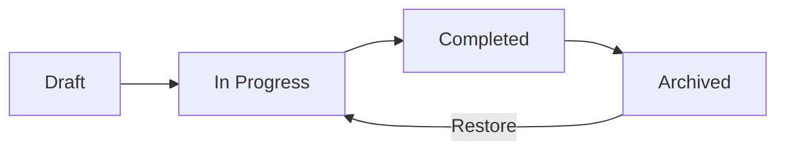

# Working with reviews

A review is a point-in-time assessment of how ready a product or team is. You work through questions, surface gaps, and build a shared picture of what needs attention before a target date.

!!! tip "First time? Start with the [Assessor quickstart](assessor-quickstart.md) — 2 minutes, no fluff."

## Review lifecycle

**Draft** — the review has been created but no questions answered yet. **In Progress** — questions are being answered. **Completed** — every question has a response. **Archived** — the assessment cycle is over and the review is preserved as a historical record.

!!! note "Archiving preserves everything"
    Archived reviews are hidden from active views but no data is lost — all answers, session history, pillar notes, and attachments remain intact. You can restore an archived review at any time to continue working on it. Permanent deletion is a separate action that requires the review to be archived first and an explicit typed confirmation.

## Answering questions

Questions come in two types — the template author chooses which type when designing the template. As an assessor, you just answer what's in front of you. Both types save automatically.

=== "Yes / No"

    Binary assessment — the requirement is either met or not.

    - **Yes** — met (green highlight)
    - **No** — not met (red highlight)
    - **N/A** — doesn't apply (opens reason selector)

    !!! example "Best for clear-cut checks"
        "Do you have automated failover?", "Are backups tested monthly?", "Has the rollback procedure been verified?"

=== "Checklist"

    Multiple items to verify — partial completion is tracked.

    - Check individual items as you verify them
    - Progress indicator shows how many items are complete
    - The question is "answered" when all items are checked or marked N/A

    !!! example "Best for multi-part requirements"
        "Circuit breaker readiness: timeout configured, fallback defined, alerts set up" — each item is verified independently, and the overall question tracks partial progress.

### Marking questions as Not Applicable

When a question doesn't apply, click **N/A** and select a reason:

| Reason | When to use it |
|--------|---------------|
| **Not in scope** | Applies to a different type of system |
| **Handled by infrastructure** | A platform team manages this for you |
| **Legacy system** | Predates this requirement |
| **Pending deprecation** | System is being retired |
| **Other** | Custom reason — add a comment |

Choosing the right reason matters — advisors reviewing your assessment will use it to understand your context and decide whether the N/A is justified.

!!! warning "N/A is audited"
    Every N/A answer is visible to advisors and appears in the review history. Use it when a question genuinely doesn't apply — not as a shortcut. If you're unsure, answer "No" and add context in pillar notes.

## Progress at a glance

Each pillar tab shows its completion percentage — a pillar is complete when every question has a response. The review detail page shows the full picture:

## Maturity results

When a pinned template revision has a maturity definition, Review Details adds a Maturity estimate band to **Breakdown** and a Maturity column to the pillar table. Hover or focus a pillar value to read its stage meaning and coverage. Select the pillar row to see how its questions contribute. Checklist meters can reveal the first five practice states, then the rest on request. **Follow-ups** uses visible Revision tabs on desktop, a compact selector on mobile, and a static Revision identity when only one is pinned. Results never combine across revisions.

The five stages are fixed by the ORR 2026 profile — template authors can move the boundaries between them but cannot rename them:

| Stage | Name | Meaning |
|-------|------|---------|
| 1 | Not implemented | Practices are absent or not yet repeatable |
| 2 | Ad-hoc | Practices exist in places but depend on individual effort |
| 3 | Defined | Shared practices are documented and used consistently |
| 4 | Measured | Practices are measured and improved using evidence |
| 5 | Optimized | Practices are continuously improved and embedded |

**Score stage and Follow-up placement do different jobs.** Answers and each question's severity-derived weight affect the score. Authored Follow-up placement adds stage context to an explicit gap. It cannot change the score, evidence state, queue order, question link, or handoff action.

**Follow-ups is a work queue.** The cut mat labels the active choice **Selected template** and keeps its effective result and coverage compact. Recorded gaps group by Critical, High, then Medium question severity. **Refine** opens a right-side panel for Handoff status, pillars, and severities present in the current queue. It shows practices available to add by default; switch Handoff status to review earlier handoffs. Unanswered questions appear once in a separate, non-selectable section. N/A evidence remains absent. **Question details** opens guidance and includes the exact assessment action.

**Coverage and the provisional qualifier.** A question without a stored answer reduces coverage, earns no points, and keeps its full applicable weight in the score. It remains Not assessed and never becomes unmet. A recorded empty or partial checklist answer is different: every applicable unchecked practice is an explicit gap. Per-practice N/A removes only that practice's share, and a whole checklist marked N/A removes the question and all its practices from scoring and gap groups while still counting as answered for coverage. Until every question is answered, the Score stage is **Provisional**. The qualifier disappears at full coverage.

**Assessment updates maturity as you answer.** The Progress row shows the current percentage and stage before the answer is saved. Its information control explains the rule: Template Authors set question severity, higher severity gives more points, checklist items share their question's points, unanswered questions earn zero points, and N/A removes those points from the score.

**Review Details stays concise.** Breakdown shows the active template's effective percentage, stage, and whether the result is settled or provisional. The pillar table uses **Progress** for resolved checklist items, **Answered** for question coverage, and **Maturity** for the weighted result. A checklist with 17 of 20 items checked contributes 17 completed items to Progress even though the question already counts as answered. Pillar Maturity values explain their stage and coverage on hover or focus. The compact result band does not expose point fractions or practice shares.

**Advisor overrides.** An Advisor on the review can record a reviewed stage and percentage with an explanation and evidence when the calculated result does not reflect what they verified on the ground. The compact result then shows the reviewed value while keeping the calculated result discoverable, and the full override history stays attached to the review. Overrides are recorded per revision; any current Advisor may supersede or revoke one.

**When there is no result.** A compact state explains when a revision has no maturity definition, no applicable answered question, or more than ten questions. Follow-ups keeps the same severity-first queue without stage context. It never invents a zero-percent result or combines revisions.

!!! note "Authoring maturity configuration"
    Maturity definitions are authored in the Template Studio on a template's local draft revision — see [Writing great templates](authoring-templates.md#maturity-configuration). While template publication is frozen, drafts stay local to the browser, and the published revisions you assess against carry seeded definitions with equal stage bands and equal practice shares.

## Handing off selected practices

From review **Follow-ups** you can hand off explicit unmet practices to your team's existing tracker. Peaky does not create anything in that tracker.

1. **Choose practices.** Use **Add to handoff** beside each recorded gap. The full row acts as a checkbox and changes to **In handoff**. A "No" Yes/No question appears as one practice; checklist gaps remain independent. The value at the end of the row is that practice's calculated potential.
2. **Order the handoff.** The Handoff composer stays beside the queue on wide screens. On narrow screens, switch to **Handoff**, which also shows the selected count. Move or remove items, or use **Clear all** to empty the active sequence in one action. Open **Add a handoff note** only when the next team needs context. Notes allow up to 2,000 characters.
3. **Read potential movement.** Handoff keeps each Revision separate. It shows the exact current and projected percentage, then magnifies selected movement against the remaining gap to the next stage. A crossed threshold says **Reached**. A rounded value cannot fill the bar unless the exact result crossed. Open the Stage popover for the full-scale comparison.
4. **Copy Markdown.** **Copy Markdown** copies the visible order immediately, including after a reorder. It includes a review link, summary table, detailed practice sections, optional notes, resources, and exact assessment links.
5. **Close the handoff.** Assessment closes it automatically when every selected practice becomes met or N/A. Manual closing remains available while work is selected; unresolved work requires a closing note. Closing records the transfer and does not change assessment answers or mark practices complete. Unresolved practices return to Available and can join a later handoff; only one active handoff can own them at a time. History and sequence numbers stay on the current device. You can reopen the latest manually closed handoff if no newer handoff is active.
6. **Associate an existing ticket.** **Link existing work item** asks only for an `https://` URL. Peaky detects Jira, GitLab, and YouTrack URLs, or uses the hostname and final path segment for another tracker. Check the detected provider and item ID before confirming. Peaky never creates, edits, or reads tickets in the provider. Each practice has one current association; a conflict asks you to confirm an explicit replacement.

!!! note "Working offline"
    Selecting, reordering, and editing handoff notes always work. They save locally and sync when you reconnect. The existing-ticket form remains available, but confirming an association or replacement needs a current shared view to prevent conflicting links. The form explains this and disables confirmation while shared sync is unavailable.

## Session history

Every time you save progress, Peaky creates a ^^session snapshot^^ — a timestamped record of who saved, what changed, and the comment they added. The history timeline shows how the assessment evolved over multiple sessions:

Session history is what makes reviews useful beyond a single sitting. Advisors can see how readiness improved week over week. PMs can track whether gaps are closing before the target date. And when the next assessment cycle starts, the previous review's history provides a baseline.

!!! note "Local-first saves"
    Answers save to your browser instantly — no network required. Changes sync to the server in the background. You can work offline and everything will be there when you reconnect.

## Pillar notes

Each pillar has a notes section for context that doesn't fit into a Yes/No answer. Notes support markdown and are visible to all review participants.

Use pillar notes for:

- Explaining why a "No" exists and what the remediation plan is
- Documenting evidence for "Yes" answers (links to dashboards, runbooks)
- Capturing advisor feedback during review sessions

## After the assessment

When all questions are answered, the review reaches ^^Completed^^. This is where the value starts.

**For assessors** — your "No" answers are now visible gaps. Use pillar notes to document what you know: partial progress, remediation plans, blockers.

**For team leads and PMs** — review the completed assessment to see which pillars have gaps. Prioritize with your team: which are must-fix before the target date, and which are acceptable risks?

**For advisors** — review the gaps and session history. Share context from other teams who solved similar problems. Your experience is the most valuable part of this process.

**For the next cycle** — archive the review when the cycle is over. Create a new review when the next one starts — the history from previous cycles helps track improvement over time.

For details on pillar notes and evidence, see [Understanding templates](templates.md). For shortcuts that speed up review, see the [Power user guide](power-user/index.md).
