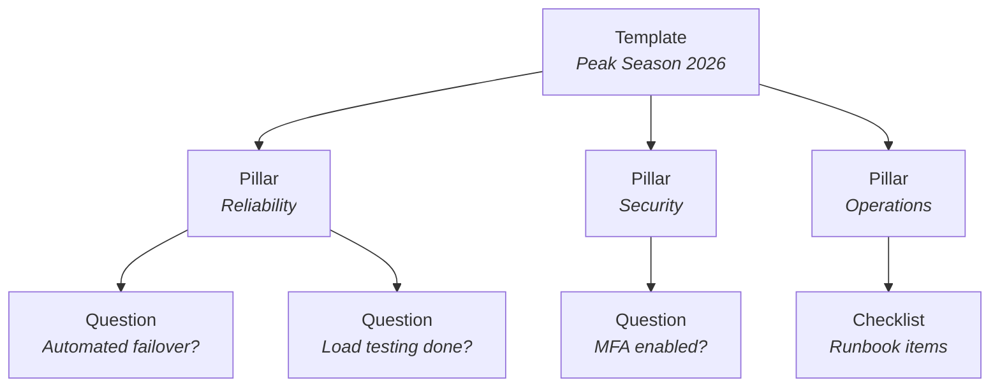

# Understanding templates

Templates define ^^what ready means^^ for your organization. They're the reusable frameworks that reviewers work through, question by question.

## Template structure

**1/ Templates** are the overall assessment framework — "Peak Season 2026 Readiness", "Compliance Controls", or anything your organization needs to assess.

**2/ Pillars** are the categories that organize questions. Think of them as the major dimensions of readiness: Reliability, Security, Operations, Stakeholder Readiness.

**3/ Questions** are the specific items to assess, either Yes/No or Checklist type.

## Templates and Revisions

A **Template** is the stable catalog identity. It keeps the same ID, owning Team, name, description, and `active` or `archived` lifecycle while its content evolves.

A **Revision** is a complete snapshot of the Template's metadata, Pillars, and Questions:

- **Draft** — editable work in progress, stored only in the current browser
- **Published** — an immutable numbered snapshot shown as `vN`
- **Retired** — an immutable historical snapshot that cannot be chosen for a new Review

A Review records the exact published Revision selected at creation time. Later draft edits or Revision retirement do not change its Questions. Existing Reviews remain pinned to the original snapshot for a stable audit trail.

!!! warning "Current Preview limitation"
    Publication and Template archive, restore, and delete are currently unavailable. You can author and preview a local draft, but you cannot publish it yet.

## Browsing templates

The Templates page shows all available frameworks:

Templates can cover any domain — peak season readiness, compliance controls, process maturity, launch checklists, or custom standards specific to your organization.

!!! tip "Multi-template reviews"
    A single Review can include one to three current published Revisions from different active Templates. The exact selected Revisions and their order stay fixed for that Review.

## Inside a template

Click a template to see its structure in the Template Studio:

### Question anatomy

Open a question to edit its full detail in the Guided Drafting Room — a focused, full-screen editor that walks through each section:

| Field | Purpose |
|-------|---------|
| **Question text** | The specific requirement being assessed |
| **Type** | Yes/No or Checklist |
| **Risk level** | Critical, High, Medium, or Low — signals how much a gap here matters |
| **Why this matters** | Context for assessors — the reasoning behind the question |
| **Leading practices** | What "good" looks like — actionable guidance |
| **Helpful links** | Resources, runbooks, dashboards, documentation |

### Preview mode

Preview shows exactly what assessors will see — question cards, answer buttons, and info panels:

Use preview to verify that Questions are clear, risk levels make sense, and the flow is logical. During the current publication freeze, preview is the final in-product check for a local draft; it does not make that draft available to new Reviews.

!!! danger "Protect unpublished work"
    Draft authoring is local-only: it creates no server copy and does not sync to another browser. Clearing site data, recreating the local database, losing the browser profile, or applying a destructive Preview data reset permanently deletes the draft. Export important work to Markdown first.

!!! note "Templates are living documents"
    Templates evolve as your organization learns. After each assessment cycle, review which Questions produced useful signals and which were always N/A, then prepare the next draft Revision. Published and retired Revisions are immutable so completed and in-progress Reviews keep their original snapshot.

## Want to create your own?

See the [authoring guide](authoring-templates.md) for a style guide on writing effective questions, choosing question types, and organizing pillars.
